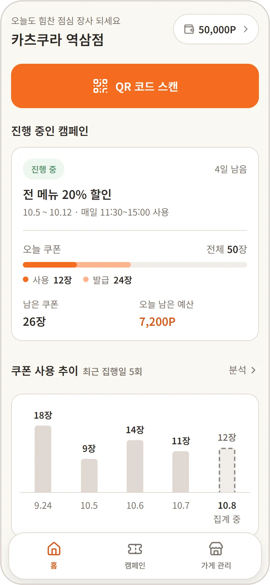
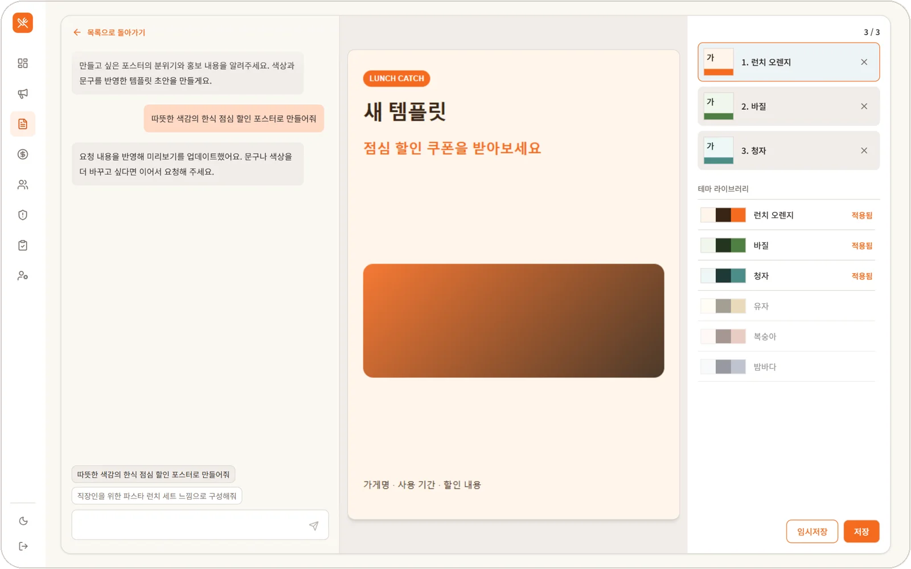
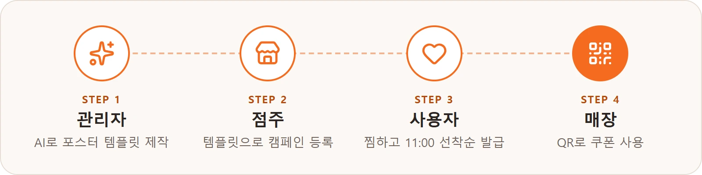
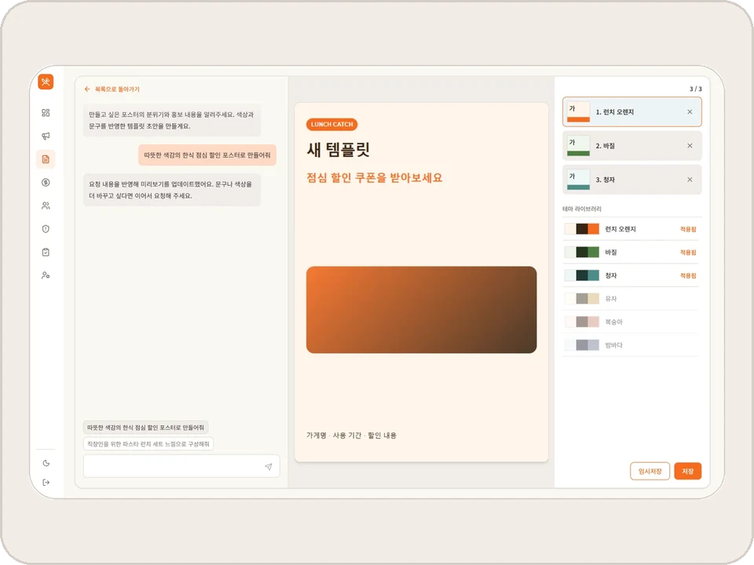
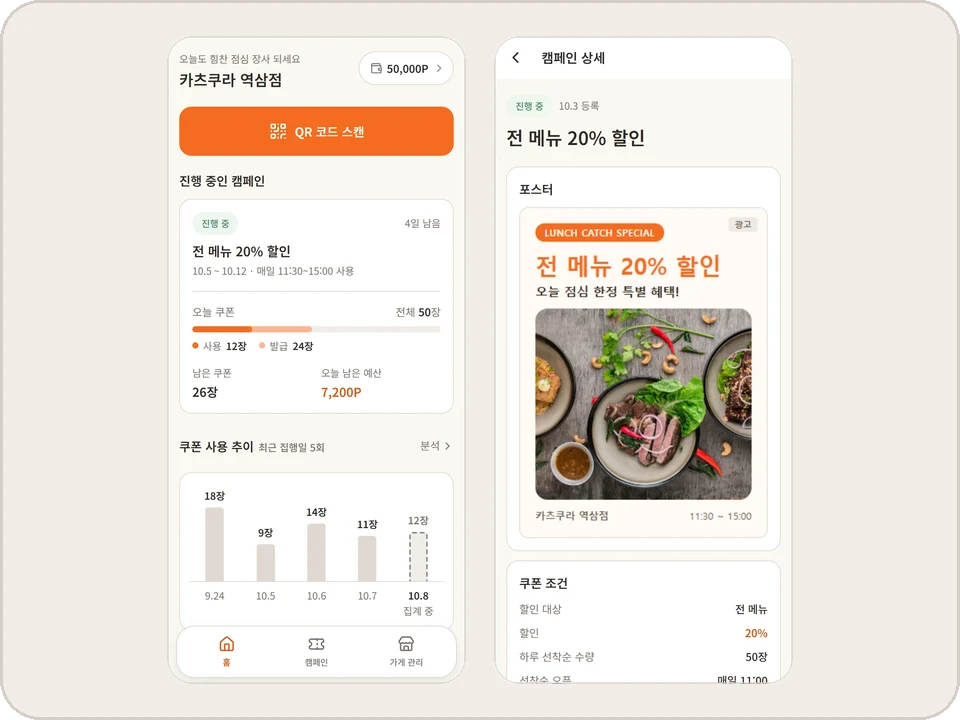
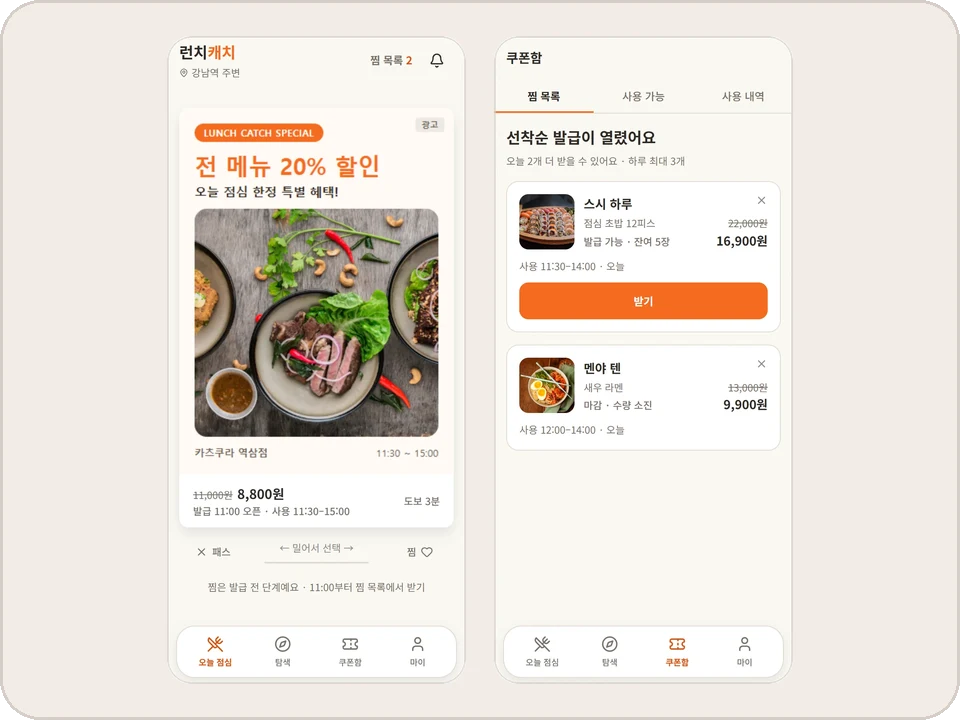
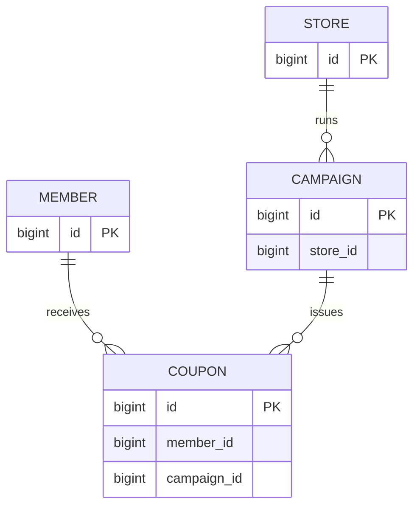

# 🍱 런치캐치 (Lunch Catch) · Backend

> 주변 가게와 직장인을 점심 쿠폰으로 이어주는 위치 기반 쿠폰 플랫폼의 백엔드 API 서버

<p align="center">
  
  
  
  <br />
  <sub>왼쪽부터 사용자 앱 · 점주 앱 · 관리자 앱</sub>
</p>

<br>

## 목차

- [프로젝트 소개](#프로젝트-소개)
- [팀원 소개](#팀원-소개)
- [핵심 기능](#핵심-기능)
- [배포](#배포)
- [기술 스택](#기술-스택)
- [아키텍처](#아키텍처)
- [패키지 구조](#패키지-구조)
- [ERD](#erd)
- [핵심 설계와 문제 해결](#핵심-설계와-문제-해결)
- [포팅 매뉴얼](#포팅-매뉴얼)
- [협업 규칙](#협업-규칙)

<br>

## 프로젝트 소개

### 개발 기간

2026.09.09 ~ 2026.10.28 (7주)

### 기획 배경

- **문제**: 직장인은 매일 점심 메뉴를 고민하는데 외식비는 계속 오르고, 동네 가게 사장님은 점심 손님을 더 모으고 싶어도 적은 비용으로 할 수 있는 홍보 수단이 부족하다.
- **정의**: 직장인과 주변 가게 사이에 서로의 필요를 이어주는 채널이 없다.
- **해결**: 사장님은 LLM으로 만든 템플릿에 가게 정보만 채워 쿠폰 포스터를 등록한다. 주변 직장인은 포스터를 보고 점심 할인 쿠폰을 받는다.

<details>
<summary><b>📋 과제 요구사항 구현 내용</b></summary>

<br>

- 과제 **AI 기반 이벤트 페이지 제작 및 게시 관리 시스템**의 이벤트 페이지를 **점심 쿠폰 포스터**로 해석한다.
- 관리자가 LLM으로 만든 포스터 템플릿을 점주가 가져다 쿠폰 광고를 만든다. 사용자는 포스터를 보고 쿠폰을 발급받는다.

| 과제 요구사항                         | 구현 내용                                                                                                           |
| ------------------------------------- | ------------------------------------------------------------------------------------------------------------------- |
| 채팅으로 이벤트 페이지 HTML 생성·수정 | 관리자가 "가을 신메뉴 느낌으로 만들어줘"처럼 요청해 포스터 템플릿 HTML을 생성하고 "버튼 색상을 바꿔줘"처럼 수정한다 |
| iframe 미리보기                       | 관리자 템플릿, 점주 포스터, 사용자 피드와 가게 상세의 포스터를 모두 iframe으로 표시한다                             |
| 저장과 수정 이력                      | 미리보기를 확인하고 임시저장할 때마다 새 버전으로 저장한다                                                          |
| 게시 상태 관리                        | 템플릿의 임시저장·게시·활성 상태와 캠페인의 활성화·중단·재개·종료를 관리한다                                        |
| 이벤트 기간과 노출 제어               | 캠페인 집행 기간, 하루 예산과 쿠폰 발급 시간을 관리한다                                                             |
| 사용자 화면에서 조회                  | 점주가 만든 포스터가 사용자 피드와 가게 상세에 그대로 노출된다                                                      |

</details>

<br>

## 팀원 소개

### Backend

|                            박준서                            |                          김현우                          |                            정규동                             |                             최민혁                              |                            최재웅                            |
| :----------------------------------------------------------: | :------------------------------------------------------: | :-----------------------------------------------------------: | :-------------------------------------------------------------: | :----------------------------------------------------------: |
|  |  |  |  |  |
|        [@devjohnpark](https://github.com/devjohnpark)        |          [@muzimzz](https://github.com/muzimzz)          |       [@gyudongjeong](https://github.com/gyudongjeong)        |      [@MinhyeokChoi99](https://github.com/MinhyeokChoi99)       |        [@yongmaru789](https://github.com/yongmaru789)        |
|                  팀장 · 광고 서빙 · 인프라                   |                    회원 · 정산 · 분석                    |                      계정 · 입점 · 알림                       |                        쿠폰 · 가게 탐색                         |                    캠페인 · 템플릿 · 운영                    |

### Frontend

|                         이규태                          |                          고유정                          |                           서지현                            |
| :-----------------------------------------------------: | :------------------------------------------------------: | :---------------------------------------------------------: |
|  |  |  |
|          [@Ourumo](https://github.com/Ourumo)           |          [@daenggg](https://github.com/daenggg)          |        [@jhwest-dev](https://github.com/jhwest-dev)         |
|                   FE 파트장 · 점주 앱                   |                        관리자 앱                         |                          사용자 앱                          |

프론트엔드 저장소: [lunch-catch/lc-frontend](https://github.com/lunch-catch/lc-frontend) · 인프라 저장소: [lunch-catch/lc-infra](https://github.com/lunch-catch/lc-infra)

<br>

## 핵심 기능



|                                                          화면                                                           | 기능                                                                                                                                                                                                                          |
| :---------------------------------------------------------------------------------------------------------------------: | ----------------------------------------------------------------------------------------------------------------------------------------------------------------------------------------------------------------------------- |
|  | **1. 관리자 · AI로 포스터 템플릿 제작**<br><br>• 채팅으로 요청하면 LLM이 포스터 템플릿 HTML을 생성하고 결과를 iframe으로 바로 미리 본다<br>• 마음에 드는 결과는 임시저장해 버전으로 쌓고 그중 하나를 게시해 점주에게 공개한다 |
|                            | **2. 점주 · 캠페인과 포스터 등록**<br><br>• 공개된 템플릿을 골라 가게 사진, 할인 문구 같은 빈칸만 채워 포스터를 만든다<br>• 쿠폰 조건, 노출 대상, 하루 예산과 기간을 정하고 자동 검수를 통과하면 캠페인을 노출한다            |
|          | **3. 사용자 · 찜하고 11:00 선착순 발급**<br><br>• 주변 가게 포스터를 카드로 넘기며 마음에 드는 쿠폰을 찜한다<br>• 11:00부터 선착순으로 발급하고 재고와 회원별 하루 발급 한도를 확인한다                                       |
|                                      | **4. 매장 · QR로 쿠폰 사용**<br><br>• 사용자가 60초 동안만 유효한 1회용 QR을 보여주면 점주가 스캔해 사용을 처리한다<br>• QR은 60초마다 바뀌며 한 번만 쓸 수 있다. 캡처한 QR의 재사용을 막는다                                 |

<br>

백엔드는 위 흐름에 더해 점주의 포인트 충전과 광고 노출에 따른 차감, 캠페인 성과 집계와 배치 실행을 담당한다.

## 배포

| 서비스      | 대상                 | 운영 (`main`)                                        | 개발 (`develop`)                                             | 문서                                                                                   |
| ----------- | -------------------- | ---------------------------------------------------- | ------------------------------------------------------------ | -------------------------------------------------------------------------------------- |
| 관리자 앱   | 운영자               | [admin.lunchcatch.com](https://admin.lunchcatch.com) | [admin.dev.lunchcatch.com](https://admin.dev.lunchcatch.com) | [README](https://github.com/lunch-catch/lc-frontend/blob/develop/apps/admin/README.md) |
| 점주 앱     | 가게 사장님          | [owner.lunchcatch.com](https://owner.lunchcatch.com) | [owner.dev.lunchcatch.com](https://owner.dev.lunchcatch.com) | [README](https://github.com/lunch-catch/lc-frontend/blob/develop/apps/owner/README.md) |
| 사용자 앱   | 직장인 (모바일 웹)   | [lunchcatch.com](https://lunchcatch.com)             | [dev.lunchcatch.com](https://dev.lunchcatch.com)             | [README](https://github.com/lunch-catch/lc-frontend/blob/develop/apps/user/README.md)  |
| 백엔드 서버 | 세 앱이 사용하는 API | [api.lunchcatch.com](https://api.lunchcatch.com)     | [api.dev.lunchcatch.com](https://api.dev.lunchcatch.com)     | [API 명세](docs/api-spec/api-spec.md)                                                  |

<br>

## 기술 스택(확인 추가 및 제거)

| 구분                  | 기술                                                                                                                                                                                                                                                                                                                                                                                                                                                                                                                                                                                                                                                                                                      |
| --------------------- | --------------------------------------------------------------------------------------------------------------------------------------------------------------------------------------------------------------------------------------------------------------------------------------------------------------------------------------------------------------------------------------------------------------------------------------------------------------------------------------------------------------------------------------------------------------------------------------------------------------------------------------------------------------------------------------------------------- |
| 언어 · 프레임워크     |                                                                                                                                                                                                                                                                                                                                                                                                                                                                                               |
| 빌드                  |                                                                                                                                                                                                                                                                                                                                                                                                                                                                                                                                                                                        |
| 데이터베이스 · 캐시   |                                                                                                                                                                                                                                                                                                                                                                                                                                     |
| 데이터 접근           |                                                                                                                                                                                                                                                                                                                                                                                                    |
| 인증                  |                                                                                                                                                                                                                                                  |
| AI · 이미지 검수      |                                                                                                                                                                                                                                                                                                                                                                                                                                                  |
| 파일 저장             |                                                                                                                                                                                                                                                                                                                                                                                                                                                                                                                                     |
| 결제                  |                                                                                                                                                                                                                                                                                                                                                                                                                                                                                                                              |
| API 문서              |                                                                                                                                                                                                                                                                                                                                                                                                                                        |
| 외부 연동 · 장애 처리 |                                                                                                                                                                                                                                                                                                                                                                                                                                                                                                               |
| 관측                  |                                                                                                                                                                                                                                                                                 |
| 테스트 · 코드 품질    |         |
| 배포                  |                                                                                                                                                                                                                                                                                                                          |
| 협업                  |                                                                                                                                                                                                                                                                                                                                                                  |

인프라는 [lc-infra](https://github.com/lunch-catch/lc-infra)에서 관리한다.

<br>

## 아키텍처


## 패키지 구조

```text
lc-backend/
├── src/
│   ├── main/
│   │   ├── java/com/launchcatch/
│   │   │   ├── campaign/       # 캠페인, 포스터와 템플릿을 관리한다.
│   │   │   ├── adserving/      # 광고 피드와 노출, 찜을 관리한다.
│   │   │   ├── coupon/         # 선착순 쿠폰 발급과 사용을 처리한다.
│   │   │   ├── billing/        # 포인트, 결제와 차감을 처리한다.
│   │   │   ├── store/          # 입점 절차와 가게 정보를 관리한다.
│   │   │   ├── member/         # 사용자 계정을 관리한다.
│   │   │   ├── owner/          # 점주 계정을 관리한다.
│   │   │   ├── admin/          # 관리자 계정을 관리한다.
│   │   │   ├── analytics/      # 성과와 집계를 관리한다.
│   │   │   ├── auth/           # 공용 인증을 제공한다.
│   │   │   ├── ops/            # 플랫폼 설정과 배치 실행을 관리한다.
│   │   │   └── global/         # 기술 공통 기능을 제공한다.
│   │   └── resources/
│   │       ├── db/migration/   # 도메인별 스키마를 관리한다.
│   │       ├── db/seed/        # 시험 데이터를 관리한다.
│   │       ├── application.yml
│   │       └── application-batch.yml
│   └── test/
├── docs/
│   ├── api-spec/               # HTTP API 계약을 관리한다.
│   ├── design/                 # 도메인별 설계를 관리한다.
│   ├── architecture/           # 도메인 경계와 의존 방향을 정한다.
│   ├── code-convention/        # 코드 작성과 리뷰 기준을 정한다.
│   ├── software-quality/       # 품질 기준을 정한다.
│   ├── workflow/               # 로컬 실행과 협업 절차를 안내한다.
│   └── troubleshooting/        # 장애와 해결 과정을 기록한다.
├── .github/workflows/          # 병합 검사와 배포를 실행한다.
├── build.gradle
├── compose.yaml
├── Dockerfile
├── application-local.yml.example
└── AGENTS.md
```

- 패키지 구성과 도메인 간 공개 계약은 [도메인 구조와 의존성 설계](docs/architecture/런치캐치_도메인_구조와_의존성_설계.md#13-패키지)를 참고한다.

<br>

## ERD(임시)



실선은 업무상 연결 관계를 나타낸다. 데이터베이스의 외래 키 제약조건을 뜻하지 않는다.

## 핵심 설계와 문제 해결(내용추가하기)

### AI 기반 캠페인 생성

<!-- TODO: HTML 생성 과정과 검증 방법을 작성한다. -->

### 광고 피드 서빙

<!-- TODO: 광고 후보 선정과 피드 구성 방식을 작성한다. -->

### 쿠폰

<!-- TODO: 선착순 발급과 QR 사용 처리 방식을 작성한다. -->

### 배치 장애 복구

<!-- TODO: 작업 실행 관리와 장애 후 이어받는 방식을 작성한다. -->

### 모니터링

<!-- TODO: 로그와 지표로 서비스 상태를 확인하는 방법을 작성한다. -->

### 결제

<!-- TODO: 결제 승인과 실패 시 처리 방식을 작성한다. -->

<br>

## 포팅 매뉴얼

### 1. 요구 사항

- **JDK 21**을 설치한다.
- **Docker와 Docker Compose**를 준비하고 Docker를 실행한다. 로컬 MySQL과 Valkey, 통합 테스트에 사용한다.
- Gradle은 별도로 설치하지 않는다. 저장소의 `./gradlew`를 사용한다.

### 2. 저장소 클론과 설정 파일 준비

```bash
git clone https://github.com/lunch-catch/lc-backend.git
cd lc-backend

cp application-local.yml.example application-local.yml
```

- 복사한 파일에서 필요한 설정의 주석을 풀고 값을 채운다.
- Gradle Wrapper가 첫 실행 때 Gradle과 의존성을 내려받는다.

### 3. 환경 변수

| 이름                            | 사용하는 곳          | 설명                                                                                |
| ------------------------------- | -------------------- | ----------------------------------------------------------------------------------- |
| `JWT_SECRET`                    | 토큰 서명            | 32바이트 이상의 무작위 서명 키를 설정한다                                           |
| `KAKAO_CLIENT_ID`               | 사용자 로그인        | 카카오 REST API 키를 설정한다                                                       |
| `KAKAO_CLIENT_SECRET`           | 사용자 로그인        | 카카오 Client Secret을 설정한다                                                     |
| `KAKAO_APP_ID`                  | 연결 해제 웹훅       | 카카오 앱 ID를 설정한다                                                             |
| `KAKAO_ADMIN_KEY`               | 카카오 로그아웃      | 카카오 Admin 키를 설정한다                                                          |
| `TOSS_SECRET_KEY`               | 결제 승인 · 조회     | 팀 상점의 결제위젯 시크릿 키를 설정한다. 로컬 기본값은 토스 문서용 공개 테스트 키다 |
| `S3_REGION` · `S3_MEDIA_BUCKET` | 이미지 · 서류 업로드 | S3 리전과 버킷을 설정한다                                                           |
| `CDN_BASE_URL`                  | 이미지 조회          | 이미지 URL의 기본 주소를 설정한다                                                   |
| `CORS_ALLOWED_ORIGINS`          | 프론트 연동          | 허용할 프론트 주소를 설정한다. 기본값은 `http://localhost:5173`이다                 |
| `JWT_COOKIE_SECURE`             | 쿠키 전송            | 로컬 HTTP에서는 `false`, 운영 HTTPS에서는 `true`로 설정한다                         |

JWT 서명 키는 다음 명령으로 생성한다.

```bash
openssl rand -base64 64
```

- 환경 변수 대신 `application-local.yml`의 대응 항목을 채워도 된다. 설정 항목은 [예제 파일](application-local.yml.example)을 참고한다.
- `.env`는 Docker Compose의 컨테이너 설정에 사용하고, `application-local.yml`은 Spring 애플리케이션 설정에 사용한다.
- 이미지 업로드, LLM 생성과 이미지 검수에는 AWS 자격 증명과 해당 서비스의 접근 권한도 필요하다.
- 전체 실행 절차와 오류별 해결 방법은 [로컬 실행 문서](docs/workflow/로컬_실행.md)를 참고한다.

### 4. 로컬 실행

```bash
./gradlew bootRun
```

- 프로필을 지정하지 않으면 `local`로 실행한다.
- Spring Boot Docker Compose가 MySQL과 Valkey를 띄우고 접속 정보를 주입한다.
- 기동할 때 마이그레이션을 실행한다. `local` 프로필에서는 시험 데이터도 초기화한다.

| 대상         | 주소                                                                    |
| ------------ | ----------------------------------------------------------------------- |
| API          | [localhost:8080](http://localhost:8080)                                 |
| Swagger UI   | [localhost:8080/swagger-ui.html](http://localhost:8080/swagger-ui.html) |
| OpenAPI JSON | [localhost:8080/v3/api-docs](http://localhost:8080/v3/api-docs)         |
| 상태 확인    | [localhost:8081/actuator/health](http://localhost:8081/actuator/health) |

```bash
curl http://localhost:8081/actuator/health
```

시험 계정과 데이터는 [시드 README](src/main/resources/db/seed/README.md)를 참고한다.

### 5. 빌드와 검사

| 명령어                       | 설명                                                    |
| ---------------------------- | ------------------------------------------------------- |
| `./gradlew bootJar`          | 실행 가능한 JAR를 만든다                                |
| `./gradlew test`             | 테스트를 실행한다. 통합 테스트에는 Docker가 필요하다    |
| `./gradlew check`            | 테스트, 커버리지 검증과 커버리지 데이터 검사를 실행한다 |
| `./gradlew jacocoTestReport` | JaCoCo 커버리지 보고서를 만든다                         |

- 병합 전 검사는 `G-BUILD`가 담당한다.
- 검사 항목과 통과 기준은 [개발 배포 플로우](docs/workflow/개발_배포_플로우.md#3-게이트)를 참고한다.

### 6. 배포

- GitHub Actions가 JAR를 빌드하고 Docker 이미지를 Amazon ECR에 올린다.
- `develop`에 변경이 반영되면 개발 서버로, `main`에 반영되면 운영으로 배포한다.
- 운영 배포는 [인프라 저장소](https://github.com/lunch-catch/lc-infra)의 배포 스크립트로 수행한다.
- 배포 절차는 [개발 배포 플로우](docs/workflow/개발_배포_플로우.md#4-배포)를 참고한다.

<br>

## 협업 규칙

- 이슈, 브랜치, PR과 커밋에 관한 작업 규칙은 [AGENTS.md](AGENTS.md)를 따른다.
- 브랜치 보호, 병합 큐와 배포 경로는 [개발 배포 플로우](docs/workflow/개발_배포_플로우.md)를 따른다.
- PR이 바꾼 파일에 적용할 코드 리뷰 기준은 [CODEREVIEW.md](docs/CODEREVIEW.md)에서 확인한다.
