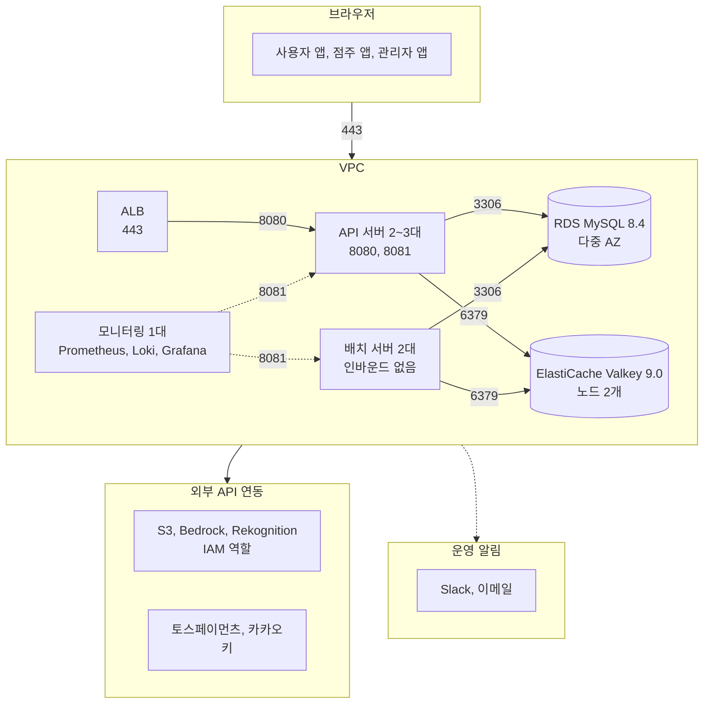
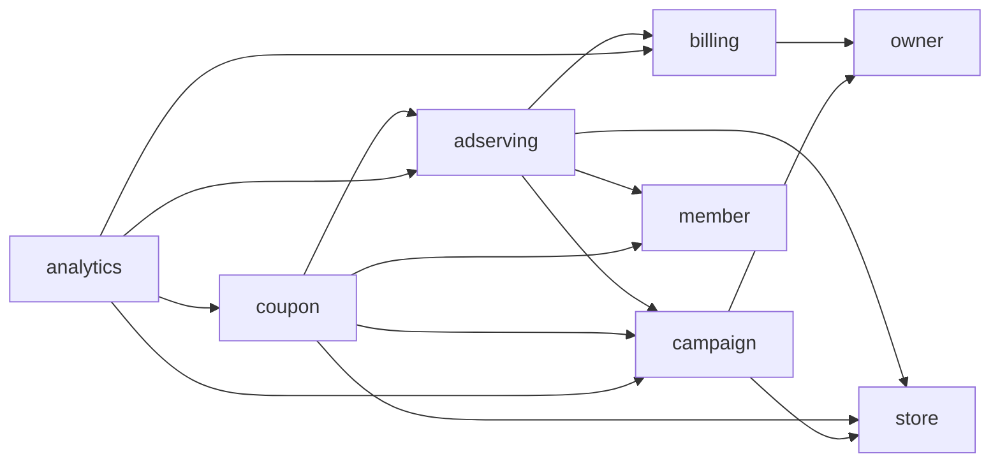

# lc-backend

## 프로젝트 개요

런치캐치는 점심시간의 직장인에게 주변 가게의 선착순 할인 쿠폰을 광고로 띄우고, 점주는 그 광고가 노출된 만큼 포인트를 내는 광고 플랫폼이다. 

| 구분     | 주소                                                                                                                                                                    |
| ------ | --------------------------------------------------------------------------------------------------------------------------------------------------------------------- |
| 서비스    | [lunchcatch.com](https://lunchcatch.com) (사용자), [owner.lunchcatch.com](https://owner.lunchcatch.com) (점주), [admin.lunchcatch.com](https://admin.lunchcatch.com) (관리자) |
| API    | `https://api.lunchcatch.com`, 개발 서버는 `https://api.dev.lunchcatch.com`                                                                                                 |
| API 문서 | [개발 서버 Swagger UI](https://api.dev.lunchcatch.com/swagger-ui.html)                                                                                                    |
| 다른 저장소 | [lc-frontend](https://github.com/lunch-catch/lc-frontend) (앱 3개), [lc-infra](https://github.com/lunch-catch/lc-infra) (AWS 와 배포)                                       |

### 서비스 소개

| 사용자 | 하는 일                                                             |
| --- | ---------------------------------------------------------------- |
| 회원  | 지금 위치 주변의 쿠폰 광고를 피드로 받고, 마음에 드는 가게를 찜하고, 선착순 쿠폰을 받아 가게에서 QR 로 쓴다 |
| 점주  | 가게를 등록하고 쿠폰 캠페인을 만들고, 포인트를 충전해 광고를 집행하고, 노출과 발급 실적을 본다           |
| 관리자 | 점주의 입점과 사업자 정보를 검수하고, 쿠폰 전단지 템플릿을 만들고, 포인트 정책과 환불을 다룬다           |
### 기술 스택

| 분류 | 쓰는 것 |
|---|---|
| 언어와 빌드 | Java 21 (`eclipse-temurin:21.0.9`), Gradle 8.14.3 (wrapper) |
| 프레임워크 | Spring Boot 4.0.5, Spring Security, springdoc-openapi 3.0.3 |
| 저장소 | MySQL 8.4, Valkey 9.0, Spring Data JPA, QueryDSL, Flyway |
| 인증과 외부 연동 | JJWT 0.12.7, OAuth2 Client (카카오), 토스페이먼츠, AWS S3, Bedrock, Rekognition |
| 복원력과 관측 | resilience4j 2.4.0, Micrometer Prometheus, logstash-logback-encoder 8.0 |
| 품질 | JUnit 5, Testcontainers, ArchUnit 1.4.1, JaCoCo 0.8.15, SonarQube |

### 규모

| 항목 | 값 |
|---|---|
| 업무 도메인 | 9개 (+ 공용 `auth`, `ops`, `global`) |
| 자바 파일 | 1,085개 |
| 테이블 | 74개 |
| HTTP API | 경로 105개, 작업 127개 |
| 테스트 | 클래스 453개, 테스트 3,957개 |

### 문서

코드 작업하기전 프로젝트의 이해도가 없다면 문서를 읽는다.

| 문서                                                           | 무엇을 얻나                                |
| ------------------------------------------------------------ | ------------------------------------- |
| [도메인 구조와 의존성 설계](./docs/architecture/런치캐치_도메인_구조와_의존성_설계.md) | 그 코드의 자리와 부를 수 있는 것                   |
| [API 명세](./docs/api-spec/api-spec.md)                        | 계약. 경로, 인증, 응답 봉투, 상태 코드              |
| [도메인 설계서](./docs/design/README.md)                           | 그 API 의 설계와 도메인의 구조와 동작, 장애 처리        |
| [마이그레이션 규약](./src/main/resources/db/migration/migration.md)  | 스키마를 바꿀 때. SQL 의 배치와 규칙               |
| [배치 운영](./docs/design/ops/런치캐치_배치_운영.md)                     | 배치를 건드릴 때. 점유와 이어받기, 재실행              |
| [AWS 아키텍처](./docs/architecture/런치캐치_AWS_아키텍처.md)             | 운영과 개발 서버의 AWS 구성 (원본은 lc-infra)      |
| [작업 규칙](./AGENTS.md)                                         | 이슈와 PR, 커밋, 문서와 주석, 문장 규칙. 규칙의 단일 출처다 |
| [작업 플로우](./docs/workflow/README.md)                          | 명세에서 구현과 배포까지의 순서, 로컬과 QA 실행, 팀 알림    |

나머지는 PR 작업 후 LLM 코드 리뷰로 받아 고친다.

| 문서                                                     | 담는 것                                        |
| ------------------------------------------------------ | ------------------------------------------- |
| [코드 리뷰 기준](./docs/CODEREVIEW.md)                       | 바꾼 경로에 어느 가이드가 걸리는지. 리뷰가 이 매핑으로 기준 적용을 보장한다 |
| [코드 관용과 패턴](./docs/code-convention/README.md)          | 판정 기준과 근거의 짝, 규칙 번호 체계                      |
| [품질 기준](./docs/software-quality/quality-attributes.md) | 성능, 보안, 신뢰성, 관측을 어디까지 해내야 하는지               |
| [검증 시나리오](./docs/scenarios/README.md)                  | 기능마다 무엇을 어떻게 확인하는지                          |

## 아키텍처

### 서버와 저장소



- 요청은 ALB 를 거쳐 API 서버로 가고, API 서버는 RDS 와 ElastiCache 를 읽고 쓴다
- API 서버와 배치 서버는 같은 jar 다. 프로필로 갈려 스케줄러는 배치에서만 돈다. 배치는 인바운드가 없고 두 대 가운데 한 대만 작업을 점유한다
- API 서버는 S3 와 Bedrock, Rekognition, 토스페이먼츠, 카카오를 부른다. 이미지는 브라우저가 CloudFront 에서 직접 받아 API 서버를 거치지 않는다
- 모니터링은 8081 로 지표를 긁고 경보를 Slack 과 이메일로 보낸다
- 구성은 `lc-infra` 가 Terraform 으로 소유한다. 자세한 그림은 [AWS 아키텍처](./docs/architecture/런치캐치_AWS_아키텍처.md)에 있다

### 도메인 사이의 의존 방향

업무 도메인 9개가 기능과 데이터를 소유한다. **다른 도메인에서 쓸 수 있는 것은 그 도메인의 `contract/` 뿐이다.** 아래는 코드의 `import` 를 세어 그린 실제 의존이다.



| 사실                                                       | 뜻                                       |
| -------------------------------------------------------- | --------------------------------------- |
| `member`, `store`, `ops`, `auth`, `global` 은 나가는 의존이 0이다 | 읽히기만 하는 쪽이다. 고칠 때 영향 범위가 자기 안으로 닫힌다     |
| `analytics` 는 일곱 도메인을 읽는다                                | 집계가 모든 도메인의 결과를 모은다. 그래서 읽기 전용 계약만 받는다  |
| 순환이 없다                                                   | 두 도메인이 서로를 부르면 함께 배포해야 하고 테스트도 함께 떠야 한다 |

공개면을 어디에 두고, 경계를 넘을 때 무엇을 넘기고, 이벤트를 누가 갖는지를 규칙으로 못 박았다.

1. **공개면은 `contract/` 하나다.** 인터페이스와 `record`, `enum` 만 둔다. 엔티티와 저장소는 두지 않는다.
2. **경계를 넘는 참조는 FK 가 아니라 ID 값이다.** 테이블을 옮기거나 도메인을 떼어낼 때 다른 도메인이 깨지지 않는다.
3. **이벤트는 발행하는 도메인의 `contract` 에 둔다.** 받는 쪽이 발행 도메인의 내부를 알지 않아도 된다.

3개 모두 사람이 아니라 [`ArchitectureTest`](./src/test/java/com/launchcatch/ArchitectureTest.java)가 빌드에서 막는다. 규칙 16개가 돌고, 다른 도메인의 내부를 참조하거나 순환이 생기면 테스트가 깨진다. 경계를 어디에 긋고 왜 그렇게 정했는지는 [도메인 구조와 의존성 설계](./docs/architecture/런치캐치_도메인_구조와_의존성_설계.md)가 갖는다.

### 패키지 구조

단일 모듈이고 패키지가 경계다. 업무 도메인 9개 아래에 계층을 두고, 다른 도메인에 공개하는 것만 `contract/` 에 둔다.

```
src/main/java/com/launchcatch/
├── adserving/     광고 피드와 노출, 찜 (121파일)
│   ├── contract/      다른 도메인에 공개하는 인터페이스와 record
│   ├── engine/        그날 후보 적재와 선정
│   ├── feed/          피드 조회, 필터, serve 기록
│   ├── impression/    노출 수집과 보존 삭제
│   └── wishlist/      찜 목록
├── billing/       포인트 원장과 결제, 노출 차감 (193파일)
├── analytics/     퍼널 이벤트, 일별 집계, 리포트 (143파일)
├── campaign/      캠페인, 포스터, 템플릿 (137파일)
├── store/         가게, 입점, 메뉴와 이미지 (114파일)
├── coupon/        발급 회차, 선착순 발급, QR (88파일)
├── owner/         점주 계정과 상태 (76파일)
├── member/        회원 계정과 프로필 (62파일)
├── admin/         관리자 계정 (45파일)
├── auth/          토큰 발급과 검증, 역할 (29파일)
├── ops/           설정값, 스케줄러, 실행 이력, 감사 로그 (40파일)
└── global/        예외, 응답 포맷, 거리 계산, 로깅 (36파일)
```


| 계층 | 역할 | 규칙 |
|---|---|---|
| 업무 도메인 9개 | 기능과 데이터를 소유한다 | 서로의 `contract` 만 참조한다 |
| `auth`, `ops` | 모든 도메인이 쓰는 하위 모듈 | 업무 도메인을 의존하지 않는다 |
| `global` | 예외, 응답 포맷, 거리 계산 | 아무것도 의존하지 않는다 |

아래 계층은 위를 의존하지 않는다. `global` 은 도메인 지식이 없어 모두가 쓴다.

| 도메인                | 소유                                                 | 담당                     |
| ------------------ | -------------------------------------------------- | ---------------------- |
| `campaign`(캠페인)    | 캠페인, 상태 이력, 가게별 대상 인원, 포스터와 검수 결과, 템플릿과 버전         | @yongmaru789           |
| `adserving`(광고 서빙) | 일일 광고 피드 후보, serve 기록, 노출 로그, 스와이프 이력, 찜 목록, 피드 필터 | @devjohnpark           |
| `coupon`(쿠폰)       | 발급 회차, 하루 발급 한도, 발급된 쿠폰(순번, QR, 사용 이력)             | @MinhyeokChoi99        |
| `billing`(정산)      | 포인트 원장, 점주 잔액, 결제와 환불, 그날 예약액, 단가 스냅샷, 노출 차감 판정    | @muzimzz               |
| `store`(가게)        | 가게, 입점 신청, 사업자 검증, 이미지와 메뉴, 그날의 캠페인 요약             | @gyudongjeong          |
| `member`(회원)       | 회원 계정, 프로필, 저장 위치, 동의 설정                           | @muzimzz               |
| `owner`(점주)        | 점주 계정과 상태                                          | @gyudongjeong          |
| `admin`(관리자)       | 관리자 계정                                             | @gyudongjeong          |
| `analytics`(분석)    | 전환 퍼널 이벤트 로그, 일별 집계, 캠페인 리포트                       | @muzimzz               |
| `auth`(공용 인증)      | 토큰 발급과 검증, 회전 정책, 역할                               | @muzimzz @gyudongjeong |
| `ops`(운영)          | 플랫폼 설정값, 스케줄러와 실행 이력, 감사 로그                        | @yongmaru789 @muzimzz  |
| `global`(기술 공통)    | 예외, 응답 포맷, 거리 계산                                   | @devjohnpark           |

### 데이터 모델

테이블 74개를 도메인이 나눠 맡는다. 스키마는 ORM 이 아니라 Flyway SQL 이 갖고, 도메인마다 폴더와 이력 테이블이 따로다. 규칙은 [마이그레이션 규약](./src/main/resources/db/migration/migration.md)에 있다.

돈과 발급이 흐르는 핵심 테이블만 그리면 이렇다.

```mermaid
erDiagram
    OWNER {
        bigint owner_id PK
        varchar status
    }
    STORE {
        bigint store_id PK
        bigint owner_id UK
        varchar business_verification_status
    }
    CAMPAIGN {
        bigint campaign_id PK
        bigint owner_id FK
        bigint store_id FK
        varchar status
        bigint active_store_marker UK
    }
    COUPON_EVENT {
        bigint coupon_event_id PK
        bigint campaign_id UK
        date business_date UK
        int issue_quantity
    }
    MEMBER_COUPON {
        bigint member_coupon_id PK
        bigint coupon_event_id FK
        bigint member_id UK
        varchar status
    }
    MEMBER {
        bigint member_id PK
        varchar provider_user_id UK
        varchar status
    }
    AD_CANDIDATE {
        date business_date PK
        bigint campaign_id PK
        bigint store_id
        bigint reserved_amount
    }
    IMPRESSION_LOG {
        binary serve_id PK
        bigint member_id PK
        bigint campaign_id
        date business_date
        enum validity
    }
    PAYMENT {
        bigint payment_id PK
        bigint owner_id FK
        bigint amount
        varchar status
    }
    POINT_LEDGER {
        bigint point_ledger_id PK
        bigint owner_id
        bigint campaign_id
        binary serve_id UK
        bigint payment_id UK
        varchar entry_type UK
        bigint amount
    }

    OWNER ||--o| STORE : "가게 하나를 낸다"
    OWNER ||--o{ CAMPAIGN : "집행한다"
    STORE ||--o{ CAMPAIGN : "대상이다"
    OWNER ||--o{ PAYMENT : "충전한다"
    OWNER ||--o{ POINT_LEDGER : "잔액을 갖는다"
    CAMPAIGN ||--o{ COUPON_EVENT : "날마다 회차를 연다"
    CAMPAIGN ||--o{ AD_CANDIDATE : "날마다 후보가 된다"
    COUPON_EVENT ||--o{ MEMBER_COUPON : "수량을 나눈다"
    MEMBER ||--o{ MEMBER_COUPON : "회차마다 한 장 받는다"
    MEMBER ||--o{ IMPRESSION_LOG : "본다"
    AD_CANDIDATE ||--o{ IMPRESSION_LOG : "노출로 남는다"
    IMPRESSION_LOG ||--o| POINT_LEDGER : "차감 한 건을 만든다"
    PAYMENT ||--o| POINT_LEDGER : "적립 한 건을 만든다"
```



관계마다 제약이 걸려 있다.

| 제약 | 뜻 |
|---|---|
| `uk_store_owner (owner_id)` | 점주는 가게를 하나만 갖는다 |
| `uk_campaign_active_store (active_store_marker)` | 가게당 집행 중인 캠페인은 하나다. 생성 열로 ACTIVE 일 때만 `store_id` 를 담아 유일성을 건다 |
| `uk_coupon_event_campaign_date (campaign_id, business_date)` | 캠페인은 영업일마다 회차 하나를 연다 |
| `uk_member_coupon_event_member (coupon_event_id, member_id)` | 한 회차에서 회원은 한 장만 받는다 |
| `PRIMARY KEY (business_date, campaign_id)` | 피드 후보는 영업일과 캠페인의 짝으로 하나다 |
| `uk_point_ledger_serve_entry (serve_id, entry_type)` | 한 노출에 같은 종류의 원장 항목이 두 번 쌓이지 않는다 |
| `uk_point_ledger_payment_entry (payment_id, entry_type)` | 한 결제에 적립이 두 번 쌓이지 않는다 |

| 폴더 | 테이블 | 폴더 | 테이블 |
|---|---|---|---|
| `analytics` | 17 | `coupon` | 5 |
| `billing` | 11 | `notification` | 5 |
| `adserving` | 8 | `member` | 4 |
| `campaign` | 8 | `ops` | 4 |
| `store` | 8 | `admin` | 2 |
| `owner` | 2 | 합계 | 74 |

**도메인 경계를 넘는 선에는 FK 가 없다.** 위에서 `FK` 로 적은 것은 같은 도메인 안이고, 캠페인과 피드 후보처럼 경계를 넘는 것은 ID 값만 넘긴다. 그래서 테이블만 보고는 경계를 알 수 없고, 각 도메인의 설계서가 자기 테이블과 그 이유를 갖는다.

## 기술적 의사결정

아래 자리에서 가장 오래 고민했다. 각 줄의 문서가 그 판단의 근거와 버린 선택지를 갖는다.

**선착순 쿠폰의 동시 발급** 같은 순간에 몰린 요청에서 수량을 넘기지 않고 순번을 하나씩 준다. Valkey 의 Lua 로 순번과 재고를 한 번에 다루고, 설계를 세 판에 걸쳐 바꿨다. [v1](./docs/design/coupon/coupon-issuance-v1-design.md), [v2](./docs/design/coupon/coupon-issuance-v2-design.md), [v3](./docs/design/coupon/coupon-issuance-v3-design.md)

**광고 피드를 채우는 기준** 위치와 업종 선호, 하루 노출 횟수, 찜 이력으로 그날 후보에서 카드 10장을 고른다. 예산 진행률이 계획을 넘긴 캠페인과 노출 상한에 닿은 캠페인은 빠진다. [광고 서빙 설계](./docs/design/adserving/adserving_구조와_동작_설계.md)

**노출당 과금의 정확성** 노출이 저장될 때 포인트를 차감하고, 쿠폰이 소진된 뒤의 노출은 과금하지 않는다. 대사 배치가 PG 결제와 그날 소진액을 매일 맞대 본다. [정산 설계](./docs/design/billing/billing_구조와_동작_설계.md), [정산 배치](./docs/design/billing/billing-batch-design.md)

**00:00 에 몰린 일의 순서** 예약, 잔액 판정, 피드 후보 적재, 집계를 순서가 있는 단계로 나눈다. `batch_execution_log` 로 점유하고, 2분 넘게 멈춘 실행은 다른 서버가 이어받아 실패한 단계부터 다시 돈다. [배치 운영](./docs/design/ops/런치캐치_배치_운영.md)

**장애를 흡수하는 범위** 캐시가 멈췄을 때 막을지 통과시킬지를 도메인마다 미리 정해 두고, 벗어나는 자리는 근거를 적는다. 피드는 예산 규칙 없이라도 나가고, 과금은 멈춘다. [장애 처리 설계 가이드](./docs/design/장애_처리_설계_가이드.md)

**모델 출력을 믿지 않는 템플릿 생성** 관리자가 대화형으로 요청하면 Bedrock 이 템플릿(HTML)을 생성한다. 요청 문구는 모델 호출 전에 서버가 검증해 부적합한 요청의 호출을 차단하고, 모델이 반환한 HTML 은 허용 목록 기반으로 정화한 뒤 슬롯 계약을 검증한다. 수정 요청은 이전 버전과 슬롯 구조의 일치까지 확인한 후 저장한다. 실패는 성격에 따라 다르게 처리한다. 출력을 고쳐 해소되는 실패는 교정 지시를 같은 대화에 추가하여 1회만 재요청하고, 일시적 오류는 재시도 없이 즉시 실패로 응답한다. [템플릿 생성 · 수정 설계](./docs/design/campaign/poster-api-design.md), [Bedrock 장애 처리](./docs/design/campaign/campaign_장애_처리_설계.md)

**한 캠페인의 오류가 정산에 미치는 범위** 00:00 묶음에서 캠페인 종료와 집행 시작은 캠페인 한 건마다 별도의 트랜잭션과 행 잠금으로 처리한다. 가게 요약 갱신이 한 캠페인의 데이터 오류로 거부되면 그 캠페인만 건너뛰고 ERROR 로그를 남기며, 단계는 실패시키지 않는다. 한 캠페인의 잘못된 데이터 때문에 정산이 멈추면 다른 점주의 예약과 차감까지 막히기 때문이다. 그 밖의 예외는 나머지 캠페인을 끝까지 처리한 뒤 단계를 실패시켜 이어지는 정산 단계가 돌지 않게 한다. [campaign 구조와 동작 설계](./docs/design/campaign/campaign_구조와_동작_설계.md), [campaign 장애 처리 설계](./docs/design/campaign/campaign_장애_처리_설계.md)

**공개된 포스터를 바꿀 수 없게 막은 규칙** 포스터는 캠페인이 DRAFT 상태일 때만 생성, 수정할 수 있고, 공개된 뒤에는 바뀌지 않는다. 그래서 조회 응답은 브라우저가 하루 동안 다시 요청하지 않도록 `immutable` 로 캐시한다. 서버 메모리 캐시도 내용이 바뀌지 않아 시간 만료나 변경에 따른 무효화를 두지 않고 메모리가 부족할 때만 오래 쓰지 않은 항목부터 제거한다. 점주의 문구 수정은 템플릿으로 포스터를 다시 만들지 않고, 저장된 HTML 의 슬롯만 고친다. 템플릿이 다시 게시돼도 이미 만든 포스터가 영향을 받지 않게 하려는 것이다. [포스터 조회 · 수정 설계](./docs/design/campaign/poster-api-design.md)

**느린 외부 호출과 트랜잭션의 경계** 캠페인 활성화의 자동 검수(S3, Rekognition)와 가게 이미지 확인(S3)은 트랜잭션과 행 잠금 밖에서 수행한다. 서버가 외부 응답을 기다리는 동안 캠페인 행 잠금과 DB 커넥션을 점유하지 않게 하려는 것이다. 검수 결과를 반영하는 시점에 캠페인 행을 잠그고, 검수 시작 시점과 현재의 포스터 갱신 시각을 비교해 검수 이후 포스터가 변경되었다면 전이를 거부한다. [캠페인 활성화 설계](./docs/design/campaign/campaign-api-design.md), [자동 검수 장애 처리](./docs/design/campaign/campaign_장애_처리_설계.md), [가게 이미지 업로드 설계](./docs/design/store/store-api-design.md)

**템플릿 버전 번호의 관리** 템플릿 수정마다 임시저장 버전이 생성되며 템플릿당 최대 20개까지 남긴다. 20개를 초과한 버전은 한 번에 소프트삭제하고, 남은 버전의 번호는 그대로 둔다. 게시와 목록 조회가 번호로 버전을 가리키기 때문이다. 다음 번호는 게시된 번호 다음부터 이어지므로, 04시 배치가 임시저장을 지운 뒤에도 번호가 처음으로 돌아가거나 겹치지 않는다. [템플릿 설계](./docs/design/campaign/template_구조와_동작_설계.md), [템플릿 생성 · 수정 설계](./docs/design/campaign/poster-api-design.md)

## 빠른 시작

JDK 21 과 도커가 필요하다. MySQL 과 Valkey 는 컨테이너로 띄운다.

```bash
cp .env.example .env                                     # 컨테이너 이름과 포트, DB 계정
docker compose up -d                                     # MySQL 8.4 와 Valkey 9.0
cp application-local.yml.example application-local.yml   # 값을 채운다
./gradlew bootRun
curl http://localhost:8081/actuator/health
```

**`application-local.yml` 을 채우지 않으면 애플리케이션이 뜨지 않는다.** 채울 값과 막혔을 때 보는 곳은 [로컬 실행](./docs/workflow/로컬_실행.md)에 있다. 카카오나 토스 키가 없어도 띄우는 방법도 그 문서에 있다.

| 대상 | 주소 |
|---|---|
| API | `http://localhost:8080` |
| 액추에이터 | `http://localhost:8081/actuator/health` |
| API 문서 | `http://localhost:8080/swagger-ui.html` |

## 테스트와 게이트

```bash
./gradlew check                        # 테스트, 커버리지 검증, 커버리지 데이터 확인
./gradlew test --tests '*FeedService*' # 고치는 동안은 이렇게 좁힌다
```

통합 테스트가 Testcontainers 로 MySQL 과 Valkey 를 따로 띄우므로 도커가 필요하다. 전체는 로컬에서 18분쯤 걸리고 같은 테스트를 CI 가 9분에 돌린다. 고치는 동안은 좁혀 돌리고 전체는 PR 에 맡기는 편이 빠르다.

**테스트의 깊이는 기준을 정해 뒀다.** 틀리면 사고가 나는 도메인 로직, 동시성, 멱등성과 재시도, 영업일과 시각 경계 네 축으로 깊이를 정한다. [LLM 구현 플로우](./docs/workflow/LLM_구현_플로우.md)가 그 기준을 갖는다.

리뷰는 바꾼 경로에 걸리는 가이드를 [코드 리뷰 기준](./docs/CODEREVIEW.md)에서 찾아 적용한다. 경로마다 어느 문서가 걸리는지 그 표가 갖고 있어, 리뷰어가 바뀌어도 같은 기준이 적용된다.

PR 은 게이트를 통과해야 병합된다. 빌드와 테스트(G-BUILD), SonarCloud 품질 게이트, 신규 Blocker 0건을 보고, 승인 뒤 머지 큐로 들어간다. `develop` 에 병합되면 개발 서버로 자동 배포되고 운영은 `main` 으로 가는 릴리스 PR 이 올린다. 자세한 것은 [개발 배포 플로우](./docs/workflow/개발_배포_플로우.md)에 있다.

## 팀

백엔드 다섯 명이 도메인을 나눠 맡는다. 리뷰어는 바꾼 경로로 [CODEOWNERS](./.github/CODEOWNERS)가 정한다.

| 담당 | 도메인 |
|---|---|
| [@devjohnpark](https://github.com/devjohnpark) | `adserving`, `global`, 빌드와 CI, 공통 규약 |
| [@muzimzz](https://github.com/muzimzz) | `billing`, `member`, `analytics`, `auth` |
| [@gyudongjeong](https://github.com/gyudongjeong) | `store`, `owner`, `admin`, `auth` |
| [@yongmaru789](https://github.com/yongmaru789) | `campaign`, `ops` |
| [@MinhyeokChoi99](https://github.com/MinhyeokChoi99) | `coupon` |

## 보안과 라이선스

취약점을 찾으면 공개 이슈로 올리지 말고 저장소 관리자([@devjohnpark](https://github.com/devjohnpark))에게 비공개로 알려 달라. 설정 예시 파일(`application-local.yml.example`, `.env.example`)에는 실제 키를 넣지 않는다.

이 저장소의 코드와 문서는 런치캐치 팀이 저작권을 갖는다. 서비스 출시를 준비하는 코드라 복제와 수정, 배포, 상업적 사용을 허용하지 않는다. 읽고 참고하는 것은 자유다. 재사용이 필요하면 위 관리자에게 문의하면 된다. 전문은 [LICENSE](./LICENSE)에 있다.
