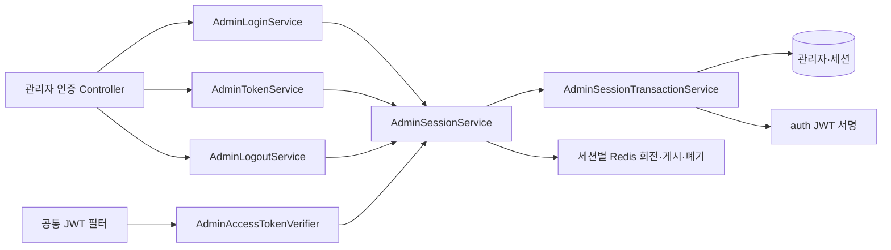
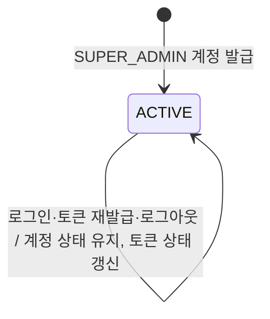
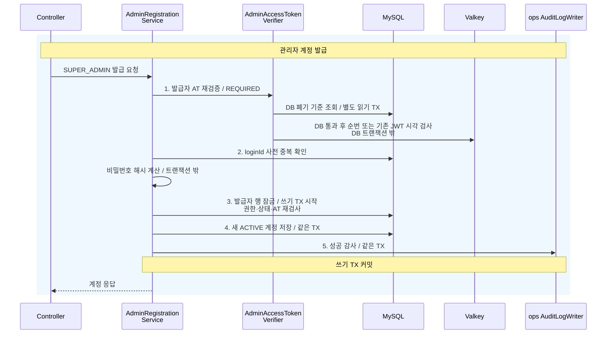

# admin 구조와 동작 설계

HTTP 계약과 엔드포인트별 절차는 [관리자 API 설계](admin-api-design.md), 회전·복구 절차는 [인증 API 설계](../auth/auth-api-design.md)가 소유한다.

## 1. 범위

이 문서는 `admin` 도메인 중 관리자 계정 발급·목록 조회와 인증·인가를 다룬다. 로그인·토큰 재발급·로그아웃과 권한 검증을 포함한다.

기능 구현 담당자는 **gyudongjeong**이다. 2026-10-23에 확인한 develop의 코드·테스트와 연결 이슈를 기준으로 한다. #534는 문서 정리 작업이며 기능 구현 근거가 아니다.

| 기능 | 구현 이슈 |
|---|---|
| 관리자 계정 발급 | [#51](https://github.com/lunch-catch/lc-backend/issues/51) |
| 최고 관리자의 관리자 계정 목록 조회 | [#649](https://github.com/lunch-catch/lc-backend/issues/649) |
| 로그인 감사 저장·로깅 보정 | [#677](https://github.com/lunch-catch/lc-backend/issues/677), [#703](https://github.com/lunch-catch/lc-backend/issues/703) |
| 관리자 로그인 | [#84](https://github.com/lunch-catch/lc-backend/issues/84) |
| 관리자 토큰 재발급 | [#116](https://github.com/lunch-catch/lc-backend/issues/116) |
| 관리자 로그아웃 | [#118](https://github.com/lunch-catch/lc-backend/issues/118) |

이슈의 당시 요구와 현재 구현이 다르면 현재 코드·테스트를 동작 기준으로 삼고 이슈는 요구와 결정의 이력으로 참조한다.

| 맡는 것 | 맡지 않는 것 |
|---|---|
| 관리자 계정, 로그인 세션과 현재 RT, 발급·폐기 순번을 관리한다 | JWT 서명·쿠키와 공통 요청 제한은 auth가 관리한다 |
| SUPER_ADMIN의 계정 발급·목록 조회와 관리자 인증을 처리한다 | 점주·회원·결제의 관리자 화면은 해당 데이터를 소유한 도메인이 처리한다 |
| ops의 공개 계약으로 감사 기록을 요청한다 | 감사 테이블과 저장 구현은 ops가 소유한다 |

근거는 [아키텍처](../../architecture/런치캐치_도메인_구조와_의존성_설계.md) 1.2와 [관리자 명세](../../api-spec/admin-api-spec.md)다.

이슈 링크는 구현 이력을 추적하는 용도다. 설계 결정의 근거는 이 문서 각 장에서 연결한 저장소 내부 명세·API 설계·아키텍처로 한정한다. 내부 문서가 이유를 정하지 않은 선택은 12장의 미정 사항으로 남긴다.

## 2. 애그리거트와 패키지

`Admin`은 계정과 전체 폐기 기준을 소유한다. `AdminLoginSession`은 로그인별 현재 RT와 게시 순번·폐기를 소유한다. 과거 RT 재사용은 기존 Redis tombstone으로 탐지한다. 같은 계정으로 여러 기기를 쓰더라도 각 세션의 토큰은 독립적이다.

| 묶음 | 테이블 | 지키는 규칙 |
|---|---|---|
| 관리자 계정과 로그인 세션 | `admin`, `admin_login_session` | 계정의 현재 상태·전체 폐기와 세션 회전·로그아웃의 순서를 관리자 행 잠금으로 확정한다 |

계정 상태 변경과 세션 검사를 원자적으로 처리하기 위해 관리자 도메인에 함께 둔다. 계정 -> 세션 순서로 잠가 교착 순서를 피하지만 같은 계정 요청은 직렬화되는 비용이 있다. 비밀번호 비교와 Redis I/O는 이 잠금 밖이다.

```text
admin/
├── config/
│   ├── AdminLoginAuditFilter.java    로그인 결과를 운영 로그로 기록한다
│   ├── AdminLoginSecurityConfig.java
│   └── AdminRegistrationSecurityConfig.java
├── controller/
│   ├── AdminAccountQueryController.java
│   ├── AdminLoginController.java
│   ├── AdminLogoutController.java
│   ├── AdminRegistrationController.java
│   └── AdminTokenController.java
├── dto/
│   └── AdminAccountResponse.java    로그인 ID·이름·역할만 조회한다
├── entity/
│   ├── Admin.java
│   ├── AdminLoginSession.java
│   └── AdminStatus.java
├── exception/
│   ├── AdminErrorCode.java
│   └── AdminException.java
├── repository/
│   ├── AdminAccessTokenRevocationRepository.java    MySQL의 AT 폐기 기준을 조회한다
│   ├── AdminAccessTokenVersionRepository.java    Valkey의 AT 폐기 순번을 관리한다
│   ├── AdminLoginSessionRepository.java
│   ├── AdminRepository.java
│   └── AdminSessionRefreshTokenRepository.java
├── service/
│   ├── AdminAccountQueryService.java    활성 계정 목록을 읽고 검색한다
│   ├── AdminLoginAuditService.java    로그인 결과와 감사 실패 지표를 기록한다
│   ├── AdminLoginAuditTransactionService.java    별도 TX로 로그인 감사를 저장한다
│   ├── AdminAccessTokenVerifier.java    auth의 AccessTokenValidationPolicy를 구현한다
│   ├── AdminLoginService.java
│   ├── AdminSessionService.java    세션 결과와 감사 장애를 처리한다
│   ├── AdminSessionTransactionService.java    세션 발급·회전·폐기를 처리한다
│   ├── AdminLogoutService.java
│   ├── AdminLogoutTransactionService.java    DB 토큰 폐기와 별도 성공 감사를 처리한다
│   ├── AdminRegistrationService.java    계정 발급과 성공 감사 기록을 조정한다
│   ├── AdminTokenService.java
│   └── AdminTokenTransactionService.java    토큰 회전·폐기의 DB 처리를 담당한다
├── AdminLoginAuditContext.java    서비스·필터의 중복 기록을 막는다
├── AdminAccessTokenClaims.java
└── AdminAccessTokenRevocation.java
```

입구는 HTTP와 공통 인증 필터의 `AccessTokenValidationPolicy` 호출이다. 자체 스케줄과 수신 이벤트는 없다.
다른 도메인의 엔티티는 참조하지 않으며 감사 대상은 ID와 문자열로 전달한다.

### 규칙을 두는 곳

| 규칙 | 두는 곳 |
|---|---|
| ACTIVE 계정 생성, 발급 순번 증가, RT 제거와 AT 폐기 기준 갱신 | `Admin` |
| 세션별 RT 해시·게시 순번·RT 폐기·로그아웃 상태 | `AdminLoginSession` |
| 비밀번호 비교·현재 계정 재검사·회전·복구 순서 | 각 service와 DB 전용 transaction service |
| SUPER_ADMIN 계정 발급·목록 조회, ADMIN·SUPER_ADMIN 로그아웃 | 두 security config. 서비스에서도 현재 DB 역할을 재확인한다 |
| 로그인 결과·감사 기록 | 식별 가능한 계정은 `AdminLoginAuditService`, 나머지 요청은 `AdminLoginAuditFilter`가 기록한다. 감사 저장은 별도 TX다 |

## 3. 저장

MySQL `admin`의 `login_id` UNIQUE가 동시 중복 발급을 막는다. 비밀번호는 BCrypt, RT는 SHA-256 해시로 저장한다.
신규 RT는 세션별로 저장하며 새 로그인은 이전 세션을 교체하지 않는다. 세션의 열·제약·보존 한계는 [관리자 API 설계](admin-api-design.md#저장-구조와-감사-로그)를 따른다. 아래 Valkey 표는 배포 전 계정 단위 키다. 신규 세션 키는 관리자 API 설계에 있다. 회전·DB 복구·복원 한계는 두 경로가 공유한다.
`refresh_token_issuance_version`, `access_token_revoked_version`, `access_token_valid_after`의 의미와 DB 제약은 [관리자 API 설계](admin-api-design.md)의 "저장 구조와 감사 로그" 절을 따른다.

| 데이터 | 키 | 만료 | 원본 | 읽는 곳 |
|---|---|---|---|---|
| RT 레코드·현재 해시 | `refreshToken:{hash}`, `activeRefreshToken:{role}:{id}` | RT 유효기간 | `admin.refresh_token_hash`와 만료 시각 | 공통 `RefreshTokenRepository`, 관리자 토큰 서비스 |
| RT 게시 순번 | `refreshTokenIssuanceVersion:{role}:{id}` | TTL을 두지 않는다 | `admin.refresh_token_issuance_version` | RT 게시·폐기 Lua |
| AT 폐기 순번 | `accessTokenRevokedVersion:{role}:{id}` | TTL을 두지 않는다 | `admin.access_token_revoked_version` | `AdminAccessTokenVerifier` |
| 기존 JWT 폐기 시각 | `accessTokenValidAfter:{role}:{id}` | AT 유효기간 | `admin.access_token_valid_after` | 공통 `AccessTokenCutoffVerifier` |

현재 계정 상태만 저장하며 별도 상태 전이 이력은 없다. 감사 기록은 ops가 소유하며 [관리자 API 설계](admin-api-design.md)의 "저장 구조와 감사 로그" 절에 있는 `audit_log` 표를 따른다. 도메인 집계·다른 업무 데이터의 사본은 해당 없다.

계정 목록은 읽기 전용 TX에서 `ACTIVE`인 `ADMIN`·`SUPER_ADMIN`만 조회한다. 로그인 ID·이름을 부분 검색하고 생성 시각·ID 내림차순으로 정렬한다. DB에서 응답 세 필드만 선택하며 비밀번호·토큰은 읽기 결과에 담지 않는다. 페이지네이션을 두지 않은 근거는 [계정 목록 설계](admin-api-design.md#계정-목록-조회)를 따른다.

RT 회전·재사용 기록은 [인증 설계](../auth/auth-api-design.md)가 소유한다. Redis만으로 DB 폐기 기준을 대체하지 않는다.

DB의 현재 RT 해시로 토큰 유효성은 확인할 수 있지만 Redis의 과거 회전·재사용 기록 전체를 복원하지는 못한다. 원본에서 재구성 가능한 값만 Valkey에 둔다는 가이드와의 차이는 12장에 남긴다.
RT 원문도 DB 해시에서 복원할 수 없다. DB 폴백은 요청으로 받은 RT를 현재 해시·만료 시각과 대조하는 방식이다.

## 4. 계산 로직

도메인별 수량·금액 계산은 해당 없다. BCrypt 비교와 토큰 해싱·생성은 기존 보안 구성과 auth 구현을 사용한다.
순번 증가는 `Admin`이 `Math.incrementExact`로 수행한다. 폐기 시각은 이전 값보다 뒤로만 이동한다.

## 5. 모듈 연결

| 방향 | 공개면 | 시점 |
|---|---|---|
| 구현 | auth의 `AccessTokenValidationPolicy` | 관리자 AT 인증마다 `AdminAccessTokenVerifier`가 DB 폐기 기준부터 확인한다 |
| 호출 | auth의 JWT·쿠키·RT 저장소 | 로그인·회전·로그아웃에서 사용한다 |
| 쓰기 | ops의 `AuditLogWriter` | 계정 발급·토큰 재발급 성공은 업무 DB 변경과 함께, 로그아웃 성공과 식별 가능한 계정의 로그인 결과는 각각 별도 트랜잭션으로 기록한다 |

공개 업무 조회 contract는 없다. 정책 인터페이스의 시그니처는 [AccessTokenValidationPolicy](../../../src/main/java/com/launchcatch/auth/contract/AccessTokenValidationPolicy.java)가 소유한다.

정책 구현은 `boolean supports(Role role)`와 `boolean isValid(Role role, Long id, LocalDateTime issuedAt, Map<String, Object> additionalClaims, CutoffPolicy policy)`를 제공한다. 반환 record는 없다.
성공한 계정 발급·로그인·토큰 재발급·로그아웃 감사는 각 1회의 `AuditLogWriter` 호출이다. 실패 감사는 식별 가능한 실패 경로에서 별도로 호출하며 조회 캐시를 두지 않는다. 호출 조건은 [관리자 API 설계](admin-api-design.md)의 "저장 구조와 감사 로그" 절에 있는 `audit_log` 표에 정리되어 있다.

## 6. 구조와 동작 그림

### 모듈 구조



세션이 없는 배포 전 토큰만 기존 Redis·DB 호환 경로로 처리한다. 감사는 ops의 공개 계약을 호출한다.

### 상태 변경



`DELETED`는 저장·인증 거부에 사용하는 상태다. 현재 `Admin`에는 삭제 전이 메서드가 없으므로 ACTIVE에서 삭제하는 실행 경로를 그리지 않는다.
발급 실패는 새 계정을 남기지 않는다. 비활성 계정 로그인은 `AUTH-001`로 거부한다. 이벤트는 발행하지 않는다.

| 전이·변경 | 일으키는 쪽 | 나가는 이벤트 | 금지일 때 응답 |
|---|---|---|---|
| 계정 없음 → ACTIVE | SUPER_ADMIN 계정 발급 | 없음 | 인증·권한·ID 중복은 [관리자 명세](../../api-spec/admin-api-spec.md)를 따른다 |
| ACTIVE 유지·토큰 상태 갱신 | 관리자 로그인·토큰 재발급·로그아웃 | 없음 | 로그인은 AUTH-001, 토큰 재발급·로그아웃은 [인증 명세](../../api-spec/auth-api-spec.md)를 따른다 |

DELETED는 입력·기존 저장 상태의 거부 대상이며 이번 범위에 상태 전이 API가 없다. 계정 생성과 토큰 갱신의 Given-When-Then은 12장에 연결한다.

### 주요 흐름

계정 발급, 로그인, 로그아웃의 세 흐름을 그린다. 토큰 재발급은 7장에 DB 경계를 적고 회전·복구 절차는 [인증 API 설계](../auth/auth-api-design.md)의 관리자 "토큰 재발급" 절을 따른다. auth·ops 호출은 같은 프로세스 안의 호출이다.

**관리자 계정 발급.** 발급자 검증 뒤 새 계정과 성공 감사를 같은 트랜잭션에 저장한다.



| 실패 지점 | 남는 상태 | 다시 요청하면 |
|---|---|---|
| 1~3. 발급자 검증·중복 확인·해싱·잠금 후 재검사 | 새 계정을 저장하지 않는다 | 현재 권한·토큰·loginId로 다시 검사한다 |
| 4~5. 새 계정 또는 성공 감사 저장 | 같은 쓰기 트랜잭션의 계정·감사를 함께 롤백한다 | 커밋 결과가 불명이면 계정 생성 여부부터 확인한다. 이미 생성된 loginId는 중복으로 거절한다 |

**관리자 로그인·재발급·로그아웃.** 신규 로그인은 세션을 추가하고 재발급은 해당 세션의 RT만 바꾼다. 로그아웃은 해당 세션만 폐기한다. 처리 순서와 실패 뒤 남는 상태는 [관리자 API 설계](admin-api-design.md)의 각 절을 따른다.

## 7. 트랜잭션과 동시성

| 흐름 | DB에서 함께 묶는 것 | 트랜잭션 밖 |
|---|---|---|
| 계정 발급 | 발급자 잠금·현재 권한과 세션 재검사·새 계정·성공 감사 | BCrypt 해싱 |
| 목록 조회 | 현재 계정 확인·목록 조회 | AT 검증은 별도 읽기 트랜잭션 |
| 신규 로그인 | 관리자 잠금·비밀번호 해시 재검사·세션 순번 할당·세션 RT 백업·JWT 서명 | 최초 계정 조회·BCrypt·Redis 게시·로그인 감사 |
| 세션 재발급 | 관리자 -> 세션 잠금·현재 해시 확인·새 해시·RT 게시 순번·성공 감사·JWT 서명 | Redis 선행 회전·게시·조건부 복구·재사용 폐기 후 실패 감사 |
| 세션 로그아웃 | 관리자 -> 세션 잠금·계정과 세션 확인·세션 폐기 | 커밋 후 Redis 폐기·성공 감사·삭제 쿠키 응답 |

새 로그인과 다른 세션의 회전·로그아웃은 서로의 토큰을 지우지 않는다. 동일 RT는 한 번만 회전한다. 재사용이면 해당 세션 RT 폐기를 커밋한 후 오류를 던진다. 기존 관리자 정책대로 AT는 로그아웃 또는 만료까지 유지한다. 같은 브라우저의 탭 간 갱신 직렬화는 프론트 연계 조건이다.

발급도 같은 관리자 행을 잠그므로 로그아웃이 먼저 커밋되면 세션 재검사로 발급을 거부한다. 전체 폐기 순번은 모든 세션에 적용된다. 서로 다른 발급자가 같은 loginId를 만들면 UNIQUE로 하나만 저장한다.

JWT 서명은 네트워크 호출이 없는 메모리 연산이므로 세션 트랜잭션 안에서 처리한다. DB 커밋 결과가 불명이면 성공으로 단정하지 않고 새 쿠키를 발급하지 않는다. 재로그인으로 새 세션을 받는다. 영속 감사 큐는 없으며 커밋과 별도 감사 사이의 프로세스 중단은 감사 유실 가능성이 있다.

배포 전 단일 기기 토큰의 Redis 회전·복구·폐기는 [인증 설계](../auth/auth-api-design.md#배포-전-단일-기기-토큰)를 따른다.

## 8. 외부 API

해당 없음. 관리자 계정 인증에서 외부 사업자 API를 호출하지 않는다. MySQL·Valkey 장애는 [장애 처리 설계](admin_장애_처리_설계.md)가 다룬다.

## 9. 실패 처리

돈이 걸린 업무 흐름은 해당 없다. 토큰 부분 반영과 감사 실패는 [장애 처리 설계](admin_장애_처리_설계.md)를 따른다.

## 10. 배치

해당 없음. 관리자 도메인이 등록한 스케줄러와 토큰 복구 배치는 없다.

## 11. 성능

신규 세션의 AT 검증은 별도 읽기 트랜잭션에서 세션과 현재 관리자 조회가 필요하다. 인증 요청마다 DB 부하가 생긴다. RT는 Redis 회전과 DB 백업을 함께 사용하며 세션별 키로 기기 간 캐시 충돌을 막는다. DB 장애 시 인증을 거부한다.

신규 로그인은 세션 한 행을 추가하고 갱신은 같은 행의 현재 RT와 게시 순번을 바꾼다. Redis의 RT·tombstone은 RT 수명을 따르고 게시 순번에는 TTL을 두지 않는다. DB 세션과 Redis 순번의 자동 정리는 없으며 저장량을 모니터링한다.

로그인·갱신·로그아웃은 계정 행을 잠그므로 같은 계정에 집중한 요청의 대기가 발생한다. 검증 환경에서 여러 계정과 단일 계정을 나누어 BCrypt 시간, SQL 수, 잠금 대기, DB 풀 대기와 p95를 측정해야 한다. 인증 API의 별도 TPS·지연 목표는 정하지 않았다.

## 12. 테스트와 미정 사항

아래는 현재 테스트의 검증 대상을 요약한 것이다. 이번 문서 작업에서 테스트를 새로 실행했다는 뜻은 아니다.

| Given(조건)·When(요청) | Then(기대 결과) | 근거 테스트 |
|---|---|---|
| 최고 관리자가 계정 목록을 검색한다 | 활성 관리자만 최신순으로 반환하며 검색 특수문자를 문자 그대로 처리한다. 일반 관리자는 거부한다 | `AdminAccountQueryIntegrationTest`, `AdminAccountQueryServiceTest` |
| 로그인 성공·식별 가능한 실패의 감사 저장이 실패한다 | 인증 결과를 유지하고 감사 실패 로그·메트릭을 남긴다 | `AdminLoginAuditServiceTest`, `AdminLoginSecurityIntegrationTest` |
| SUPER_ADMIN이 발급하고 감사 저장이 실패한다 | 새 계정도 롤백한다 | `AdminRegistrationServiceTest`, `AdminRegistrationSecurityIntegrationTest` |
| 같은 계정에 로그인·로그아웃·발급이 경합한다 | 행 잠금으로 순서를 확정하고 각 세션의 토큰과 폐기를 분리한다 | `AdminConcurrentLoginIntegrationTest`, `AdminRegistrationLogoutConcurrencyIntegrationTest` |
| RT가 동시에 재사용되거나 회전 결과가 불명이다 | 이중 정상 회전을 막고 확인·보상 조건을 지킨다 | `AdminTokenConcurrencyIntegrationTest`, `AdminTokenServiceTest` |
| DB 폐기 또는 Redis 장애 상황에서 AT를 검증한다 | DB 폐기를 우회하지 않고 정책별로 거부·오류 처리한다 | `AdminAccessTokenVerifierTest`, `AdminAccessTokenVersionRedisIntegrationTest` |
| 세션 저장 뒤 JWT 서명이 실패한다 | 세션·순번을 같은 트랜잭션에서 롤백하고 쿠키를 발급하지 않는다 | `AdminLoginSecurityIntegrationTest`, `AdminSessionTransactionServiceTest` |
| DB 폐기 뒤 Redis 정리 또는 성공 감사가 실패한다 | DB 폐기는 유지한다. Redis 실패는 오류를 반환하고 감사 실패만으로는 성공을 취소하지 않는다 | `AdminLogoutServiceTest`, `AdminConcurrentLoginIntegrationTest` |

| 추가 Given·When | Then | 근거 테스트 |
|---|---|---|
| ACTIVE 계정·유효한 비밀번호로 로그인한다 | 계정 상태는 유지하고 새 세션과 RT 백업을 추가한다 | `AdminLoginServiceTest`, `AdminLoginSecurityIntegrationTest` |
| 두 발급자가 같은 loginId로 동시에 발급한다 | UNIQUE로 계정 하나만 남겨야 한다 | `AdminRegistrationServiceTest`는 중복 변환 근거다. 서로 다른 발급자의 실제 동시 중복 생성 시험은 미검증이다 |
| 오래된 Redis 게시가 더 최신 순번 뒤 도착한다 | 최신 토큰 상태를 유지한다 | `AdminTokenConcurrencyIntegrationTest`, `AdminAccessTokenVersionRedisIntegrationTest` |

도메인 이벤트 지연과 공유 수량 경합은 7장의 해당 없음 사유를 따른다.

| 미정 항목 | 현재 상태 | 막는 것 |
|---|---|---|
| 실제 배포·롤백 검증 | [배포 확인 기록](admin-api-design.md)이 미확인이다 | 혼합 버전에서의 폐기 보장 여부를 확정하지 못한다 |
| 장애 허용 횟수의 지표·경보와 부하 측정 | [장애 처리 설계](admin_장애_처리_설계.md)를 따른다 | 운영상 탐지와 처리량 보장을 확정하지 못한다 |

| 추가 미정 항목 | 어디까지 정해졌나 | 막는 것 |
|---|---|---|
| 세션·Redis 순번 보존과 정리 | 자동 삭제는 없다. 세션 행 삭제는 기존 AT 호환 판정에 영향을 준다 | 만료·폐기 데이터의 안전한 정리 정책이 필요하다 |
| 예상 트래픽과 부하 검증 | 11장에 비용 모델과 측정 방법을 적었다. 인증 API는 별도 TPS·지연 목표를 두지 않는다 | 예상 동시 요청량과 실제 풀 용량을 대조한 부하 검증 전에는 운영 용량을 판단하지 못한다 |
| 동시 중복 발급 시험 | DB UNIQUE와 중복 변환은 확인했으나 서로 다른 발급자의 동시 생성 시험은 미검증이다 | 7장의 공유 loginId 경합 검증 완료로 표시할 수 없다 |
