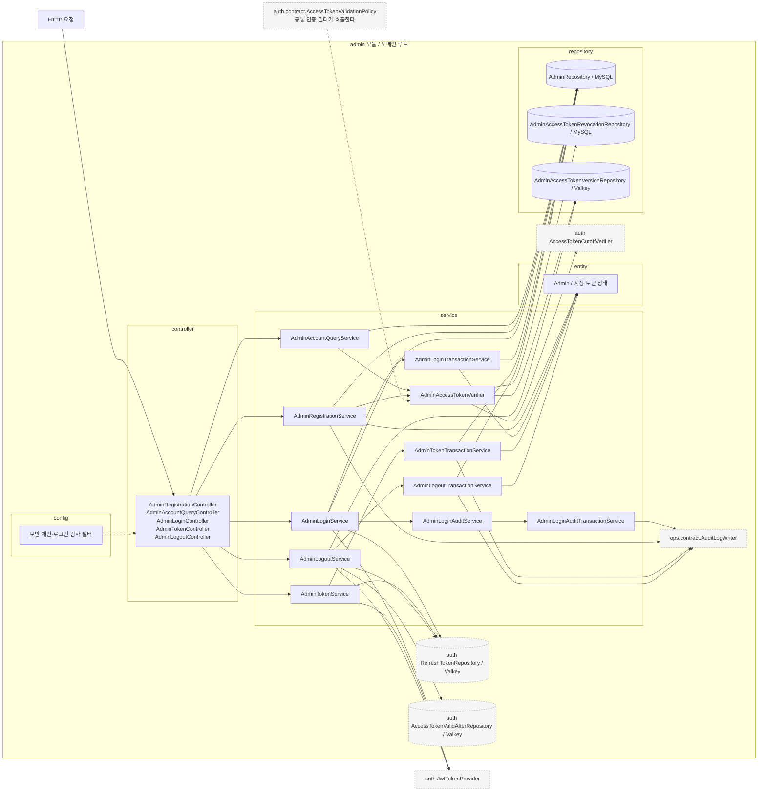
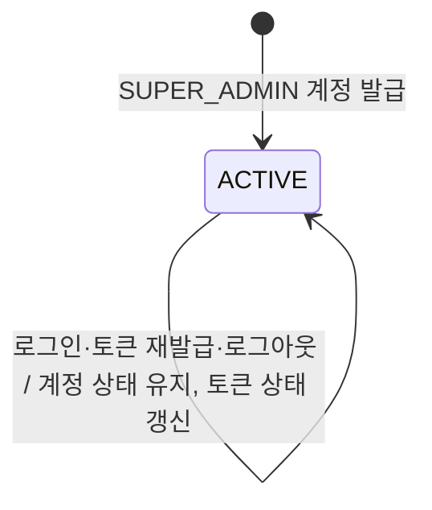
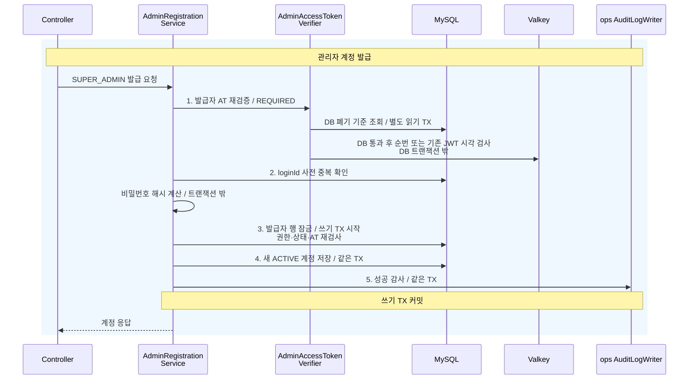
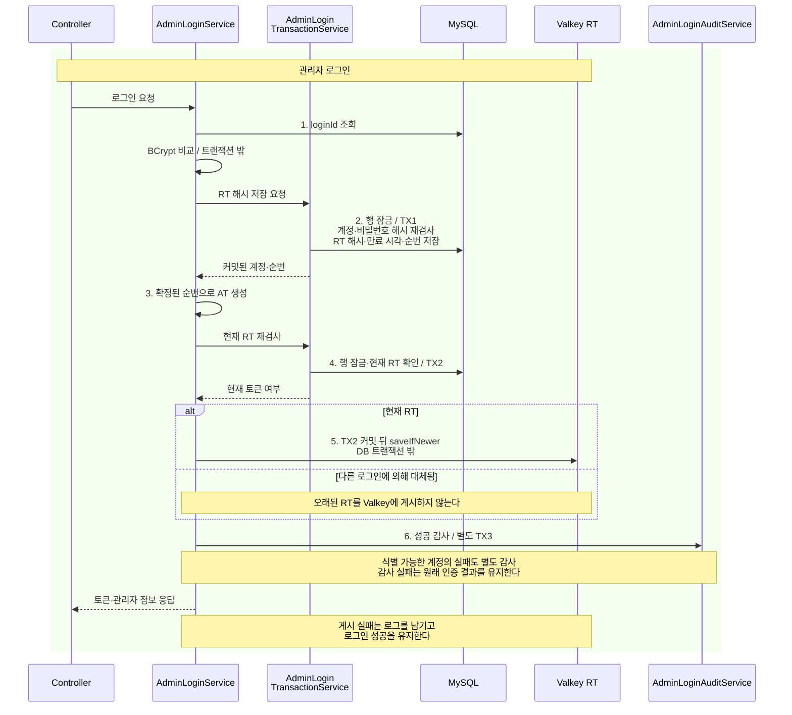
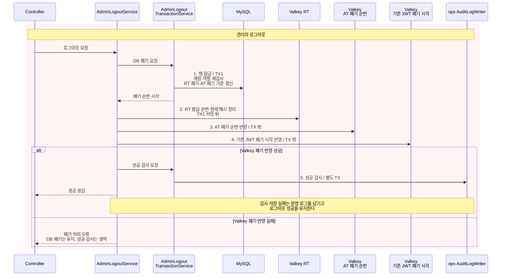

# admin 구조와 동작 설계

HTTP 계약과 엔드포인트별 절차는 [관리자 API 설계](admin-api-design.md), 회전·복구 절차는 [인증 API 설계](../auth/auth-api-design.md)가 소유한다.

## 1. 범위

이 문서는 `admin` 도메인 중 관리자 계정 발급·목록 조회와 인증·인가를 다룬다. 로그인·토큰 재발급·로그아웃과 권한 검증을 포함한다.

기능 구현 담당자는 **gyudongjeong**이다. 2026-10-23에 확인한 develop의 코드·테스트와 연결 이슈를 기준으로 한다. #534는 문서 정리 작업이며 기능 구현 근거가 아니다.

| 기능 | 구현 이슈 |
|---|---|
| 관리자 계정 발급 | [#51](https://github.com/lunch-catch/lc-backend/issues/51) |
| 최고 관리자의 관리자 계정 목록 조회 | [#649](https://github.com/lunch-catch/lc-backend/issues/649) |
| 로그인 감사 저장·로깅 보정 | [#677](https://github.com/lunch-catch/lc-backend/issues/677), [#703](https://github.com/lunch-catch/lc-backend/issues/703) |
| 관리자 로그인 | [#84](https://github.com/lunch-catch/lc-backend/issues/84) |
| 관리자 토큰 재발급 | [#116](https://github.com/lunch-catch/lc-backend/issues/116) |
| 관리자 로그아웃 | [#118](https://github.com/lunch-catch/lc-backend/issues/118) |

이슈의 당시 요구와 현재 구현이 다르면 현재 코드·테스트를 동작 기준으로 삼고 이슈는 요구와 결정의 이력으로 참조한다.

| 맡는 것 | 맡지 않는 것 |
|---|---|
| 관리자 계정, 현재 Refresh Token 해시, 발급·폐기 순번을 관리한다 | JWT 서명·쿠키와 공통 요청 제한은 auth가 관리한다 |
| SUPER_ADMIN의 계정 발급·목록 조회와 관리자 인증을 처리한다 | 점주·회원·결제의 관리자 화면은 해당 데이터를 소유한 도메인이 처리한다 |
| ops의 공개 계약으로 감사 기록을 요청한다 | 감사 테이블과 저장 구현은 ops가 소유한다 |

근거는 [아키텍처](../../architecture/런치캐치_도메인_구조와_의존성_설계.md) 1.2와 [관리자 명세](../../api-spec/admin-api-spec.md)다.

이슈 링크는 구현 이력을 추적하는 용도다. 설계 결정의 근거는 이 문서 각 장에서 연결한 저장소 내부 명세·API 설계·아키텍처로 한정한다. 내부 문서가 이유를 정하지 않은 선택은 12장의 미정 사항으로 남긴다.

## 2. 애그리거트와 패키지

`Admin`이 계정과 현재 토큰 상태를 함께 소유한다. 현재 구현은 로그아웃과 발급의 순서를 같은 관리자 행 잠금으로 확정한다.

| 애그리거트 | 테이블 | 지키는 규칙 | 경계의 근거 |
|---|---|---|---|
| 관리자 계정 | `admin` | 현재 RT와 발급·폐기 순번을 같은 계정 행 아래 갱신한다 | [관리자 API 설계](admin-api-design.md) |

계정과 RT를 함께 두면 폐기 순서를 한 행에서 확정할 수 있지만 인증 경합이 같은 행에 모인다. 토큰을 분리하면 쓰기 부하를 나눌 수 있지만 계정·토큰 사이의 원자적 검사가 추가된다.
현재 단일 계정당 RT 하나라는 계약을 따른다. 별도 토큰 애그리거트로 나누지 않은 역사적 결정 이유는 기존 설계에서 확인되지 않아 12장에 남긴다.

```text
admin/
├── config/
│   ├── AdminLoginAuditFilter.java    로그인 결과를 운영 로그로 기록한다
│   ├── AdminLoginSecurityConfig.java
│   └── AdminRegistrationSecurityConfig.java
├── controller/
│   ├── AdminAccountQueryController.java
│   ├── AdminLoginController.java
│   ├── AdminLogoutController.java
│   ├── AdminRegistrationController.java
│   └── AdminTokenController.java
├── dto/
│   └── AdminAccountResponse.java    로그인 ID·이름·역할만 조회한다
├── entity/
│   ├── Admin.java
│   └── AdminStatus.java
├── exception/
│   ├── AdminErrorCode.java
│   └── AdminException.java
├── repository/
│   ├── AdminAccessTokenRevocationRepository.java    MySQL의 AT 폐기 기준을 조회한다
│   ├── AdminAccessTokenVersionRepository.java    Valkey의 AT 폐기 순번을 관리한다
│   └── AdminRepository.java
├── service/
│   ├── AdminAccountQueryService.java    활성 계정 목록을 읽고 검색한다
│   ├── AdminLoginAuditService.java    로그인 결과와 감사 실패 지표를 기록한다
│   ├── AdminLoginAuditTransactionService.java    별도 TX로 로그인 감사를 저장한다
│   ├── AdminAccessTokenVerifier.java    auth의 AccessTokenValidationPolicy를 구현한다
│   ├── AdminLoginService.java
│   ├── AdminLoginTransactionService.java    행 잠금 아래 RT 해시와 발급 순번을 저장한다
│   ├── AdminLogoutService.java
│   ├── AdminLogoutTransactionService.java    DB 토큰 폐기와 별도 성공 감사를 처리한다
│   ├── AdminRegistrationService.java    계정 발급과 성공 감사 기록을 조정한다
│   ├── AdminTokenService.java
│   └── AdminTokenTransactionService.java    토큰 회전·폐기의 DB 처리를 담당한다
├── AdminLoginAuditContext.java    서비스·필터의 중복 기록을 막는다
├── AdminAccessTokenClaims.java
└── AdminAccessTokenRevocation.java
```

입구는 HTTP와 공통 인증 필터의 `AccessTokenValidationPolicy` 호출이다. 자체 스케줄과 수신 이벤트는 없다.
다른 도메인의 엔티티는 참조하지 않으며 감사 대상은 ID와 문자열로 전달한다.

### 규칙을 두는 곳

| 규칙 | 두는 곳 |
|---|---|
| ACTIVE 계정 생성, 발급 순번 증가, RT 제거와 AT 폐기 기준 갱신 | `Admin` |
| 비밀번호 비교·현재 계정 재검사·회전·복구 순서 | 각 service와 DB 전용 transaction service |
| SUPER_ADMIN 계정 발급·목록 조회, ADMIN·SUPER_ADMIN 로그아웃 | 두 security config. 서비스에서도 현재 DB 역할을 재확인한다 |
| 로그인 결과·감사 기록 | 식별 가능한 계정은 `AdminLoginAuditService`, 나머지 요청은 `AdminLoginAuditFilter`가 기록한다. 감사 저장은 별도 TX다 |

## 3. 저장

MySQL `admin`의 `login_id` UNIQUE가 동시 중복 발급을 막는다. 비밀번호는 BCrypt, RT는 SHA-256 해시로 저장한다.
현재 RT는 계정당 하나다. 새 로그인은 이전 RT를 교체하지만 기존 AT 전체를 폐기하지는 않는다.
`refresh_token_issuance_version`, `access_token_revoked_version`, `access_token_valid_after`의 의미와 DB 제약은 [관리자 API 설계](admin-api-design.md)의 "저장 구조와 감사 로그" 절을 따른다.

| 데이터 | 키 | 만료 | 원본 | 읽는 곳 |
|---|---|---|---|---|
| RT 레코드·현재 해시 | `refreshToken:{hash}`, `activeRefreshToken:{role}:{id}` | RT 유효기간 | `admin.refresh_token_hash`와 만료 시각 | 공통 `RefreshTokenRepository`, 관리자 토큰 서비스 |
| RT 게시 순번 | `refreshTokenIssuanceVersion:{role}:{id}` | TTL을 두지 않는다 | `admin.refresh_token_issuance_version` | RT 게시·폐기 Lua |
| AT 폐기 순번 | `accessTokenRevokedVersion:{role}:{id}` | TTL을 두지 않는다 | `admin.access_token_revoked_version` | `AdminAccessTokenVerifier` |
| 기존 JWT 폐기 시각 | `accessTokenValidAfter:{role}:{id}` | AT 유효기간 | `admin.access_token_valid_after` | 공통 `AccessTokenCutoffVerifier` |

현재 계정 상태만 저장하며 별도 상태 전이 이력은 없다. 감사 기록은 ops가 소유하며 [관리자 API 설계](admin-api-design.md)의 "저장 구조와 감사 로그" 절에 있는 `audit_log` 표를 따른다. 도메인 집계·다른 업무 데이터의 사본은 해당 없다.

계정 목록은 읽기 전용 TX에서 `ACTIVE`인 `ADMIN`·`SUPER_ADMIN`만 조회한다. 로그인 ID·이름을 부분 검색하고 생성 시각·ID 내림차순으로 정렬한다. DB에서 응답 세 필드만 선택하며 비밀번호·토큰은 읽기 결과에 담지 않는다. 페이지네이션을 두지 않은 근거는 [계정 목록 설계](admin-api-design.md#계정-목록-조회)를 따른다.

RT 회전·재사용 기록은 [인증 설계](../auth/auth-api-design.md)가 소유한다. Redis만으로 DB 폐기 기준을 대체하지 않는다.

DB의 현재 RT 해시로 토큰 유효성은 확인할 수 있지만 Redis의 과거 회전·재사용 기록 전체를 복원하지는 못한다. 원본에서 재구성 가능한 값만 Valkey에 둔다는 가이드와의 차이는 12장에 남긴다.
RT 원문도 DB 해시에서 복원할 수 없다. DB 폴백은 요청으로 받은 RT를 현재 해시·만료 시각과 대조하는 방식이다.

## 4. 계산 로직

도메인별 수량·금액 계산은 해당 없다. BCrypt 비교와 토큰 해싱·생성은 기존 보안 구성과 auth 구현을 사용한다.
순번 증가는 `Admin`이 `Math.incrementExact`로 수행한다. 폐기 시각은 이전 값보다 뒤로만 이동한다.

## 5. 모듈 연결

| 방향 | 공개면 | 시점 |
|---|---|---|
| 구현 | auth의 `AccessTokenValidationPolicy` | 관리자 AT 인증마다 `AdminAccessTokenVerifier`가 DB 폐기 기준부터 확인한다 |
| 호출 | auth의 JWT·쿠키·RT 저장소 | 로그인·회전·로그아웃에서 사용한다 |
| 쓰기 | ops의 `AuditLogWriter` | 계정 발급·토큰 재발급 성공은 업무 DB 변경과 함께, 로그아웃 성공과 식별 가능한 계정의 로그인 결과는 각각 별도 트랜잭션으로 기록한다 |

공개 업무 조회 contract는 없다. 정책 인터페이스의 시그니처는 [AccessTokenValidationPolicy](../../../src/main/java/com/launchcatch/auth/contract/AccessTokenValidationPolicy.java)가 소유한다.

정책 구현은 `boolean supports(Role role)`와 `boolean isValid(Role role, Long id, LocalDateTime issuedAt, Map<String, Object> additionalClaims, CutoffPolicy policy)`를 제공한다. 반환 record는 없다.
성공한 계정 발급·로그인·토큰 재발급·로그아웃 감사는 각 1회의 `AuditLogWriter` 호출이다. 실패 감사는 식별 가능한 실패 경로에서 별도로 호출하며 조회 캐시를 두지 않는다. 호출 조건은 [관리자 API 설계](admin-api-design.md)의 "저장 구조와 감사 로그" 절에 있는 `audit_log` 표에 정리되어 있다.

## 6. 구조와 동작 그림

### 모듈 구조



### 상태 변경



`DELETED`는 저장·인증 거부에 사용하는 상태다. 현재 `Admin`에는 삭제 전이 메서드가 없으므로 ACTIVE에서 삭제하는 실행 경로를 그리지 않는다.
발급 실패는 새 계정을 남기지 않는다. 비활성 계정 로그인은 `AUTH-001`로 거부한다. 이벤트는 발행하지 않는다.

| 전이·변경 | 일으키는 쪽 | 나가는 이벤트 | 금지일 때 응답 |
|---|---|---|---|
| 계정 없음 → ACTIVE | SUPER_ADMIN 계정 발급 | 없음 | 인증·권한·ID 중복은 [관리자 명세](../../api-spec/admin-api-spec.md)를 따른다 |
| ACTIVE 유지·토큰 상태 갱신 | 관리자 로그인·토큰 재발급·로그아웃 | 없음 | 로그인은 AUTH-001, 토큰 재발급·로그아웃은 [인증 명세](../../api-spec/auth-api-spec.md)를 따른다 |

DELETED는 입력·기존 저장 상태의 거부 대상이며 이번 범위에 상태 전이 API가 없다. 계정 생성과 토큰 갱신의 Given-When-Then은 12장에 연결한다.

### 주요 흐름

계정 발급, 로그인, 로그아웃의 세 흐름을 그린다. 토큰 재발급은 7장에 DB 경계를 적고 회전·복구 절차는 [인증 API 설계](../auth/auth-api-design.md)의 관리자 "토큰 재발급" 절을 따른다. auth·ops 호출은 같은 프로세스 안의 호출이다.

**관리자 계정 발급.** 발급자 검증 뒤 새 계정과 성공 감사를 같은 트랜잭션에 저장한다.



| 실패 지점 | 남는 상태 | 다시 요청하면 |
|---|---|---|
| 1~3. 발급자 검증·중복 확인·해싱·잠금 후 재검사 | 새 계정을 저장하지 않는다 | 현재 권한·토큰·loginId로 다시 검사한다 |
| 4~5. 새 계정 또는 성공 감사 저장 | 같은 쓰기 트랜잭션의 계정·감사를 함께 롤백한다 | 커밋 결과가 불명이면 계정 생성 여부부터 확인한다. 이미 생성된 loginId는 중복으로 거절한다 |

**관리자 로그인.** DB 저장과 게시 전 재검사를 각각 커밋한 뒤 RT를 Valkey에 게시한다.



| 실패 지점 | 남는 상태 | 다시 요청하면 |
|---|---|---|
| 1~2. 계정·비밀번호 확인 또는 DB 저장 | 검증 실패는 토큰을 바꾸지 않는다. 저장 실패는 TX1을 롤백하며 커밋 결과 불명은 성공으로 단정하지 않는다 | 새 로그인으로 현재 계정을 다시 확인하고 RT를 교체한다 |
| 3~4. AT 생성 또는 게시 전 DB 확인 | TX1은 이미 커밋됐다. 실패한 이번 RT 해시와 일치할 때만 별도 TX로 제거를 시도한다. 정리도 실패하면 DB 해시가 남을 수 있다 | 새 로그인으로 RT를 교체한다. 다른 로그인에서 저장한 RT는 정리 대상이 아니다 |
| 5. Valkey 게시 | DB 현재 RT는 유지하고 로그인은 성공으로 응답한다 | 이후 토큰 재발급은 [인증 설계](../auth/auth-api-design.md)의 DB 복구 조건을 따른다 |
| 6. 로그인 감사 저장 | 감사 TX만 롤백하고 원래 로그인 결과를 유지한다 | 자동 재처리하지 않고 ERROR 로그와 실패 지표를 남긴다 |

계정 부재나 서비스 진입 전 거절은 감사 DB에 쓰지 않고 필터 로그·메트릭으로 기록한다. 처리 조건은 [로그인 감사 설계](admin-api-design.md#로그인-감사)를 따른다.

**관리자 로그아웃.** DB 폐기를 커밋한 뒤 Valkey에 반영하고 성공 감사를 별도로 저장한다.



| 실패 지점 | 남는 상태 | 다시 요청하면 |
|---|---|---|
| 1. DB 폐기·커밋 | 롤백되면 기존 토큰 상태를 유지한다. 커밋 결과가 불명이면 폐기 여부를 단정하지 않는다. Redis 정리는 진행하지 않는다 | 현재 인증 상태를 다시 확인한다 |
| 2~4. Redis 정리 | DB의 RT·AT 폐기는 유지한다. 오류를 응답하고 성공 감사는 생략한다 | 이전 AT는 DB 기준으로 이미 무효다. 이전 AT를 이용한 HTTP 재시도로 Redis를 정리한다고 가정하지 않는다 |
| 5. 성공 감사 저장 | 토큰 폐기는 유지하고 감사 TX만 롤백한다. 운영 로그를 남기고 성공 응답을 유지한다 | 감사 저장을 자동 재시도하지 않는다 |

## 7. 트랜잭션과 동시성

| 흐름 | DB에서 함께 묶는 것 | 트랜잭션 밖 |
|---|---|---|
| 계정 발급 | 발급자 행 잠금, 상태·역할·폐기 재검사, 새 계정과 감사 저장 | BCrypt 해싱 |
| 계정 목록 조회 | 읽기 전용 TX에서 요청자 현재 상태·역할을 확인하고 목록을 읽는다. 행 잠금·쓰기·감사는 없다 | AT 폐기 검증은 별도 읽기 TX와 Redis 추가 검사를 사용한다 |
| 로그인 | TX1에서 계정 행 잠금·재검사와 RT 해시·만료·발급 순번을 저장한다. TX2에서 행 잠금 아래 현재 상태·해시를 다시 확인한다 | 최초 계정 조회·BCrypt·AT 생성·Redis 게시. 실패한 RT 정리와 로그인 감사는 각각 별도 TX다 |
| 토큰 재발급 | 행 잠금 아래 상태·역할·이전 해시·만료를 확인하고 새 해시·만료·순번과 성공 감사를 함께 저장한다 | Redis 회전·게시·보상. DB 결과 확인·재사용 폐기·실패 감사는 각각 별도 TX다 |
| 로그아웃 | TX1에서 행 잠금·계정 재검사, RT 제거·순번 증가·AT 폐기 기준을 저장한다 | Redis 정리 후 별도 TX로 성공 감사를 저장한다 |

로그인·토큰 재발급·로그아웃은 같은 계정 행 잠금으로 직렬화한다. 발급과 로그아웃도 발급자 행으로 순서를 정한다.
동일 loginId의 다른 발급자는 UNIQUE로 경합한다. 지연된 Redis 작업은 순번 비교로 최신 상태를 덮지 못하게 한다.
재사용 RT를 다시 회전시키는 멱등 성공은 제공하지 않는다. 회전 타임아웃·보상은 [인증 설계](../auth/auth-api-design.md)를 따른다.

**결정: DB 확정 후 Redis에 게시한다.** DB와 Redis의 원자적 커밋은 제공하지 않는다. 같은 트랜잭션에서 Redis를 호출하면 잠금을 오래 잡으면서도 원자성을 얻지 못한다.
현재 방식은 DB 연결을 먼저 반환하지만 게시 실패와 프로세스 중단이 남는다. DB 해시·순번 검증으로 보완하며 영속 게시 큐는 없다. 로그인·토큰 재발급의 캐시 게시는 비동기 작업으로 넘기지 않고 요청 스레드에서 커밋 후 직접 호출한다. 정상 토큰 재발급의 최초 Redis 회전은 DB 갱신보다 먼저이며 회전 실패·복구 절차는 [인증 설계](../auth/auth-api-design.md)가 소유한다. 근거는 [관리자 API 설계](admin-api-design.md)의 "로그인" 절이다.

로그인 감사는 인증 TX와 분리해 성공과 식별 가능한 실패를 남긴다. 감사 저장 장애는 인증 결과를 바꾸지 않는다. 영속 큐 없이 요청 스레드에서 별도 TX로 직접 저장하므로 중단 시 유실될 수 있다. 근거는 [로그인 감사 설계](admin-api-design.md#로그인-감사)다.

로그아웃 감사는 폐기와 같은 트랜잭션에 묶으면 감사 장애가 필수 폐기를 막는다. 커밋 후 별도 TX로 직접 호출하면 폐기는 유지되지만 감사 저장 전 프로세스 중단 시 기록이 빠질 수 있다. 영속 큐로 보장하는 대안은 현재 구현하지 않았으며, 실패 시 운영 로그를 남기는 선택의 근거는 [관리자 API 설계](admin-api-design.md)의 "로그아웃" 절이다.

| 주요 흐름 | 같은 요청이 다시 옴 | 같은 계정의 동시 요청 | 여러 계정이 같은 자원에 씀 | 이벤트 지연·순서 역전 |
|---|---|---|---|---|
| 계정 목록 조회 | 읽기만 하며 요청마다 현재 권한을 확인한다 | 행 잠금을 사용하지 않는다. 조회와 동시에 생성된 계정의 즉시 반영은 보장하지 않는다 | 공유 쓰기는 없다 | 해당 없음. 이벤트를 사용하지 않는다 |
| 계정 발급 | 요청 ID 기반 멱등 저장은 없다. 같은 loginId는 UNIQUE로 거절한다 | 발급자 행을 비관 잠근다 | 다른 발급자의 같은 loginId는 UNIQUE로 하나만 반영한다 | 해당 없음. 도메인 이벤트를 발행하지 않는다 |
| 로그인·토큰 재발급·로그아웃 | 새 로그인은 RT를 교체한다. 이미 사용한 RT는 거부한다. 재사용이 감지되면 DB의 현재 RT를 폐기하고 발급 순번을 증가시킨다. AT 폐기 기준은 바꾸지 않는다 | 같은 관리자 행의 비관 잠금과 이전 해시 비교를 사용한다 | 계정별 토큰·순번을 분리한다. 공유 수량은 없다 | 이벤트는 없다. 지연된 Redis 게시·폐기는 단조 순번으로 판정한다 |

행 잠금을 쓰면 기존 계정 검증과 토큰 변경을 한 번에 직렬화하지만 같은 계정의 대기가 늘어난다. CAS만 쓰면 대기를 줄일 수 있지만 상태·역할·감사와의 재검증이 복잡해진다.
현재 잠금은 [관리자 API 설계](admin-api-design.md)가 정한다. 영업일 계산·일괄 처리 상한은 해당 없음이며 계정 단건을 처리한다.

## 8. 외부 API

해당 없음. 관리자 계정 인증에서 외부 사업자 API를 호출하지 않는다. MySQL·Valkey 장애는 [장애 처리 설계](admin_장애_처리_설계.md)가 다룬다.

## 9. 실패 처리

돈이 걸린 업무 흐름은 해당 없다. 토큰 부분 반영과 감사 실패는 [장애 처리 설계](admin_장애_처리_설계.md)를 따른다.

## 10. 배치

해당 없음. 관리자 도메인이 등록한 스케줄러와 토큰 복구 배치는 없다.

## 11. 성능

정상 서비스 경로의 비용을 아래와 같이 계산한다. 공통 보안 필터의 처리와 오류 복구는 제외하며 SQL 수는 실측 전 예상치다. DB 쓰기는 감사 저장을 포함한다.

| 흐름 | DB 읽기 / 쓰기 | DB 트랜잭션 | Valkey 호출 |
|---|---|---|---|
| 계정 목록 조회 | 폐기 기준·요청자·목록 조회 3회 / 쓰기 없음 | 읽기 TX와 별도 폐기 기준 조회 TX | AT 추가 검사 1회 |
| 계정 발급 | 폐기 기준·loginId·발급자 조회 3회 / 계정·감사 저장 2회 | 폐기 기준 읽기 1회, 계정·감사 쓰기 1회 | AT 추가 검사 1회 |
| 로그인 | 최초 계정 조회 1회·잠금 조회 2회 / RT 갱신·감사 저장 2회 | 저장·게시 전 확인·감사 3회 | RT 게시 1회 |
| 정상 토큰 재발급 | 계정 잠금 조회 1회 / RT·감사 저장 2회 | 회전·감사 1회 | RT 조회·회전·게시 3회 |
| 로그아웃 | 계정 잠금 조회 1회 / RT·AT 폐기 갱신·감사 저장 2회 | 폐기·성공 감사 2회 | RT 해시 유무에 따라 3~4회 |

공통 인증에서 관리자 AT를 검증할 때마다 폐기 기준 조회 1회와 별도 읽기 트랜잭션이 추가된다. DB 검증을 통과하면 Valkey를 1회 더 읽는다.
따라서 관리자 AT 검증 TPS가 T이면 폐기 확인만 초당 T회의 DB 읽기가 필요하다. 로그인 TPS가 L이면 서비스 경로에서 초당 약 3L회의 DB 읽기와 L회의 RT 갱신과 L회의 감사 저장이 추가된다. BCrypt 비용과 경합 계정의 행 잠금 대기가 별도 병목이다.

계정 목록은 전체 결과를 메모리에 담으므로 계정 수 증가에 따른 응답 크기를 측정해야 한다. 현재 페이지 크기 상한은 없다.

확인 방법은 정상·DB 지연·Valkey 장애의 세 조건에서 서로 다른 계정과 단일 계정 집중 요청을 나누어 부하를 가하는 것이다. BCrypt 시간, 행 잠금 대기, SQL 수, 풀 대기와 p95를 함께 측정한다.
[인증 API 설계](../auth/auth-api-design.md)는 관리자 로그인·토큰 재발급·로그아웃의 오류율을 0.1% 미만으로 두고 인증 API의 TPS·응답 지연 목표는 두지 않는다. 이 문서에서 별도 목표를 만들지 않으며, 예상 트래픽에 대한 비용 모델과 풀 용량의 적합성 검증을 12장의 미정 사항으로 남긴다.

## 12. 테스트와 미정 사항

아래는 현재 테스트의 검증 대상을 요약한 것이다. 이번 문서 작업에서 테스트를 새로 실행했다는 뜻은 아니다.

| Given(조건)·When(요청) | Then(기대 결과) | 근거 테스트 |
|---|---|---|
| 최고 관리자가 계정 목록을 검색한다 | 활성 관리자만 최신순으로 반환하며 검색 특수문자를 문자 그대로 처리한다. 일반 관리자는 거부한다 | `AdminAccountQueryIntegrationTest`, `AdminAccountQueryServiceTest` |
| 로그인 성공·식별 가능한 실패의 감사 저장이 실패한다 | 인증 결과를 유지하고 감사 실패 로그·메트릭을 남긴다 | `AdminLoginAuditServiceTest`, `AdminLoginSecurityIntegrationTest` |
| SUPER_ADMIN이 발급하고 감사 저장이 실패한다 | 새 계정도 롤백한다 | `AdminRegistrationServiceTest`, `AdminRegistrationSecurityIntegrationTest` |
| 같은 계정에 로그인·로그아웃·발급이 경합한다 | 행 잠금으로 순서를 확정하고 지연 게시를 차단한다 | `AdminLoginConcurrencyIntegrationTest`, `AdminLogoutConcurrencyIntegrationTest`, `AdminRegistrationLogoutConcurrencyIntegrationTest` |
| RT가 동시에 재사용되거나 회전 결과가 불명이다 | 이중 정상 회전을 막고 확인·보상 조건을 지킨다 | `AdminTokenConcurrencyIntegrationTest`, `AdminTokenServiceTest` |
| DB 폐기 또는 Redis 장애 상황에서 AT를 검증한다 | DB 폐기를 우회하지 않고 정책별로 거부·오류 처리한다 | `AdminAccessTokenVerifierTest`, `AdminAccessTokenVersionRedisIntegrationTest` |
| DB 저장 뒤 AT 생성 또는 게시 전 재검사가 실패한다 | 이번 RT 해시에 한해서 정리를 시도하고 오류를 반환한다 | `AdminLoginServiceTest` |
| DB 폐기 뒤 Redis 정리 또는 성공 감사가 실패한다 | DB 폐기는 유지한다. Redis 실패는 오류를 반환하고 감사 실패만으로는 성공을 취소하지 않는다 | `AdminLogoutServiceTest`, `AdminLogoutConcurrencyIntegrationTest` |

| 추가 Given·When | Then | 근거 테스트 |
|---|---|---|
| ACTIVE 계정·유효한 비밀번호로 로그인한다 | 계정 상태는 유지하고 RT와 순번을 갱신한다 | `AdminLoginServiceTest`, `AdminLoginSecurityIntegrationTest` |
| 두 발급자가 같은 loginId로 동시에 발급한다 | UNIQUE로 계정 하나만 남겨야 한다 | `AdminRegistrationServiceTest`는 중복 변환 근거다. 서로 다른 발급자의 실제 동시 중복 생성 시험은 미검증이다 |
| 오래된 Redis 게시가 더 최신 순번 뒤 도착한다 | 최신 토큰 상태를 유지한다 | `AdminTokenConcurrencyIntegrationTest`, `AdminAccessTokenVersionRedisIntegrationTest` |

도메인 이벤트 지연과 공유 수량 경합은 7장의 해당 없음 사유를 따른다.

| 미정 항목 | 현재 상태 | 막는 것 |
|---|---|---|
| 실제 배포·롤백 검증 | [배포 확인 기록](admin-api-design.md)이 미확인이다 | 혼합 버전에서의 폐기 보장 여부를 확정하지 못한다 |
| 장애 허용 횟수의 지표·경보와 부하 측정 | [장애 처리 설계](admin_장애_처리_설계.md)를 따른다 | 운영상 탐지와 처리량 보장을 확정하지 못한다 |

| 추가 미정 항목 | 어디까지 정해졌나 | 막는 것 |
|---|---|---|
| RT 상태의 애그리거트 경계·복원 불가 회전 이력 | 계정 행에 현재 해시·순번을 두며 Redis 과거 기록 유실은 복원하지 못한다. 기존 API 설계에 동작은 있으나 별도 경계를 배제한 결정 이유는 없다 | admin·auth 담당자의 저장 경계 및 복원 정책 확정이 필요하다 |
| 예상 트래픽과 부하 검증 | 11장에 비용 모델과 측정 방법을 적었다. 인증 API는 별도 TPS·지연 목표를 두지 않는다 | 예상 동시 요청량과 실제 풀 용량을 대조한 부하 검증 전에는 운영 용량을 판단하지 못한다 |
| 동시 중복 발급 시험 | DB UNIQUE와 중복 변환은 확인했으나 서로 다른 발급자의 동시 생성 시험은 미검증이다 | 7장의 공유 loginId 경합 검증 완료로 표시할 수 없다 |
