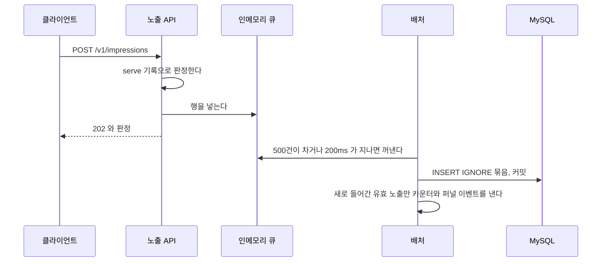

# 노출 수집 v3: 응답한 뒤 `impression_log` 를 묶어 저장한다

쓰기마다 어느 방식을 고르는지와 버전 목록은 [요청 중 쓰기 설계](./adserving_요청_중_쓰기_설계.md)가 갖는다.

요청 스레드는 판정까지만 하고 응답한다. 저장할 행은 인메모리 큐에 넣는다. 배처가 큐에서 행을 모아 한 트랜잭션으로 `INSERT IGNORE` 한다. 정산 차감은 v2 그대로 릴레이가 커밋된 행을 모아 넘긴다.

## v2 를 바꾸는 이유

- 클라이언트는 노출의 응답을 쓰지 않는다(FR-097). 화면을 벗어나며 보낸 요청은 응답을 받지 못할 수도 있다. 응답 전에 저장을 끝내서 얻는 것은 저장 보장 하나다.
- 노출의 유실 목표는 0.1% 미만이다(NFR-015). 응답 뒤에 저장하다 빠지는 몫이 이 목표 안에 든다. 빠진 노출은 과금되지 않을 뿐 점주에게 더 걷지 않는다.
- 요청 스레드가 DB 커넥션을 잡지 않는다. 노출 API 의 응답 시간이 DB 의 커밋 시간과 커넥션 풀 대기에서 떨어진다.
- 노출 1건마다 하던 커밋이 묶음마다 한 번으로 준다.

## 정한 값

| 항목 | 값 | 이유 |
|---|---|---|
| 묶음을 내보내는 때 | 500건이 차거나 200ms 가 지났을 때 가운데 먼저 닿는 쪽 | 초당 1,000건이면 약 200건씩 나간다. 한가할 때도 노출이 200ms 안에 저장되고 카운터도 그만큼만 늦는다 |
| 큐 상한 | 10,000건 | 초당 1,000건의 10초 분량이다. DB 가 잠깐 느려지는 동안을 버틴다 |
| 큐가 찼을 때 | 요청 스레드가 최대 100ms 기다린다. 그래도 차 있으면 버리고 `202` 를 돌려주며 센다 | 상한 없이 기다리면 DB 가 멈춘 동안 노출 요청이 웹 서버의 스레드를 모두 잡아 같은 서버의 다른 API 도 멈춘다. 100ms 는 노출 p99 목표 500ms 안에 든다 |
| 서버가 내려갈 때 | 웹 서버가 요청을 다 받은 뒤 큐를 끝까지 비운다 | 배포마다 생기는 유실을 없앤다 |

## 빠지는 자리

| 자리 | 빠지는 양 | 다시 보내면 |
|---|---|---|
| 프로세스가 강제로 죽는다(OOM, 서버 장애) | 큐에 있던 행. 최대 10,000건이고 평소에는 묶음 하나(수백 건) 안이다 | 클라이언트는 다시 보내지 않는다. 빠진 채로 남는다 |
| 서버가 내려가며 비우는 사이에 DB 가 멈춰 있다 | 남은 묶음 | 같다 |
| DB 가 10초 넘게 멈추거나 느려 큐가 찬다 | 그 뒤에 온 노출. DB 가 멈추면 피드도 실패해 새 카드가 나가지 않으므로 이미 받은 카드의 노출에 그친다 | 같다 |
| 묶음 쓰기가 10번 다시 써도 실패한다 | 그 묶음(최대 500건). 쉬는 시간을 다 더하면 최대 약 31초다. 늘 실패하는 묶음이 작업자를 붙잡아 모든 노출을 버리게 되는 것을 막는다(REL-2-07) | 같다 |

빠진 노출은 저장도 차감도 되지 않는다. 클라이언트 전송 카운터와 `impression_log` 건수를 대조해 유실률을 잰다(`feed-api-design.md` 유실 목표).

## 함께 바꾸는 것

- **다시 보낸 요청의 응답:** 저장된 노출을 확인하지 않고 늘 다시 판정해 돌려준다(#1044). 저장은 `INSERT IGNORE` 라 처음 넣은 행만 남는다. 두 판정 사이에 serve 기록이 만료되면 응답이 처음과 다를 수 있다. 클라이언트는 응답을 쓰지 않는다. 노출 요청은 DB 를 쓰지 않는다. 그날 후보와 소진은 서버 메모리에서, serve 기록은 Valkey 에서 읽는다.
- **카운터와 퍼널 이벤트:** 요청마다가 아니라 묶음 커밋 뒤에, 그 묶음에서 새로 들어간 유효 노출에만 낸다. 이미 있던 행이나 같은 묶음의 중복은 세지 않는다.
- **받은 시각:** 요청이 받은 시각을 행에 담아 넘긴다. 저장 시각(`created_at`)과 영업일은 묶음을 넣는 시각이 아니라 이 값이다. 자정 직전의 노출이 다음 날로 넘어가지 않는다(#783).
- **같은 묶음의 중복:** 같은 `(serveId, 사용자)` 가 한 묶음에 둘이면 `INSERT IGNORE` 가 하나만 넣는다.

## 대가

- 응답한 노출이 저장되지 않을 수 있다. 위 "빠지는 자리" 다.
- DB 가 오래 멈추면 큐가 찬 뒤의 노출을 버린다.
- 노출 상한이 읽는 카운터가 최대 200ms 늦게 오른다. 그 사이 상한을 조금 넘겨 내려가는 카드가 생길 수 있다.
- 배처, 큐, 종료할 때 비우기, 묶음 결과에서 새로 들어간 행을 가리는 코드가 는다.
