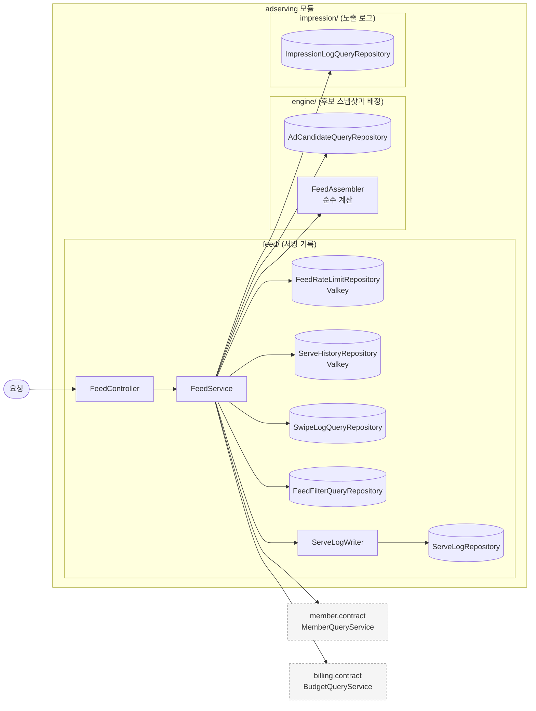
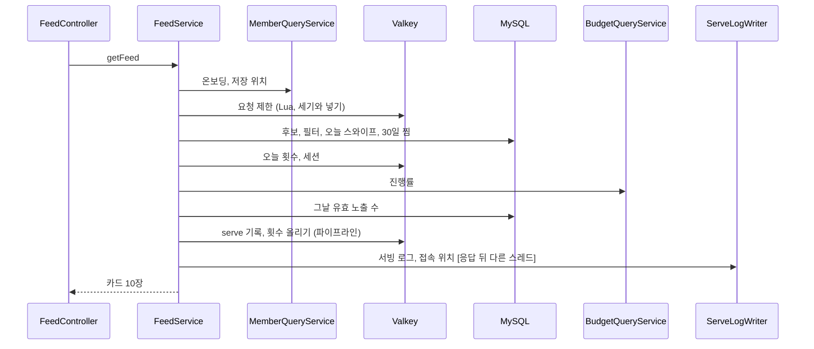

# adserving 구조와 동작 설계

목차와 쓰는 규칙은 [구조와 동작 설계 가이드](../구조와_동작_설계_가이드.md)를 따른다. 엔드포인트마다의 처리와
성능 목표는 [`feed-api-design.md`](./feed-api-design.md)가 갖는다.

지금은 `GET /v1/feed`(#236)가 지나는 경로만 훑었다. 스와이프, 노출, 찜, 필터, 진단, 00:00 후보 적재는
그 기능을 만드는 이슈가 이 문서를 채운다. 훑지 않은 자리는 "아직 훑지 않았다" 로 둔다.

## 1. 범위

| 맡는 기능 | 근거 |
|---|---|
| 그날 후보 스냅샷에서 피드 카드 10장 배정 | 요구사항 67, 96, 97, 99행. [`feed-api-design.md`](./feed-api-design.md) |
| 같은 캠페인을 한 사용자에게 하루 2회, 세션 1회까지만 내려주기 | 비즈니스 규칙의 공정성 절 |
| 사용자별 피드 요청 제한(최근 60초 6회) | 67행. [`feed-api-spec.md`](../../api-spec/feed-api-spec.md) |
| serve 기록, 서빙 로그, 그날 첫 요청 위치 | 67행, 100행 |

| 맡지 않는 것 | 소유 도메인 |
|---|---|
| 예산 소진 진행률, 그날 예약액, 단가 | billing. `BudgetQueryService` 로 읽기만 한다 |
| 온보딩 여부, 성별, 연령대, 저장 위치 | member. `MemberQueryService` 로 읽기만 한다 |
| 잔여 쿠폰 수량 | coupon. 피드는 싣지 않는다 |

## 2. 애그리거트와 패키지

| 애그리거트 | 테이블 | 지키는 규칙 | 나눈 근거 |
|---|---|---|---|
| 후보 스냅샷과 배정 계산 (`engine/`) | `ad_candidate` | 서빙 경로는 이 테이블만 읽는다 | 매일 00:00 다시 적재해 변경 주기가 다르다 |
| 서빙 기록 (`feed/`) | `serve_log`, `swipe_log`, `feed_visit_daily` | 카드 한 장에 serve 기록 하나 | 피드 요청마다 쌓인다 |
| 노출 로그 (`impression/`) | `impression_log` | 아직 훑지 않았다 | 설계 문서 1.3 |
| 찜 목록 (`wishlist/`) | `wishlist` | 아직 훑지 않았다 | 설계 문서 1.3 |

```
adserving/
├── config/AdservingSecurityConfig.java
├── engine/
│   ├── FeedAssembler.java                     순수 계산. 자격, 예산, 탐색 반경, 슬롯
│   └── repository/AdCandidateQueryRepository.java
├── feed/
│   ├── ServeRecord.java, UuidV7.java
│   ├── controller/FeedController.java
│   ├── service/FeedService.java, ServeLogWriter.java
│   └── repository/  FeedRateLimitRepository(Valkey), ServeHistoryRepository(Valkey),
│                    ServeLogRepository, SwipeLogQueryRepository, FeedFilterQueryRepository
└── impression/repository/ImpressionLogQueryRepository.java
```

- 피드가 읽는 테이블(`ad_candidate`, `swipe_log`, `feed_filter`, `impression_log`)은 아직 엔티티가 없다.
  쓰는 기능의 이슈가 엔티티를 만들기 전까지 읽기는 `JdbcTemplate` 로 한다. 엔티티가 생기면 그 저장소로 옮긴다.
- 애그리거트끼리는 캠페인 ID 로만 잇는다.
- 입구는 지금 요청 하나(`GET /v1/feed`)다. 스케줄(00:00 후보 적재), 이벤트(캠페인 상태 변경),
  다른 도메인의 호출(`WishlistQueryService`, `CandidateStateUpdater`)은 아직 훑지 않았다.

## 3. 저장

| 적을 것 | 정한 것 |
|---|---|
| 그날 첫 요청 위치 | `feed_visit_daily` PK `(business_date, member_id)` 와 `INSERT IGNORE` 로 하루 한 건만 남긴다 |
| 서빙 로그 | 피드 한 번의 카드를 한 번에 넣는다(`batchUpdate`) |
| 그날 유효 노출 수 | 피드 요청마다 `impression_log` 에서 후보 캠페인만 센다. 카운터를 두지 않는다 |
| 후보 조회 | 반경 5000m 사각 범위로 한 번 읽고 원과 탐색 반경은 메모리에서 거른다 |

| 데이터 | 키 | 만료 | 원본 | 읽는 곳 |
|---|---|---|---|---|
| 피드 요청 시각 | `feedRateLimit:{memberId}` 정렬 집합 | 60초 | 없음. 잃으면 그 창의 제한이 풀린다 | `FeedService` |
| serve 기록 | `serve:{serveId}` 해시 | 30분 | `serve_log`(응답 뒤 비동기) | 노출 수집(아직 없다) |
| 오늘 캠페인마다 내려준 횟수 | `feedServed:{영업일}:{memberId}` 해시 | 2일 | `serve_log` | `FeedService` |
| 이번 세션에 내려준 캠페인 | `feedSession:{memberId}` 집합 | 마지막 피드 요청에서 30분 | `serve_log` | `FeedService` |

**결정: 하루와 세션 횟수를 어디서 세나** (#236 임시 결정)

| 선택지 | 장점 | 단점 |
|---|---|---|
| A. `serve_log` 를 센다 | 원본이라 틀리지 않는다 | 응답 뒤에 비동기로 쓰여 바로 다음 요청에서 보이지 않을 수 있다. 요청마다 DB 읽기가 하나 는다 |
| B. Valkey 에 센다 | 바로 다음 요청에서 보인다 | Valkey 가 멈추면 세지 못해 통과시킨다 |

B 를 고른다. 같은 사용자의 다음 요청이 몇 초 안에 오므로 A 는 상한을 지키지 못한다. 세션은 마지막 피드
요청에서 30분으로 본다. 스와이프와 노출도 활동으로 세기로 하면 그 기능이 세션 키의 만료를 늘린다.

## 4. 계산 로직

`engine/FeedAssembler` 가 맡는다. 현재 시각과 사용자 정보는 `FeedService` 가 구해 넘긴다.

| 단계 | 규칙 | 근거 |
|---|---|---|
| 자격 | 사용자가 캠페인의 노출 반경(`target_radius`) 안이고, 대상 성별(`ALL` 이거나 같음)과 연령대가 맞고, 업종 필터에 들고, 제외 캠페인이 아니다 | 96행. 노출 반경은 #236 결정 |
| 제외 캠페인 | 오늘 `swipe_log` 에 있는 캠페인, 오늘 2회 받은 캠페인, 이번 세션에 받은 캠페인 | 102행, 공정성 절. `swipe_log` 만 보는 것은 #236 결정 |
| 예산 | 예산 계획이 없거나, 진행률이 1.2 를 넘거나, 그날 유효 노출이 `예약액 x 105 / (단가 x 100)` 에 닿으면 뺀다 | 99행 |
| 탐색 반경 | 1000, 2000, 3000, 5000 순으로 넓힌다. 안의 후보가 10장 이상이면 멈추고, 5000 에서도 모자라면 있는 만큼 쓴다 | 67행. 10장 기준은 #236 결정 |
| 배분 3장 | 진행률 오름차순, 같으면 `campaign_created_at` 오름차순, 그다음 캠페인 ID | 97행. 동률 순서는 #236 임시 결정 |
| 관련성 7장 | 나머지에서 점수 상위 7장을 고르고, 그 7장의 순서만 정렬(거리순, 할인순)로 바꾼다 | 70행. 정렬의 뜻은 #236 결정 |
| 위치 | 배분을 1, 4, 7번에 두고 나머지를 관련성으로 채운다. 한쪽이 모자라면 다른 쪽으로 채워 앞으로 당긴다 | #236 임시 결정. 응답에 위치 번호가 없어 빈 위치를 나타낼 수 없다 |

관련성 점수는 `0.45 x 거리 + 0.35 x 선호도 + 0.20 x 할인` 이다(#236 결정).

| 항목 | 0~1 로 맞추는 식 |
|---|---|
| 거리 | `1 - 거리 / 탐색 반경` |
| 선호도 | 오늘까지 30일 동안 찜한 수 가운데 그 업종의 비율. 찜이 없으면 0 |
| 할인 | 할인율이면 `값 / 100`. 금액이면 `값 / 10,000` 을 1 에서 자른다 |

신규 우선 노출(`new_priority_until`)은 규칙이 없어 쓰지 않는다. 지금 적재되는 값도 늘 `NULL` 이다.

## 5. 모듈 연결

| 방향 | 대상 도메인 | 인터페이스 | 시점 |
|---|---|---|---|
| 읽기 | member | `MemberQueryService.findById` | 피드 요청마다 1번 |
| 읽기 | billing | `BudgetQueryService.getProgress` | 서빙 시간대의 피드 요청마다. 후보가 5000개를 넘으면 나눠 부른다 |

- 두 호출 모두 캐시를 두지 않는다. 온보딩과 진행률은 요청 사이에 바뀔 수 있다.
- 공개 인터페이스(`WishlistQueryService`, `CandidateStateUpdater`)는 아직 훑지 않았다.

## 6. 구조와 동작 그림

### 모듈 구조



`feed/` 의 service 가 `engine/` 과 `impression/` 의 저장소를 읽는다. 반대 방향은 없다.

### 상태 변경

해당 없음. 피드 경로는 상태를 바꾸지 않는다. 후보 상태(`campaign_state`)는 00:00 적재와 캠페인 통보가
바꾸고, 그 경로는 아직 훑지 않았다.

### 주요 흐름



| 실패 지점 | 남는 상태 | 다시 요청하면 |
|---|---|---|
| 요청 제한 뒤, 응답 전 오류(5xx) | 요청이 횟수에 들어간다 | 창 안의 남은 횟수로 다시 받는다 |
| serve 기록 쓰기 | 카드는 나갔는데 serve 기록이 없다 | 그 카드의 노출은 `EXPIRED_OR_UNKNOWN` 이 된다(9장) |
| 서빙 로그 쓰기 | 응답은 나갔고 `serve_log` 행이 없다 | 진단이 "기록 없음" 을 보인다 |

## 7. 트랜잭션과 동시성

| 흐름 | 한 트랜잭션에 묶는 것 | 트랜잭션 밖 |
|---|---|---|
| 피드 조회 | 없다. 읽기만 한다 | Valkey 쓰기, 서빙 로그 쓰기 |
| 서빙 로그 쓰기 | 없다. `serve_log` 일괄 삽입과 `feed_visit_daily` 삽입을 따로 커밋한다 | |

**결정: 서빙 로그를 어떻게 미루나** (#236 결정)

| 선택지 | 장점 | 단점 |
|---|---|---|
| A. 유한 대기열의 별도 실행기, 차면 버린다 | DB 가 느려도 피드 응답이 늦어지지 않는다 | 대기열이 차거나 프로세스가 죽으면 빠진다 |
| B. 유한 대기열, 차면 호출 스레드가 쓴다 | 덜 빠진다 | DB 가 느려지면 피드 응답이 늦어진다 |

A 를 고른다. 서빙 로그는 판정과 과금에 쓰이지 않는다(100행). 대기열은 피드 1,000회분(카드 10,000장),
스레드는 2개로 잠정이다. 실행기는 빈으로 등록하지 않고 `ServeLogWriter` 안에 둔다. `Executor` 빈이 생기면
스프링 부트의 기본 실행기가 꺼진다. 내려갈 때는 10초까지 남은 일을 마저 쓴다.

| 상황 | 확인할 것 | 정한 것 |
|---|---|---|
| 같은 요청이 다시 옴 | 멱등 키 | 해당 없음. 피드는 요청마다 새 묶음이다 |
| 같은 회원의 요청이 동시에 옴 | 회원 단위 상한 | 요청 제한은 Lua 한 번에 세고 넣어 함께 일곱째로 통과하지 않는다. 하루와 세션 횟수는 읽고 쓰는 사이가 원자적이지 않아 동시 요청 둘이 같은 캠페인을 함께 받을 수 있다. 요청 제한이 그 폭을 1분에 6회로 묶는다 |
| 여러 회원이 같은 자원에 씀 | 수량, 잔액 | 해당 없음. 피드는 수량과 잔액을 바꾸지 않는다 |
| 이벤트가 늦거나 순서가 바뀜 | 늦은 이벤트 | 해당 없음 |

영업일은 `FeedService` 가 `Clock`(Asia/Seoul)으로 정한다. 서빙 시간대는 10:00 이상 13:00 미만이다.

## 8. 외부 API

해당 없음.

## 9. 실패 처리

| 흐름 | 불리하게 남는 경우 | 누구에게 | 막는 방법 |
|---|---|---|---|
| 피드 조회 | Valkey 가 멈춰 serve 기록을 못 쓴 채 카드가 나간다. 그 카드의 노출은 무효가 되어 차감되지 않는다 | 플랫폼(노출을 공짜로 준다). 점주는 손해가 없다 | 통과시킨 횟수를 `adserving_feed_cache_bypass_total{operation="history_write"}` 로 센다 |
| 피드 조회 | Valkey 가 멈춰 하루 2회 상한을 세지 못한다 | 사용자(같은 광고를 더 본다) | `operation="history_read"` 로 센다 |

## 10. 배치

아직 훑지 않았다. 00:00 후보 적재(`LoadDailyCandidateJob`)는 그 이슈가 채운다.

## 11. 성능

| 적을 것 | 피드 조회 |
|---|---|
| 요청 하나의 비용 | DB 읽기 최대 6(후보, 필터 둘, 스와이프 둘, 노출 수), 다른 도메인 호출 2, Valkey 호출 4(제한, 횟수, 세션, 파이프라인 쓰기). 응답 뒤 DB 쓰기 2 |
| 처리량 계산 | 목표 500 TPS x 응답 뒤 쓰기 2 = 초당 1,000번의 쓰기 문장, 행으로는 초당 약 5,500행 |
| 확인 방법 | k6 로 10:00~12:59 를 재현한다. 서빙 로그 대기열이 차는지는 `adserving_serve_log_dropped_total` 로 본다 |

아직 재지 않았다. 스레드 2개가 초당 500회의 일괄 삽입을 따라가는지가 처음 볼 자리다.

## 12. 테스트와 미정 사항

| 미정 항목 | 어디까지 정해졌나 | 막는 것 |
|---|---|---|
| 서빙 로그 실행기 크기 | 스레드 2, 대기열 1,000 잠정 | 부하 시험 전에는 유실률 목표(0.1% 미만)를 지키는지 모른다 |
| 신규 우선 노출 | 컬럼만 있고 규칙이 없다 | 배분 슬롯의 동률 순서 |
| 가게 상세 찜과 찜 삭제의 당일 제외 | 오늘 `swipe_log` 만 본다 | 그 API 의 이슈가 당일 이력에 더해야 그날 피드에서 빠진다 |
| 세션 활동의 범위 | 피드 요청만 활동으로 센다 | 스와이프와 노출이 세션을 늘리는지 |
