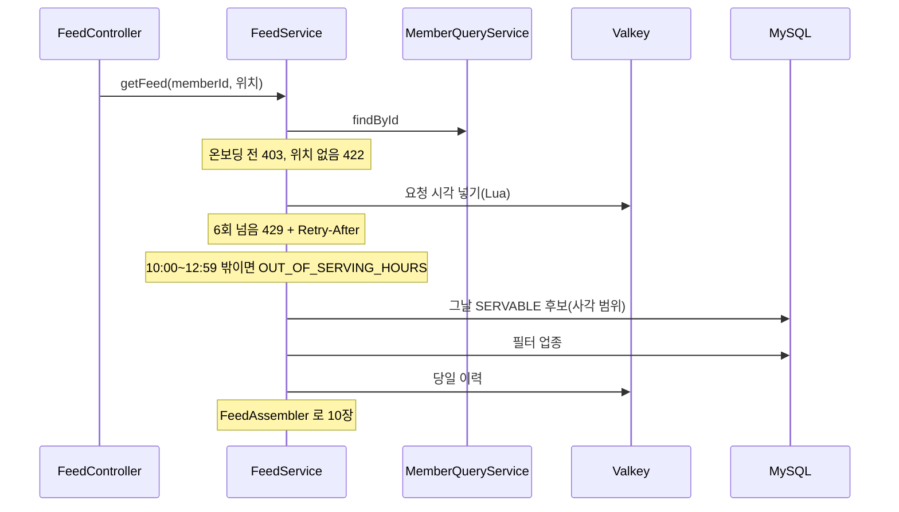

# adserving 구조와 동작 설계

광고 서빙 도메인의 구조와 동작을 적는다. 엔드포인트마다의 처리와 성능 목표는
[`feed-api-design.md`](./feed-api-design.md) 가 갖는다. 지금은 `GET /v1/feed` 의 후보 선별(#236)까지 훑었다.
배정 규칙과 서빙 기록(#307), 나머지 엔드포인트는 그 이슈가 이 문서를 채운다.

## 1. 범위

| 맡는 것 | 근거 |
|---|---|
| 그날 후보 스냅샷에서 사용자에게 카드 10장을 고른다 | FR-064, FR-093 |
| 사용자마다 최근 60초 6회로 피드 요청을 막는다 | FR-064, 명세의 요청 제한 |
| 찜과 패스로 그날 피드에서 뺄 캠페인을 기억한다 | FR-099 (9), BR-040 |

| 맡지 않는 것 | 소유 |
|---|---|
| 온보딩 완료 여부, 저장 위치, 성별, 연령대 | member. `MemberQueryService` 로 읽는다 |
| 예산 소진 진행률과 그날 단가 | billing. `BudgetQueryService` 로 읽는다(#307) |
| 잔여 수량 | coupon. 피드에 싣지 않는다(`feed-api-design.md`) |

## 2. 애그리거트와 패키지

| 애그리거트 | 테이블 | 지키는 규칙 | 나눈 근거 |
|---|---|---|---|
| 후보 스냅샷(`engine`) | `ad_candidate` | 서빙은 그날 행만 읽는다 | 00:00 에 통째로 다시 만들어 변경 주기가 다르다 |
| 피드(`feed`) | `feed_filter_category`(읽기만) | 필터 업종이 비면 전 업종이다 | 아키텍처 1.3 의 `feed` 서브 도메인 |

```
adserving/
├── config/AdservingSecurityConfig.java
├── engine/
│   ├── FeedAssembler.java        카드 고르기. 계층 밖의 순수 계산
│   ├── FeedCandidate.java        계산이 받는 후보 record
│   ├── entity/AdCandidate.java
│   └── repository/AdCandidateRepository.java
└── feed/
    ├── UuidV7.java
    ├── controller/FeedController.java
    ├── service/FeedService.java
    ├── repository/FeedRateLimitRepository.java     Valkey
    ├── repository/DailyExclusionRepository.java    Valkey
    ├── repository/FeedFilterCategoryRepository.java
    └── entity/FeedFilterCategory.java
```

- `feed` 는 `engine` 의 후보를 엔티티가 아니라 `FeedCandidate` 로 넘겨받아 계산한다.
- 입구는 HTTP 요청 하나다. 스케줄, 이벤트, 다른 도메인의 호출은 아직 없다.

## 3. 저장

| 적을 것 | 결정 |
|---|---|
| 후보 조회 | 최대 탐색 반경(5000m)을 덮는 사각 범위로 `idx_candidate_geo` 를 타고 한 번 읽는다. 상태(`SERVABLE`)와 소진(`sold_out_at IS NULL`)은 쿼리가, 거리와 노출 대상은 `FeedAssembler` 가 거른다 |
| 다른 도메인 데이터의 사본 | `ad_candidate` 는 00:00 의 캠페인과 가게 사본이다. 그날 안에서는 캠페인과 쿠폰의 통보로만 바뀐다 |

| 데이터 | 키 | 만료 | 원본 | 읽는 곳 |
|---|---|---|---|---|
| 피드 요청 시각 | `adserving:feedRequests:{memberId}` 정렬 집합. 점수가 요청 시각(ms) | 마지막 요청 뒤 60초 | 없다. 잃으면 그 60초의 횟수가 비워진다 | `FeedRateLimitRepository` |
| 당일 이력 | `adserving:dailyExclusion:{영업일}:{memberId}` 집합. 원소가 `campaignId` | 쓰는 쪽이 다음 영업일 00:00 이후로 건다 | 없다. 잃으면 그날 넘긴 카드가 다시 보인다 | `DailyExclusionRepository` |

**결정: 당일 이력을 어디에 두나** (#236 에서 정했다)

| 선택지 | 장점 | 단점 |
|---|---|---|
| A. `swipe_log` 당일분과 `wishlist` 로 읽는다 | 새 저장소가 없다 | 가게 상세에서 찜했다가 지운 캠페인은 스와이프가 없어 그날 다시 나온다. 명세의 "지운 캠페인은 그날 피드에 다시 나오지 않는다" 를 어긴다 |
| B. Valkey 에 사용자별 당일 집합을 둔다 | 명세를 다 지킨다 | 원본이 없어 캐시를 잃으면 그날 이력이 빠진다 |

B 를 고른다. 빠질 때 잃는 것이 이미 넘긴 카드가 다시 보이는 것뿐이고 과금과 권한은 바뀌지 않는다.
이 문서의 "원본은 MySQL" 규칙에서 벗어난다. 쓰는 쪽(스와이프와 찜 API)은 아직 없다.

## 4. 계산 로직

`FeedAssembler.assemble` 이 그날 후보에서 카드를 고른다. 현재 시각과 위치는 `FeedService` 가 넘긴다.

1. 당일 이력, 필터 업종, 노출 대상 성별과 연령대, 캠페인 노출 반경(`target_radius`)으로 거른다
2. 거리 오름차순, 같으면 `campaignId` 오름차순으로 줄 세운다
3. 탐색 반경 1000, 2000, 3000, 5000 가운데 10장이 모이는 가장 좁은 반경에서 10장을 자른다.
   5000 에서도 모자라면 있는 만큼이다. **임시**: 명세의 "후보가 모자라면" 을 10장 미만으로 읽었다(#236)

배분과 관련성 슬롯, 예산과 노출 상한, 하루 2회와 세션 1회는 #307 이 이 계산에 더한다.

## 5. 모듈 연결

| 방향 | 대상 도메인 | 인터페이스 | 시점 |
|---|---|---|---|
| 읽기 | member | `MemberQueryService.findById` | 피드 요청마다 1번 |

## 6. 구조와 동작 그림



상태 변경이 없는 읽기 흐름이라 상태 그림은 해당 없음이다.

## 7. 트랜잭션과 동시성

| 흐름 | 한 트랜잭션에 묶는 것 | 트랜잭션 밖 |
|---|---|---|
| 피드 조회 | 없다. 읽기 둘이 각자 끝난다 | Valkey 호출 |

| 상황 | 확인한 것 |
|---|---|
| 같은 회원의 요청이 동시에 옴 | 세기와 넣기를 한 Lua 스크립트로 처리해 두 요청이 같은 수를 읽고 함께 들어오지 않는다 |
| 같은 요청이 다시 옴 | 읽기라 멱등 키가 없다. 다시 오면 횟수에 한 번 더 들어간다 |
| 여러 회원이 같은 자원에 씀 | 해당 없음 |
| 이벤트가 늦거나 순서가 바뀜 | 해당 없음 |

- 영업일과 서빙 시간대는 `FeedService` 가 `Clock`(Asia/Seoul)으로 판단한다. 13:00 은 시간대 밖이다.
- 요청 제한의 지금 시각은 Valkey 의 `TIME` 이 아니라 앱의 `Clock` 이다. 서버끼리 시계가 어긋나면 그만큼 창이 밀린다.

## 8. 외부 API

해당 없음.

## 9. 실패 처리

돈이 걸린 경로가 아직 없어 해당 없음. 대상이 멈췄을 때의 처리는 [`adserving_장애_처리_설계.md`](./adserving_장애_처리_설계.md) 에 있다.

## 10. 배치

아직 훑지 않았다. `ad_candidate` 를 만드는 00:00 적재 작업이 이 도메인의 것이다.

## 11. 성능

| 적을 것 | 피드 조회 |
|---|---|
| 요청 하나의 비용 | DB 읽기 2, 다른 도메인 호출 1(회원 조회, 그 안의 DB 읽기), Valkey 호출 2 |
| 처리량 계산 | 목표 500 TPS x DB 읽기 3 = 초당 1,500 읽기. 쓰기는 없다 |
| 확인 방법 | 아직 없다. k6 시나리오는 #307 뒤에 돌린다 |

## 12. 테스트와 미정 사항

| 미정 항목 | 어디까지 정해졌나 | 막는 것 |
|---|---|---|
| 탐색 반경을 넓히는 기준 | 10장 미만으로 임시로 정했다 | 없다. 기준이 정해지면 `FeedAssembler` 한 곳을 바꾼다 |
| 당일 이력에 쓰는 쪽 | 키 모양과 만료만 정했다 | 스와이프와 찜 삭제 API 가 쓰기 전까지 당일 이력은 늘 비어 있다 |
