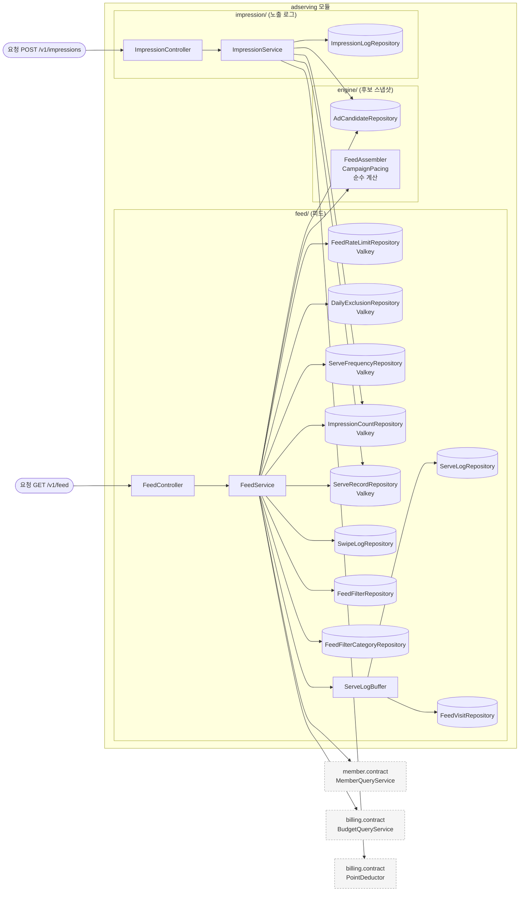
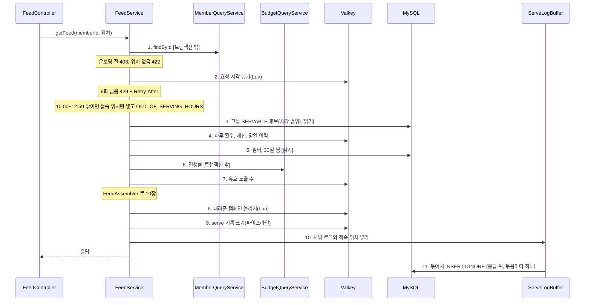
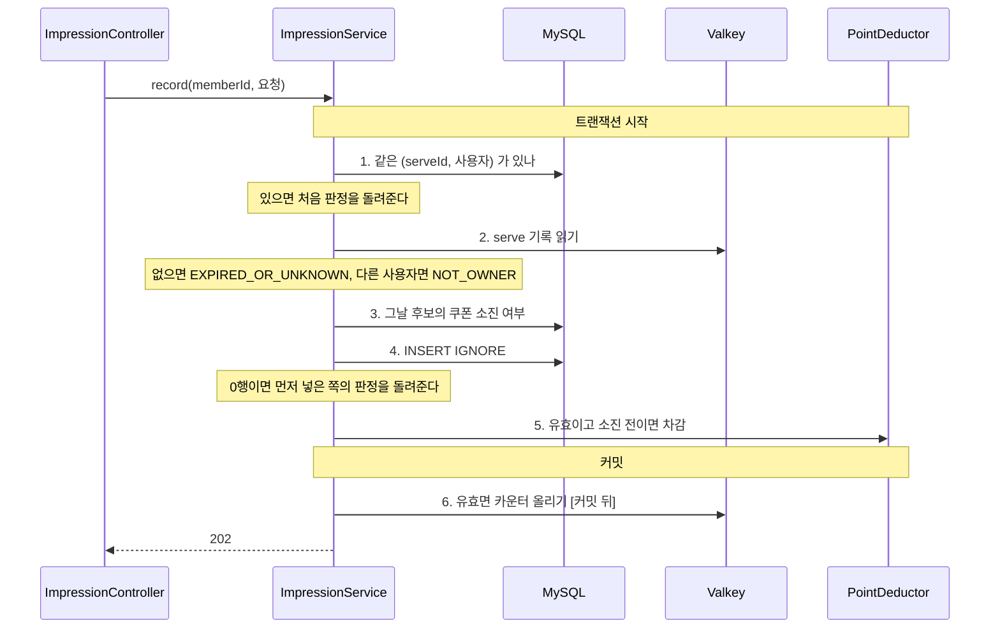

# adserving 구조와 동작 설계

광고 서빙 도메인의 구조와 동작을 적는다. 엔드포인트마다의 처리와 성능 목표는
[`feed-api-design.md`](./feed-api-design.md) 가 갖는다. 지금은 `GET /v1/feed` 의 후보 선별(#236), 배정 규칙(#307), serve 기록과 서빙 로그(#315), `POST /v1/impressions`(#323)까지 훑었다.
나머지 엔드포인트는 그 이슈가 이 문서를 채운다.

## 1. 범위

| 맡는 것 | 근거 |
|---|---|
| 그날 후보 스냅샷에서 사용자에게 카드 10장을 고른다 | FR-064, FR-093 |
| 배분 3장과 관련성 7장으로 배치하고 예산을 넘긴 캠페인을 뺀다 | FR-093, FR-094, FR-096 |
| 같은 캠페인을 하루 2회, 한 세션 1회까지만 내려준다 | 비즈니스 규칙(`feed-api-design.md` 4단계) |
| 사용자마다 최근 60초 6회로 피드 요청을 막는다 | FR-064, 명세의 요청 제한 |
| 찜과 패스로 그날 피드에서 뺄 캠페인을 기억한다 | FR-099 (9), BR-040 |
| 카드마다 serve 기록을 남겨 노출 검증에 쓰게 한다 | FR-097 |
| 서빙 로그와 그날 첫 접속 위치를 응답 뒤에 쓴다 | FR-027, FR-042, FR-064 |
| 카드가 보인 순간을 받아 유효와 무효를 가르고, 유효 노출을 정산에 넘겨 차감한다 | FR-066, FR-097, FR-100 |

| 맡지 않는 것 | 소유 |
|---|---|
| 온보딩 완료 여부, 저장 위치, 성별, 연령대 | member. `MemberQueryService` 로 읽는다 |
| 예산 소진 진행률, 그날 예약액과 단가 | billing. `BudgetQueryService` 로 읽는다 |
| 노출 과금 판정(`BILLED`, `NOT_BILLED_BUDGET`) | billing. 상한을 넘겨 나간 노출도 과금은 정산이 막는다 |
| 잔여 수량 | coupon. 피드에 싣지 않는다(`feed-api-design.md`) |

## 2. 애그리거트와 패키지

| 애그리거트 | 테이블 | 지키는 규칙 | 나눈 근거 |
|---|---|---|---|
| 후보 스냅샷(`engine`) | `ad_candidate` | 서빙은 그날 행만 읽는다 | 00:00 에 통째로 다시 만들어 변경 주기가 다르다 |
| 피드(`feed`) | `feed_filter`, `feed_filter_category`, `swipe_log`(읽기만), `serve_log`, `feed_visit_daily`(쓰기만) | 필터가 없으면 전 업종, 거리순이다. 그날 첫 접속 위치만 남는다 | 아키텍처 1.3 의 `feed` 서브 도메인 |
| 노출 로그(`impression`) | `impression_log` | (serveId, 사용자)마다 1건이다. 무효면 사유가 있고 유효면 없다 | 노출 저장이 정산의 판정, 원장과 한 트랜잭션이라 서빙과 따로 바뀐다 |

```
adserving/
├── config/AdservingSecurityConfig.java
├── engine/
│   ├── FeedAssembler.java        카드 고르기와 슬롯 배치. 계층 밖의 순수 계산
│   ├── FeedCandidate.java        계산이 받는 후보 record
│   ├── FeedContext.java          계산이 받는 사용자와 예산 record
│   ├── CampaignPacing.java       진행률과 노출 상한 판정
│   ├── entity/AdCandidate.java
│   └── repository/AdCandidateRepository.java
└── feed/
    ├── controller/FeedController.java
    ├── service/FeedService.java
    ├── service/ServeLogBuffer.java                  서빙 로그 대기열과 작업자
    ├── repository/FeedRateLimitRepository.java      Valkey
    ├── repository/DailyExclusionRepository.java     Valkey
    ├── repository/ServeFrequencyRepository.java     Valkey
    ├── repository/ImpressionCountRepository.java    Valkey
    ├── repository/ServeRecordRepository.java        Valkey
    ├── repository/ServeLogRepository.java           JDBC 배치
    ├── repository/FeedVisitRepository.java          JDBC 배치
    ├── repository/SwipeLogRepository.java
    ├── repository/FeedFilterRepository.java
    ├── repository/FeedFilterCategoryRepository.java
    └── ServeRecord.java                             serve 기록 record. 노출이 읽는다
impression/
    ├── controller/ImpressionController.java
    ├── service/ImpressionService.java
    ├── repository/ImpressionLogRepository.java      읽기는 JPA, 쓰기는 INSERT IGNORE
    └── entity/ImpressionLog.java
```

- `feed` 는 `engine` 의 후보를 엔티티가 아니라 `FeedCandidate` 로, 나머지 입력을 `FeedContext` 로 넘겨 계산한다.
- 애그리거트끼리는 객체로 쥐지 않고 ID 로만 잇는다. `serve_log`, `swipe_log` 는 `campaign_id` 로 후보를 가리키고 연관 매핑이 없다.
- `impression` 은 `feed` 의 serve 기록과 유효 노출 수 카운터, `engine` 의 후보 소진 여부를 읽는다. 반대 방향은 없다.
- 입구는 HTTP 요청 둘(`GET /v1/feed`, `POST /v1/impressions`)이다. 스케줄, 이벤트, 다른 도메인의 호출은 아직 없다.

### 규칙을 두는 곳

| 규칙 | 두는 곳 |
|---|---|
| 엔티티 하나의 상태로 판정되는 규칙 | 무효 노출은 사유가 있고 유효 노출은 없다. `ImpressionLog` 의 정적 팩터리 셋(`valid`, `notOwner`, `unknown`)이 지킨다. 스키마가 CHECK 로 막지 않는다 |
| 후보 조건, 하루 2회와 세션 1회, 탐색 반경, 배분과 관련성 슬롯, 관련성 점수 | `FeedAssembler`(순수 계산) |
| 진행률 1.2 초과와 노출 상한 판정 | `CampaignPacing.blocked()`(순수 계산) |
| 온보딩, 위치, 요청 제한, 서빙 시간대의 순서, 입력을 모으는 순서, 기록을 남기는 시점 | `FeedService` |
| 서빙 로그를 묶어 쓰고 차면 버리는 규칙 | `ServeLogBuffer` |
| 노출의 유효 판정, 같은 노출이 다시 올 때의 처리, 차감과 카운터의 시점 | `ImpressionService` |

`ServeLogBuffer` 를 `FeedService` 와 나눈 것은 입구가 달라서다. 앞은 요청 스레드가, 뒤는 작업자 스레드가 부른다.

## 3. 저장

| 적을 것 | 결정 |
|---|---|
| 후보 조회 | 최대 탐색 반경(5000m)을 덮는 사각 범위로 `idx_candidate_geo` 를 타고 한 번 읽는다. 상태(`SERVABLE`)와 소진(`sold_out_at IS NULL`)은 쿼리가, 나머지는 `FeedAssembler` 가 거른다 |
| 업종 선호도 | `idx_swipe_member_date` 로 최근 30일의 찜을 업종별로 센다. 요청마다 읽는다 |
| 다른 도메인 데이터의 사본 | `ad_candidate` 는 00:00 의 캠페인과 가게 사본이다. 그날 안에서는 캠페인과 쿠폰의 통보로만 바뀐다 |
| 집계를 세는 방식 | 그날 유효 노출 수는 `impression_log` 를 세지 않고 카운터를 읽는다. 틀리면 `impression_log` 에서 다시 센다 |
| DB 제약으로 막을 것과 코드로 막을 것 | 같은 카드가 `serve_log` 에 두 번 들어가는 것은 PK(`serve_id`)와 `INSERT IGNORE` 로, 같은 날 두 번째 접속 위치는 PK(`business_date`, `member_id`)와 `INSERT IGNORE` 로 막는다. 같은 노출의 두 번째 저장은 `impression_log` 의 PK(`serve_id`, `member_id`)와 `INSERT IGNORE` 로 막고, 넣은 행 수로 처음 저장인지 가른다. 먼저 읽어 보는 것은 다시 온 요청을 빨리 돌려보내려는 것이고 동시 요청은 PK 가 막는다 |
| 이력 | 해당 없음. 상태가 바뀌는 엔티티가 없다. `serve_log`, `feed_visit_daily`, `impression_log` 는 쌓기만 하고 고치지 않는다 |

| 데이터 | 키 | 만료 | 원본 | 읽는 곳 |
|---|---|---|---|---|
| 피드 요청 시각 | `adserving:feedRequests:{memberId}` 정렬 집합. 점수가 요청 시각(ms) | 마지막 요청 뒤 60초 | 없다. 잃으면 그 60초의 횟수가 비워진다 | `FeedRateLimitRepository` |
| 당일 이력 | `adserving:dailyExclusion:{영업일}:{memberId}` 집합. 원소가 `campaignId` | 쓰는 쪽이 다음 영업일 00:00 이후로 건다 | 없다. 잃으면 그날 넘긴 카드가 다시 보인다 | `DailyExclusionRepository` |
| 하루 내려준 횟수 | `adserving:servedDaily:{영업일}:{memberId}` 해시. 필드 `campaignId`, 값 횟수 | 다음 영업일 00:00 까지 남은 시간 | 없다. 잃으면 그날 같은 카드가 더 나온다 | `ServeFrequencyRepository` |
| 세션에 내려준 캠페인 | `adserving:servedSession:{memberId}` 집합 | 피드 요청마다 30분을 다시 건다 | 없다. 키가 사라지면 새 세션이다 | `ServeFrequencyRepository` |
| 그날 유효 노출 수 | `adserving:validImpressions:{영업일}` 해시. 필드 `campaignId`, 값 건수. 영업일은 카드를 내려준 날이다 | 올릴 때마다 이틀 | `impression_log` 의 유효 노출 | `ImpressionCountRepository`. 올리는 쪽은 `ImpressionService` 다 |
| serve 기록 | `adserving:serve:{serveId}` 문자열. 회원:캠페인:가게:슬롯:자리:내려준 시각(ms) | 30분 | 없다. `serve_log` 는 판정에 쓰지 않는다. 잃으면 그동안의 노출이 무효다 | `ServeRecordRepository`, `ImpressionService` |

**결정: 당일 이력을 어디에 두나** (#236 에서 정했다)

| 선택지 | 장점 | 단점 |
|---|---|---|
| A. `swipe_log` 당일분과 `wishlist` 로 읽는다 | 새 저장소가 없다 | 가게 상세에서 찜했다가 지운 캠페인은 스와이프가 없어 그날 다시 나온다. 명세의 "지운 캠페인은 그날 피드에 다시 나오지 않는다" 를 어긴다 |
| B. Valkey 에 사용자별 당일 집합을 둔다 | 명세를 다 지킨다 | 원본이 없어 캐시를 잃으면 그날 이력이 빠진다 |

B 를 고른다. 빠질 때 잃는 것이 이미 넘긴 카드가 다시 보이는 것뿐이고 과금과 권한은 바뀌지 않는다.
이 문서의 "원본은 MySQL" 규칙에서 벗어난다. 쓰는 쪽(스와이프와 찜 API)은 아직 없다.

**결정: 하루 2회와 세션 1회를 어디서 세나** (#307 에서 정했다)

| 선택지 | 장점 | 단점 |
|---|---|---|
| A. `serve_log` 에서 그날 내려준 캠페인을 읽는다 | 새 저장소가 없다 | 응답 뒤 비동기로 쓰고(#315) 유실을 허용해 연달아 온 요청에서 아직 안 쓰인 기록을 못 본다. 요청마다 DB 읽기가 하나 는다 |
| B. Valkey 에 사용자별 하루 해시와 세션 집합을 둔다 | 응답 전에 올려 다음 요청이 바로 본다 | 원본이 없어 캐시를 잃으면 그날 같은 카드가 더 나온다 |

B 를 고른다. 이것도 "원본은 MySQL" 규칙에서 벗어난다. 잃을 때 같은 카드가 더 나올 뿐 과금은 바뀌지 않는다.
하루 해시의 만료는 남은 시간(`PEXPIRE`)으로 건다. 시각(`EXPIREAT`)으로 걸면 앱이 정한 영업일과 Valkey 의 시계가 어긋날 때 키가 쓰자마자 사라진다.

**결정: 그날 유효 노출 수를 어디서 읽나** (#307 에서 정했다)

| 선택지 | 장점 | 단점 |
|---|---|---|
| A. 요청마다 `impression_log` 를 `GROUP BY` 로 센다 | 원본이라 정확하다 | 500 TPS 에서 후보 수백 개의 집계가 매번 돈다 |
| B. Valkey 카운터를 읽는다 | 요청마다 `HMGET` 한 번이다 | 원본과 어긋날 수 있다. 올리는 쪽(노출 API)이 아직 없다 |

B 를 고른다. 노출 API 가 유효 노출을 처음 저장하고 커밋한 뒤에 올린다(7장).

**결정: serve 기록을 어디에 두나** (#315 에서 정했다)

| 선택지 | 장점 | 단점 |
|---|---|---|
| A. 서버마다 로컬 캐시(Caffeine) | 빠르고 외부에 기대지 않는다 | 노출 요청이 다른 서버로 가거나 배포로 서버가 내려가면 기록을 못 찾아 유효 노출이 무효가 된다 |
| B. Valkey | 서버 여러 대가 함께 본다 | Valkey 가 멈추면 그동안의 노출이 모두 무효다. 피드마다 쓰기가 한 번 는다 |

B 를 고른다. 응답 전에 피드 1회의 카드를 파이프라인 한 번으로 쓴다. 응답 뒤에 쓰면 곧바로 온 노출이 기록보다 먼저 닿는다.

## 4. 계산 로직

`FeedAssembler.assemble` 이 카드를 고른다. 현재 시각, 위치, 예산은 `FeedService` 가 구해 `FeedContext` 로 넘긴다.

1. 거른다. 당일 이력, 필터 업종, 노출 대상 성별과 연령대, 캠페인 노출 반경(`target_radius`), 하루 2회, 이번 세션
2. 예산을 읽었으면 더 거른다. 그날 예산 계획이 없거나, 진행률이 1.2 를 넘거나, 유효 노출 수가 노출 상한(예약액 / 단가 x 1.05)에 닿은 캠페인이다
3. 탐색 반경 1000, 2000, 3000, 5000 가운데 10장이 모이는 가장 좁은 반경을 고른다. 5000 에서도 모자라면 있는 만큼이다.
   **임시**: 명세의 "후보가 모자라면" 을 10장 미만으로 읽었다(#236)
4. 배분 3장: 진행률 오름차순, 같으면 `campaign_created_at`, 그다음 `campaignId` 오름차순이다
5. 관련성: 남은 후보를 점수 내림차순으로 `10 - 배분 장수` 만큼 고르고, 피드 필터 정렬로 줄 세운다.
   DISTANCE 면 거리 오름차순, DISCOUNT_RATE 면 할인 점수 내림차순이다
6. 배분을 1, 4, 7번에 두고 나머지 자리를 관련성으로 채운다. 전체가 10장보다 적으면 빈 자리 없이 앞으로 당긴다

관련성 점수는 아래다(#307 에서 정했다). 세 항목 모두 0~1 이다.

| 항목 | 가중치 | 식 |
|---|---|---|
| 거리 | 0.45 | `1 - 거리 / 이번 요청의 탐색 반경` |
| 카테고리 선호도 | 0.35 | 오늘을 넣은 최근 30일의 찜 가운데 그 업종의 비율. 찜이 없으면 0 |
| 할인 | 0.20 | 이번 후보 가운데 같은 종류(PERCENT 끼리, AMOUNT 끼리)의 최댓값으로 나눈 값. 메뉴 가격이 없어 두 종류를 직접 비교할 수 없다 |

예산을 읽지 못했으면 2 와 4 를 건너뛰고 10장 모두 관련성이다(9장).

## 5. 모듈 연결

| 방향 | 대상 도메인 | 인터페이스 | 시점 |
|---|---|---|---|
| 읽기 | member | `MemberQueryService.findById` | 피드 요청마다 1번 |
| 읽기 | billing | `BudgetQueryService.getProgress` | 서빙 시간대의 피드 요청마다 1번. 후보가 5000개를 넘으면 나눠 부른다 |
| 쓰기 | billing | `PointDeductor.deduct` | 처음 저장된 유효 노출마다 1번. 노출 저장과 같은 트랜잭션이다. 쿠폰 소진 뒤의 노출은 부르지 않는다 |

- `getProgress` 에는 그날 사각 범위의 후보 전부를 넘긴다. 그 계약은 당일 카운터만 읽어 서빙 경로에서 불러도 된다고 적었다.
- `deduct` 에 넘기는 영업일은 노출을 받은 날이 아니라 카드를 내려준 날이다(그 계약). 서빙 시간대가 10:00~12:59 라 둘이 갈리지는 않는다.
- 읽기 두 호출 모두 캐시를 두지 않는다. 회원 조회는 정지와 온보딩처럼 바로 반영돼야 하는 값이다. 진행률은 노출마다 바뀌어 캐시하면 1.2 초과 판정이 늦는다.

## 6. 구조와 동작 그림

### 모듈 구조



- `feed` 와 `impression` 에서 `engine` 으로, `impression` 에서 `feed` 로만 화살표가 간다. 반대 방향은 없다
- 스케줄, 이벤트, 다른 도메인의 호출로 들어오는 입구와 공개면(`contract`)은 아직 없다

### 상태 변경

해당 없음. 이 도메인이 쓰는 엔티티에 상태 전이가 없다. 후보의 `campaign_state` 는 캠페인의 통보로 바뀌고 그 처리는 아직 없다.

### 주요 흐름

피드 조회와 노출 수집 둘이다. 다른 도메인 호출은 같은 프로세스 안의 호출이다.

**피드 조회.** 트랜잭션은 없고 DB 읽기가 각자 끝난다.



| 실패 지점 | 남는 상태 | 다시 요청하면 |
|---|---|---|
| 1, 3, 5 | 아무것도 남지 않는다. `500` 이다. 2 를 지났으면 요청 횟수에는 들어갔다 | 새로 처리한다 |
| 2, 4, 7 | Valkey 가 멈추면 그 규칙만 빼고 계속한다. 남는 것이 없다 | 새로 처리한다 |
| 6 | 예산 규칙 없이 계속한다(9장) | 새로 처리한다 |
| 8 | 내려준 횟수가 오르지 않아 다음 요청에서 같은 카드가 더 나올 수 있다 | 새 카드가 나간다 |
| 9 | 응답은 나가지만 그 카드의 노출이 무효다 | 새 serveId 로 새 기록이 남는다 |
| 10 | 대기열이 차면 그 피드의 서빙 로그와 접속 위치가 빠진다 | 새 피드는 새로 넣는다 |
| 11 | 그 묶음의 서빙 로그와 접속 위치가 빠진다 | 해당 없음. 응답 뒤라 클라이언트는 모른다 |

**노출 수집.** 돈이 걸린 흐름이다. 노출 저장과 정산의 판정, 원장이 한 트랜잭션이다.



| 실패 지점 | 남는 상태 | 다시 요청하면 |
|---|---|---|
| 1, 3, 4 | 롤백된다. 아무것도 남지 않는다. `500` 이다 | 클라이언트가 1회 재시도하면 새로 처리한다 |
| 2 | Valkey 가 멈추면 기록 없음으로 보고 `EXPIRED_OR_UNKNOWN` 으로 저장한다 | 이미 저장돼 처음 판정(무효)을 돌려준다. Valkey 가 돌아와도 유효로 바뀌지 않는다 |
| 5 | 노출 저장까지 롤백된다. `500` 이다. 그날 예산 계획이 없으면 정산이 `IllegalStateException` 을 던진다 | 새로 처리한다. 같은 원인이면 같은 자리에서 실패한다 |
| 6 | 노출과 차감은 커밋됐고 카운터만 오르지 않는다. 상한이 그만큼 늦게 걸린다 | 이미 저장돼 처음 판정을 돌려주고 카운터는 다시 올리지 않는다 |

## 7. 트랜잭션과 동시성

| 흐름 | 한 트랜잭션에 묶는 것 | 트랜잭션 밖 |
|---|---|---|
| 피드 조회 | 없다. DB 읽기가 각자 끝난다 | Valkey 호출, 정산 조회, 서빙 로그와 접속 위치 쓰기 |
| 노출 수집 | `impression_log` 저장, 정산의 판정 기록과 원장(`PointDeductor`, `MANDATORY`) | serve 기록 읽기, 커밋 뒤의 유효 노출 수 카운터 |

**결정: 서빙 로그와 접속 위치를 무엇으로 미루나** (#315 에서 정했다)

| 선택지 | 장점 | 단점 |
|---|---|---|
| A. 요청 안에서 바로 쓴다 | 더 둘 것이 없다 | 피드 1회에 10행이라 초당 5,000행의 쓰기가 응답 지연에 들어가고, DB 쓰기가 실패하면 피드까지 실패한다 |
| B. 서버마다 크기가 정해진 대기열과 작업자 하나 | 응답이 쓰기를 기다리지 않고 묶어서 쓴다 | 프로세스가 죽거나 대기열이 차거나 쓰기가 실패하면 빠진다 |
| C. 같은 트랜잭션에 적고 폴러가 집어 올린다 | 빠지지 않는다 | 피드 조회에 쓰기 트랜잭션이 생겨 A 의 지연이 그대로 남는다 |

B 를 고른다. 서빙 로그는 판정과 과금에 쓰이지 않고 유실을 0.1% 미만까지 허용한다(`feed-api-design.md` 유실 목표).
대기열은 피드 5,000건(약 50,000행, 목표 처리량으로 10초 분량)이고 한 번에 50건(약 500행)씩 JDBC 배치 INSERT 로 쓴다.
차면 기다리지 않고 버린다. 두 값은 근거 없는 값(C)이라 부하 시험에서 바꾼다.
종료할 때는 웹 서버가 요청을 다 받은 뒤(`SmartLifecycle` 단계 0) 멈추고 남은 것을 비운다.

**결정: 유효 노출 수 카운터를 언제 올리나** (#323)

| 선택지 | 장점 | 단점 |
|---|---|---|
| A. 트랜잭션 안에서 올린다 | 코드가 단순하다 | 롤백된 노출까지 세어 상한이 이르게 걸린다. Valkey 는 롤백되지 않는다 |
| B. 커밋 뒤에 올린다 | 커밋된 노출만 센다 | 커밋과 올리기 사이에 프로세스가 죽거나 Valkey 가 멈추면 빠진다 |
| C. 같은 트랜잭션에 올릴 일을 적고 폴러가 올린다 | 빠지지 않는다 | 테이블과 폴러가 늘고 상한이 늦게 걸린다 |

B 를 고른다(트랜잭션 동기화의 `afterCommit`). 빠지면 상한이 그만큼 늦게 걸릴 뿐이고 상한을 넘긴 노출은 정산이 과금하지 않는다.
카운터가 원본과 어긋나면 `impression_log` 의 유효 노출로 다시 센다.

| 상황 | 확인한 것 |
|---|---|
| 같은 회원의 요청이 동시에 옴 | 요청 제한은 한 Lua 스크립트로 세고 넣어 함께 들어오지 않는다. 하루 횟수는 읽고 고른 뒤 올려서, 동시에 온 두 요청이 같은 캠페인을 함께 내려줄 수 있다. 같은 사용자의 동시 요청은 60초 6회 제한 안에서만 생겨 받아들였다 |
| 같은 노출이 다시 옴 | (serveId, 사용자) 가 멱등 키다. 먼저 읽어 있으면 처음 판정을 돌려준다. 동시에 두 건이 오면 `INSERT IGNORE` 가 한 건만 넣고 늦은 쪽은 0행이라 먼저 넣은 쪽의 판정을 읽어 돌려준다. 차감과 카운터는 넣은 쪽에서만 한 번 돈다. 정산도 같은 serveId 의 두 번째 차감을 첫 판정으로 돌려준다 |
| 같은 피드 요청이 다시 옴 | 멱등 키가 없다. 다시 오면 요청 횟수와 내려준 횟수에 한 번 더 들어가고 새 serveId 로 새 카드가 나간다. `serve_log` 와 `feed_visit_daily` 는 `INSERT IGNORE` 라 같은 키가 두 번 써져도 한 행이다 |
| 여러 회원이 같은 자원에 씀 | 노출 상한은 읽기만 하고 판정 시점의 수로 거른다. 여러 피드가 동시에 같은 캠페인을 내려 상한을 조금 넘길 수 있다. 넘긴 노출은 정산이 과금하지 않는다 |
| 이벤트가 늦거나 순서가 바뀜 | 해당 없음 |

- 영업일과 서빙 시간대는 `FeedService` 가 `Clock`(Asia/Seoul)으로 판단한다. 13:00 은 시간대 밖이다.
- 요청 제한의 지금 시각과 하루 해시의 남은 시간은 앱의 `Clock` 으로 정한다. 서버끼리 시계가 어긋나면 그만큼 밀린다.

## 8. 외부 API

해당 없음.

## 9. 실패 처리

| 흐름 | 불리하게 남는 경우 | 누구에게 | 막는 방법 |
|---|---|---|---|
| 정산이 멈춘 동안의 피드 | 진행률 1.2 초과와 노출 상한 제외가 빠져 예산을 넘긴 캠페인도 나간다 | 공정성(다른 점주) | 차감은 정산이 따로 막아 점주가 더 내지 않는다. `adserving_budget_unavailable_total` 로 센다 |
| 노출 수 카운터가 멈춘 동안의 피드 | 0 으로 보고 상한을 넘겨 내보낸다 | 플랫폼 | 넘긴 노출은 과금되지 않는다. `adserving_cache_bypass_total` 로 센다 |
| serve 기록을 쓰지 못한 피드 | 그 카드의 노출이 무효라 과금되지 않는다 | 플랫폼 | `adserving_cache_bypass_total`(`use=serve_record`) 로 센다 |
| serve 기록을 읽지 못한 노출 | 유효 노출이 `EXPIRED_OR_UNKNOWN` 으로 저장돼 과금되지 않는다. 다시 보내도 처음 판정이 남는다 | 플랫폼 | `adserving_cache_bypass_total`(`use=serve_record`) 로 센다 |
| 차감이 실패한 노출 | 노출까지 롤백돼 남지 않는다. 클라이언트는 1회 재시도하고 포기한다 | 플랫폼 | 노출 저장과 판정, 원장이 함께 롤백되어 점주에게 불리하게 남는 것은 없다 |
| 카운터를 올리지 못한 노출 | 상한이 늦게 걸려 미과금 노출이 더 나간다 | 플랫폼 | `adserving_cache_bypass_total`(`use=impression_count`) 로 센다 |

대상이 멈췄을 때의 처리는 [`adserving_장애_처리_설계.md`](./adserving_장애_처리_설계.md) 에 있다.

## 10. 배치

아직 훑지 않았다. `ad_candidate` 를 만드는 00:00 적재 작업이 이 도메인의 것이다.

## 11. 성능

| 적을 것 | 피드 조회 |
|---|---|
| 요청 하나의 비용 | DB 읽기 4(후보, 필터, 필터 업종, 30일 찜), 다른 도메인 호출 2(회원, 정산), Valkey 호출 7(serve 기록 10건은 파이프라인 한 번). 응답 뒤 DB 쓰기는 요청이 아니라 묶음 단위다 |
| 처리량 계산 | 목표 500 TPS x DB 읽기 4 = 초당 2,000 읽기, 회원 조회를 더하면 2,500. 응답 뒤 쓰기는 초당 `serve_log` 5,000행과 `feed_visit_daily` 500행을 50건 묶음으로 서버마다 나눠 쓴다 |
| 확인 방법 | 아직 없다. k6 시나리오(10:00~12:59, 특히 10:50~11:05)로 대기열 크기와 묶음 수도 함께 잰다 |

| 적을 것 | 노출 수집 |
|---|---|
| 요청 하나의 비용 | DB 읽기 2(중복 확인, 후보 소진), DB 쓰기 1(`impression_log`)에 정산의 판정과 원장 쓰기, 트랜잭션 1, Valkey 호출 2(serve 기록 읽기, 커밋 뒤 카운터) |
| 처리량 계산 | 목표 10,000 TPS(NFR-010) x 쓰기 트랜잭션 1 = 초당 10,000 트랜잭션. 정산의 쓰기까지 한 트랜잭션에 들어가 이 경로가 DB 쓰기의 대부분이다. 지금 구성으로 되는지는 재지 않았다 |
| 확인 방법 | 아직 없다. 피드와 같은 k6 시나리오에 노출 요청을 섞는다 |

## 12. 테스트와 미정 사항

6장에 상태 전이가 없어 7장 동시성 표의 행과 6장 주요 흐름의 실패 지점에서 시나리오를 뽑았다.

| 시나리오 | Given | When | Then | 테스트 |
|---|---|---|---|---|
| 같은 회원의 요청이 몰림 | 최근 60초에 6번 받았다 | 일곱째 요청이 온다 | `429` 와 남은 초를 올림한 `Retry-After` 를 받고, 거부된 요청은 세지 않는다 | `FeedIntegrationTest.최근_60초_안의_일곱째_요청은_429_와_남은_초를_받는다` |
| 같은 카드가 다시 나옴 | 같은 캠페인을 이번 세션에 한 번, 오늘 두 번 내려줬다 | 같은 세션과 새 세션에서 피드를 요청한다 | 두 경우 모두 그 캠페인이 나오지 않는다 | `FeedIntegrationTest.같은_캠페인은_한_세션에_한_번_하루에_두_번까지만_내려준다` |
| 같은 날 다시 접속함 | 오늘 한 번 피드를 받았다 | 다른 위치에서 다시 받는다 | `feed_visit_daily` 에는 첫 위치만 남는다 | `FeedIntegrationTest.그날_두_번째_요청의_위치는_남기지_않는다` |
| 여러 피드가 한 캠페인을 내려줌 | 그날 유효 노출 수가 노출 상한에 닿았다 | 피드를 요청한다 | 그 캠페인이 나오지 않는다 | `FeedIntegrationTest.그날_유효_노출_수가_노출_상한에_닿은_캠페인은_내려주지_않는다` |
| 정산이 멈춤(6) | `BudgetQueryService` 가 예외를 던진다 | 피드를 요청한다 | 예산 규칙 없이 `200 SERVING` 이다 | `FeedIntegrationTest.정산이_멈춰도_예산_규칙_없이_서빙을_이어간다` |
| serve 기록을 못 씀(9) | Valkey 쓰기가 실패한다 | 피드를 요청한다 | 응답은 나가고 `use=serve_record` 로 센다 | `FeedValkeyFallbackTest.serve_기록을_쓰지_못해도_예외를_올리지_않고_센다` |
| 대기열이 참(10) | 대기열에 5,000건이 있다 | 피드를 하나 더 넣는다 | 버리고 그 카드 수만큼 센다 | `ServeLogBufferTest.대기열이_차면_버리고_그_피드의_카드_수만큼_센다` |
| 묶음 쓰기가 실패함(11) | DB 쓰기가 한 번 실패한다 | 묶음 둘을 쓴다 | 첫 묶음을 버리고 세며 둘째는 쓴다 | `ServeLogBufferTest.쓰기가_실패하면_그_묶음을_버리고_세며_다음_묶음은_쓴다` |
| 서버가 내려감 | 대기열에 2건이 남았다 | 대기열을 멈춘다 | 남은 것을 모두 쓴다 | `ServeLogBufferTest.멈출_때_남은_것을_모두_쓴다` |
| 같은 노출이 다시 옴 | 유효 노출 1건이 저장됐다 | 같은 사용자가 같은 serveId 를 다시 보낸다 | 처음 판정을 돌려주고 행, 차감, 카운터가 한 번뿐이다 | `ImpressionIntegrationTest.같은_사용자가_같은_카드를_다시_보내면_처음_판정을_돌려주고_한_번만_차감하고_센다` |
| 같은 노출이 동시에 옴 | 다른 요청이 먼저 넣었다 | `INSERT IGNORE` 가 0행이다 | 먼저 넣은 쪽의 판정을 돌려주고 차감하지 않는다 | `ImpressionServiceTest.동시에_와서_먼저_넣은_쪽이_있으면_그_판정을_돌려주고_차감하지_않는다` |
| 차감이 실패함(5) | 정산이 예외를 던진다 | 유효 노출을 보낸다 | `500` 이고 노출도 카운터도 남지 않는다 | `ImpressionIntegrationTest.차감이_실패하면_노출도_저장되지_않고_카운터도_오르지_않는다` |
| 롤백됨(6) | 트랜잭션이 롤백된다 | 유효 노출을 보낸다 | 카운터를 올리지 않는다 | `ImpressionServiceTest.롤백되면_올리지_않는다` |
| 상한에 닿음 | 카운터가 상한보다 1 작다 | 유효 노출 1건 뒤 피드를 요청한다 | 그 캠페인이 피드에서 빠진다 | `ImpressionIntegrationTest.노출이_쌓여_노출_상한에_닿은_캠페인은_피드에서_빠진다` |

| 미정 항목 | 어디까지 정해졌나 | 막는 것 |
|---|---|---|
| 탐색 반경을 넓히는 기준 | 10장 미만으로 임시로 정했다 | 없다. 기준이 정해지면 `FeedAssembler` 한 곳을 바꾼다 |
| 당일 이력에 쓰는 쪽 | 키 모양과 만료만 정했다 | 스와이프와 찜 삭제 API 가 쓰기 전까지 당일 이력은 늘 비어 있다 |
| 서빙 로그 대기열의 크기와 묶음 수 | 5,000건과 50건으로 임시로 정했다 | 없다. 부하 시험 뒤 `ServeLogBuffer` 의 두 값을 바꾼다 |
| 세션을 늘리는 활동 | 피드 요청으로만 임시로 정했다 | 스와이프와 노출 요청도 세션을 늘릴지 정해야 한다. 노출 API 는 아직 늘리지 않는다 |
| 노출이 분석으로 가는 이벤트(`ImpressionServedEvent`) | 이벤트 타입이 없다 | 분석의 전환 퍼널에 노출이 빠진다 |
| 신규 우선 노출(`new_priority_until`) | 계산 규칙이 문서에 없다 | 배분 슬롯에 넣을 자리가 정해지지 않았다 |
