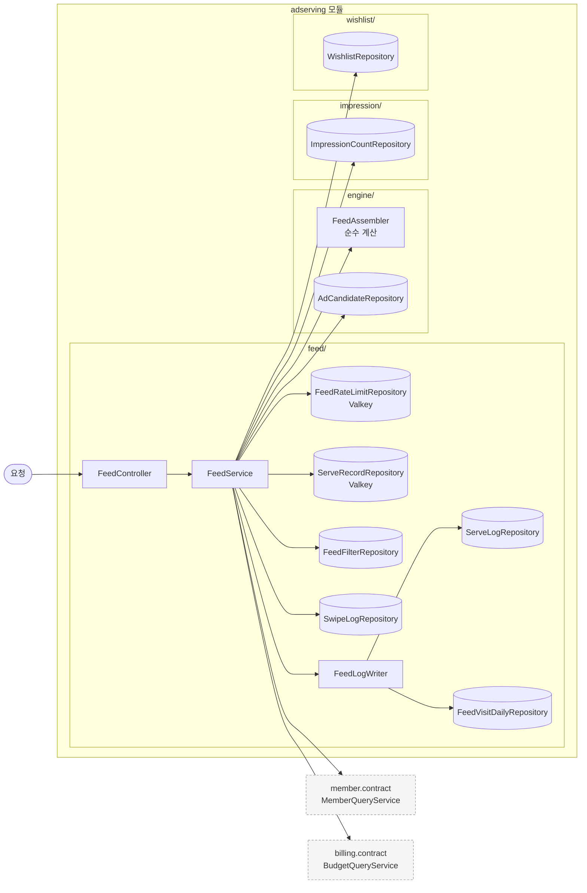
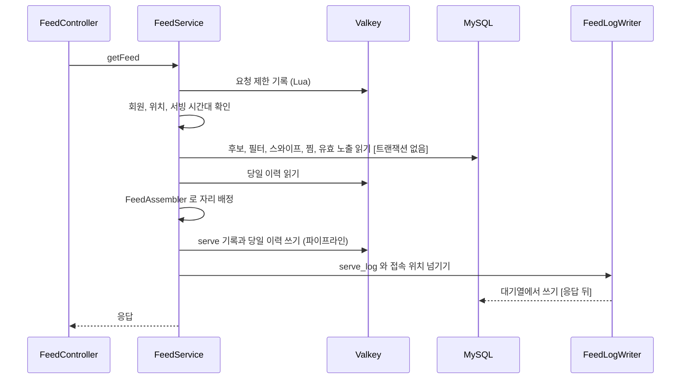

# adserving 구조와 동작 설계

광고 서빙 도메인의 구조와 동작을 적는다. 목차와 쓰는 규칙은
[구조와 동작 설계 가이드](../구조와_동작_설계_가이드.md)를 따른다. 엔드포인트별 처리와 성능 목표는
[`feed-api-design.md`](./feed-api-design.md) 가 갖고 여기서는 반복하지 않는다.

지금은 `GET /v1/feed`(#236)가 닿는 자리만 채웠다. 나머지 엔드포인트와 00:00 단계는 그 이슈가 채운다.
**임시** 로 표시한 행은 #236 에서 근거 없이 정한 값이다. 팀이 다른 값을 정하면 바꾼다.

## 1. 범위

| 맡는 기능 | 근거 |
|---|---|
| 스와이프 피드의 후보 거르기와 자리 배정 | 기능 명세서 67, 96, 97, 99행 |
| 사용자마다 최근 60초 6회의 피드 요청 제한 | 67행, `feed-api-spec.md` 요청 제한 |
| 카드마다의 serve 기록과 서빙 로그 | 100행, `serve_log` |

| 맡지 않는 것 | 소유 도메인 |
|---|---|
| 예산 소진 진행률, 그날 예약액, 단가 | billing. `BudgetQueryService` 로 읽는다 |
| 온보딩 완료 여부, 성별, 연령대, 저장 위치 | member. `MemberQueryService` 로 읽는다 |
| 쿠폰 잔여 수량 | coupon. 피드에 싣지 않는다 |

## 2. 애그리거트와 패키지

| 애그리거트 | 테이블 | 지키는 규칙 | 나눈 근거 |
|---|---|---|---|
| 후보 스냅샷 (`engine`) | `ad_candidate` | 서빙 경로는 이 테이블만 읽는다 | 00:00 에 통째로 만들고 하루 동안 통보로만 바뀐다 |
| 서빙 기록 (`feed`) | `serve_log`, `swipe_log`, `feed_filter`, `feed_filter_category`, `feed_visit_daily` | 같은 카드는 한 번만 기록한다(PK) | 피드 요청마다 쌓인다 |
| 노출 로그 (`impression`) | `impression_log` | 같은 사용자의 같은 카드는 한 번만 판정한다(PK) | 정산 차감과 한 트랜잭션이라 따로 둔다 |
| 찜 목록 (`wishlist`) | `wishlist` | 사용자와 캠페인마다 하나다(UNIQUE) | 캠페인이 끝날 때까지 남는다 |

애그리거트끼리는 캠페인 ID 로만 참조한다. 피드는 다른 애그리거트의 저장소를 읽기만 하고 쓰지 않는다.

```
adserving/
├── config/       AdservingSecurityConfig, FeedLogExecutorConfig
├── engine/       FeedAssembler(순수 계산), FeedSort, SlotType
│   ├── entity/       AdCandidate (읽기 매핑만)
│   └── repository/   AdCandidateRepository
├── feed/         UuidV7
│   ├── controller/   FeedController
│   ├── service/      FeedService, FeedLogWriter
│   ├── repository/   FeedRateLimitRepository, ServeRecordRepository (Valkey)
│   │                 ServeLogRepository, FeedVisitDailyRepository, SwipeLogRepository, FeedFilterRepository (MySQL)
│   ├── dto/
│   └── exception/    FeedErrorCode, FeedExceptionHandler
├── impression/repository/   ImpressionCountRepository
└── wishlist/repository/     WishlistRepository
```

입구는 지금 HTTP 요청 하나다. 스케줄(00:00 적재), 이벤트(캠페인 상태 변경), 다른 도메인의 호출
(`WishlistQueryService`, `CandidateStateUpdater`)은 아직 없다.

## 3. 저장

| 적을 것 | 결정 |
|---|---|
| 같은 카드의 중복 기록 | `serve_log` PK `serve_id`. 서버가 UUIDv7 로 만들어 겹치지 않는다 |
| 그날 첫 접속 위치 | `feed_visit_daily` PK `(business_date, member_id)` 에 `INSERT IGNORE` |
| 그날 유효 노출 수 | 요청마다 `impression_log` 를 후보 ID 로 묶어 센다(`idx_imp_campaign_date`). 노출 API 가 아직 없어 카운터를 올릴 자리가 없다. **임시** |
| 업종 선호도 | 최근 30일 `swipe_log` 의 WISH 가운데 그 업종의 비율이다. 찜이 없으면 모든 업종이 0 이다. **임시** |
| 오늘 제외할 캠페인 | 오늘 `swipe_log` 행과 오늘 만든 `wishlist` 행이다. 오늘 지운 찜은 기록이 없어 빼지 못한다. **임시** |
| 다른 도메인 데이터의 사본 | `ad_candidate` 가 캠페인과 가게의 사본이다. 만드는 일은 00:00 (8)단계(#180)다 |

`serve_log` 와 `feed_visit_daily` 는 앱이 키를 정하는 테이블이라 JPA `save` 대신 JDBC 로 쓴다.
`save` 는 행마다 SELECT 를 먼저 보낸다.

| 데이터 | 키 | 만료 | 원본 | 읽는 곳 |
|---|---|---|---|---|
| serve 기록 | `adserving:serve:{serveId}` 해시 | 30분 | 없다. 같은 값이 `serve_log` 에 비동기로 남는다 | 노출, 스와이프(예정) |
| 그날 캠페인별 서빙 횟수 | `adserving:served:{영업일}:{memberId}` 해시 | 영업일 끝 + 1시간 | 없다 | 피드 |
| 세션에 내려준 캠페인 | `adserving:session:{memberId}` 집합 | 마지막 피드 뒤 30분 | 없다 | 피드 |
| 최근 60초 요청 시각 | `adserving:feedRate:{memberId}` 정렬 집합 | 60초 | 없다 | 피드 |

**결정: serve 기록과 당일 이력을 어디에 두나**

| 선택지 | 장점 | 단점 |
|---|---|---|
| A. JVM 안의 캐시 | 네트워크 왕복이 없다 | 서버가 여러 대면 노출이 다른 서버로 갈 때 serve 기록을 못 찾아 무효가 된다 |
| B. Valkey | 어느 서버에서도 같은 기록을 본다 | Valkey 가 멈추면 피드가 멈춘다(장애 처리 설계) |

B 를 고른다(#236, 작성자 결정). 노출 판정이 틀리는 것은 점주에게 과금 없는 노출이 된다. 당일 이력은
원본에서 다시 만들 수 없다. 대신 Valkey 가 피드의 단일 장애 지점이 된다.

## 4. 계산 로직

`engine/FeedAssembler` 가 걸러 낸 후보로 자리를 정한다. 저장소와 시각을 모르고 record 만 받는다.

| 단계 | 규칙 | 근거 |
|---|---|---|
| 탐색 반경 | 1000, 2000, 3000, 5000 m 순으로 넓히고 후보가 10장 이상 모이는 첫 반경을 쓴다. 5000 에서 멈춘다 | 67행 반경 확장. 넓히는 조건은 **임시** |
| 배분 3장 | 예산 소진 진행률 오름차순, 같으면 캠페인을 먼저 만든 순 | 96, 99행, `campaign_created_at` 컬럼 설명 |
| 관련성 7장 | 점수 = 0.45 x 거리 + 0.35 x 업종 선호도 + 0.20 x 할인. 높은 7장을 고른다 | 97행 가중치. 각 항의 식은 **임시** |
| 관련성 표시 순서 | 거리순이면 가까운 순, 할인율순이면 할인 점수가 큰 순 | 70행 |
| 자리 | 배분은 1, 4, 7번. 한쪽이 모자라면 다른 쪽이 그 자리를 채운다 | 96행. 모자랄 때의 처리는 **임시** |

각 항의 식은 다음과 같다. 거리는 `1 - 거리 / 탐색 반경` 이다. 할인은 할인율이면 `값 / 100`, 금액이면
`min(값 / 10000, 1)` 이다. 금액과 율을 같은 축에 놓는 근거가 없어 1만 원을 할인율 100% 로 보았다.

`FeedService` 가 그 앞에서 거르는 조건은 아래와 같다. 모두 만족해야 후보가 된다.

| 조건 | 근거 |
|---|---|
| `campaign_state = SERVABLE`, `sold_out_at IS NULL` | `ad_candidate` 테이블 설명 |
| 거리가 캠페인의 노출 반경(`target_radius`) 안 | `ad_candidate.target_radius` |
| 성별이 `ALL` 이거나 사용자와 같다. 사용자 연령대가 대상 연령대에 있다 | `target_gender`, `target_age_groups` |
| 피드 필터 업종에 있다. 고른 업종이 없으면 전체다 | 70행 |
| 오늘 찜이나 패스하지 않았다 | 102행 (9) |
| 오늘 2회 미만으로 내려줬고 이번 세션에 내려주지 않았다 | 비즈니스 규칙. 하루 2회 값은 ops 에 없어 상수다. **임시** |
| 그날 예산 계획이 있고 진행률이 1.2 이하다 | 99행 |
| 그날 유효 노출이 노출 상한(예약액 / 단가 x 1.05) 미만이다 | 99행 |

## 5. 모듈 연결

| 방향 | 대상 도메인 | 인터페이스 | 시점 |
|---|---|---|---|
| 읽기 | member | `MemberQueryService.findById` | 피드 요청마다 1회 |
| 읽기 | billing | `BudgetQueryService.getProgress` | 피드 요청마다 1회. 후보가 5000 을 넘으면 나눠 부른다 |

캐시를 두지 않는다. 회원 정보는 정지와 탈퇴처럼 바로 반영되어야 하는 값이고, 진행률은 정산이 이미
Valkey 에서 읽는다.

## 6. 구조와 동작 그림

### 모듈 구조



### 상태 변경

해당 없음. 피드는 상태를 바꾸지 않고 기록만 남긴다. 후보의 상태 전이는 캠페인 통보를 받는 이슈가 채운다.

### 주요 흐름



| 실패 지점 | 남는 상태 | 다시 요청하면 |
|---|---|---|
| 요청 제한 기록 뒤 어디서든 예외 | 요청 제한 기록을 지운다. 지우기도 실패하면 60초 동안 한 번이 더 세진다 | 처음부터 다시 한다 |
| serve 기록 쓰기 | 일부 카드의 serve 기록만 남을 수 있다. 30분 뒤 사라진다. 응답은 500 이다 | 새 카드로 다시 받는다 |
| 서빙 로그 쓰기 | 응답은 이미 나갔다. 진단에서 "기록 없음" 이 된다 | 해당 없음 |

## 7. 트랜잭션과 동시성

| 흐름 | 한 트랜잭션에 묶는 것 | 트랜잭션 밖 |
|---|---|---|
| 피드 조회 | 없다. 읽기만 하고 쓰기는 Valkey 와 비동기 JDBC 다 | 서빙 로그 쓰기(`feedLogExecutor`) |

**결정: 서빙 로그를 어떻게 미루나**

| 선택지 | 장점 | 단점 |
|---|---|---|
| A. 응답 안에서 동기로 쓴다 | 빠지지 않는다 | 초당 5,000행의 쓰기가 응답 지연에 들어가고 DB 쓰기 실패가 피드 실패가 된다 |
| B. 크기 있는 대기열에 넘기고 차면 버린다 | 응답이 DB 를 기다리지 않는다 | 프로세스가 죽거나 대기열이 차면 빠진다 |
| C. 크기 있는 대기열에 넘기고 차면 기다린다 | 대기열이 차도 빠지지 않는다 | DB 가 느려지면 피드가 함께 느려진다 |

B 를 고른다. 서빙 로그는 판정과 과금에 쓰이지 않는다(`feed-api-design.md`). 대기열 크기 1000, 스레드 2개,
버린 행은 `adserving_feed_log_dropped_total`, 쓰기에 실패한 행은 `adserving_feed_log_failed_total` 로 센다. 크기와
스레드 수는 **임시** 다. 배포로 내려갈 때는 10초까지 남은 기록을 마저 쓴다.

| 상황 | 확인할 것 |
|---|---|
| 같은 요청이 다시 옴 | 매번 새 카드다. 멱등 키가 없다. 요청 제한이 횟수를 막는다 |
| 같은 회원의 요청이 동시에 옴 | 요청 제한은 Lua 한 번으로 세고 기록해 6회를 넘지 않는다. 당일 이력은 읽은 뒤 쓰므로 동시 요청 둘이 같은 캠페인을 함께 내려줄 수 있다. 하루 2회가 3회가 될 수 있고 막지 않는다 |
| 여러 회원이 같은 자원에 씀 | 해당 없음. 피드는 수량과 잔액을 바꾸지 않는다 |
| 이벤트가 늦거나 순서가 바뀜 | 해당 없음 |

영업일과 서빙 시간대(10:00 이상 13:00 미만)는 `FeedService` 가 `ClockConfig.ZONE` 의 시각으로 판단한다.

## 8. 외부 API

해당 없음.

## 9. 실패 처리

| 흐름 | 불리하게 남는 경우 | 누구에게 | 막는 방법 |
|---|---|---|---|
| 피드 조회 | serve 기록 없이 카드가 나가면 그 카드의 노출이 모두 무효가 되어 과금되지 않는다 | 플랫폼 | serve 기록 쓰기가 실패하면 피드를 실패시킨다 |
| 피드 조회 | 노출 상한을 요청마다 로그로 세므로, 같은 순간 들어온 노출이 반영되기 전에 상한을 조금 넘겨 내려줄 수 있다 | 플랫폼. 상한을 넘은 노출은 정산이 과금하지 않는다 | 막지 않는다 |

## 10. 배치

아직 훑지 않았다. 00:00 (8), (9), (10)단계는 #180 이 채운다.

## 11. 성능

| 적을 것 | 값 |
|---|---|
| 요청 하나의 비용 | DB 읽기 6(후보, 필터 2, 스와이프 2, 찜) + 노출 수 1, Valkey 4(요청 제한, 당일 이력 2, 파이프라인 1), 다른 도메인 호출 2, 응답 뒤 DB 쓰기 2 |
| 처리량 계산 | 목표 500 TPS x 응답 뒤 쓰기 2문장 = 초당 1,000문장(`serve_log` 배치 1, `INSERT IGNORE` 1). 행으로는 초당 5,000행이다 |
| 확인 방법 | k6 로 10:00~12:59 를 재현한다. 아직 재지 않았다 |

`impression_log` 를 요청마다 세는 쿼리가 가장 무겁다. 후보 ID 수만큼 인덱스 범위를 읽는다. 노출 API 가 생기면
Valkey 카운터로 바꾸는 것을 먼저 본다.

## 12. 테스트와 미정 사항

| 미정 항목 | 어디까지 정해졌나 | 막는 것 |
|---|---|---|
| 관련성 점수 각 항의 식, 반경을 넓히는 조건, 한쪽이 모자랄 때의 자리 | 4장에 **임시** 로 정했다 | 배정 결과 |
| 하루 2회 상한과 가중치의 출처 | 상수다. ops 공개 기능으로 옮길지 정하지 않았다 | 관리자 진단의 `settings` |
| 오늘 지운 찜의 제외 | 지운 기록이 스키마에 없다 | 명세서 "지운 캠페인은 그날 피드에 다시 나오지 않는다" |
| 유효 노출 수를 세는 방식 | 요청마다 로그로 센다 | 피드 응답 지연 |
| `new_priority_until` | 쓰지 않는다 | 신규 캠페인의 우선 노출 |
| 서빙 로그 대기열 크기 | 1000, 차면 버린다 | 서빙 로그 유실률 |
