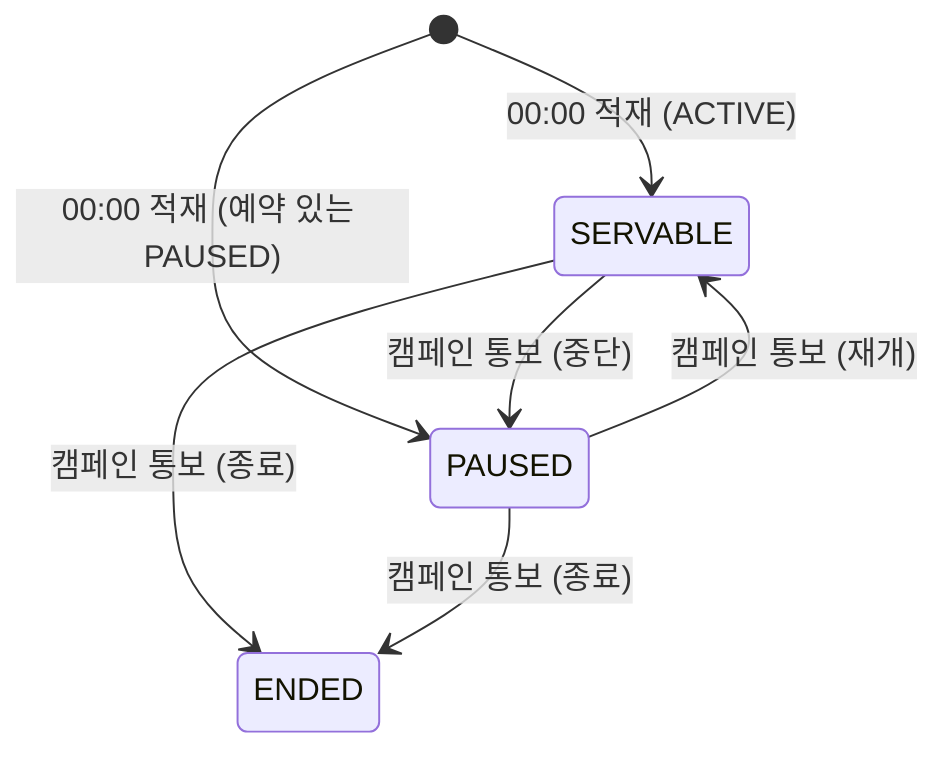

# adserving 구조와 동작 설계

[구조와 동작 설계 가이드](../구조와_동작_설계_가이드.md)의 목차를 따른다. 엔드포인트별 처리와
성능 목표는 [`feed-api-design.md`](./feed-api-design.md)가 갖는다. 의존 대상이 죽었을 때의
처리는 `adserving_장애_처리_설계.md` 가 갖는다. 아직 쓰지 않았다.

## 1. 범위

| 적을 것 | 내용 |
|---|---|
| 맡는 기능 | 스와이프 피드 조회, 찜과 패스, 노출 수 집계, 필터 설정, 찜한 캠페인 조회와 삭제, 피드 배정 진단 |
| 맡는 배치 | 00:00 묶음의 (8) 후보 스냅샷, (9) 당일 이력 초기화, (10) 가게별 대상 인원 집계 |
| 맡지 않는 것 | 과금 판정은 정산. 발급 수량과 소진은 쿠폰. 가게 정보는 가게. 캠페인 상태는 캠페인. 사용자 속성은 사용자. 묶음 점유와 이어받기와 실패 확정은 `ops` |

경계가 흐려지는 자리가 둘이다.

**잔여 수량을 싣지 않는다.** 쿠폰이 소유한 값이다. 광고 서빙이 읽으면 쿠폰이 이미 찜 여부를
읽고 있어 순환이 생긴다. 소진은 쿠폰이 `CandidateStateUpdater` 로 알려 준다.

**과금 판정을 하지 않는다.** 노출을 저장하고 차감을 부르기만 한다. `BILLED` 와
`NOT_BILLED_*` 는 정산이 자기 기록에 남긴다. 예외가 하나다. 쿠폰 소진 뒤 도착한 유효 노출은
차감을 부르지 않고 `impression_log.sold_out` 에 적는다.

## 2. 애그리거트와 패키지

패키지 트리는 [설계 문서](../../architecture/런치캐치_도메인_구조와_의존성_설계.md) 1.3 이
갖는다. 여기서 다시 적지 않는다.

| 애그리거트 | 테이블 | 지키는 규칙 | 나눈 근거 |
|---|---|---|---|
| 후보 스냅샷 | `ad_candidate` | 영업일과 캠페인당 한 행 | 하루 단위로 통째로 바뀐다. 서빙 경로가 이 표만 읽는다 |
| 노출 로그 | `impression_log` | 서빙 기록과 회원당 한 행. 무효 노출도 한 행이다 | 노출 저장과 차감이 한 트랜잭션이다 |
| 서빙 기록 | `serve_log` | 카드 한 장당 한 행 | 응답 뒤 비동기로 쓴다. 판정과 과금에 쓰이지 않는다 |
| 스와이프 기록 | `swipe_log` | 서빙 기록과 회원당 한 행 | 저장 결과로 `applied` 를 답해서 트랜잭션 안에 둔다. 당일 제외와 선호도 집계가 읽는다 |
| 찜 목록 | `wishlist` | 회원과 캠페인당 한 행 | 캠페인이 끝날 때까지 유지된다. 변경 주기가 다르다 |

**설계 문서 1.3 의 트리에 자리가 없는 테이블이 셋이다.** `feed_filter`,
`feed_filter_category`, `feed_visit_daily` 다. 앞 둘은 회원별 설정이고 뒤는 회원별 그날 첫
요청 위치다. 어느 애그리거트에 둘지 아직 정하지 않았다. 12장에 올린다.

**애그리거트끼리 ID 로 참조한다.** 객체로 쥐지 않는다. 다른 도메인의 것도 ID 값이다.
`campaign_id`, `store_id`, `member_id` 가 전부 소프트 참조다. FK 는 같은 도메인 안에서만
쓴다. `feed_filter_category` 가 `feed_filter` 를 참조하는 것 하나다.

**한 도메인 안에서 두 애그리거트에 걸친 규칙을 트랜잭션으로 묶지 않는다.** 노출 수집이 서빙
기록을 보지만 그 조회가 캐시다. 노출 로그와 서빙 기록이 한 트랜잭션에 들어가지 않는다.

**그 규칙을 지키지 못하는 자리가 하나다.** 스와이프가 스와이프 기록과 찜 목록을 한 트랜잭션에
묶는다. 응답의 `applied` 가 저장 결과라서 앞이 커밋되고 뒤가 실패하면 찜했다고 답한 캠페인이
찜 목록에 없다. 어떻게 풀지 아직 정하지 않았다. 12장에 올린다.

## 3. 저장

| 적을 것           | 내용                                                                                                                   |
| -------------- | -------------------------------------------------------------------------------------------------------------------- |
| DB 제약으로 막을 것   | 중복 노출과 중복 스와이프는 PK `(serve_id, member_id)` 로 막는다. 중복 찜은 `uk_wishlist_member_campaign` 이다. 코드의 "조회 후 저장" 은 동시 요청에 뚫린다 |
| 집계를 세는 방식      | 그날 유효 노출 수를 광고 서빙이 자기 노출 로그로 센다. 예산 소진 진행률은 정산이 계산해 준다                                                               |
| 다른 도메인 데이터의 사본 | `ad_candidate` 가 캠페인과 가게의 값을 복사한다. 00:00 에 만들고 그날 안에서는 상태만 통보로 갱신한다                                                  |
| 이력             | 상태 이력을 따로 두지 않는다. `campaign_state` 와 `state_changed_at` 만 둔다. 전이 이력은 캠페인의 `campaign_status_log` 가 갖는다                |
| 복잡한 조회         | 찜 목록은 `wishlist` 에서 그날 `ad_candidate` 를 LEFT JOIN 한다. 스냅샷에 없는 캠페인이면 표시 필드가 `null` 이다                                 |

인메모리 저장소(Valkey)에 두는 것은 둘이다.

| 데이터      | 키          | 만료       | 원본          | 읽는 곳           |
| -------- | ---------- | -------- | ----------- | -------------- |
| serve 기록 | `serve_id` | TTL 30분  | `serve_log` | 노출 검증, 스와이프 검증 |
| 피드 요청 시각 | 회원         | 최근 60초 창 | 없다          | 요청 제한          |

**serve 기록의 TTL 이 노출 인정 시간과 같다.** 30분을 넘겨 온 노출은 `EXPIRED_OR_UNKNOWN`
무효다. 캐시가 비면 그 판정이 그대로 나온다.

**피드 요청 시각은 원본이 없다.** 다시 만들 수 없는 유일한 캐시 데이터다. 유실되면 그 회원이
60초 안에 6회를 다시 받을 수 있다. 요청 제한이 느슨해지는 방향이라 거절이 늘지는 않는다.

## 4. 계산 로직

공식이 정해져 있는 것이 셋이다. 순수 클래스로 빼서 `engine/` 바로 아래에 둔다. Spring, JPA,
repository, client 를 import 하지 않는다.

| 계산     | 공식                                      | 근거                                  |
| ------ | --------------------------------------- | ----------------------------------- |
| 관련성 점수 | 거리 45, 카테고리 선호도 35, 할인 20               | `feed-api-design.md` `GET /v1/feed` |
| 노출 상한  | 그날 예약액 / 그날 단가 x 1.05                   | 같은 문서                               |
| 거리     | `global.geo.GeoDistance`, `BoundingBox` | 이미 있다. 여기서 다시 만들지 않는다               |

**예산 소진 진행률을 계산하지 않는다.** 정산의 `BudgetQueryService` 가 준다. 원장이 정산에만
있어서 광고 서빙이 셀 수 없다.

**카테고리 선호도는 30일 스와이프 이력으로 만든다.** `swipe_log.category_code` 가 그것을 위해
`ad_candidate` 에서 복사된 값이다. 집계 방식은 아직 정하지 않았다. 12장에 올린다.

## 5. 모듈 연결

| 방향  | 대상 도메인 | 인터페이스                                              | 시점                    |
| --- | ------ | -------------------------------------------------- | --------------------- |
| 읽기  | 캠페인    | `CampaignQueryService`                             | 00:00 (8)단계           |
| 읽기  | 가게     | `StoreQueryService`                                | 00:00 (8)단계           |
| 읽기  | 사용자    | `MemberQueryService`                               | 피드 요청마다, 00:00 (10)단계 |
| 읽기  | 정산     | `BudgetQueryService`                               | 피드 요청마다               |
| 쓰기  | 정산     | `PointDeductor`                                    | 노출 저장과 같은 트랜잭션        |
| 쓰기  | 캠페인    | `StoreAudienceUpdater`                             | 00:00 (10)단계          |
| 받음  | 캠페인    | `CampaignEndedEvent`, `CampaignStatusChangedEvent` | 상태가 바뀔 때              |
| 받음  | 쿠폰     | `CandidateStateUpdater` 호출                         | 선착순 소진 때              |
| 공개  | 쿠폰, 알림 | `WishlistQueryService`                             | 발급 자격 확인, 10:50 발송 대상 |
| 공개  | 쿠폰     | `CandidateStateUpdater`                            | 소진 표시                 |
| 공개  | 분석     | `ImpressionServedEvent`, `SwipedEvent`             | 비동기                   |

**피드 요청마다 다른 도메인을 두 번 부른다.** 사용자와 정산이다. 캠페인과 가게는 00:00 에
스냅샷으로 받아 두어 서빙 중에 부르지 않는다. 그래서 `ad_candidate` 가 있다.

**정산 호출의 캐시를 둘지 아직 정하지 않았다.** 목표 500 TPS 라 진행률 조회가 초당 500번이다.
12장에 올린다.

공개 인터페이스의 시그니처는 `feed-api-design.md` 의 `다른 도메인에 공개한 기능` 절이 갖는다.

## 6. 상태와 흐름

상태를 갖는 것은 `ad_candidate` 하나다.

**전이는 캠페인 통보로만 일어난다.** 광고 서빙이 스스로 바꾸지 않는다. `state_changed_at` 이
지금 값보다 늦은 통보만 반영한다. 적재와 적재 직후 재조회도 같은 비교를 쓴다.

**소진은 상태가 아니다.** `sold_out_at` 이 따로 있다. 후보 조건이
`campaign_state = SERVABLE AND sold_out_at IS NULL` 이라 둘을 함께 본다. 소진은 쿠폰이
알려 주고 되돌아가지 않는다.

## 7. 트랜잭션과 동시성

| 흐름 | 한 트랜잭션에 묶는 것 | 트랜잭션 밖 |
|---|---|---|
| 노출 수집 | `impression_log` 저장, 정산의 차감, 정산의 원장 | 분석 이벤트 발행 |
| 피드 응답 | 없다. 읽기만 한다 | `serve_log`, `feed_visit_daily` 쓰기 |
| 스와이프 | `swipe_log` 저장, `wishlist` 저장이나 삭제 | 분석 이벤트 발행 |
| 가게 상세 찜과 찜 삭제 | `wishlist` 저장이나 삭제 | 없다 |
| 캠페인 종료 통보 | `ad_candidate` 상태 갱신 | 끝난 캠페인의 `wishlist` 행 삭제 |
| 00:00 (8) | 적재 전체. 캠페인당 1행이라 가게 수만큼이다 | 적재 직후 재조회 |
| 00:00 (10) | 호출 하나(1000행 이하) | 청크 사이 대기 |

**외부 API 를 부르지 않는다.** 트랜잭션 안에서 기다릴 것이 없다.

**커밋 뒤로 미루는 것이 넷이다.** 분석 이벤트, `serve_log` 쓰기, `feed_visit_daily` 쓰기,
끝난 캠페인의 찜 삭제다.

**종료 통보가 애그리거트 둘을 건드려서 나눈다.** 찜 삭제가 실패하면 그 행이 남는다. 찜 목록
조회가 그날 후보를 LEFT JOIN 하므로 표시 필드가 `null` 로 나간다. `feed-api-spec.md` 327행이
그 경우를 이미 적어서 사용자에게 보이는 모양이 깨지지 않는다.

주요 흐름마다 넷을 본다.

| 상황 | 확인할 것 | 어디서 |
|---|---|---|
| 같은 요청이 다시 옴 | PK `(serve_id, member_id)` | 노출, 스와이프 |
| 같은 회원의 요청이 동시에 옴 | 하루 2회와 한 세션 1회 | 피드 응답. 세는 자리가 미정이다 |
| 여러 회원이 같은 자원에 씀 | 없다. 수량은 쿠폰이 갖는다 | 해당 없음 |
| 이벤트가 늦거나 순서가 바뀜 | `state_changed_at` 비교 | 캠페인 통보 |

**경쟁 지점에 비관 잠금을 쓰지 않는다.** 중복은 PK 와 유일 키가 막는다. 상태는 시각 비교로
막는다. 노출 수집이 정산의 차감을 부르는 자리에서 어느 쪽이 먼저 잠그는지는 정산이 정한다.

**영업일은 `ClockConfig.ZONE`(Asia/Seoul)으로 판단한다.** DB 의 날짜 함수를 쓰지 않는다.
한 번에 다루는 건수의 상한은 (10)단계의 1000행이다.

## 8. 외부 API

**해당 없음.** 광고 서빙은 외부 API 를 부르지 않는다. 지도와 카카오는 프론트와 사용자 도메인
쪽이다.

## 9. 실패 처리

의존 대상이 죽었을 때의 처리는 `adserving_장애_처리_설계.md` 가 갖는다. 아직 쓰지 않았다.
여기에는 돈이 걸린 경로에서 누군가에게 불리하게 남는 경우만 적는다.

| 흐름 | 불리하게 남는 경우 | 누구에게 | 막는 방법 |
|---|---|---|---|
| 노출 수집 | 전송이 서버에 닿지 않아 집계되지 않는다 | 플랫폼. 차감도 되지 않아 점주에게 불리하지 않다 | 클라이언트가 1회 재시도하고 `keepalive` 를 쓴다. 유실률 목표는 `feed-api-design.md` 의 유실 목표 절 |
| 노출 수집 | 차감이 실패해 노출 저장까지 롤백된다 | 플랫폼. 노출 기록이 없어진다 | 한 트랜잭션이라 어긋나지는 않는다. 클라이언트가 1회 재시도하므로 그 사이에 정산이 살아나면 복구된다. 계속 실패하면 유실로 남는다 |
| 00:00 (8) | 적재가 실패해 그날 후보가 없다 | 점주. 노출 기회를 잃는다 | 앞 단계 실패로 중단되면 관리자에게 알린다. 전날 후보를 쓰지 않는다 |
| 00:00 (10) | 집계가 실패해 추천 인원이 낡는다 | 점주. 추천 하루 예산이 전날 기준이다 | 캠페인이 전날 값을 쓴다 |

**(8)이 실패하면 그날 서비스가 안 된다.** 서빙 경로가 `ad_candidate` 만 읽기 때문이다. 전날
후보를 쓰면 종료된 캠페인이 노출되고 과금까지 일어난다. 그래서 전날 값으로 대체하지 않는다.

## 10. 배치

00:00 묶음의 순서와 중복 실행 방지와 실패 확정은
[`런치캐치_배치_운영.md`](../ops/런치캐치_배치_운영.md)가 갖는다. 여기에는 이 도메인이 등록하는
작업만 적는다.

`ops.scheduler.DailyJob` 을 구현해 빈으로 등록한다. 순서는 `@Order` 가 정한다. 구현은
`job/` 에 두고 저장소가 아니라 `service/` 를 부른다. `job/` 이 Entry 계층이라 저장소를
주입받으면 계층 의존 규칙이 떨어진다.

| 단계            | 작업이 하는 일                                             | 읽는 상태               | 같은 날 두 번 돌면                                        | 실패하면 그날        |
| ------------- | ---------------------------------------------------- | ------------------- | -------------------------------------------------- | -------------- |
| (8) 후보 스냅샷    | 캠페인과 가게를 읽어 `ad_candidate` 에 적재한다                    | (6)까지 확정된 캠페인 상태    | PK 가 `(business_date, campaign_id)` 라 덮어쓴다. 같은 결과다 | 서비스 불가다. 9장 참조 |
| (9) 당일 이력 초기화 | 지울 것이 없다. 피드에서 넘긴 찜과 패스는 `swipe_log` 를, 노출 횟수는 `impression_log` 를 그날 영업일로 걸러 읽는다. `wishlist` 는 피드 제외에 쓰지 않아 지우지 않는다 | 없다 | 지울 것이 없어 같다 | 영향 없다 |
| (10) 대상 인원 집계 | 최근 7일 점심 접속 사용자를 가게마다 반경 4단계 x 성별 x 연령대로 세어 캠페인에 넘긴다 | 없다. 앞 단계와 순서 의존이 없다 | `store_audience` 의 유일 키가 네 열이라 덮어쓴다. 같은 결과다        | 캠페인이 전날 값을 쓴다  |

### (8) 상태를 접는 규칙

| 캠페인 상태 | `campaign_state` |
|---|---|
| (6)까지 확정된 `ACTIVE` | `SERVABLE` |
| 그날 예약이 잡힌 `PAUSED(OWNER)`, `PAUSED(NO_POINTS)` | `PAUSED` |

적재한 뒤 한 번 더 조회한다. 적재 도중에 캠페인이 상태를 바꿨을 수 있다. 갱신 조건은 6장과
같은 `state_changed_at` 비교다.

### (9) 가 지울 것이 없는 이유

광고 서빙이 이력을 지워서 당일로 만들지 않는다. 영업일 열로 걸러서 당일로 만든다. 날짜가
바뀌면 어제 행이 조건에 걸리지 않는다. 당일 제외 기준은
[`feed-api-design.md`](./feed-api-design.md) 64행이 갖는다.

| 이력 | 거르는 조건 |
|---|---|
| 찜 | `swipe_log.business_date = 오늘 AND action = WISH` |
| 패스 | `swipe_log.business_date = 오늘 AND action = PASS` |
| 노출 횟수 | `impression_log.business_date = 오늘` |

**지우면 오히려 망가진다.** `wishlist` 를 지우면 사용자 찜 목록이 매일 자정에 비워진다.
`swipe_log` 를 지우면 카테고리 선호도가 쓰는 30일 이력이 날아간다.

**가게 상세에서 찜한 캠페인은 위 조건에 걸리지 않는다.** `POST /v1/wishlist` 에는 `serveId`
가 없어서 `swipe_log` 에 행을 만들 수 없다. 그런데 `feed-api-spec.md` 373행은 찜을 지운
캠페인이 그날 피드에 다시 나오지 않는다고 적는다. 그 경로의 당일 제외를 어디에 기록할지 아직
정하지 않았다. 12장에 올린다.

남는 것은 하루 2회와 한 세션 1회 카운터뿐이다. 그 자리를 캐시로 정하면 (9)단계가 지울 것이
생긴다. 12장에 올린다.

### (10) 끊어 넘기는 규칙

**한 번에 1000행을 넘기지 않는다.** 행 수가 가게당 반경 4종 x 성별 3종 x 연령대 4종 = 최대
48개다. 가게 20곳이면 960행이고 한 가게의 행이 두 트랜잭션에 걸치지 않는다. 기준은
[`qa-data-integrity-guideline.md`](../../software-quality/qa-data-integrity-guideline.md)의
`트랜잭션 내 갱신 행 수 1000행 이하` 다.

**전부 들고 있지 않는다.** 가게 500곳이면 24,000행이다.
[`qa-performance-efficiency-guideline.md`](../../software-quality/qa-performance-efficiency-guideline.md)가
`한 번에 메모리에 올리는 행 수 10000행 이하` 로 정한다. 세면서 끊어 넘긴다.

**청크 사이에 짧게 쉬고 커넥션 몫을 지킨다.**
[`qa-compatibility-guideline.md`](../../software-quality/qa-compatibility-guideline.md)가 배치
전용 커넥션을 DB 최대의 20% 이하로 두고 청크 사이의 대기를 요구한다. 25번을 쉬지 않고
몰아치면 그 몫을 넘긴다.

## 11. 성능

엔드포인트별 목표는 [`feed-api-design.md`](./feed-api-design.md)가 갖는다. 여기서는 그 목표를
지금 구조로 맞출 수 있는지 센다.

| 흐름 | 요청 하나의 비용 |
|---|---|
| `GET /v1/feed` | DB 읽기 1(`ad_candidate`), 다른 도메인 호출 2(사용자, 정산), 캐시 쓰기 10, 캐시 읽기 1(요청 제한), 비동기 DB 쓰기 11 |
| `POST /v1/swipes` | 캐시 읽기 1(serve 기록 검증), DB 쓰기 1~2(`swipe_log`, `WISH` 면 `wishlist`), 트랜잭션 1 |
| `POST /v1/impressions` | 캐시 읽기 1, DB 쓰기 1, 다른 도메인 호출 1(차감), 트랜잭션 1 |
| `GET /v1/wishlist` | DB 읽기 1(조인 한 번) |

목표로 환산하면 이렇다.

| 흐름 | 목표 TPS | 초당 DB 쓰기 | 초당 다른 도메인 호출 |
|---|---|---|---|
| `GET /v1/feed` | 500 | 5,500 (비동기) | 1,000 |
| `POST /v1/swipes` | 5,000 | 5,000 ~ 10,000 (동기, 트랜잭션 안) | 0 |
| `POST /v1/impressions` | 10,000 | 10,000 (동기, 트랜잭션 안) | 10,000 |
| `GET /v1/wishlist` | 500 | 0 | 0 |

**동기 쓰기가 무거운 흐름이 둘이다.** 노출 수집이 초당 1만 행이고 스와이프가 최대 1만 행이다.
둘 다 트랜잭션 안이다.

**그중 노출 수집이 더 무겁다.** 그 트랜잭션 안에서 정산을 부른다. 스와이프는 다른 도메인을
부르지 않는다. 지금 구조로 되는지는 부하 시험으로 재야 한다. 되지 않으면 묶어 받는 방식으로
바꾼다. 그 여지는 `feed-api-design.md` 가 적어 두었다.

**확인 방법은 k6 다.** 10:00~12:59, 특히 10:50~11:05 를 재현한다.

## 12. 테스트와 미정 사항

구현 전에 Given-When-Then 으로 쓴다. 6장의 전이마다, 7장 동시성 표의 행마다 하나 이상 둔다.

| 미정 항목                                                             | 어디까지 정해졌나                                                           | 막는 것                                                                             |
| ----------------------------------------------------------------- | ------------------------------------------------------------------- | -------------------------------------------------------------------------------- |
| (9)단계가 지울 것                                                       | 찜과 패스와 노출 횟수는 영업일 열로 걸러 지울 것이 없다. 하루 2회와 한 세션 1회 카운터만 남았다                    | 아래 행과 묶여 있다 |
| 하루 2회와 한 세션 1회를 세는 자리                                             | 공식은 비즈니스 규칙에 있다. 30분 활동이 없으면 새 세션이다. 응답 뒤에 쓰는 `serve_log` 로는 셀 수 없다 | 정하지 않으면 동시에 온 두 요청이 서로를 보지 못해 상한을 넘는다. 캐시에 카운터를 두면 (9)단계가 지울 것이 생긴다. 두 항목이 묶여 있다 |
| `feed_filter`, `feed_filter_category`, `feed_visit_daily` 의 애그리거트 | 설계 문서 1.3 의 트리에 자리가 없다                                              | 패키지 자리가 정해지지 않아 저장소와 서비스를 어디에 둘지 모른다                                             |
| 카테고리 선호도 집계 방식                                                    | 30일 스와이프 이력을 쓴다. `swipe_log.category_code` 가 그것을 위한 복사본이다           | 관련성 점수의 35점 항목을 계산할 수 없다                                                         |
| 정산 호출의 캐시                                                         | 피드 요청마다 진행률을 읽는다. 목표 500 TPS 다                                      | 초당 500번 호출이 정산 쪽에서 받아지는지 모른다                                                     |
| 좌표 없는 가게                                                          | `store` 의 좌표가 NULL 허용인데 `ad_candidate` 는 `NOT NULL` 이다              | (8)단계에서 후보에서 뺄지 적재를 막을지 정해야 한다                                                   |
| 가게 상세에서 찜한 캠페인의 당일 제외 | `POST /v1/wishlist` 에는 `serveId` 가 없어 `swipe_log` 에 남지 않는다. `feed-api-spec.md` 373행은 지운 캠페인이 그날 피드에 다시 나오지 않는다고 적는다 | `wishlist` 에 영업일 열을 더할지, 그 경로의 제외를 캐시에 둘지, api-spec 을 고칠지 정해야 한다 |
| 스와이프 트랜잭션이 애그리거트 둘을 묶는 것 | 가이드 2장이 두 애그리거트를 한 트랜잭션에 묶지 말라고 정한다. 응답의 `applied` 가 저장 결과라서 나눌 수 없다 | 나누면 찜했다고 답한 캠페인이 찜 목록에 없을 수 있다. 묶은 채로 둘지 `swipe_log` 를 찜의 원본으로 삼을지 정해야 한다 |

돈이나 수량이 틀릴 수 있는 것, 다른 담당자가 기다리는 것, 구조를 바꾸는 것 순으로 닫는다.
위 표에서는 정산 호출의 캐시가 첫째다. 세 테이블의 애그리거트 자리가 둘째다.
