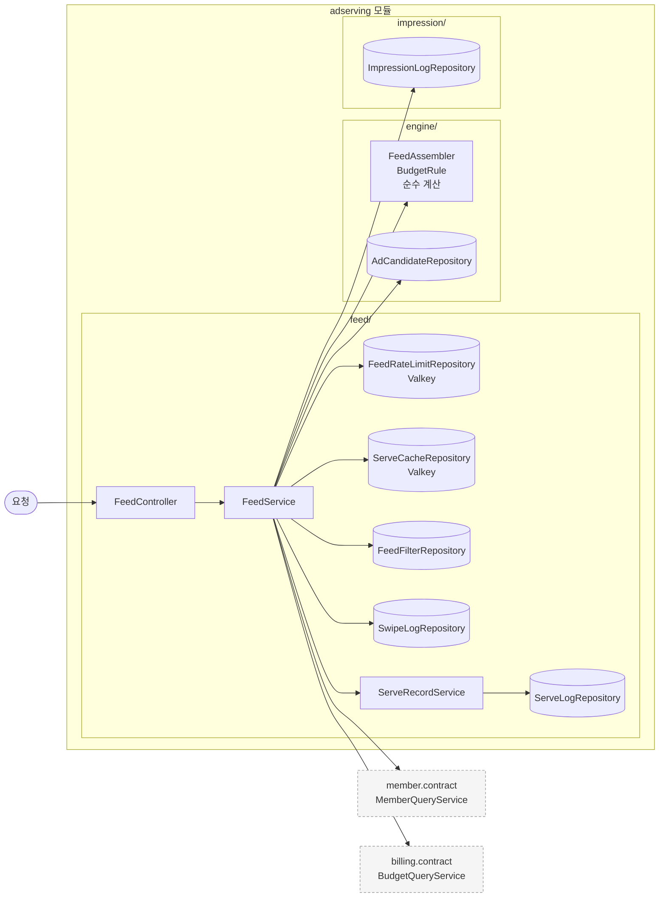
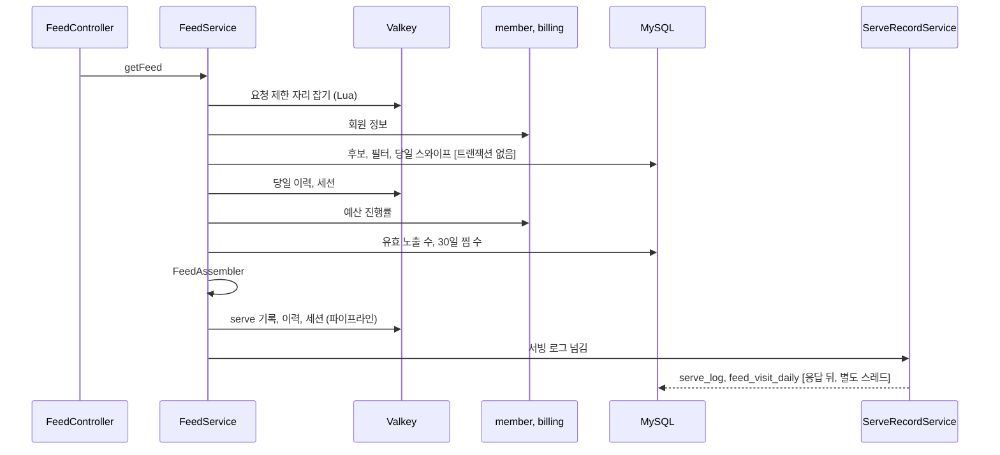

# adserving 구조와 동작 설계

광고 서빙 도메인의 모듈 구조, 저장, 계산, 동작을 적는다. 목차는 [구조와 동작 설계 가이드](../구조와_동작_설계_가이드.md) 부록을 따른다.
엔드포인트 하나에서 출발하는 처리는 [`feed-api-design.md`](./feed-api-design.md) 가 갖는다. 의존 대상이 멈췄을 때의 처리는
[`adserving_장애_처리_설계.md`](./adserving_장애_처리_설계.md) 가 갖는다.

**지금은 `GET /v1/feed`(#230)를 구현하며 훑은 범위만 채웠다.** 나머지 엔드포인트와 00:00 후보 적재 작업은
구현하는 이슈에서 채운다. 훑지 않은 자리는 "아직 훑지 않았다" 로 둔다.

`임시(#230)` 가 붙은 결정은 근거 문서가 정하지 않아 #230 에서 임시로 정한 것이다. 선택지 비교는 #230 이슈 댓글에 있다.

## 1. 범위

| 맡는 기능 | 근거 |
|---|---|
| 스와이프 피드 10장 배정과 요청 제한 | 명세서 `GET /v1/feed`, 요구사항 67, 96, 97, 99행 |
| serve 기록(30분)과 서빙 로그, 그날 첫 요청 위치 | 요구사항 67, 100행 |
| 찜과 패스, 노출, 피드 필터, 찜 목록, 배정 진단 | 아직 훑지 않았다 |
| 00:00 후보 스냅샷 적재 | 아직 훑지 않았다 |

| 맡지 않는 것 | 소유 도메인 |
|---|---|
| 예산 소진 진행률, 그날 예약액과 단가 | billing (`BudgetQueryService`) |
| 노출 차감과 과금 판정 | billing (`PointDeductor`) |
| 회원 성별, 연령대, 저장 위치, 온보딩 완료 여부 | member (`MemberQueryService`) |
| 잔여 쿠폰 수량 | coupon. 피드는 싣지 않는다 |

## 2. 애그리거트와 패키지

| 애그리거트 | 테이블과 저장소 | 지키는 규칙 | 나눈 근거 |
|---|---|---|---|
| engine (후보 스냅샷과 배정 계산) | `ad_candidate` | 서빙 경로는 그날 스냅샷만 읽는다 | 매일 00:00 덮어써서 변경 주기가 다르다 |
| feed (서빙 기록, 스와이프 이력) | `serve_log`, `swipe_log`, `feed_filter`, `feed_filter_category`, `feed_visit_daily`, Valkey 의 serve 기록과 회원 당일 이력과 요청 제한 | 같은 캠페인은 하루 2회, 한 세션 1회 | 피드 요청마다 쓰고 읽는다 |
| impression (노출 로그) | `impression_log` | 아직 훑지 않았다. 피드는 유효 노출 수를 읽기만 한다 | 정산 차감과 한 트랜잭션 |
| wishlist | `wishlist` | 아직 훑지 않았다 | |

```
adserving/
├── config/AdservingSecurityConfig.java
├── engine/                     순수 계산과 후보 스냅샷
│   ├── Candidate, Eligible, AssignedCard, Assembly, FeedFilter, FeedSort, SlotType
│   ├── FeedAssembler.java       반경 확장과 슬롯 배정
│   ├── BudgetRule.java          예산으로 후보를 빼는 규칙
│   └── repository/AdCandidateRepository.java
├── feed/
│   ├── ServedFeed.java, UuidV7.java
│   ├── controller/FeedController.java, FeedExceptionHandler.java
│   ├── service/FeedService.java, ServeRecordService.java
│   ├── repository/FeedFilterRepository, SwipeLogRepository, ServeLogRepository,
│   │              FeedRateLimitRepository (Valkey), ServeCacheRepository (Valkey)
│   ├── dto/, exception/
└── impression/repository/ImpressionLogRepository.java
```

- 애그리거트끼리는 ID 로만 참조한다. 피드는 `impression_log` 를 캠페인 ID 와 영업일로 세기만 한다.
- 입구는 지금 요청 하나(`GET /v1/feed`)다. 스케줄, 이벤트, 다른 도메인의 호출은 아직 훑지 않았다.
- 저장소는 JdbcTemplate 으로 쓴다. 피드 경로의 쓰기는 행을 처음 만드는 INSERT 뿐이고 읽기는 집계와 범위 조회다.
  키를 직접 정한 엔티티는 저장 전에 행마다 SELECT 를 내서 초당 5,000행 쓰기에 맞지 않는다.

## 3. 저장

| 적을 것 | 결정 |
|---|---|
| DB 제약으로 막을 것 | `serve_log` 는 `serve_id`(UUIDv7) PK. `feed_visit_daily` 는 (영업일, 회원) PK 와 `INSERT IGNORE` 로 그날 첫 요청만 남긴다 |
| 집계를 세는 방식 | 그날 유효 노출 수는 요청마다 `impression_log` 를 `(campaign_id, business_date)` 인덱스로 센다. 카운터를 따로 두지 않았다. 11장 참고 |
| 다른 도메인 데이터의 사본 | `ad_candidate` 가 캠페인과 가게의 그날 사본이다. 00:00 에 만들고 캠페인 통보로만 바뀐다 |
| 복잡한 조회 | 후보는 위경도 범위 비교로 `idx_candidate_geo` 를 타고, 정확한 거리와 대상 조건은 애플리케이션에서 건다 |

인메모리 저장소(Valkey)에 두는 것이다.

| 데이터 | 키 | 만료 | 원본 | 읽는 곳 |
|---|---|---|---|---|
| 요청 제한 | `adserving:feed-rate:{회원}` 정렬 집합. 점수는 요청 시각(밀리초) | 60초 | 없음. 잃으면 그 창의 횟수가 0 이 된다 | 피드 요청 |
| serve 기록 | `adserving:serve:{serveId}` 해시 | 30분 | `serve_log`(비동기라 늦을 수 있다) | 노출 검증(아직 구현 전) |
| 회원 당일 이력 | `adserving:served:{영업일}:{회원}` 해시. 캠페인마다 받은 횟수 | 26시간 | `serve_log` | 피드 요청 |
| 회원 세션 | `adserving:session:{회원}` 집합. 이번 세션에 받은 캠페인 | 30분. 피드를 받을 때마다 다시 건다 | 없음 | 피드 요청 |

**결정: 하루 2회, 세션 1회 이력을 어디에 두나** `임시(#230)`

| 선택지 | 장점 | 단점 |
|---|---|---|
| A. `serve_log` 를 센다 | 원본 하나로 끝난다 | 응답 뒤 비동기로 쓰여 바로 다음 요청에서 아직 없을 수 있다. 피드마다 DB 읽기가 늘어난다 |
| B. Valkey 에 따로 둔다 | 다음 요청에서 바로 보인다 | Valkey 를 잃으면 그날 이력이 사라져 같은 캠페인이 다시 나갈 수 있다 |

B 를 고른다. 1분에 6회까지 받는 경로라 비동기 지연이 바로 규칙 위반이 된다. 잃었을 때 손해는 같은 카드가 한 번 더 나가는 것이다.
세션 활동은 지금 피드 요청만 센다. 노출과 스와이프 API 를 구현할 때 다시 본다.

## 4. 계산 로직

`engine/` 바로 아래의 순수 클래스다. 시각과 회원 정보는 `FeedService` 가 구해 넘긴다.

| 계산 | 클래스 | 규칙 |
|---|---|---|
| 반경 확장 | `FeedAssembler` | 1000, 2000, 3000, 5000 으로 넓혀 가다 후보가 10장 이상인 첫 반경에서 멈춘다. 끝까지 모자라면 5000 |
| 노출 반경 | `FeedAssembler` | 탐색 반경과 캠페인의 `target_radius` 둘 다의 안쪽만 후보다. `임시(#230)`. 노출 반경이 최대 3000 이라 5000 단계는 후보를 더하지 못한다 |
| 배분 3장 | `FeedAssembler` | 1, 4, 7번. 신규 우선(`new_priority_until` 이 오늘 이후), 진행률 오름차순, 캠페인 생성 시각 순. 신규 우선의 자리는 `임시(#230)` |
| 관련성 7장 | `FeedAssembler` | 남은 후보에서 관련성 점수 내림차순으로 고르고 필터 정렬로 다시 줄세운다. 점수 식은 [`feed-api-design.md`](./feed-api-design.md) |
| 빈 자리 | `FeedAssembler` | 한쪽이 모자라면 다른 쪽이 채워 앞으로 당긴다. `slotPosition` 은 1 부터 빈 자리 없이 이어진다 |
| 예산 제외 | `BudgetRule` | 진행률 1.2 초과, 또는 그날 유효 노출 수가 `예약액 x 105 / (단가 x 100)`(내림) 이상 |

## 5. 모듈 연결

| 방향 | 대상 도메인 | 인터페이스 | 시점 |
|---|---|---|---|
| 읽기 | member | `MemberQueryService.findById` | 피드 요청마다 1회 |
| 읽기 | billing | `BudgetQueryService.getProgress` | 피드 요청마다 1회. 후보가 5,000 을 넘으면 나눠 부른다. 대상 조건을 통과한 후보가 없으면 부르지 않는다. 구현(#193)이 아직 없어 `ObjectProvider` 로 받는다 |
| 읽기 | ops | 없음 | 슬롯 비율, 가중치, 하루 상한을 ops 가 공개하지 않아 상수로 둔다. `임시(#230)` |
| 공개 | coupon, notification | `WishlistQueryService`, `CandidateStateUpdater` | 아직 훑지 않았다 |

다른 도메인 호출을 캐시하지 않는다. 회원 정보는 정지 같은 즉시 제한이 걸리는 값이고, 진행률은 분 단위로 바뀐다.

## 6. 구조와 동작 그림

### 모듈 구조



### 상태 변경

해당 없음. 피드 경로에는 상태가 있는 엔티티가 없다. `ad_candidate.campaign_state` 의 전이는 후보 적재 작업에서 훑는다.

### 주요 흐름



| 실패 지점 | 남는 상태 | 다시 요청하면 |
|---|---|---|
| 회원, 위치, 후보 조회 | 요청 제한의 자리를 돌려놓는다. 아무것도 남지 않는다 | 처음부터 다시 한다 |
| serve 기록 쓰기 | 피드는 나간다. 그 카드의 노출은 `EXPIRED_OR_UNKNOWN` 으로 판정되어 과금되지 않는다 | 이력이 없어 같은 캠페인이 다시 나갈 수 있다 |
| 서빙 로그 쓰기 | 피드는 나간다. 진단(30행)에서 "기록 없음" 이 된다 | 해당 없음 |

## 7. 트랜잭션과 동시성

| 흐름 | 한 트랜잭션에 묶는 것 | 트랜잭션 밖 |
|---|---|---|
| 피드 조회 | 없음. 읽기만 하고 쓰기는 Valkey 와 비동기 저장이다 | 전부 |
| 서빙 로그 저장 | 없음. `serve_log` 일괄 INSERT 와 `feed_visit_daily` INSERT 가 따로 커밋된다 | 둘 중 하나만 남을 수 있다 |

| 상황 | 확인할 것 | 결정 |
|---|---|---|
| 같은 요청이 다시 옴 | 멱등 키 | 해당 없음. 읽기라 다시 오면 새 피드다. 요청 제한에는 들어간다 |
| 같은 회원의 요청이 동시에 옴 | 60초 6회 | Lua 한 번으로 세기와 자리 잡기를 함께 해 넘지 않는다. 회원 당일 이력은 원자적이지 않아 동시 요청 둘이 같은 캠페인을 함께 받을 수 있다 |
| 여러 회원이 같은 자원에 씀 | 노출 상한 | 피드는 상한을 읽기만 한다. 상한 직전에 동시에 내려간 카드의 노출은 정산이 차감 때 `NOT_BILLED_BUDGET` 으로 판정한다 |
| 이벤트가 늦거나 순서가 바뀜 | | 해당 없음 |

- 영업일과 서빙 시간대(10:00 이상 13:00 미만)는 `Clock`(Asia/Seoul)으로 `FeedService` 가 판단한다.
- 한 번에 다루는 후보 수는 5km 상자 안의 그날 후보 전부다. 상한을 두지 않았다. 11장 참고.

## 8. 외부 API

해당 없음.

## 9. 실패 처리

| 흐름 | 불리하게 남는 경우 | 누구에게 | 막는 방법 |
|---|---|---|---|
| 피드 조회 | serve 기록을 못 써서 노출이 무효가 된다 | 플랫폼. 노출이 과금되지 않는다. 점주 손해는 아니다 | 실패 횟수를 센다(`adserving_feed_fallback_total{target="serve_cache"}`) |
| 피드 조회 | 예산을 읽지 못한 회차에 진행률 1.2 초과 캠페인이 나간다 | 공정성. 과금은 정산이 따로 판정한다 | 통과 횟수를 센다(`target="budget"`) |

## 10. 배치

아직 훑지 않았다. 00:00 후보 적재(`LoadDailyCandidateJob`)를 구현하는 이슈에서 채운다.

## 11. 성능

목표는 [`feed-api-design.md`](./feed-api-design.md) 의 `GET /v1/feed` 500 TPS, p99 500ms 다.

| 적을 것 | 계산 |
|---|---|
| 요청 하나의 비용 | DB 읽기 5(후보, 필터 1~2, 당일 스와이프, 유효 노출 수, 30일 찜 수), 다른 도메인 호출 2, Valkey 왕복 4(제한, 이력 2, 기록 파이프라인), 트랜잭션 0 |
| 비동기 쓰기 | 피드 1회에 `serve_log` 10행 일괄 1회와 `feed_visit_daily` 1회. 500 TPS 면 초당 5,000행. 스레드 2개, 대기열 1,000 `임시(#230)` |
| 확인 방법 | k6 로 10:00~12:59 피크를 재현한다. 아직 재지 않았다 |

**재지 않은 위험이 둘이다.** 유효 노출 수를 요청마다 `COUNT` 로 세므로 노출이 쌓일수록 무거워진다. 상한에 닿을 무렵이면
캠페인 하나에 1,000건이 넘는다. 5km 안의 후보 수에도 상한이 없다. 둘 다 부하 시험에서 보고 카운터나 상한을 둘지 정한다.

## 12. 테스트와 미정 사항

| 축 | 테스트 |
|---|---|
| 요청 제한 | `FeedIntegrationTest.최근_60초_6회를_넘으면_429_와_Retry_After_를_주고_200_이_아닌_요청은_세지_않는다` |
| 하루 2회, 세션 1회 | `FeedServiceTest.오늘_2회_받았거나_이번_세션에_받은_캠페인을_뺀다`, `FeedIntegrationTest.같은_세션에서는_이미_받은_캠페인을_다시_내려주지_않는다` |
| 예산 제외 | `BudgetRuleTest`, `FeedIntegrationTest.서빙할_수_없거나_소진됐거나_오늘_넘겼거나_노출_상한에_닿은_캠페인은_내려주지_않는다` |
| 슬롯 배정 | `FeedAssemblerTest` |

| 미정 항목 | 어디까지 정해졌나 | 막는 것 |
|---|---|---|
| 관련성 점수의 정규화 | 가중치만 정해졌다. 식은 `임시(#230)` | 요구사항이 식을 정하면 바꾼다 |
| 회원 당일 이력의 저장 자리 | Valkey `임시(#230)` | 이력 테이블이 생기면 바꾼다 |
| 슬롯 비율, 가중치, 하루 상한의 출처 | 상수 `임시(#230)` | ops 가 조회를 공개하면 읽는다 |
| 유효 노출 수를 세는 방식 | 요청마다 `COUNT` | 부하 시험 결과 |
