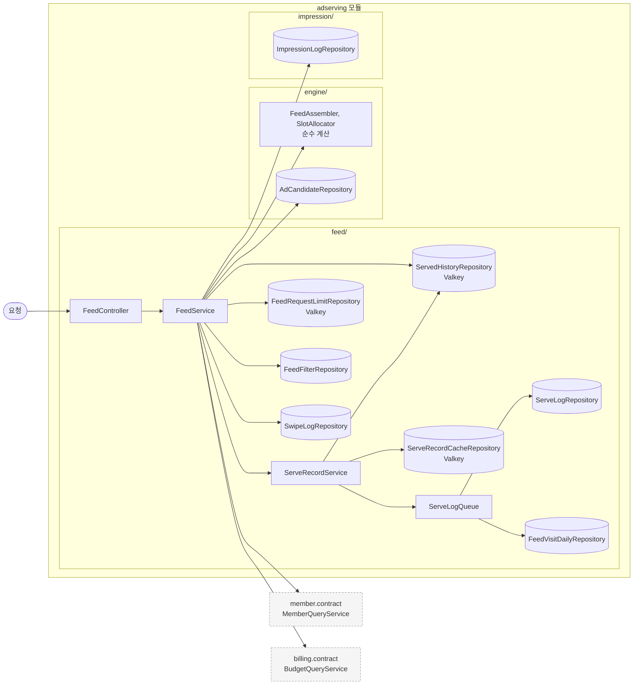
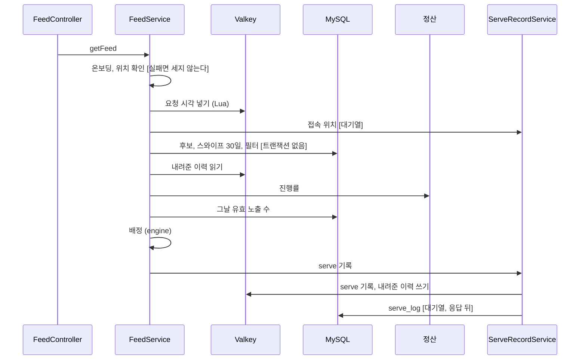

# adserving 구조와 동작 설계

[구조와 동작 설계 가이드](../구조와_동작_설계_가이드.md)의 목차를 따른다. 이 판은 `GET /v1/feed`(#187)가
건드린 것만 채웠다. 나머지 기능이 걸린 장은 "아직 훑지 않았다" 로 둔다.

엔드포인트별 처리와 성능 목표는 [`feed-api-design.md`](./feed-api-design.md)가 갖는다. 의존 대상이
멈췄을 때의 처리는 [`adserving_장애_처리_설계.md`](./adserving_장애_처리_설계.md)가 갖는다.

## 1. 범위

| 적을 것 | 내용 |
|---|---|
| 맡는 기능과 근거 | 스와이프 피드 조회(67, 96, 97, 99행). 이 판에서 구현한 것은 이것 하나다 |
| 아직 훑지 않은 기능 | 찜과 패스, 노출 수집, 피드 필터 저장, 찜 목록, 피드 배정 진단, 00:00 (8), (9), (10)단계 |
| 맡지 않는 것과 그 소유 도메인 | 예산 소진 진행률과 그날 예약액과 단가는 정산이 계산한다. 잔여 수량은 쿠폰이 갖는다. 성별, 연령대, 저장 위치, 온보딩 여부는 회원이 갖는다 |

**예산 소진 진행률을 다시 계산하지 않는다.** 정산의 `BudgetQueryService` 가 준다. 광고 서빙은 그
값에 소비 기준(1.2 초과 제외)과 노출 상한(예약액 / 단가 x 1.05)만 적용한다. 그 둘은
`BudgetProgress` 의 주석이 광고 서빙 몫으로 넘겼다.

## 2. 애그리거트와 패키지

| 애그리거트 | 테이블 | 이 판에서 하는 일 | 나눈 근거 |
|---|---|---|---|
| 후보 스냅샷 (`engine/`) | `ad_candidate` | 그날 서빙 가능한 후보를 읽는다. 배정 계산이 같은 패키지에 있다 | 하루 단위로 통째로 바뀐다. 서빙 경로가 이 표만 읽는다(96행) |
| 서빙 기록과 스와이프 이력 (`feed/`) | `serve_log`, `swipe_log` | `serve_log` 를 응답 뒤에 쓰고 `swipe_log` 를 읽는다 | 설계 문서 1.3 의 트리 |
| 노출 로그 (`impression/`) | `impression_log` | 그날 유효 노출 수를 센다 | 설계 문서 1.3 의 트리 |
| 피드 필터와 접속 위치 (`feed/`) | `feed_filter`, `feed_filter_category`, `feed_visit_daily` | 필터를 읽고 그날 첫 요청 위치를 쓴다 | 설계 문서 1.3 의 트리에 자리가 없다. 피드 요청이 읽고 써서 임시로 `feed/` 에 둔다(#187) |

```
adserving/
├── config/AdservingSecurityConfig.java      GET /v1/feed 는 MEMBER
├── engine/
│   ├── FeedAssembler.java                   거르기와 탐색 반경
│   ├── SlotAllocator.java                   배분 3장과 관련성 7장
│   ├── FeedCandidate, Viewer, FeedInput, FeedPlan, PlannedCard, BudgetSnapshot, CategoryPreference
│   └── repository/AdCandidateRepository.java
├── feed/
│   ├── ServeRecord.java, SwipeHistory.java, ServeIds.java
│   ├── ServeLogQueue.java                   응답 뒤 쓰기 대기열
│   ├── controller/FeedController.java
│   ├── service/FeedService.java             요청 처리 순서와 캐시 장애 처리
│   ├── service/ServeRecordService.java      serve 기록, 내려준 이력, 비동기 쓰기
│   ├── repository/                          JDBC 넷, Valkey 셋
│   ├── dto/, exception/, entity/SwipeAction.java
└── impression/repository/ImpressionLogRepository.java
```

**`ad_candidate` 를 JPA 엔티티로 매핑하지 않았다.** 복합 키라 `BaseTimeEntity` 를 상속할 수 없고 이
판은 읽기만 한다. JdbcTemplate 로 읽어 record 로 받는다. 엔티티는 적재 작업이 쓰기를 가져올 때
만든다.

**애그리거트끼리 ID 로 참조한다.** `campaign_id`, `store_id`, `member_id` 는 모두 소프트 참조다.

| 규칙 | 두는 곳 |
|---|---|
| 노출 대상, 노출 반경, 필터, 그날 이력, 예산으로 거르기와 슬롯 배정 | `engine` 의 순수 클래스 |
| 사용자 확인, 요청 제한, 서빙 시간대, 캐시 장애 처리, 기록 순서 | `FeedService` |
| serve 기록, 내려준 이력, 비동기 쓰기 | `ServeRecordService` |

## 3. 저장

| 적을 것 | 내용 |
|---|---|
| DB 제약으로 막을 것 | `feed_visit_daily` 는 PK `(business_date, member_id)` 와 `INSERT IGNORE` 로 그날 첫 행만 남긴다 |
| 집계를 세는 방식 | 그날 유효 노출 수를 요청마다 `impression_log` 에서 센다(`idx_imp_campaign_date`). 카운터를 두지 않는다. 비용은 11장에 있다 |
| 다른 도메인 데이터의 사본 | `ad_candidate` 가 캠페인과 가게의 값을 복사한다. 이 판은 읽기만 한다 |
| 복잡한 조회 | 후보는 5000m 상자로 한 번 읽고 반경 확장은 메모리에서 한다. 반경마다 다시 조회하지 않는다 |

인메모리 저장소(Valkey)에 두는 데이터다.

| 데이터 | 키 | 만료 | 원본 | 읽는 곳 |
|---|---|---|---|---|
| serve 기록 | `adserving:serve:{serveId}` 해시 | 30분 | `serve_log` | 노출 검증(아직 구현 전) |
| 피드 요청 시각 | `adserving:feed:requests:{memberId}` 정렬 집합 | 60초 | 없다 | 요청 제한 |
| 그날 캠페인마다 내려준 횟수 | `adserving:feed:served:{영업일}:{memberId}` 해시 | 2일 | 없다 | 하루 2회 제한 |
| 이번 세션에 내려준 캠페인 | `adserving:feed:session:{memberId}` 집합 | 마지막 피드 요청 뒤 30분 | 없다 | 세션 1회 제한 |

**serve 기록의 해시 필드는 노출 검증이 읽을 모양이다.** `feedId`, `memberId`, `businessDate`,
`campaignId`, `storeId`, `slotType`, `slotPosition`, `servedAt` 이다.

**하루 2회와 세션 1회는 `serve_log` 로 세지 않는다.** `serve_log` 는 응답 뒤 비동기로 쓰여 늦고 빠질
수 있다. 키에 영업일이 들어가 다음 날에는 새 키를 본다. 그래서 00:00 (9)단계가 지울 것이 없다.

**원본이 없는 셋은 지워져도 제한이 느슨해질 뿐이다.** 그날 그 사용자에게 상한을 한 번 더 열어 준다.
거절이 늘지는 않는다.

## 4. 계산 로직

`engine/` 의 `FeedAssembler` 와 `SlotAllocator` 다. Spring 과 저장소를 import 하지 않고 지금 시각과
예산은 `FeedService` 가 넘긴다.

| 계산 | 공식 | 근거 |
|---|---|---|
| 거르기 | 그날 이력과 하루 2회와 세션 1회에 걸린 캠페인, 필터 밖 업종, 대상 성별과 연령대가 맞지 않는 캠페인, 캠페인 노출 반경 밖, 예산에 걸린 캠페인을 뺀다 | 96, 99행, 비즈니스 규칙 |
| 대상 성별 | `ALL` 이면 누구나, 아니면 회원 성별과 같아야 한다. 회원 성별 `OTHER` 는 `ALL` 만 받는다 | 캠페인 대상이 `ALL`, `MALE`, `FEMALE` 뿐이다 |
| 예산 | 진행률 > 1.2 이거나 유효 노출 수 >= floor(예약액 x 1.05 / 단가) 면 뺀다. 그날 진행률이 없으면 뺀다 | 99행, `BudgetQueryService` 주석 |
| 탐색 반경 | 1000, 2000, 3000, 5000 가운데 적격 후보가 10장 이상인 가장 작은 반경이다. 끝까지 모자라면 5000 이다 | 67행 반경 확장 |
| 배분 슬롯 3장 | 신규 우선 노출(`new_priority_until` >= 그날) 먼저, 그다음 진행률 오름차순, 그다음 `campaign_created_at` 오름차순이다 | 96, 99행, `ad_candidate` 컬럼 주석 |
| 관련성 점수 | 0.45 x 거리 + 0.35 x 카테고리 선호도 + 0.20 x 할인이다. 거리 = 1 - 거리/탐색 반경, 카테고리 선호도 = 최근 30일 찜 가운데 그 업종의 비율, 할인 = `PERCENT` 는 값/100, `AMOUNT` 는 min(값, 10000)/10000 이다 | 97행. 정규화는 임시(#187) |
| 관련성 슬롯 7장 | 점수 상위 7장을 고른 뒤 필터 정렬로 놓는다. `DISTANCE` 는 거리 오름차순, `DISCOUNT_RATE` 는 할인 점수 내림차순이다 | 70행 "정렬은 추천 카드 7장에만" |
| 자리 | 1, 4, 7번이 배분 슬롯이다. 한쪽이 모자라면 빈 자리 없이 다른 쪽에서 당겨 채운다 | 96행 |

**예산을 모르면 예산 조건 없이 배정한다.** 정산의 구현이 develop 에 없는 동안(#193)만 그렇다.
`BudgetSnapshot.UNKNOWN` 이 그 상태다.

## 5. 모듈 연결

| 방향 | 대상 도메인 | 인터페이스 | 시점 |
|---|---|---|---|
| 읽기 | 회원 | `MemberQueryService.findById` | 피드 요청마다 1번 |
| 읽기 | 정산 | `BudgetQueryService.getProgress` | 서빙 시간대의 피드 요청마다 1번. 후보가 5000 을 넘으면 나눠 부른다 |

**정산은 `ObjectProvider` 로 받는다.** 구현이 develop 에 없어 그대로 주입하면 컨텍스트가 뜨지
않는다. #193 이 병합되면 직접 주입으로 바꾼다.

**정산 호출에 캐시를 두지 않았다.** 피드 500 TPS 면 초당 500번이다. 정산이 카운터와 시간대별 목표만
읽어 핫패스에서 불러도 된다고 적었다(`BudgetQueryService` 주석).

**다른 도메인의 enum 을 그대로 쓴다.** `campaign.contract` 의 `TargetGender`, `AgeGroup`,
`DiscountTargetType`, `DiscountType` 과 `member.contract` 의 `Gender`, `AgeGroup` 이다. 두 `AgeGroup`
은 이름으로 맞춘다.

공개하는 기능은 아직 훑지 않았다.

## 6. 구조와 동작 그림

### 모듈 구조



### 상태 변경

아직 훑지 않았다. 이 판은 `ad_candidate.campaign_state` 를 읽기만 한다.

### 주요 흐름



| 실패 지점 | 남는 상태 | 다시 요청하면 |
|---|---|---|
| 정산 조회 | 요청 횟수 하나와 접속 위치가 남는다. 카드는 없다 | 같은 처리를 처음부터 한다 |
| serve 기록 쓰기 | 응답은 나간다. 그 카드의 노출은 `EXPIRED_OR_UNKNOWN` 이 된다 | 다음 피드는 새 카드라 영향이 없다 |
| `serve_log` 쓰기 | 응답은 나간다. 진단이 그 묶음을 "기록 없음" 으로 본다 | 다시 쓰지 않는다 |

## 7. 트랜잭션과 동시성

| 흐름 | 한 트랜잭션에 묶는 것 | 트랜잭션 밖 |
|---|---|---|
| 피드 응답 | 없다. 읽기만 한다 | `serve_log`, `feed_visit_daily` 쓰기는 응답 뒤 대기열에서 한다 |

| 상황 | 확인할 것 | 피드 응답에서 |
|---|---|---|
| 같은 요청이 다시 옴 | 멱등 키 | 해당 없음. 요청마다 새 카드 묶음이고 요청 제한이 횟수를 센다 |
| 같은 회원의 요청이 동시에 옴 | 하루 2회와 세션 1회 | 이력을 읽고 배정한 뒤 쓴다. 원자적이지 않아 동시에 온 두 요청이 서로를 못 보고 상한을 넘을 수 있다. 요청 제한이 60초 6회라 넘어도 한 번이다. 임시로 받아들인다(#187) |
| 같은 회원의 요청이 동시에 옴 | 요청 제한 | Lua 한 번으로 지우기, 세기, 넣기를 함께 해서 넘지 않는다 |
| 여러 회원이 같은 자원에 씀 | 수량, 잔액 | 해당 없음. 피드는 쓰지 않는다 |

**영업일과 서빙 시간대는 `ClockConfig.ZONE` 의 지금으로 판단한다.** 10:00 이상 13:00 미만이 서빙
시간대다. 요청 제한의 시각도 같은 시계로 넣는다. 응답의 `nextFeedAvailableAt` 과 같은 시계라야 둘이
맞는다.

**잠금을 쓰지 않는다.** 피드는 DB 에 쓰지 않는다.

## 8. 외부 API

해당 없음. 광고 서빙은 외부 API 를 부르지 않는다.

## 9. 실패 처리

의존 대상이 멈췄을 때의 처리는 [`adserving_장애_처리_설계.md`](./adserving_장애_처리_설계.md)가 갖는다.
여기에는 돈이 걸린 경로에서 누군가에게 불리하게 남는 경우만 적는다.

| 흐름 | 불리하게 남는 경우 | 누구에게 | 막는 방법 |
|---|---|---|---|
| 피드 응답 | serve 기록을 쓰지 못한 카드의 노출이 무효가 되어 차감되지 않는다 | 플랫폼 | 지표 `adserving.feed.cache.bypass{target=serve_record}` 로 센다 |
| 피드 응답 | 내려준 이력을 읽거나 쓰지 못해 하루 2회를 넘겨 내려준다 | 플랫폼. 노출 상한은 그대로라 점주의 과금은 늘지 않는다 | 같은 지표의 `served_history` 로 센다 |
| 피드 응답 | 정산 구현이 없는 동안 예산 조건 없이 내려준다 | 플랫폼 | #193 병합 뒤 직접 주입으로 바꾼다 |

## 10. 배치

아직 훑지 않았다. 피드가 두는 Valkey 키는 모두 만료로 사라져 00:00 (9)단계가 지울 것을 만들지 않는다.

## 11. 성능

목표는 [`feed-api-design.md`](./feed-api-design.md)의 `GET /v1/feed` 500 TPS, p99 500ms 다.

| 흐름 | 요청 하나의 비용 |
|---|---|
| `GET /v1/feed` | DB 읽기 5(`ad_candidate`, `swipe_log`, `feed_filter`, `feed_filter_category`, `impression_log` 집계), 다른 도메인 호출 2(회원, 정산), Valkey 왕복 5(요청 제한 1, 이력 읽기 2, serve 기록 파이프라인 1, 이력 쓰기 파이프라인 1), 비동기 DB 쓰기 2(`serve_log` 배치 1, `feed_visit_daily` 1) |

| 흐름 | 목표 TPS | 초당 DB 읽기 | 초당 비동기 DB 쓰기 | 초당 다른 도메인 호출 |
|---|---|---|---|---|
| `GET /v1/feed` | 500 | 2,500 | 1,000 문장(행으로 5,500) | 1,000 |

**가장 무거운 읽기는 유효 노출 집계다.** 5000m 상자 안 후보 전부의 그날 노출을 요청마다 센다.
노출이 쌓이는 11시 이후 느려지면 노출 수집이 카운터를 두는 쪽으로 바꾼다. 아직 재지 않았다.

**확인 방법은 k6 다.** 10:00~12:59, 특히 10:50~11:05 를 재현한다.

## 12. 테스트와 미정 사항

| 미정 항목 | 어디까지 정해졌나 | 막는 것 |
|---|---|---|
| 정산 구현이 없는 동안의 예산 | `ObjectProvider` 로 받아 없으면 예산 조건 없이 배정한다 | #193 병합 뒤 직접 주입으로 바꿔야 한다 |
| 관련성 점수의 정규화 | 가중치만 정해졌다. 거리, 선호도, 할인의 0 ~ 1 척도는 임시다(4장) | 공식이 바뀌면 `SlotAllocator` 와 그 테스트가 바뀐다 |
| 하루 2회와 세션 1회의 동시 요청 | 읽고 배정한 뒤 쓴다. 원자적이지 않다 | 넘는 경우를 막으려면 배정과 기록을 Lua 하나로 묶어야 한다 |
| 슬롯 비율, 가중치, 하루 노출 횟수, 세션 길이 | 명세값을 상수로 두었다 | ops 가 설정값 조회를 공개해야 바꿀 수 있다. 진단(30행)이 "그 시각에 적용된 설정값" 을 보이려면 필요하다 |
| `feed_filter`, `feed_filter_category`, `feed_visit_daily` 의 자리 | 임시로 `feed/` 에 두었다 | 설계 문서 1.3 의 트리에 넣어야 한다 |
| 가게 상세에서 찜했다가 지운 캠페인의 당일 제외 | 피드는 그날 `swipe_log` 만 본다 | `DELETE /v1/wishlist` 를 구현할 때 정한다 |
