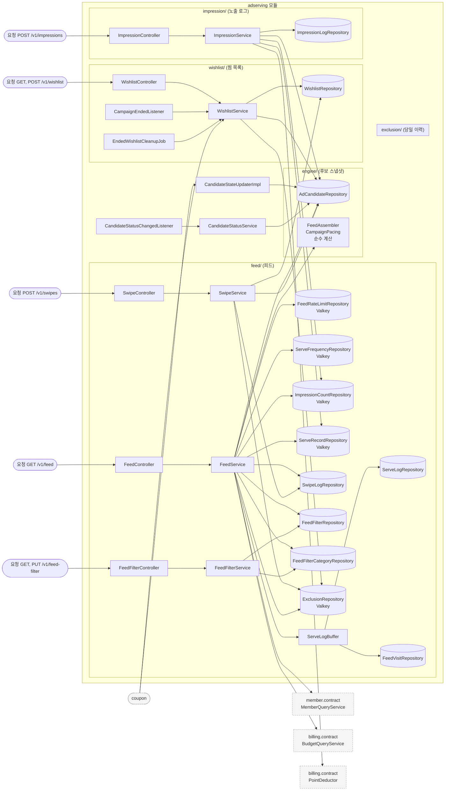
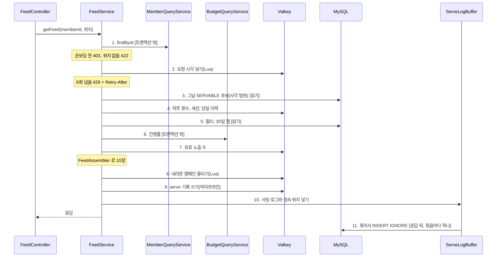
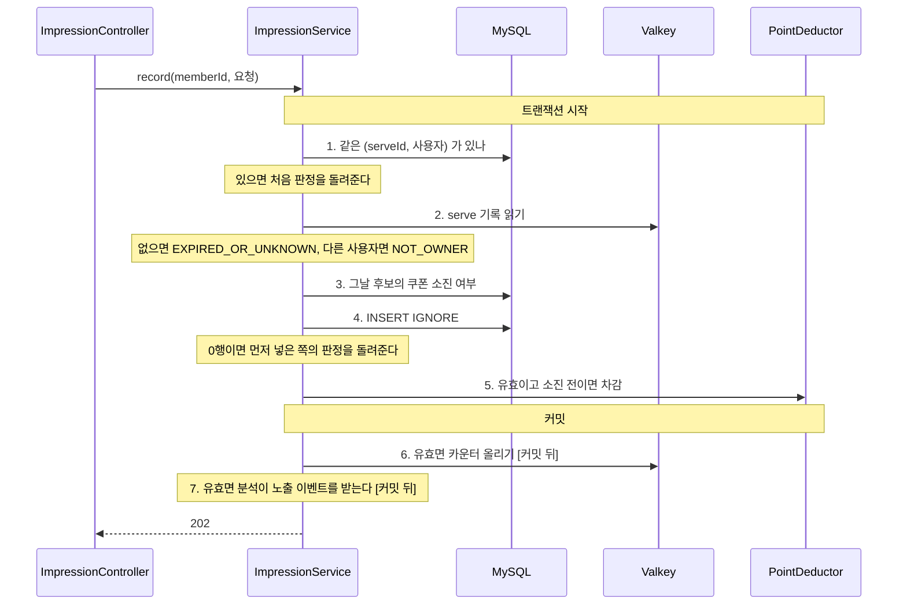
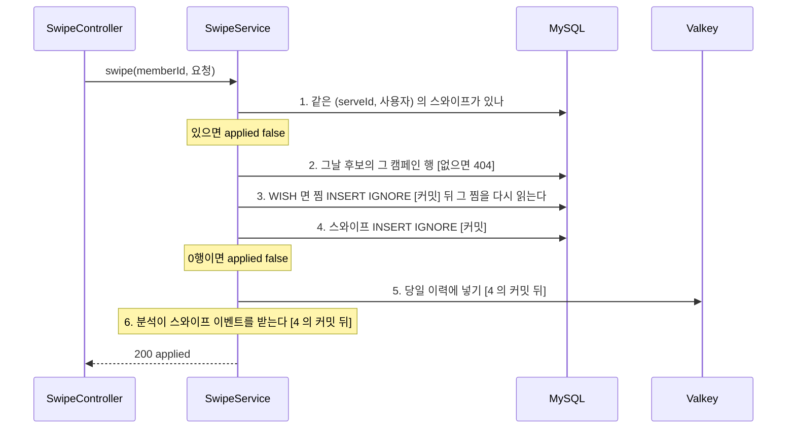
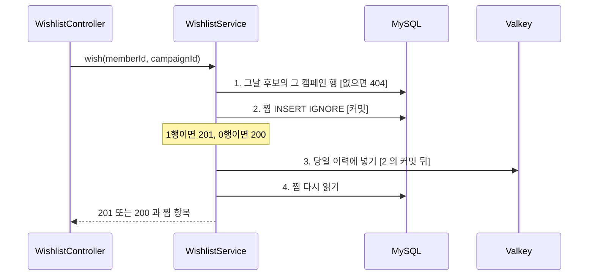

# adserving 구조와 동작 설계

광고 서빙 도메인의 구조와 동작을 적는다. 엔드포인트마다의 처리와 성능 목표는
[`feed-api-design.md`](./feed-api-design.md) 가 갖는다. 지금은 `GET /v1/feed` 의 후보 선별(#236), 배정 규칙(#307), serve 기록과 서빙 로그(#315), `POST /v1/impressions`(#323), `POST /v1/swipes`(#379), `GET /v1/feed-filter`(#405), `PUT /v1/feed-filter`(#411), 분석으로 가는 퍼널 이벤트(#349), 쿠폰에 공개한 `WishlistQueryService` 와 `CandidateStateUpdater`(#163), 분석이 부르는 집계 조회(#350)까지 훑었다.
나머지 엔드포인트는 그 이슈가 이 문서를 채운다.

## 1. 범위

| 맡는 것 | 근거 |
|---|---|
| 그날 후보 스냅샷에서 사용자에게 카드 10장을 고른다 | FR-064, FR-093 |
| 배분 3장과 관련성 7장으로 배치하고 예산을 넘긴 캠페인을 뺀다 | FR-093, FR-094, FR-096 |
| 같은 캠페인을 하루 2회, 한 세션 1회까지만 내려준다 | 비즈니스 규칙(`feed-api-design.md` 4단계) |
| 사용자마다 최근 60초 6회로 피드 요청을 막는다 | FR-064, 명세의 요청 제한 |
| 카드를 찜하거나 패스하고, 찜은 찜 목록에 넣는다 | FR-065, FR-071 |
| 내 피드 필터(업종, 정렬)를 돌려주고 통째로 바꾼다 | FR-067 |
| 내 찜 목록을 그날 후보 스냅샷의 표시 값과 함께 돌려준다 | FR-071 |
| 가게 상세에서 그날 후보인 캠페인을 찜한다 | FR-071 |
| 피드의 찜과 패스, 가게 상세의 찜으로 그날 피드에서 뺄 캠페인을 기억한다 | FR-099 (9), BR-040 |
| 카드마다 serve 기록을 남겨 노출 검증에 쓰게 한다 | FR-097 |
| 서빙 로그와 그날 첫 접속 위치를 응답 뒤에 쓴다 | FR-027, FR-042, FR-064 |
| 카드가 보인 순간을 받아 유효와 무효를 가르고, 유효 노출을 정산에 넘겨 차감한다 | FR-066, FR-097, FR-100 |
| 쿠폰에 회원의 찜 여부와 찜한 캠페인을 알려준다 | FR-080 |
| 쿠폰의 선착순 소진 통보를 받아 그날 후보에 소진을 표시한다 | FR-093 |
| 처음 저장한 유효 노출과 반영된 스와이프를 분석의 퍼널에 알린다 | V52 기능 101행 |
| 영업일마다 노출과 찜을 캠페인, 회원 단위로 묶어 분석에 내준다 | 설계 문서 2.2 집계 조회, 규칙 4 |

| 맡지 않는 것 | 소유 |
|---|---|
| 온보딩 완료 여부, 저장 위치, 성별, 연령대 | member. `MemberQueryService` 로 읽는다 |
| 예산 소진 진행률, 그날 예약액과 단가 | billing. `BudgetQueryService` 로 읽는다 |
| 노출 과금 판정(`BILLED`, `NOT_BILLED_BUDGET`) | billing. 상한을 넘겨 나간 노출도 과금은 정산이 막는다 |
| 잔여 수량 | coupon. 피드와 찜 목록에 싣지 않는다(`feed-api-design.md`) |

## 2. 애그리거트와 패키지

| 애그리거트 | 테이블 | 지키는 규칙 | 나눈 근거 |
|---|---|---|---|
| 후보 스냅샷(`engine`) | `ad_candidate` | 서빙은 그날 행만 읽는다 | 00:00 에 통째로 다시 만들어 변경 주기가 다르다 |
| 피드(`feed`) | `feed_filter`, `feed_filter_category`, `swipe_log`, `serve_log`, `feed_visit_daily` | 필터가 없으면 전 업종, 거리순이다. 그날 첫 접속 위치만 남는다 | 아키텍처 1.3 의 `feed` 서브 도메인 |
| 찜 목록(`wishlist`) | `wishlist` | (사용자, 캠페인)마다 1건이다 | 캠페인이 끝날 때까지 남아 그날 단위의 피드 기록과 수명이 다르다(아키텍처 1.3) |
| 노출 로그(`impression`) | `impression_log` | (serveId, 사용자)마다 1건이다. 무효면 사유가 있고 유효면 없다 | 노출 저장이 정산의 판정, 원장과 한 트랜잭션이라 서빙과 따로 바뀐다 |

```
adserving/
├── config/AdservingSecurityConfig.java
├── contract/
│   ├── WishlistQueryService.java     쿠폰이 부르는 찜 조회
│   ├── CandidateStateUpdater.java    쿠폰이 부르는 소진 반영
│   ├── AdservingStatsQueryService.java   분석의 집계 조회(#350)
│   ├── CampaignImpressionStats.java
│   ├── MemberInvalidImpressionCount.java
│   └── CampaignMemberConcentration.java
├── engine/
│   ├── FeedAssembler.java        카드 고르기와 슬롯 배치. 계층 밖의 순수 계산
│   ├── FeedCandidate.java        계산이 받는 후보 record
│   ├── FeedContext.java          계산이 받는 사용자와 예산 record
│   ├── CampaignPacing.java       진행률과 노출 상한 판정
│   ├── entity/AdCandidate.java
│   ├── exception/CandidateErrorCode.java   그날 후보가 아니다(ADSERVING-004)
│   ├── service/CandidateStateUpdaterImpl.java   CandidateStateUpdater 구현
│   ├── service/CandidateStatusService.java      캠페인 상태 변경을 그날 후보의 서빙 상태에 반영한다
│   ├── service/CandidateLoadService.java        00:00 에 그날 후보를 적재하고 적재 중의 상태 전이를 다시 읽어 반영한다
│   ├── job/LoadDailyCandidateJob.java           00:00 묶음 75. 적재와 재조회를 두 트랜잭션으로 부른다
│   ├── repository/AdCandidateLoadImpl.java      적재의 upsert. 소진 시각을 덮지 않고 상태는 늦을 때만 바꾼다
│   ├── listener/CandidateStatusChangedListener.java  CampaignStatusChangedEvent 를 받는다
│   └── repository/AdCandidateRepository.java
├── exclusion/
│   └── repository/ExclusionRepository.java  Valkey. 스와이프와 가게 상세 찜, 찜 삭제가 쓰고 피드가 읽는다
└── feed/
    ├── controller/FeedController.java
    ├── controller/SwipeController.java
    ├── controller/FeedFilterController.java
    ├── service/FeedService.java
    ├── service/SwipeService.java
    ├── service/FeedFilterService.java
    ├── service/ServeLogBuffer.java                  서빙 로그 대기열과 작업자
    ├── repository/FeedRateLimitRepository.java      Valkey
    ├── repository/ServeFrequencyRepository.java     Valkey
    ├── repository/ImpressionCountRepository.java    Valkey
    ├── repository/ServeRecordRepository.java        Valkey
    ├── repository/ServeLogRepository.java           JDBC 배치
    ├── repository/FeedVisitRepository.java          JDBC 배치
    ├── repository/SwipeLogRepository.java
    ├── repository/FeedFilterRepository.java
    └── repository/FeedFilterCategoryRepository.java
wishlist/
    ├── controller/WishlistController.java
    ├── service/WishlistService.java                 조회, 가게 상세 찜, 찜 삭제, 종료 표시와 정리. WishlistQueryService 구현 포함
    ├── listener/CampaignEndedListener.java          캠페인 종료를 받아 찜을 종료로 표시한다
    ├── job/EndedWishlistCleanupJob.java             00:00 묶음 80. 끝난 날을 빼고 3일이 지난 찜을 지운다
    ├── repository/WishlistRepository.java           넣기는 INSERT IGNORE, 종료 표시와 정리는 벌크 UPDATE 와 DELETE
    └── entity/Wishlist.java
impression/
    ├── controller/ImpressionController.java
    ├── service/ImpressionService.java
    ├── service/AdservingStatsQueryServiceImpl.java  집계 조회 구현. 찜은 feed 의 SwipeLogRepository 로 센다
    ├── repository/ImpressionLogRepository.java      읽기는 JPA, 쓰기는 INSERT IGNORE, 집계는 네이티브 쿼리
    └── entity/ImpressionLog.java
```

- `feed` 는 `engine` 의 후보를 엔티티가 아니라 `FeedCandidate` 로, 나머지 입력을 `FeedContext` 로 넘겨 계산한다.
- 애그리거트끼리는 객체로 쥐지 않고 ID 로만 잇는다. `serve_log`, `swipe_log` 는 `campaign_id` 로 후보를 가리키고 연관 매핑이 없다.
- `impression` 은 `feed` 의 serve 기록과 유효 노출 수 카운터, `engine` 의 후보 소진 여부를 읽는다. 반대 방향은 없다.
- `feed` 의 스와이프는 `wishlist` 에 찜을 넣는다. 두 애그리거트를 한 트랜잭션에 묶지 않고 쓰는 순서로 맞춘다(7장).
- `wishlist` 의 찜 목록 조회는 `engine` 의 그날 후보에서 표시 값을 읽는다. 반대 방향은 없다.
- 당일 이력은 스와이프와 가게 상세 찜, 찜 삭제가 함께 쓰고 피드가 읽어 `feed` 와 `wishlist` 밖의 `exclusion` 에 둔다. `wishlist` 가 `feed` 를 부르지 않게 하려는 것이다(#420). 오래 사는 찜 목록이 그날 단위의 피드에 기대지 않는다.
- 그날 후보가 아니라는 판정(`ADSERVING-004`)은 스와이프와 가게 상세 찜이 함께 써서 `engine` 의 `CandidateErrorCode` 가 갖는다(#420).
- 입구는 HTTP 요청 일곱(`GET /v1/feed`, `POST /v1/impressions`, `POST /v1/swipes`, `GET`, `PUT /v1/feed-filter`, `GET`, `POST /v1/wishlist`)이다. 다른 도메인의 호출은 쿠폰이 부르는 `WishlistQueryService` 와 `CandidateStateUpdater` 둘(#163)과 analytics 가 부르는 `AdservingStatsQueryService`(#350)다. 스케줄과 이벤트는 아직 없다.
- 집계 조회의 구현은 노출을 주로 세서 `impression` 에 둔다. 찜은 `feed` 의 `swipe_log` 에서 센다.

### 규칙을 두는 곳

| 규칙 | 두는 곳 |
|---|---|
| 엔티티 하나의 상태로 판정되는 규칙 | 무효 노출은 사유가 있고 유효 노출은 없다. `ImpressionLog` 의 정적 팩터리 셋(`valid`, `notOwner`, `unknown`)이 지킨다. 스키마가 CHECK 로 막지 않는다 |
| 후보 조건, 하루 2회와 세션 1회, 탐색 반경, 배분과 관련성 슬롯, 관련성 점수 | `FeedAssembler`(순수 계산) |
| 진행률 1.2 초과와 노출 상한 판정 | `CampaignPacing.blocked()`(순수 계산) |
| 온보딩, 위치, 요청 제한의 순서, 입력을 모으는 순서, 기록을 남기는 시점 | `FeedService` |
| 서빙 로그를 묶어 쓰고 차면 버리는 규칙 | `ServeLogBuffer` |
| 노출의 유효 판정, 같은 노출이 다시 올 때의 처리, 차감과 카운터의 시점과 영업일 | `ImpressionService` |
| 집계 조회의 시간대(0~23시), 판정과 사유를 세는 기준, 상위 회원을 고르는 순서 | `ImpressionLogRepository` 의 집계 쿼리 |
| 노출과 찜을 캠페인 ID 로 합치는 규칙, 시간대를 24칸으로 채우는 규칙 | `AdservingStatsQueryServiceImpl` |
| 같은 카드를 다시 넘길 때의 처리, 찜과 스와이프 기록과 당일 이력을 쓰는 순서 | `SwipeService` |
| 필터를 저장하지 않은 회원의 기본값(전체 업종, 거리순) | `FeedFilterService`. 피드는 같은 기본값을 `FeedService` 에서 따로 정한다. 한 곳으로 모으지 않은 것은 #411 에서 임시로 정했다 |
| 필터를 통째로 바꾸는 순서, 같은 업종이 두 번 올 때의 처리 | `FeedFilterService` |
| 현재 유효한 찜의 기준(행이 있으면 유효) | `WishlistService` 의 `WishlistQueryService` 구현. 단건과 목록이 같은 기준을 쓴다(#163) |
| 소진을 다시 통보받을 때와 후보가 없을 때의 처리 | `CandidateStateUpdaterImpl` |
| 서빙 가능 여부를 후보 상태로 바꾸는 규칙, 늦은 통보만 반영하는 규칙, 후보가 없을 때의 처리 | `CandidateStatusService` 와 `AdCandidateRepository.changeState` |
| 고를 수 있는 업종 코드와 정렬 값 | `FeedFilterSaveRequest` 의 애노테이션. 업종 코드는 store 가 소유하고 `contract` 로 공개하지 않아 `store.category_code` 의 CHECK 와 같은 목록을 따로 둔다(#411 에서 임시로 정했다) |
| 찜 목록의 표시 값을 그날 후보 행 유무로 채우고 없으면 `null` 로 두는 규칙 | `WishlistService`, `WishlistItemResponse` |
| 가게 상세 찜이 받는 캠페인(그날 후보 행), 처음 찜과 다시 찜의 구분, 찜과 당일 이력을 쓰는 순서, 찜 삭제가 당일 이력에 넣는 조건 | `WishlistService` |

`ServeLogBuffer` 를 `FeedService` 와 나눈 것은 입구가 달라서다. 앞은 요청 스레드가, 뒤는 작업자 스레드가 부른다.

## 3. 저장

| 적을 것 | 결정 |
|---|---|
| 후보 조회 | 최대 탐색 반경(5000m)을 덮는 사각 범위로 `idx_candidate_geo` 를 타고 한 번 읽는다. 상태(`SERVABLE`)와 소진(`sold_out_at IS NULL`)은 쿼리가, 나머지는 `FeedAssembler` 가 거른다 |
| 업종 선호도 | `idx_swipe_member_date` 로 최근 30일의 찜을 업종별로 센다. 요청마다 읽는다 |
| 찜 목록 | `uk_wishlist_member_campaign`(`member_id`, `campaign_id`)의 앞 열로 회원의 찜을 읽고 `created_at`, `wishlist_id` 내림차순으로 정렬한다. 표시 값은 그날 후보를 PK(`business_date`, `campaign_id`)의 IN 으로 한 번 더 읽어 붙인다. 후보 행이 있으면 상태와 소진은 보지 않는다(#416) |
| 필터 업종 | `feed_filter_category` 를 PK(`member_id`, `category_code`)로 읽고 업종 코드 오름차순으로 돌려준다(#405). 순서 컬럼이 없어 고른 순서는 남지 않는다 |
| 필터 저장 | `feed_filter` 는 `INSERT ... ON DUPLICATE KEY UPDATE` 로 정렬을 넣거나 바꾸고, `feed_filter_category` 는 그 회원의 행을 지우고 다시 넣는다. 같은 업종이 두 번 오면 하나만 넣는다(#411 에서 임시로 정했다) |
| 다른 도메인 데이터의 사본 | `ad_candidate` 는 00:00 의 캠페인과 가게 사본이다. 그날 안에서는 캠페인과 쿠폰의 통보로만 바뀐다 |
| 쿠폰의 찜 조회 | `uk_wishlist_member_campaign`(`member_id`, `campaign_id`)으로 단건은 있는지만 보고, 목록은 앞 열로 그 회원의 `campaign_id` 만 읽는다. 캠페인별 회원 일괄 조회는 같은 키로 입력한 회원(500명까지)의 행만 읽는다(#578). 셋 다 `campaign_ended_at IS NULL` 인 행만 유효로 본다. 순서는 정하지 않는다(#163, #553) |
| 끝난 캠페인의 찜 | 종료 표시는 `idx_wishlist_campaign` 으로 그 캠페인의 행 중 `campaign_ended_at` 이 비어 있는 것만 채운다. 정리는 `idx_wishlist_campaign_ended` 로 기준 시각 전에 끝난 행을 지운다(#553) |
| 소진 반영 | `ad_candidate` 의 PK(`business_date`, `campaign_id`)로 `sold_out_at IS NULL` 인 행만 바꾼다. 받은 소진 시각을 그대로 쓰고 부른 시각은 `updated_at` 에만 쓴다. 0행이면 PK 로 후보가 있는지 한 번 더 본다(#163) |
| 집계를 세는 방식 | 그날 유효 노출 수는 `impression_log` 를 세지 않고 카운터를 읽는다. 틀리면 `impression_log` 에서 다시 센다. 분석의 집계 조회는 카운터를 읽지 않고 아래 "집계 조회의 귀속" 대로 원본을 센다 |
| 집계 조회 | 노출은 `idx_imp_date_reason` 의 앞 열로 그날 행만 읽어 캠페인별로 한 번 훑는다. 판정, 사유, 슬롯을 같은 행들에서 세어 축끼리의 합이 맞는다. 시간대는 24칸이라 캠페인과 시로 묶는 쿼리를 따로 두고, 한 읽기 전용 트랜잭션에서 불러 같은 스냅샷을 본다(#498). 회원별 무효 노출은 그 인덱스의 두 열을 탄다. 찜은 `idx_swipe_date` 로 그날 `WISH` 만 센다. 두 테이블을 조인하지 않고 서비스가 캠페인 ID 로 합친다 |
| DB 제약으로 막을 것과 코드로 막을 것 | 같은 카드가 `serve_log` 에 두 번 들어가는 것은 PK(`serve_id`)와 `INSERT IGNORE` 로, 같은 날 두 번째 접속 위치는 PK(`business_date`, `member_id`)와 `INSERT IGNORE` 로 막는다. 같은 노출의 두 번째 저장은 `impression_log` 의 PK(`serve_id`, `member_id`)와 `INSERT IGNORE` 로, 같은 카드의 두 번째 스와이프는 `swipe_log` 의 같은 PK 로, 같은 캠페인의 두 번째 찜은 `uk_wishlist_member_campaign` 으로 막는다. 노출은 넣은 행 수로 처음 저장인지 가른다. 먼저 읽어 보는 것은 다시 온 요청을 빨리 돌려보내려는 것이고 동시 요청은 PK 가 막는다 |
| 이력 | 해당 없음. 그날 후보의 `sold_out_at` 은 한 번만 채워지고 다시 바뀌지 않는다. `serve_log`, `feed_visit_daily`, `impression_log`, `swipe_log` 는 쌓기만 하고 고치지 않는다. `wishlist` 는 지울 때 행을 지우고, 캠페인이 끝나면 `campaign_ended_at` 을 한 번만 채운 뒤 3일 뒤 지운다 |

| 데이터 | 키 | 만료 | 원본 | 읽는 곳 |
|---|---|---|---|---|
| 피드 요청 시각 | `adserving:feedRequests:{memberId}` 정렬 집합. 점수가 요청 시각(ms) | 마지막 요청 뒤 60초 | 없다. 잃으면 그 60초의 횟수가 비워진다 | `FeedRateLimitRepository` |
| 당일 이력 | `adserving:exclusion:{영업일}:{memberId}` 집합. 원소가 `campaignId` | 다음 영업일 00:00 까지 남은 시간 | 없다. 잃으면 그날 넘긴 카드가 다시 보인다 | `ExclusionRepository`. 쓰는 쪽은 `SwipeService` 와 `WishlistService` 의 가게 상세 찜과 찜 삭제다 |
| 하루 내려준 횟수 | `adserving:servedDaily:{영업일}:{memberId}` 해시. 필드 `campaignId`, 값 횟수 | 다음 영업일 00:00 까지 남은 시간 | 없다. 잃으면 그날 같은 카드가 더 나온다 | `ServeFrequencyRepository` |
| 세션에 내려준 캠페인 | `adserving:servedSession:{memberId}` 집합 | 피드 요청마다 30분을 다시 건다 | 없다. 키가 사라지면 새 세션이다 | `ServeFrequencyRepository` |
| 그날 유효 노출 수 | `adserving:validImpressions:{영업일}` 해시. 필드 `campaignId`, 값 건수. 영업일은 노출을 받은 날이다(#498). 정산이 차감하는 영업일과 같아 노출 상한과 그날 예약액이 같은 날을 본다 | 올릴 때마다 이틀 | `impression_log` 의 유효 노출 | `ImpressionCountRepository`. 올리는 쪽은 `ImpressionService` 다 |
| serve 기록 | `adserving:serve:{serveId}` 문자열. 회원:캠페인:가게:슬롯:자리:내려준 시각(ms) | 30분. 노출 인정 시간이고 정산은 이 값을 따로 두지 않아 과금을 인정하는 범위가 된다(#497, #498) | 없다. `serve_log` 는 판정에 쓰지 않는다. 잃으면 그동안의 노출이 무효다 | `ServeRecordRepository`, `ImpressionService` |

**결정: 당일 이력을 어디에 두나** (#236 에서 정했다)

| 선택지 | 장점 | 단점 |
|---|---|---|
| A. `swipe_log` 당일분과 `wishlist` 로 읽는다 | 새 저장소가 없다 | 가게 상세에서 찜했다가 지운 캠페인은 스와이프가 없어 그날 다시 나온다. 명세의 "지운 캠페인은 그날 피드에 다시 나오지 않는다" 를 어긴다 |
| B. Valkey 에 사용자별 당일 집합을 둔다 | 명세를 다 지킨다 | 원본이 없어 캐시를 잃으면 그날 이력이 빠진다 |

B 를 고른다. 빠질 때 잃는 것이 이미 넘긴 카드가 다시 보이는 것뿐이고 과금과 권한은 바뀌지 않는다.
이 문서의 "원본은 MySQL" 규칙에서 벗어난다. 스와이프 API 가 반영된 스와이프마다 넣고(#379), 가게 상세 찜 API 가 찜마다 넣는다(#420). 찜 삭제 API 는 지울 찜이 없어도, 그날 후보가 아니어도 넣는다(#547). 앞 요청이 Valkey 에 넣지 못했으면 다시 보낼 때 채워지고, 00:00 후보 적재 전에 지운 찜도 적재 뒤 그날 피드에 나오지 않는다.

**결정: 하루 2회와 세션 1회를 어디서 세나** (#307 에서 정했다)

| 선택지 | 장점 | 단점 |
|---|---|---|
| A. `serve_log` 에서 그날 내려준 캠페인을 읽는다 | 새 저장소가 없다 | 응답 뒤 비동기로 쓰고(#315) 유실을 허용해 연달아 온 요청에서 아직 안 쓰인 기록을 못 본다. 요청마다 DB 읽기가 하나 는다 |
| B. Valkey 에 사용자별 하루 해시와 세션 집합을 둔다 | 응답 전에 올려 다음 요청이 바로 본다 | 원본이 없어 캐시를 잃으면 그날 같은 카드가 더 나온다 |

B 를 고른다. 이것도 "원본은 MySQL" 규칙에서 벗어난다. 잃을 때 같은 카드가 더 나올 뿐 과금은 바뀌지 않는다.
하루 해시의 만료는 남은 시간(`PEXPIRE`)으로 건다. 시각(`EXPIREAT`)으로 걸면 앱이 정한 영업일과 Valkey 의 시계가 어긋날 때 키가 쓰자마자 사라진다.

**결정: 그날 유효 노출 수를 어디서 읽나** (#307 에서 정했다)

| 선택지 | 장점 | 단점 |
|---|---|---|
| A. 요청마다 `impression_log` 를 `GROUP BY` 로 센다 | 원본이라 정확하다 | 500 TPS 에서 후보 수백 개의 집계가 매번 돈다 |
| B. Valkey 카운터를 읽는다 | 요청마다 `HMGET` 한 번이다 | 원본과 어긋날 수 있다. 올리는 쪽(노출 API)이 아직 없다 |

B 를 고른다. 노출 API 가 유효 노출을 처음 저장하고 커밋한 뒤에 올린다(7장).

**결정: serve 기록을 어디에 두나** (#315 에서 정했다)

| 선택지 | 장점 | 단점 |
|---|---|---|
| A. 서버마다 로컬 캐시(Caffeine) | 빠르고 외부에 기대지 않는다 | 노출 요청이 다른 서버로 가거나 배포로 서버가 내려가면 기록을 못 찾아 유효 노출이 무효가 된다 |
| B. Valkey | 서버 여러 대가 함께 본다 | Valkey 가 멈추면 그동안의 노출이 모두 무효다. 피드마다 쓰기가 한 번 는다 |

B 를 고른다. 응답 전에 피드 1회의 카드를 파이프라인 한 번으로 쓴다. 응답 뒤에 쓰면 곧바로 온 노출이 기록보다 먼저 닿는다.

### 집계 조회의 귀속

| 값 | 기준 |
|---|---|
| 영업일 | `impression_log.business_date`(노출을 받은 날). 정산의 차감 영업일과 같다(5장). 자정을 넘겨 받은 노출은 다음 영업일로 센다 |
| 유효 노출 | `validity = 'VALID'`. 쿠폰 소진 뒤 노출(`sold_out`)을 포함한다. 그래서 정산의 `BILLED + NOT_BILLED_BUDGET + NOT_BILLED_PAUSED + NOT_BILLED_NO_PLAN` 에 소진 뒤 노출을 더한 값과 같다 |
| 무효 노출 | `invalid_reason` 의 두 값. `EXPIRED_OR_UNKNOWN` 의 캠페인은 요청이 보낸 값이라 없는 캠페인 ID 일 수 있다 |
| 시간대 | 받은 시각(`created_at`)의 시(0~23)를 그대로 센다. 내려준 시각이 저장되지 않아서다(#350 에서 정했다). 서빙 시간대가 없어져 10시와 12시에 붙이던 규칙을 지웠다(#498) |
| 슬롯 유형 | 유효 노출의 `slot_type`. 유효 노출은 serve 기록이 있어 비지 않는다 |
| 찜 | `swipe_log` 의 `WISH`. 가게 상세 찜은 들어가지 않는다. 31일이 지난 날은 보관 기간이 지나 0 이다(#350 에서 정했다) |
| 회원 축 | 무효 노출은 (캠페인, 회원)마다 상한 없이 전부 내준다. A-09 가 기간 합계와 전체 건수를 내야 해서다. 유효 노출은 회원 수와 상위 N명의 합만 내준다 |

**결정: 시간대를 어느 시각으로 자르나** (#350 에서 정했다)

| 선택지 | 장점 | 단점 |
|---|---|---|
| A. 받은 시각 `created_at`, 13시는 12시로 붙인다 | 스키마를 바꾸지 않는다. 서버 시각이라 조작할 수 없다 | 10:59 에 내려준 카드를 11:00 에 받으면 11시로 센다 |
| B. `impression_log` 에 내려준 시각을 더한다 | 가장 정확하다 | 쓰기가 가장 많은 테이블의 스키마와 노출 저장 경로를 함께 바꾼다 |
| C. 클라이언트의 표시 시각 `displayed_at` | 사용자가 본 순간에 가깝다 | 조작하거나 기기 시계가 틀리면 분포가 틀어진다 |

A 를 고른다. 시간대 분포가 서빙 시각과 달라 리포트에 쓰기 어렵다는 요구가 오면 B 로 옮긴다. 13시를 12시로 붙이던 부분은 서빙 시간대를 없애며 지웠다(#498).

**결정: 찜을 어디서 세나** (#350 에서 정했다)

| 선택지 | 장점 | 단점 |
|---|---|---|
| A. `swipe_log` 의 `WISH` | 노출에서 찜으로 가는 퍼널과 분모가 맞는다. 찜을 풀어도 줄지 않는다 | 가게 상세 찜이 빠진다. 31일이 지난 날을 다시 집계하면 0 이다 |
| B. `wishlist` 의 그날 행 | 가게 상세 찜까지 센다 | 찜을 풀거나 캠페인이 끝나면 행을 지워 다시 집계하면 줄어든다 |

A 를 고른다. 가게 상세 찜을 리포트에 넣어야 하면 그 찜을 영업일과 함께 남기는 기록을 먼저 만든다.

## 4. 계산 로직

`FeedAssembler.assemble` 이 카드를 고른다. 현재 시각, 위치, 예산은 `FeedService` 가 구해 `FeedContext` 로 넘긴다.

1. 거른다. 당일 이력, 필터 업종, 노출 대상 성별과 연령대, 캠페인 노출 반경(`target_radius`), 하루 2회, 이번 세션
2. 예산을 읽었으면 더 거른다. 그날 예산 계획이 없거나, 진행률이 1.2 를 넘거나, 유효 노출 수가 노출 상한(예약액 / 단가 x 1.05)에 닿은 캠페인이다
3. 탐색 반경 1000, 2000, 3000, 5000 가운데 10장이 모이는 가장 좁은 반경을 고른다. 5000 에서도 모자라면 있는 만큼이다.
   **임시**: 명세의 "후보가 모자라면" 을 10장 미만으로 읽었다(#236)
4. 배분 3장: 진행률 오름차순, 같으면 `campaign_created_at`, 그다음 `campaignId` 오름차순이다
5. 관련성: 남은 후보를 점수 내림차순으로 `10 - 배분 장수` 만큼 고르고, 피드 필터 정렬로 줄 세운다.
   DISTANCE 면 거리 오름차순, DISCOUNT_RATE 면 할인 점수 내림차순이다
6. 배분을 1, 4, 7번에 두고 나머지 자리를 관련성으로 채운다. 전체가 10장보다 적으면 빈 자리 없이 앞으로 당긴다

관련성 점수는 아래다(#307 에서 정했다). 세 항목 모두 0~1 이다.

| 항목 | 가중치 | 식 |
|---|---|---|
| 거리 | 0.45 | `1 - 거리 / 이번 요청의 탐색 반경` |
| 카테고리 선호도 | 0.35 | 오늘을 넣은 최근 30일의 찜 가운데 그 업종의 비율. 찜이 없으면 0 |
| 할인 | 0.20 | 이번 후보 가운데 같은 종류(PERCENT 끼리, AMOUNT 끼리)의 최댓값으로 나눈 값. 메뉴 가격이 없어 두 종류를 직접 비교할 수 없다 |

예산을 읽지 못했으면 2 와 4 를 건너뛰고 10장 모두 관련성이다(9장).

## 5. 모듈 연결

| 방향 | 대상 도메인 | 인터페이스 | 시점 |
|---|---|---|---|
| 읽기 | member | `MemberQueryService.findById` | 피드 요청마다 1번 |
| 읽기 | campaign | `CampaignQueryService.findServableOn`, `findAllById` | 00:00 후보 적재에 1번씩. 적재 대상과 적재 직후 재조회다(#582) |
| 읽기 | store | `StoreQueryService.findAdCandidatesByStoreIds`, `findMenusByIdIn` | 00:00 후보 적재에서. 가게는 계약 상수 `MAX_AD_CANDIDATE_STORE_IDS` 단위로 나눠 부른다(#582) |
| 읽기 | billing | `BudgetQueryService.getProgress` | 피드 요청마다 1번. 후보가 5000개를 넘으면 나눠 부른다 |
| 쓰기 | billing | `PointDeductor.deduct` | 처음 저장된 유효 노출마다 1번. 노출 저장과 같은 트랜잭션이다. 쿠폰 소진 뒤의 노출은 부르지 않는다 |
| 받기 | campaign | `CampaignStatusChangedEvent` | 캠페인이 낮에 멈추거나 재개될 때마다. 발행자와 같은 트랜잭션에서 그날 후보의 `campaign_state` 를 바꾼다(아키텍처 설계 2.4, #565) |
| 받기 | campaign | `CampaignEndedEvent` | 캠페인이 끝날 때 1번. 발행자와 같은 트랜잭션에서 그 캠페인의 찜을 종료로 표시한다(아키텍처 설계 2.4, #553) |
| 공개 | analytics 가 부른다 | `AdservingStatsQueryService` | 분석의 일별 집계 배치가 영업일마다 부른다. 읽기 전용 트랜잭션에서 묶은 건수만 돌려준다. 귀속은 3장 "집계 조회의 귀속" 을 따른다 |

- `getProgress` 에는 그날 사각 범위의 후보 전부를 넘긴다. 그 계약은 당일 카운터만 읽어 서빙 경로에서 불러도 된다고 적었다.
- `deduct` 에 넘기는 영업일은 노출을 받은 날이다(그 계약, #497). 판정, 차감, 소진 확인, 카운터가 같은 날을 보도록 `ImpressionService` 가 받은 날을 한 번만 구한다. 내려준 날로 넘기면 23:59 에 내려준 카드의 00:10 노출이 00:00 에 해제가 끝난 전날 예산에 과금된다.
- 그날 예산 계획이 없는 캠페인의 노출은 정산이 `NOT_BILLED_NO_PLAN` 으로 돌려준다. 00:00 묶음이 계획을 만들기 전이거나 전날 집행이 끝난 캠페인이고, serve 기록 TTL 때문에 자정 직후 30분 안에서만 생긴다.
- **후보 적재는 정산의 예약(`DailyReservationJob`, 00:00 묶음 50) 뒤에 돌아야 한다.** 먼저 돌면 계획이 없는 캠페인을 내려주고 그 노출은 모두 `NOT_BILLED_NO_PLAN` 으로 과금되지 않는다. 후보 적재는 00:00 묶음 75 다(10장, #582).
- 읽기 두 호출 모두 캐시를 두지 않는다. 회원 조회는 정지와 온보딩처럼 바로 반영돼야 하는 값이다. 진행률은 노출마다 바뀌어 캐시하면 1.2 초과 판정이 늦는다.

## 6. 구조와 동작 그림

### 모듈 구조



- `feed` 와 `impression` 과 `wishlist` 에서 `engine` 으로, `feed` 와 `wishlist` 에서 `exclusion` 으로, `impression` 에서 `feed` 로, `feed` 에서 `wishlist` 로만 화살표가 간다. 반대 방향은 없다
- 다른 도메인의 호출로 들어오는 입구는 쿠폰의 두 `contract` 다. 찜 조회는 `WishlistService` 가, 소진 반영은 `engine` 의 `CandidateStateUpdaterImpl` 이 받는다(#163). 이벤트로 들어오는 입구는 캠페인의 상태 변경(`engine`)과 종료(`wishlist`) 둘이고, 스케줄로 들어오는 입구는 끝난 찜 정리(`wishlist`) 하나다

### 상태 변경

그날 후보의 `campaign_state` 는 캠페인의 통보로만 바뀐다. 이 도메인이 스스로 전이시키지 않는다.

| 통보 | 바뀌는 상태 | 조건 |
|---|---|---|
| `CampaignStatusChangedEvent(servable=false)` | `PAUSED` | 그 영업일, 그 캠페인의 행이고 `changedAt` 이 `state_changed_at` 보다 늦다 |
| `CampaignStatusChangedEvent(servable=true)` | `SERVABLE` | 같다 |

- 낮에 끝난 캠페인도 `PAUSED` 로 둔다. 이벤트가 서빙 가능 여부만 싣고, 피드에서 빠지는 결과가 같으며 다음 날 후보에 들어가지 않는다. `ENDED` 는 쓰지 않는다(#565 에서 정했다)
- 소진(`sold_out_at`)은 상태와 따로 본다. 소진된 후보는 `SERVABLE` 로 돌아와도 피드에 나오지 않는다
- 늦은 통보만 반영해 같은 통보가 다시 오거나 순서가 바뀌어 와도 결과가 같다(아키텍처 설계 2.4)

### 주요 흐름

피드 조회, 노출 수집, 스와이프 셋이다. 필터 조회는 PK 로 두 번 읽고 끝나고, 필터 저장은 한 트랜잭션에서 넣거나 바꾸고 지우고 다시 넣어 끝나 흐름 그림을 두지 않는다. 다른 도메인 호출은 같은 프로세스 안의 호출이다.

**피드 조회.** 트랜잭션은 없고 DB 읽기가 각자 끝난다.



| 실패 지점 | 남는 상태 | 다시 요청하면 |
|---|---|---|
| 1, 3, 5 | 아무것도 남지 않는다. `500` 이다. 2 를 지났으면 요청 횟수에는 들어갔다 | 새로 처리한다 |
| 2, 4, 7 | Valkey 가 멈추면 그 규칙만 빼고 계속한다. 남는 것이 없다 | 새로 처리한다 |
| 6 | 예산 규칙 없이 계속한다(9장) | 새로 처리한다 |
| 8 | 내려준 횟수가 오르지 않아 다음 요청에서 같은 카드가 더 나올 수 있다 | 새 카드가 나간다 |
| 9 | 응답은 나가지만 그 카드의 노출이 무효다 | 새 serveId 로 새 기록이 남는다 |
| 10 | 대기열이 차면 그 피드의 서빙 로그와 접속 위치가 빠진다 | 새 피드는 새로 넣는다 |
| 11 | 그 묶음의 서빙 로그와 접속 위치가 빠진다 | 해당 없음. 응답 뒤라 클라이언트는 모른다 |

**노출 수집.** 돈이 걸린 흐름이다. 노출 저장과 정산의 판정, 원장이 한 트랜잭션이다.



| 실패 지점 | 남는 상태 | 다시 요청하면 |
|---|---|---|
| 1, 3, 4 | 롤백된다. 아무것도 남지 않는다. `500` 이다 | 클라이언트가 1회 재시도하면 새로 처리한다 |
| 2 | Valkey 가 멈추면 기록 없음으로 보고 `EXPIRED_OR_UNKNOWN` 으로 저장한다 | 이미 저장돼 처음 판정(무효)을 돌려준다. Valkey 가 돌아와도 유효로 바뀌지 않는다 |
| 5 | 노출 저장까지 롤백된다. `500` 이다. 그날 예산 계획이 없으면 정산이 `IllegalStateException` 을 던진다 | 새로 처리한다. 같은 원인이면 같은 자리에서 실패한다 |
| 6 | 노출과 차감은 커밋됐고 카운터만 오르지 않는다. 상한이 그만큼 늦게 걸린다 | 이미 저장돼 처음 판정을 돌려주고 카운터는 다시 올리지 않는다 |
| 7 | 노출과 차감과 카운터는 남고 분석의 퍼널에서만 그 노출이 빠진다 | 이미 저장돼 처음 판정을 돌려주고 이벤트는 다시 발행하지 않는다 |

**스와이프.** 두 애그리거트(찜 목록과 피드의 스와이프 기록)를 쓴다. 한 트랜잭션에 묶지 않고 쓰는 순서로 맞춘다. 쓰기마다 따로 커밋된다.



| 실패 지점 | 남는 상태 | 다시 요청하면 |
|---|---|---|
| 1, 2 | 아무것도 남지 않는다. `500` 이다 | 새로 처리한다 |
| 3 | 찜 넣기에서 실패하면 아무것도 남지 않는다. 다시 읽기에서 실패하면 찜만 남는다. 둘 다 `500` 이다 | 새로 처리한다. 찜이 남았으면 넘어가고 다시 읽는다 |
| 4 | 찜만 남고 스와이프 기록이 없다. `500` 이다 | 찜은 이미 있어 넘어가고 스와이프만 들어가 `applied: true` 다. 맞춰진다 |
| 5 | 찜과 스와이프는 남았고 당일 이력만 빠진다. 그날 그 카드가 다시 보일 수 있다 | 이미 스와이프가 있어 `applied: false` 이고 당일 이력은 다시 넣지 않는다 |
| 6 | 찜과 스와이프와 당일 이력은 남고 분석의 퍼널에서만 그 스와이프가 빠진다 | 이미 스와이프가 있어 `applied: false` 이고 이벤트는 다시 발행하지 않는다 |

**가게 상세 찜.** 찜 목록 하나를 쓰고 당일 이력에 넣는다. 그날 후보가 아니면 이미 찜한 캠페인이어도 `404` 다(#420).

**찜 삭제.** 찜 행을 지우고 당일 이력에 넣는다. 그날 후보를 읽지 않고 찜이 없어도 `204` 다. 행을 지우지 못하면 당일 이력에 넣지 않는다. 지우지 못한 찜을 그날 피드에서 빼지 않으려는 것이다(#547).



| 실패 지점 | 남는 상태 | 다시 요청하면 |
|---|---|---|
| 1, 2 | 아무것도 남지 않는다. `500` 이다 | 새로 처리한다 |
| 3 | 찜은 남고 당일 이력만 빠진다. 응답은 나간다. 그날 그 캠페인이 피드에 다시 보일 수 있다 | 이미 찜이 있어 `200` 이고 당일 이력에 다시 넣어 맞춰진다 |
| 4 | 찜과 당일 이력이 남았다. `500` 이다 | 이미 찜이 있어 `200` 이다 |

## 7. 트랜잭션과 동시성

| 흐름 | 한 트랜잭션에 묶는 것 | 트랜잭션 밖 |
|---|---|---|
| 피드 조회 | 없다. DB 읽기가 각자 끝난다 | Valkey 호출, 정산 조회, 서빙 로그와 접속 위치 쓰기 |
| 노출 수집 | `impression_log` 저장, 정산의 판정 기록과 원장(`PointDeductor`, `MANDATORY`) | serve 기록 읽기, 커밋 뒤의 유효 노출 수 카운터, 커밋 뒤에 분석이 받는 노출 이벤트 |
| 스와이프 | 없다. 찜과 스와이프 기록이 각자 커밋된다 | 당일 이력(Valkey), 기록이 커밋된 뒤에 분석이 받는 스와이프 이벤트 |
| 필터 조회 | 없다. 읽기 둘이 각자 끝난다 | 없음 |
| 가게 상세 찜 | 없다. 찜 넣기가 혼자 커밋된다 | 당일 이력(Valkey) |
| 찜 삭제 | 찜 행 지우기 하나(저장소 메서드의 트랜잭션) | 당일 이력(Valkey) |
| 필터 저장 | `feed_filter` 의 넣기 또는 바꾸기, `feed_filter_category` 의 지우기와 다시 넣기, 저장한 필터 다시 읽기 | 없음 |
| 쿠폰의 찜 조회 | 없다. 읽기 하나가 혼자 끝난다 | 없음 |
| 캠페인 상태 변경 | campaign 의 상태 전이 트랜잭션에 참여해 그날 후보의 상태 UPDATE 를 한다. 반영이 실패하면 전이도 되돌아간다 | 없음 |
| 캠페인 종료 | campaign 의 종료 트랜잭션에 참여해 찜의 종료 표시 UPDATE 를 한다. 표시가 실패하면 종료도 되돌아간다 | 없음 |
| 끝난 찜 정리 | 기준 시각 전에 끝난 찜을 지우는 DELETE 하나(저장소 메서드의 트랜잭션) | 없음 |
| 후보 적재 | 그날 후보 upsert 와 7일 지난 행 지우기를 한 트랜잭션으로 한다. 실패하면 아무것도 남지 않고 그 단계만 다시 돈다 | 없음 |
| 적재 직후 재조회 | 적재가 커밋된 뒤 새 트랜잭션에서 캠페인을 다시 읽고 늦은 전이만 상태를 바꾼다. 같은 트랜잭션이면 반복 읽기의 스냅샷 때문에 적재 중의 커밋이 보이지 않는다 | 없음 |
| 쿠폰의 소진 반영 | `ad_candidate` 갱신과 0행일 때의 후보 확인. 쿠폰 발급이 커밋된 뒤 트랜잭션 밖에서 불려 발급과 묶이지 않는다(#163) | 없음 |

**결정: 서빙 로그와 접속 위치를 무엇으로 미루나** (#315 에서 정했다)

| 선택지 | 장점 | 단점 |
|---|---|---|
| A. 요청 안에서 바로 쓴다 | 더 둘 것이 없다 | 피드 1회에 10행이라 초당 5,000행의 쓰기가 응답 지연에 들어가고, DB 쓰기가 실패하면 피드까지 실패한다 |
| B. 서버마다 크기가 정해진 대기열과 작업자 하나 | 응답이 쓰기를 기다리지 않고 묶어서 쓴다 | 프로세스가 죽거나 대기열이 차거나 쓰기가 실패하면 빠진다 |
| C. 같은 트랜잭션에 적고 폴러가 집어 올린다 | 빠지지 않는다 | 피드 조회에 쓰기 트랜잭션이 생겨 A 의 지연이 그대로 남는다 |

B 를 고른다. 서빙 로그는 판정과 과금에 쓰이지 않고 유실을 0.1% 미만까지 허용한다(`feed-api-design.md` 유실 목표).
대기열은 피드 5,000건(약 50,000행, 목표 처리량으로 10초 분량)이고 한 번에 50건(약 500행)씩 JDBC 배치 INSERT 로 쓴다.
차면 기다리지 않고 버린다. 두 값은 근거 없는 값(C)이라 부하 시험에서 바꾼다.
종료할 때는 웹 서버가 요청을 다 받은 뒤(`SmartLifecycle` 단계 0) 멈추고 남은 것을 비운다.

**결정: 유효 노출 수 카운터를 언제 올리나** (#323)

| 선택지 | 장점 | 단점 |
|---|---|---|
| A. 트랜잭션 안에서 올린다 | 코드가 단순하다 | 롤백된 노출까지 세어 상한이 이르게 걸린다. Valkey 는 롤백되지 않는다 |
| B. 커밋 뒤에 올린다 | 커밋된 노출만 센다 | 커밋과 올리기 사이에 프로세스가 죽거나 Valkey 가 멈추면 빠진다 |
| C. 같은 트랜잭션에 올릴 일을 적고 폴러가 올린다 | 빠지지 않는다 | 테이블과 폴러가 늘고 상한이 늦게 걸린다 |

B 를 고른다(트랜잭션 동기화의 `afterCommit`). 빠지면 상한이 그만큼 늦게 걸릴 뿐이고 상한을 넘긴 노출은 정산이 과금하지 않는다.
카운터가 원본과 어긋나면 `impression_log` 의 유효 노출로 다시 센다.

**결정: 찜과 스와이프 기록을 어떻게 함께 맞추나** (#379)

| 선택지 | 장점 | 단점 |
|---|---|---|
| A. 한 트랜잭션에 묶는다 | 둘이 늘 함께 남는다 | 구조와 동작 설계 가이드 2장이 막는다. 찜 목록은 캠페인이 끝날 때까지, 스와이프는 그날 단위라 수명이 다른 애그리거트다 |
| B. 스와이프를 먼저, 찜을 나중에 쓴다 | 스와이프가 먼저 확정된다 | 찜이 실패하면 재시도가 `applied: false` 로 끝나 찜이 빠진 채 남는다 |
| C. 찜을 먼저, 스와이프를 나중에 쓴다 | 스와이프가 실패해도 재시도에서 찜은 넘어가고 스와이프만 들어가 맞춰진다 | 스와이프가 끝내 실패하면 찜만 남는다 |

C 를 고른다. 이미 넘긴 카드는 찜을 쓰기 전에 먼저 걸러, 먼저 패스한 카드를 찜으로 다시 보내도 찜에 들어가지 않게 한다.

**결정: 분석 이벤트를 커밋 뒤에 넘기는 일을 누가 맡나** (#349)

노출은 트랜잭션 안에서 저장되고 스와이프는 트랜잭션 없이 기록이 바로 커밋된다. 두 이벤트 모두 커밋된 것만 분석에 가야 한다.

| 선택지 | 장점 | 단점 |
|---|---|---|
| A. 서비스는 `publishEvent` 만 부르고 수신자가 `AFTER_COMMIT` 에 `fallbackExecution` 을 켜고 받는다 | 발행 코드가 한 줄이다. 아키텍처 설계 2.4 가 정한 리스너 형태에 속성 하나만 더한다 | 롤백된 노출이 넘어가지 않는 것을 수신자의 애노테이션이 지킨다. 수신자가 속성을 빠뜨리면 스와이프 이벤트가 오류 없이 사라진다 |
| B. 발행자가 `afterCommit` 콜백에서 직접 발행한다 | 커밋 뒤 보장을 발행자가 지켜 두 이벤트의 뜻이 같다 | 수신자가 일반 `@EventListener` 여야 한다. 아키텍처 설계대로 `@TransactionalEventListener` 로 받으면 `afterCommit` 안에서 등록한 동기화가 실행되지 않아 노출 이벤트가 모두 사라진다 |
| C. 스와이프에 트랜잭션을 건다 | 두 이벤트가 같은 경로를 탄다 | 위의 #379 결정(찜과 기록을 따로 커밋한다)을 이벤트 하나 때문에 뒤집는다 |

A 를 고른다. 분석의 결정과 어긋났을 때 B 는 노출 이벤트를 모두 잃고 A 는 스와이프 이벤트만 잃는다.
수신자가 지킬 조건은 [`feed-api-design.md`](./feed-api-design.md) 의 "다른 도메인에 공개한 기능" 이 갖는다.

| 상황 | 확인한 것 |
|---|---|
| 같은 회원의 요청이 동시에 옴 | 요청 제한은 한 Lua 스크립트로 세고 넣어 함께 들어오지 않는다. 하루 횟수는 읽고 고른 뒤 올려서, 동시에 온 두 요청이 같은 캠페인을 함께 내려줄 수 있다. 같은 사용자의 동시 요청은 60초 6회 제한 안에서만 생겨 받아들였다 |
| 같은 노출이 다시 옴 | (serveId, 사용자) 가 멱등 키다. 먼저 읽어 있으면 처음 판정을 돌려준다. 동시에 두 건이 오면 `INSERT IGNORE` 가 한 건만 넣고 늦은 쪽은 0행이라 먼저 넣은 쪽의 판정을 읽어 돌려준다. 차감과 카운터는 넣은 쪽에서만 한 번 돈다. 정산도 같은 serveId 의 두 번째 차감을 첫 판정으로 돌려준다 |
| 같은 카드를 다시 넘김 | (serveId, 사용자) 가 멱등 키다. 먼저 읽어 있으면 `applied: false` 다. 동시에 두 건이 오면 `INSERT IGNORE` 가 한 건만 넣고 늦은 쪽은 `applied: false` 로 당일 이력에 다시 넣지 않는다. 찜은 같은 캠페인에 한 건뿐이라 둘이 함께 넣어도 하나만 남는다 |
| 같은 캠페인을 가게 상세에서 다시 찜함 | (사용자, 캠페인) 이 멱등 키다(`uk_wishlist_member_campaign`). 동시에 두 건이 오면 `INSERT IGNORE` 가 한 건만 넣어 한쪽은 `201`, 다른 쪽은 `200` 이다. 두 요청 모두 당일 이력에 넣지만 집합이라 하나다. 둘 다 같은 행을 다시 읽어 처음 찜한 시각을 돌려준다 |
| 같은 회원의 필터 저장이 동시에 옴 | 먼저 도는 `INSERT ... ON DUPLICATE KEY UPDATE` 가 그 회원의 `feed_filter` 행을 잠가, 뒤의 요청은 앞의 커밋까지 기다린 뒤 업종을 지우고 넣는다. 처음 저장이 둘 와도 PK 충돌 없이 한쪽이 넣고 다른 쪽이 바꾼다. 늦게 커밋한 쪽의 필터가 남는다 |
| 같은 필터 저장이 다시 옴 | 통째로 바꾸므로 멱등 키 없이 결과가 같다 |
| 같은 소진 통보가 다시 옴 | `sold_out_at IS NULL` 인 행만 바꿔 처음 소진 시각이 남는다. 동시에 두 통보가 오면 행 잠금으로 한쪽만 바꾸고 다른 쪽은 0행이다. 쿠폰이 재고 소진 거절 때마다 다시 부르는 복구가 이것에 기댄다 |
| 같은 피드 요청이 다시 옴 | 멱등 키가 없다. 다시 오면 요청 횟수와 내려준 횟수에 한 번 더 들어가고 새 serveId 로 새 카드가 나간다. `serve_log` 와 `feed_visit_daily` 는 `INSERT IGNORE` 라 같은 키가 두 번 써져도 한 행이다 |
| 여러 회원이 같은 자원에 씀 | 노출 상한은 읽기만 하고 판정 시점의 수로 거른다. 여러 피드가 동시에 같은 캠페인을 내려 상한을 조금 넘길 수 있다. 넘긴 노출은 정산이 과금하지 않는다 |
| 이벤트가 늦거나 순서가 바뀜 | 해당 없음 |

- 영업일은 `FeedService` 와 `ImpressionService` 가 `Clock`(Asia/Seoul)으로 판단한다. 서빙 시간대는 없다(#500). 노출의 영업일은 받은 시각의 날짜다.
- 요청 제한의 지금 시각과 하루 해시의 남은 시간은 앱의 `Clock` 으로 정한다. 서버끼리 시계가 어긋나면 그만큼 밀린다.

## 8. 외부 API

해당 없음.

## 9. 실패 처리

| 흐름 | 불리하게 남는 경우 | 누구에게 | 막는 방법 |
|---|---|---|---|
| 정산이 멈춘 동안의 피드 | 진행률 1.2 초과와 노출 상한 제외가 빠져 예산을 넘긴 캠페인도 나간다 | 공정성(다른 점주) | 차감은 정산이 따로 막아 점주가 더 내지 않는다. `adserving_budget_unavailable_total` 로 센다 |
| 노출 수 카운터가 멈춘 동안의 피드 | 0 으로 보고 상한을 넘겨 내보낸다 | 플랫폼 | 넘긴 노출은 과금되지 않는다. `adserving_cache_bypass_total` 로 센다 |
| serve 기록을 쓰지 못한 피드 | 그 카드의 노출이 무효라 과금되지 않는다 | 플랫폼 | `adserving_cache_bypass_total`(`use=serve_record`) 로 센다 |
| serve 기록을 읽지 못한 노출 | 유효 노출이 `EXPIRED_OR_UNKNOWN` 으로 저장돼 과금되지 않는다. 다시 보내도 처음 판정이 남는다 | 플랫폼 | `adserving_cache_bypass_total`(`use=serve_record`) 로 센다 |
| 차감이 실패한 노출 | 노출까지 롤백돼 남지 않는다. 클라이언트는 1회 재시도하고 포기한다 | 플랫폼 | 노출 저장과 판정, 원장이 함께 롤백되어 점주에게 불리하게 남는 것은 없다 |
| 카운터를 올리지 못한 노출 | 상한이 늦게 걸려 미과금 노출이 더 나간다 | 플랫폼 | `adserving_cache_bypass_total`(`use=impression_count`) 로 센다 |
| 스와이프 기록이 끝내 실패한 찜 | 찜은 남고 스와이프 기록이 없다. 30일 업종 선호도에 그 찜이 빠진다 | 사용자 | 돈이 걸리지 않는다. 클라이언트가 다시 보내면 맞춰진다 |
| 소진 반영이 빠진 그날 후보 | 소진된 캠페인이 계속 나가고, 소진 뒤 노출이 `NOT_BILLED_SOLD_OUT` 으로 걸러지지 않아 과금된다 | 점주 | 쿠폰이 `INVENTORY_EXHAUSTED` 로 발급을 거절할 때마다 `markSoldOut` 을 다시 부른다(#163 에서 정했다). 소진 뒤 발급 요청이 없으면 복구되지 않는다. 쿠폰 쪽 연동은 후속 작업이다 |
| 가게나 메뉴명을 찾지 못한 캠페인 | 그 캠페인만 적재하지 않는다. 그날 피드에 나오지 않는다 | 점주 | `adserving_candidate_load_skipped_total`(`reason=store_missing`, `menu_missing`) 로 센다. 메뉴 할인에 메뉴명 없이 넣으면 CHECK 에 걸려 적재 전체가 실패해서 뺀다 |
| 상태 통보가 온 날 후보가 없음 | 반영할 행이 없다. 예외 없이 반환한다 | 없음 | `adserving_status_candidate_missing_total` 로 센다. 적재 전이거나 적재에서 빠진 캠페인이다 |
| 소진 통보가 온 날 후보가 없음 | 반영할 행이 없다. 예외 없이 반환한다 | 없음 | `adserving_sold_out_candidate_missing_total` 로 센다. 적재 전이거나 적재에서 빠진 캠페인이다 |
| 분석에 넘어가지 못한 노출과 스와이프 | 원본은 남고 퍼널 비율에서만 빠진다 | 분석 | 돈이 걸리지 않는다. 리포트의 노출 수는 원본을 세는 집계 조회가 낸다(아키텍처 설계 2.4) |
| 당일 이력에 넣지 못한 가게 상세 찜 | 찜은 남고 그날 그 캠페인이 피드에 다시 보일 수 있다 | 사용자 | 돈이 걸리지 않는다. `adserving_cache_bypass_total`(`use=exclusion`) 로 센다. 다시 찜하면 넣는다 |
| 당일 이력에 넣지 못한 찜 삭제 | 찜은 지워졌고 그날 그 캠페인이 피드에 다시 보일 수 있다 | 사용자 | 돈이 걸리지 않는다. 같은 지표로 센다. 다시 지우면 찜이 없어도 넣는다 |

대상이 멈췄을 때의 처리는 [`adserving_장애_처리_설계.md`](./adserving_장애_처리_설계.md) 에 있다.

## 10. 배치

| 작업 | 순서 | 하는 일 | 다시 불리면 |
|---|---|---|---|
| `ADSERVING_CANDIDATE_LOAD` | 00:00 묶음 75 | 그날 서빙 대상 캠페인(`findServableOn`)과 가게를 읽어 그날 후보를 넣는다. ACTIVE 는 `SERVABLE`, 예약이 있는 PAUSED 는 `PAUSED` 다. 7일 지난 영업일의 행을 지운다. 커밋 뒤 캠페인을 다시 읽어 적재 중의 상태 전이를 반영한다(#582) | 행이 늘지 않고 소진 시각을 덮지 않으며 상태는 늦을 때만 바꾼다 |
| `ADSERVING_ENDED_WISHLIST_CLEANUP` | 00:00 묶음 80 | 영업일 D 에 D-3 00:00 전에 끝난 캠페인의 찜을 지운다. 끝난 날을 빼고 3일 동안 보이게 하려는 것이다(#548) | 지울 행이 없어 결과가 같다 |

- 정리는 다른 단계의 결과를 읽지도 바꾸지도 않아 정산 단계(40~70) 뒤에 둔다. 앞 단계가 실패하면 정리가 하루 미뤄질 뿐이다(#553).
- 적재는 정산의 예약(50)과 시간대별 목표(70) 뒤, 끝난 찜 정리(80) 앞이다. FR-099 의 (8) 적재가 (11) 찜 정리보다 앞인 순서다(#582).
- 이어받기가 같은 단계를 겹쳐 돌릴 수 있다(`런치캐치_배치_운영.md` 2장). 적재는 멱등 upsert 라 다시 돌아도 같다. 두 서버가 같은 순간 같은 행을 upsert 하면 교착이 날 수 있고, 묶음 규칙이 일시적 오류로 보고 다시 돌린다.
- 실행 세대 확인(`BatchAttemptGuard`)은 쓰지 않는다. `DailyJob.run` 이 세대를 받지 않고, 늦게 깨어난 서버가 다시 써도 같은 값이거나 더 오래된 상태는 반영되지 않는다(#582 에서 정했다).
- 지난 후보는 7일 보관한다. 지금 그날 행만 읽는다(#582 에서 정했다).
- 스케줄러가 꺼진 로컬은 시드(`R__50_daily.sql`)의 그날 후보로 피드를 본다. 적재가 도는 서버에서는 적재가 같은 키를 덮어쓴다. 두 값이 같은지 `SeedIntegrationTest` 가 본다(#582 에서 정했다).

## 11. 성능

| 적을 것 | 피드 조회 |
|---|---|
| 요청 하나의 비용 | DB 읽기 4(후보, 필터, 필터 업종, 30일 찜), 다른 도메인 호출 2(회원, 정산), Valkey 호출 7(serve 기록 10건은 파이프라인 한 번). 응답 뒤 DB 쓰기는 요청이 아니라 묶음 단위다 |
| 처리량 계산 | 목표 500 TPS x DB 읽기 4 = 초당 2,000 읽기, 회원 조회를 더하면 2,500. 응답 뒤 쓰기는 초당 `serve_log` 5,000행과 `feed_visit_daily` 500행을 50건 묶음으로 서버마다 나눠 쓴다 |
| 확인 방법 | 아직 없다. k6 시나리오(피크 10:50~11:05)로 대기열 크기와 묶음 수도 함께 잰다 |

| 적을 것 | 노출 수집 |
|---|---|
| 요청 하나의 비용 | DB 읽기 2(중복 확인, 후보 소진), DB 쓰기 1(`impression_log`)에 정산의 판정과 원장 쓰기, 트랜잭션 1, Valkey 호출 2(serve 기록 읽기, 커밋 뒤 카운터). 분석 이벤트는 분석의 실행기가 따로 쓴다 |
| 처리량 계산 | 목표 10,000 TPS(NFR-010) x 쓰기 트랜잭션 1 = 초당 10,000 트랜잭션. 정산의 쓰기까지 한 트랜잭션에 들어가 이 경로가 DB 쓰기의 대부분이다. 지금 구성으로 되는지는 재지 않았다 |
| 확인 방법 | 아직 없다. 피드와 같은 k6 시나리오에 노출 요청을 섞는다 |

| 적을 것 | 스와이프 |
|---|---|
| 요청 하나의 비용 | DB 읽기 2~3(중복 확인, 그날 후보, WISH 면 찜 다시 읽기), DB 쓰기 1~2(찜은 WISH 일 때만, 스와이프), 쓰기마다 커밋 1, Valkey 호출 1(당일 이력). 분석 이벤트는 분석의 실행기가 따로 쓴다 |
| 처리량 계산 | 목표 5,000 TPS(피드 1회에 카드 10장) x DB 쓰기 최대 2 = 초당 최대 10,000 쓰기. 노출 수집과 같은 시간대에 몰린다. 지금 구성으로 되는지는 재지 않았다 |
| 확인 방법 | 아직 없다. 피드와 노출의 k6 시나리오에 스와이프를 섞는다 |

필터 조회와 저장은 설정 화면이 부르는 API 라 목표 TPS 와 응답 시간을 두지 않았다(`feed-api-design.md` 성능 목표). 조회는 DB 읽기 2(PK) 뿐이다. 저장은 DB 쓰기 2 + 고른 업종 수(최대 9)와 읽기 2 다.

| 적을 것 | 찜 목록 조회 |
|---|---|
| 요청 하나의 비용 | DB 읽기 2(회원의 찜, 그날 후보). 찜이 없으면 1 이다. 다른 도메인 호출과 Valkey 호출은 없다 |
| 처리량 계산 | 목표 500 RPS x DB 읽기 2 = 초당 1,000 읽기. 둘 다 인덱스를 탄다. 행 수는 그 회원이 찜한 진행 중 캠페인 수다 |
| 확인 방법 | 아직 없다. 10:50~11:00 에 5,000명이 10초 안에 몰리는 k6 시나리오로 p99 300ms 를 잰다 |

가게 상세 찜은 `feed-api-design.md` 성능 목표에 TPS 와 응답 시간을 두지 않았고 유실 0.1% 미만만 둔다. 요청 하나에 DB 읽기 2(그날 후보, 찜 다시 읽기), DB 쓰기 1(찜), Valkey 호출 1(당일 이력)이다. 찜 삭제도 같은 목표이고 요청 하나에 DB 쓰기 1(유니크 키로 행 지우기)과 Valkey 호출 1 이다.

| 적을 것 | 집계 조회 |
|---|---|
| 요청 하나의 비용 | 하루 한 번 분석 배치가 부른다. `campaignStats` 는 DB 읽기 2(그날 노출 전부를 캠페인별로, 그날 찜을 캠페인별로), `memberInvalidCounts` 는 1(그날 무효 노출), `memberConcentrations` 는 1(그날 유효 노출을 회원별로 묶고 순위를 매긴다) |
| 처리량 계산 | 목표 TPS 는 없다. 그날 노출 행 수에 비례한다. `idx_imp_date_reason` 은 날짜로 범위를 줄이지만 시간대, 슬롯, 회원을 읽으려 행마다 클러스터 인덱스를 다시 읽는다. 하루 노출이 커지면 그 읽기가 비용의 대부분이다 |
| 확인 방법 | 아직 없다. 실제 하루치 규모의 `impression_log` 로 세 메서드의 실행 시간을 잰다. 느리면 날짜가 선두인 커버링 인덱스를 검토한다 |

## 12. 테스트와 미정 사항

6장 상태 변경의 통보 두 가지와 7장 동시성 표의 행, 6장 주요 흐름의 실패 지점에서 시나리오를 뽑았다.

| 시나리오 | Given | When | Then | 테스트 |
|---|---|---|---|---|
| 같은 회원의 요청이 몰림 | 최근 60초에 6번 받았다 | 일곱째 요청이 온다 | `429` 와 남은 초를 올림한 `Retry-After` 를 받고, 거부된 요청은 세지 않는다 | `FeedIntegrationTest.최근_60초_안의_일곱째_요청은_429_와_남은_초를_받는다` |
| 같은 카드가 다시 나옴 | 같은 캠페인을 이번 세션에 한 번, 오늘 두 번 내려줬다 | 같은 세션과 새 세션에서 피드를 요청한다 | 두 경우 모두 그 캠페인이 나오지 않는다 | `FeedIntegrationTest.같은_캠페인은_한_세션에_한_번_하루에_두_번까지만_내려준다` |
| 같은 날 다시 접속함 | 오늘 한 번 피드를 받았다 | 다른 위치에서 다시 받는다 | `feed_visit_daily` 에는 첫 위치만 남는다 | `FeedIntegrationTest.그날_두_번째_요청의_위치는_남기지_않는다` |
| 여러 피드가 한 캠페인을 내려줌 | 그날 유효 노출 수가 노출 상한에 닿았다 | 피드를 요청한다 | 그 캠페인이 나오지 않는다 | `FeedIntegrationTest.그날_유효_노출_수가_노출_상한에_닿은_캠페인은_내려주지_않는다` |
| 정산이 멈춤(6) | `BudgetQueryService` 가 예외를 던진다 | 피드를 요청한다 | 예산 규칙 없이 `200 SERVING` 이다 | `FeedIntegrationTest.정산이_멈춰도_예산_규칙_없이_서빙을_이어간다` |
| serve 기록을 못 씀(9) | Valkey 쓰기가 실패한다 | 피드를 요청한다 | 응답은 나가고 `use=serve_record` 로 센다 | `FeedValkeyFallbackTest.serve_기록을_쓰지_못해도_예외를_올리지_않고_센다` |
| 대기열이 참(10) | 대기열에 5,000건이 있다 | 피드를 하나 더 넣는다 | 버리고 그 카드 수만큼 센다 | `ServeLogBufferTest.대기열이_차면_버리고_그_피드의_카드_수만큼_센다` |
| 묶음 쓰기가 실패함(11) | DB 쓰기가 한 번 실패한다 | 묶음 둘을 쓴다 | 첫 묶음을 버리고 세며 둘째는 쓴다 | `ServeLogBufferTest.쓰기가_실패하면_그_묶음을_버리고_세며_다음_묶음은_쓴다` |
| 서버가 내려감 | 대기열에 2건이 남았다 | 대기열을 멈춘다 | 남은 것을 모두 쓴다 | `ServeLogBufferTest.멈출_때_남은_것을_모두_쓴다` |
| 같은 노출이 다시 옴 | 유효 노출 1건이 저장됐다 | 같은 사용자가 같은 serveId 를 다시 보낸다 | 처음 판정을 돌려주고 행, 차감, 카운터가 한 번뿐이다 | `ImpressionIntegrationTest.같은_사용자가_같은_카드를_다시_보내면_처음_판정을_돌려주고_한_번만_차감하고_센다` |
| 같은 노출이 동시에 옴 | 다른 요청이 먼저 넣었다 | `INSERT IGNORE` 가 0행이다 | 먼저 넣은 쪽의 판정을 돌려주고 차감하지 않는다 | `ImpressionServiceTest.동시에_와서_먼저_넣은_쪽이_있으면_그_판정을_돌려주고_차감하지_않는다` |
| 차감이 실패함(5) | 정산이 예외를 던진다 | 유효 노출을 보낸다 | `500` 이고 노출도 카운터도 남지 않는다 | `ImpressionIntegrationTest.차감이_실패하면_노출도_저장되지_않고_카운터도_오르지_않는다` |
| 롤백됨(6) | 트랜잭션이 롤백된다 | 유효 노출을 보낸다 | 카운터를 올리지 않는다 | `ImpressionServiceTest.롤백되면_올리지_않는다` |
| 노출이 분석에 감(7) | 유효 노출을 처음 저장했다 | 같은 노출을 다시 보낸다 | 노출 이벤트가 커밋 뒤에 한 번만 넘어간다 | `ImpressionIntegrationTest.유효_노출을_처음_저장하면_커밋_뒤_노출_이벤트가_한_번_넘어가고_다시_보내면_넘어가지_않는다` |
| 롤백된 노출(7) | 정산이 예외를 던진다 | 유효 노출을 보낸다 | 노출 이벤트가 넘어가지 않는다 | `ImpressionIntegrationTest.노출_저장이_롤백되면_이벤트가_넘어가지_않는다` |
| 상한에 닿음 | 카운터가 상한보다 1 작다 | 유효 노출 1건 뒤 피드를 요청한다 | 그 캠페인이 피드에서 빠진다 | `ImpressionIntegrationTest.노출이_쌓여_노출_상한에_닿은_캠페인은_피드에서_빠진다` |
| 같은 카드를 다시 넘김 | 그 카드를 패스했다 | 같은 카드를 찜으로 보낸다 | `applied: false` 이고 스와이프도 찜도 늘지 않는다 | `SwipeIntegrationTest.같은_카드를_다시_넘기면_applied_false_이고_기록이_늘지_않는다` |
| 같은 카드를 동시에 넘김 | 다른 요청이 먼저 스와이프를 넣었다 | `INSERT IGNORE` 가 0행이다 | `applied: false` 이고 당일 이력에 다시 넣지 않는다 | `SwipeServiceTest.동시에_와서_먼저_넣은_쪽이_있으면_applied_false_이고_당일_이력은_다시_넣지_않는다` |
| 넘긴 캠페인 | 그 캠페인을 패스했다 | 그날 피드를 요청한다 | 그 캠페인이 나오지 않는다 | `SwipeIntegrationTest.찜이나_패스한_캠페인은_그날_피드에_다시_나오지_않는다` |
| 같은 필터를 다시 저장함 | 필터를 저장했다 | 같은 요청을 다시 보낸다 | 정렬과 업종이 처음 저장과 같다 | `FeedFilterIntegrationTest.같은_요청을_두_번_보내도_결과가_같다` |
| 필터를 바꿈 | 업종 둘과 할인율순을 저장했다 | 업종 하나와 거리순으로 저장한다 | 앞의 업종이 남지 않는다 | `FeedFilterIntegrationTest.이미_저장한_필터를_통째로_바꾼다` |
| 저장한 필터로 피드를 받음 | 그날 후보가 한식뿐이다 | 일식만 저장하고 피드를 요청한다 | 카드가 없다 | `FeedIntegrationTest.저장한_업종_필터가_다음_피드_요청에_반영된다` |
| 찜을 먼저 쓰는 순서 | 찜하는 스와이프다 | 스와이프를 보낸다 | 찜, 스와이프, 당일 이력 순으로 쓴다 | `SwipeServiceTest.찜하면_찜을_먼저_넣고_스와이프를_남기고_그날_당일_이력에_넣는다` |
| 이미 찜한 캠페인을 넘김(6) | 가게 상세에서 그 캠페인을 찜했다 | 피드에서 찜으로 넘긴다 | 스와이프 이벤트에 그 찜의 id 가 실린다 | `SwipeIntegrationTest.가게_상세에서_먼저_찜한_캠페인을_찜하면_그_찜의_id_가_실린다` |
| 같은 카드의 이벤트(6) | 그 카드를 패스했다 | 같은 카드를 다시 넘긴다 | 스와이프 이벤트가 다시 넘어가지 않는다 | `SwipeIntegrationTest.같은_카드를_다시_넘기면_이벤트가_다시_넘어가지_않는다` |
| 남의 찜 | 다른 회원이 같은 캠페인을 찜했다 | 찜 목록을 조회한다 | 내 찜만 찜한 시각 내림차순으로 나온다 | `WishlistIntegrationTest.내_찜만_찜한_시각_내림차순으로_그날_후보의_표시_값과_함께_돌려준다` |
| 오늘 후보가 아닌 찜 | 어제만 후보였던 캠페인을 찜했다 | 찜 목록을 조회한다 | `storeName`, `storeImageUrl`, `discount` 가 `null` 이고 식별자와 찜한 시각은 있다 | `WishlistIntegrationTest.오늘_노출_후보가_아닌_캠페인은_표시_값이_null_이다` |
| 찜하지 않은 캠페인을 물음 | 그 캠페인을 찜하지 않았다 | `campaignId` 로 조회한다 | `200` 과 빈 배열이다(#416) | `WishlistServiceTest.campaignId_를_줬는데_그_찜이_없으면_빈_배열이다` |
| 자정 직후의 그날 | 한국 시각 00:30 이다 | 찜 목록을 조회한다 | 그날 후보를 한국 날짜로 읽는다 | `WishlistServiceTest.그날은_한국_시각의_날짜다` |
| 가게 상세에서 처음 찜함 | 그날 후보인 캠페인이다 | 찜한다 | `201` 이고 출처 카드 없이 남으며 당일 이력에 들어간다 | `WishlistIntegrationTest.가게_상세에서_처음_찜하면_201_이고_출처_카드_없이_남고_그날_당일_이력에_들어간다` |
| 가게 상세에서 다시 찜함 | 어제 찜했다 | 같은 캠페인을 찜한다 | `200` 이고 행이 늘지 않으며 처음 찜한 시각을 돌려준다 | `WishlistIntegrationTest.이미_찜한_캠페인이면_200_이고_행이_늘지_않으며_처음_찜한_시각을_돌려준다` |
| 오늘 후보가 아닌 캠페인을 찜함 | 어제 찜했고 오늘은 후보가 아니다 | 찜한다 | `404 ADSERVING-004` 이고 당일 이력에 넣지 않는다(#420) | `WishlistIntegrationTest.오늘_노출_후보가_아니면_404_ADSERVING_004_이고_찜이_늘지_않는다` |
| 가게 상세 찜이 실패함(2) | 찜 넣기가 실패한다 | 찜한다 | 당일 이력에 넣지 않는다 | `WishlistServiceTest.찜을_넣지_못하면_당일_이력에_넣지_않는다` |
| 찜을 지움 | 나와 다른 회원이 같은 캠페인을 찜했다 | 내 찜을 지운다 | `204` 이고 내 그 찜만 지워지며 당일 이력에 들어간다 | `WishlistIntegrationTest.찜을_지우면_204_이고_내_그_찜만_사라지며_그날_당일_이력에_들어간다` |
| 찜하지 않은 캠페인을 지움 | 그 캠페인을 찜하지 않았다 | 지운다 | `204` 이고 당일 이력에 들어간다(#547) | `WishlistIntegrationTest.찜하지_않은_캠페인을_지워도_204_이고_그날_당일_이력에_들어간다` |
| 찜 삭제가 실패함 | 행 지우기가 실패한다 | 지운다 | 당일 이력에 넣지 않는다 | `WishlistServiceTest.찜을_지우지_못하면_당일_이력에_넣지_않는다` |
| 캠페인이 끝남 | 두 회원이 그 캠페인을, 한 회원이 다른 캠페인을 찜했다 | 종료 이벤트가 온다 | 그 캠페인의 찜만 종료로 표시되고 쿠폰의 찜 조회에서 빠지며 목록에는 `campaignEnded: true` 로 남는다 | `WishlistCampaignEndedIntegrationTest.캠페인이_끝나면_그_캠페인의_찜만_종료로_표시되고_쿠폰의_찜_조회에서_빠진다` |
| 같은 종료 이벤트가 다시 옴 | 이미 종료로 표시됐다 | 더 늦은 시각으로 다시 온다 | 처음 종료 시각이 남는다 | `WishlistCampaignEndedIntegrationTest.같은_종료_이벤트가_다시_와도_처음_종료_시각이_남는다` |
| 캠페인 종료가 되돌아감 | 종료 트랜잭션이 실패한다 | 종료 이벤트를 받은 뒤 되돌아간다 | 종료 표시도 남지 않는다 | `WishlistCampaignEndedIntegrationTest.캠페인_종료가_되돌아가면_종료_표시도_되돌아간다` |
| 그날 후보 적재 | ACTIVE 와 예약이 있는 PAUSED 캠페인이 있다 | 적재 단계가 돈다 | 캠페인과 가게 값으로 `SERVABLE`, `PAUSED` 가 들어가고 피드 조건에 ACTIVE 만 걸린다 | `CandidateLoadIntegrationTest.서빙_대상을_캠페인과_가게_값으로_적재하고_피드가_그_후보를_찾는다` |
| 적재가 다시 돔 | 적재 뒤 소진과 더 늦은 멈춤이 들어왔다 | 같은 영업일로 다시 돈다 | 행이 늘지 않고 소진 시각과 멈춤이 남는다 | `CandidateLoadIntegrationTest.다시_돌아도_행이_늘지_않고_소진_시각과_더_늦은_상태_통보가_남는다` |
| 적재 중의 상태 전이 | 적재가 읽은 뒤 캠페인이 멈췄다 | 적재 단계가 돈다 | 재조회로 `PAUSED` 가 된다 | `CandidateLoadIntegrationTest.적재_중에_상태가_바뀐_캠페인은_재조회로_반영한다` |
| 가게나 메뉴가 없음 | 가게가 없는 캠페인과 메뉴명을 찾지 못한 메뉴 할인 캠페인이 있다 | 적재 단계가 돈다 | 둘을 빼고 나머지를 적재한다 | `CandidateLoadIntegrationTest.가게나_메뉴를_찾지_못한_캠페인은_빼고_나머지를_적재한다` |
| 지난 후보 정리 | 8일 전, 7일 전 후보가 있다 | 오늘 적재가 돈다 | 8일 전 후보만 지워진다 | `CandidateLoadIntegrationTest.보관_기간_7일이_지난_영업일의_후보만_지운다` |
| 끝난 찜 정리 | 10/1 23:59, 10/2 00:00 에 끝난 찜과 진행 중인 찜이 있다 | 10/5 정리 단계가 돈다 | 10/1 에 끝난 찜만 지워진다 | `WishlistCampaignEndedIntegrationTest.정리_단계는_끝난_날을_빼고_3일이_지난_찜만_지운다` |
| 쿠폰이 찜을 물음 | 한 회원이 두 캠페인을, 다른 회원이 한 캠페인을 찜했다 | 단건과 목록을 조회한다 | 둘이 같은 찜을 유효하다고 본다 | `WishlistQueryIntegrationTest.단건_조회와_목록_조회가_같은_찜을_유효하다고_본다` |
| 쿠폰이 묶음으로 찜을 물음 | 유효한 찜, 끝난 캠페인의 찜, 다른 캠페인의 찜, 지운 찜, 찜 없는 회원이 있다 | 캠페인별 회원 일괄 조회를 부른다 | 유효하게 찜한 회원만 나오고 회원마다 단건 조회와 같다(#578) | `WishlistQueryIntegrationTest.캠페인을_유효하게_찜한_입력_회원만_돌려주고_회원마다_단건_조회와_같다` |
| 찜을 지운 뒤 쿠폰이 물음 | 찜 행을 지웠다 | 단건과 목록을 조회한다 | 둘 모두에서 빠진다 | `WishlistQueryIntegrationTest.찜을_지우면_두_조회_모두에서_빠진다` |
| 캠페인이 멈추고 재개됨 | 같은 캠페인의 오늘과 내일 후보, 다른 캠페인의 오늘 후보가 있다 | 오늘로 멈춤과 재개를 통보한다 | 오늘 그 캠페인 후보만 피드에서 빠졌다가 다시 나온다 | `CandidateStatusChangedIntegrationTest.멈추면_그날_그_캠페인_후보만_피드에서_빠지고_재개하면_다시_나온다` |
| 상태 통보의 순서가 바뀜 | 멈춤이 반영됐다 | 더 이른 재개와 같은 시각의 재개가 온다 | 멈춘 상태가 남는다 | `CandidateStatusChangedIntegrationTest.더_이른_전이가_늦게_와도_상태가_되돌아가지_않는다` |
| 소진된 후보의 재개 | 소진된 뒤 멈췄다 | 재개를 통보한다 | 상태는 `SERVABLE` 이지만 피드에 나오지 않는다 | `CandidateStatusChangedIntegrationTest.소진된_후보는_재개돼도_피드에_나오지_않는다` |
| 캠페인의 상태 전이가 되돌아감 | 전이 트랜잭션이 실패한다 | 멈춤 통보를 받은 뒤 되돌아간다 | 후보의 상태도 남지 않는다 | `CandidateStatusChangedIntegrationTest.캠페인의_상태_전이가_되돌아가면_후보의_상태도_되돌아간다` |
| 상태 통보가 온 날 후보가 없음 | 후보가 없다 | 멈춤을 통보한다 | 예외 없이 넘어가고 센다 | `CandidateStatusChangedIntegrationTest.그날_후보가_없어도_예외_없이_넘어간다`, `CandidateStatusServiceTest.그_영업일의_후보가_없으면_예외_없이_넘어가고_센다` |
| 소진 통보 | 같은 캠페인의 오늘과 내일 후보, 다른 캠페인의 오늘 후보가 있다 | 오늘로 소진을 통보한다 | 오늘 그 캠페인 후보에만 받은 시각이 들어간다 | `CandidateSoldOutIntegrationTest.받은_영업일의_그_캠페인_후보에만_받은_소진_시각을_쓴다` |
| 같은 소진 통보가 다시 옴 | 이미 소진됐다 | 더 늦은 시각으로 다시 통보한다 | 처음 소진 시각이 남는다 | `CandidateSoldOutIntegrationTest.다시_불러도_처음_소진_시각이_남는다` |
| 그날 후보가 없음 | 다른 영업일의 후보만 있다 | 소진을 통보한다 | 예외 없이 아무것도 바꾸지 않고 센다 | `CandidateSoldOutIntegrationTest.그_영업일의_후보가_없으면_예외_없이_아무것도_바꾸지_않는다`, `CandidateStateUpdaterImplTest.그_영업일의_후보가_없으면_예외_없이_넘어가고_센다` |
| 분석이 하루 노출을 셈 | 유효, 소진 뒤, 무효 두 사유의 노출이 여러 시간대와 슬롯에 있다 | `campaignStats` 를 부른다 | 시간대 합과 슬롯 합이 유효 노출과 같고 다른 날은 세지 않는다 | `AdservingStatsQueryIntegrationTest.판정_사유_시간대_슬롯을_캠페인별로_세고_시간대_합과_슬롯_합이_유효_노출과_같다` |
| 하루 종일 받은 노출 | 00:05, 09:30, 13:20, 23:59 에 받은 유효 노출이 있다 | `campaignStats` 를 부른다 | 각 시의 칸에 하나씩 센다 | `AdservingStatsQueryIntegrationTest.받은_시각의_시를_0시부터_23시까지_그대로_센다` |
| 자정을 넘겨 받은 노출 | 23:50 에 내려준 카드를 00:10 에 받는다 | 노출을 보낸다 | 받은 날로 저장하고 차감하며 그날 카운터를 올린다 | `ImpressionIntegrationTest.자정을_넘겨_받은_노출은_받은_날로_저장하고_차감하며_그날_카운터를_올린다` |
| 찜만 있는 캠페인 | 그날 노출 없이 찜만 있다 | `campaignStats` 를 부른다 | 노출 0 과 찜 수로 나온다 | `AdservingStatsQueryIntegrationTest.그날_피드_카드의_찜만_세고_패스와_다른_날은_세지_않는다` |
| 부정 이용 회원 | 한 회원이 무효 노출을 여러 사유로 보냈다 | `memberInvalidCounts` 를 부른다 | (캠페인, 회원)마다 사유별 건수다 | `AdservingStatsQueryIntegrationTest.무효_노출을_캠페인과_회원별로_사유마다_세고_유효_노출과_다른_날은_넣지_않는다` |
| 노출이 소수 회원에 몰림 | 회원 넷의 유효 노출이 4, 3, 3, 1 건이다 | 상위 2명으로 `memberConcentrations` 를 부른다 | 회원 수 4, 상위 합 7 이다 | `AdservingStatsQueryIntegrationTest.유효_노출이_많은_상위_회원의_합과_회원_수를_세고_무효_노출은_넣지_않는다` |

| 미정 항목 | 어디까지 정해졌나 | 막는 것 |
|---|---|---|
| 탐색 반경을 넓히는 기준 | 10장 미만으로 임시로 정했다 | 없다. 기준이 정해지면 `FeedAssembler` 한 곳을 바꾼다 |
| 서빙 로그 대기열의 크기와 묶음 수 | 5,000건과 50건으로 임시로 정했다 | 없다. 부하 시험 뒤 `ServeLogBuffer` 의 두 값을 바꾼다 |
| 세션을 늘리는 활동 | 피드 요청으로만 임시로 정했다 | 스와이프와 노출 요청도 세션을 늘릴지 정해야 한다. 두 API 모두 아직 늘리지 않는다 |
| 가게 상세 찜의 퍼널 기록 | 스와이프 찜만 `SwipedEvent` 로 분석에 간다(#349 에서 정했다) | 가게 상세에서 찜한 것은 퍼널의 `wish` 에 잡히지 않는다. 분석이 원하면 이벤트를 더한다 |
| 퍼널 이벤트의 수신자 | 분석 리스너가 아직 없다 | 수신자가 `fallbackExecution` 을 빠뜨리면 스와이프 이벤트가 오류 없이 사라진다. 조건은 `feed-api-design.md` 에 있다 |
| 고를 수 있는 업종 코드 | store 의 CHECK 와 같은 목록을 광고 서빙 요청 타입에 따로 둔다(#411 에서 임시로 정했다) | 업종이 늘면 두 곳을 고쳐야 한다. store 가 업종 목록을 `contract` 로 공개하면 그것으로 검사한다 |
| 필터가 없는 회원의 기본값 | `FeedFilterService` 와 `FeedService` 가 따로 정한다(#411 에서 임시로 정했다) | 없다. 기본값이 바뀌면 두 곳을 고친다 |
| 신규 우선 노출(`new_priority_until`) | 계산 규칙이 문서에 없다 | 배분 슬롯에 넣을 자리가 정해지지 않았다 |
| 31일이 지난 날의 찜 수 | 집계 조회는 0 을 돌려준다(#350) | 분석은 이 값을 쓰지 않고 자기 `event_log` 의 `wish` 로 센다(AD-31, #460). 재집계가 저장된 찜 수를 0 으로 덮지 않는다 |
