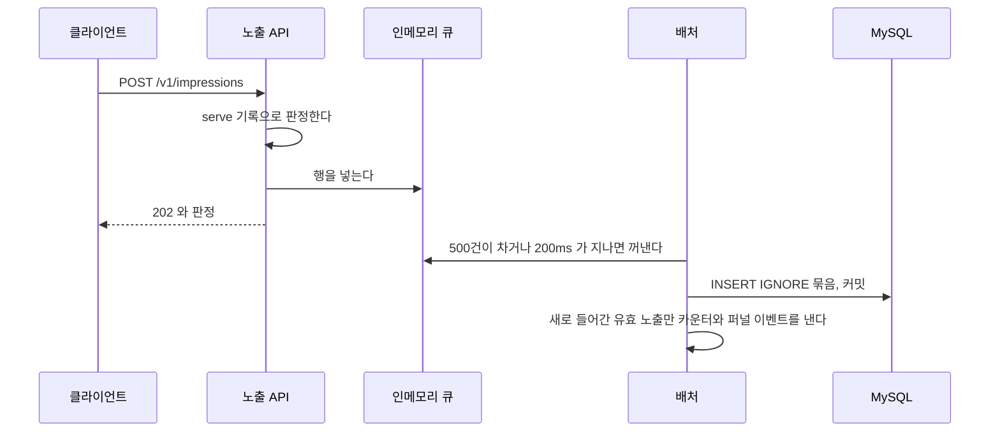

# adserving 요청 중 쓰기 설계

광고 서빙이 요청을 처리하는 중에 생기는 쓰기마다 [요청 중 쓰기의 지연과 유실 허용 범위 비교](../요청_중_쓰기의_지연과_유실_허용_범위_비교.md)의 방식 가운데 무엇을 고르는지 적는다.
쓰기마다 지금의 방식(v1)과 그 뒤에 바꿀 방식을 함께 둔다.

- 버전은 쓰기마다 따로 매긴다. 한 트랜잭션으로 함께 쓰이는 것은 하나로 센다. 노출 수집의 `impression_log` 와 정산 차감이 그렇다. 서빙 로그와 접속 위치는 대기열을 함께 쓰지만 한 트랜잭션이 아니라서 따로 센다.
- 방식은 비교 문서의 기호(A~F) 대신 이름으로 부른다. [구조와 동작 설계](./adserving_구조와_동작_설계.md) 7장의 결정 표도 선택지를 A, B, C 로 부르기 때문이다.
- 이 문서의 버전은 쓰기 구조의 버전이다. `serve_log.engine_version` 이 남기는 배정 규칙의 버전과 별개다.
- v1 의 쓰기마다 고른 이유와 빠지는 자리는 구조와 동작 설계 7장과 [장애 처리 설계](./adserving_장애_처리_설계.md)가 갖는다. 이 문서는 그 결정들을 방식별로 모아 보고 버전을 올리는 이유를 적는다.

## 1. 쓰기마다 고른 방식

| 쓰기 | 목표 부하 | 유실 허용 | 버전과 방식 |
|---|---|---|---|
| 노출 수집(`impression_log` 와 정산의 판정 기록, 원장) | 초당 10,000건 | 0.1% 미만. 빠진 노출은 과금되지 않는다 | v1 단건 동기. 노출 저장과 차감이 한 트랜잭션이다 v2 차감을 아웃박스로 옮긴다(3장) v3 판정한 뒤 응답하고 `impression_log` 저장은 인메모리 큐에서 묶어 한다(4장) |
| 서빙 로그(`serve_log`) | 초당 5,000행 | 0.1% 미만 | v1 인메모리 비동기 v2 Redis Stream 으로 옮긴다. 5장의 조건이 맞을 때만 한다 |
| 접속 위치(`feed_visit_daily`) | 회원마다 하루 한 행 | 목표 없음 | v1 인메모리 비동기 |
| 유효 노출 수 카운터(Valkey) | 초당 10,000건 | 빠지면 `impression_log` 로 다시 센다 | v1 커밋 뒤 실행 |
| 분석으로 가는 퍼널 이벤트 | 초당 10,000건(노출) | 허용한다(아키텍처 설계 2.4) | v1 커밋 뒤 전달 |

유효 노출 수 카운터와 퍼널 이벤트는 노출 수집의 커밋 뒤에 나간다. 노출 수집 v3 에서는 묶음 커밋 뒤에 나간다. 이 변경은 두 쓰기의 버전을 올리지 않는다. 노출 수집 v3 가 함께 바꾼다.

목표 부하와 유실 목표는 [`feed-api-design.md`](./feed-api-design.md) 의 "성능 목표" 와 "유실 목표" 가 갖는다.

스와이프와 찜(`swipe_log`, `wishlist`), 필터(`feed_filter`)는 버전을 나누지 않고 단건 동기로 둔다. 응답이 쓰기 결과(`applied`, 생성 여부, 저장한 필터)를 돌려줘서 비교 문서 5.1 의 조건 1에 걸린다. 쓰기 결과가 응답을 바꾸면 응답 전에 DB 에 반영해야 한다.

## 2. 쓰기마다의 v1

| 쓰기 | 방식 | 결정 |
|---|---|---|
| 노출 수집 | 단건 동기 | 구조와 동작 설계 7장의 트랜잭션 표 "노출 수집" 행 |
| 서빙 로그와 접속 위치 | 인메모리 비동기 | 구조와 동작 설계 7장 "서빙 로그와 접속 위치를 무엇으로 미루나"(#315), 장애 처리 설계 "DB 쓰기: 응답 뒤의 `serve_log`, `feed_visit_daily`" |
| 유효 노출 수 카운터 | 커밋 뒤 실행 | 구조와 동작 설계 7장 "유효 노출 수 카운터를 언제 올리나"(#323) |
| 퍼널 이벤트 | 커밋 뒤 전달 | 구조와 동작 설계 7장 "분석 이벤트를 커밋 뒤에 넘기는 일을 누가 맡나"(#349) |

노출 수집 v1 에서 노출 1건은 트랜잭션 하나 안에서 아래 순서로 처리된다.

1. `impression_log` 를 `(serveId, 사용자)` 로 읽는다. 있으면 처음 판정을 돌려준다.
2. Valkey 의 serve 기록을 읽고 유효와 무효를 가른다. 유효면 `ad_candidate` 에서 쿠폰 소진을 읽는다.
3. `impression_log` 에 `INSERT IGNORE` 한다. 0행이면 먼저 넣은 쪽의 판정을 잠금 읽기로 돌려준다.
4. 유효 노출이고 소진되지 않았으면 정산의 `PointDeductor.deduct` 를 부른다. 정산이 Valkey 의 당일 소진 카운터를 올리고 판정 기록과 원장을 INSERT 한다.
5. 커밋한다. 커밋 뒤에 유효 노출 수 카운터를 올리고 분석이 퍼널 이벤트를 받는다.

노출 1건이 INSERT 3건, Valkey 왕복 2번, 커밋 1번을 쓴다.

## 3. 노출 수집 v2: 정산 차감을 아웃박스로 옮긴다

요청은 `impression_log` 만 저장하고 응답한다. 커밋된 유효 노출 한 행이 곧 차감할 일이다. 릴레이가 그 행을 모아 정산에 넘긴다.

### v1 을 바꾸는 이유

1. **정산이 실패하면 노출도 남지 않는다.** 차감이 노출 저장과 한 트랜잭션이라 정산의 카운터나 DB 쓰기가 실패하면 노출까지 롤백된다. 클라이언트가 다시 보내지 않으면 노출도 과금도 없는 채로 끝난다. 정산은 양쪽에 기록이 없는 노출을 대사로 찾지 못한다([정산 장애 처리 설계](../billing/billing_장애_처리_설계.md) "카운터와 원장이 달라지는 경합").
2. **노출 요청 하나가 무겁다.** 초당 10,000건이면 INSERT 30,000건과 커밋 10,000번이다. 서버 한 대의 DB 풀이 8이라 트랜잭션 하나를 5ms 로 잡으면 한 대가 초당 약 1,600건이다. 측정한 값이 아니라 가정이다.
3. **정산 카운터의 보상이 요청 경로에 있다.** 정산은 커밋 전에 Valkey 의 소진 카운터를 올리고 롤백되면 종료 콜백에서 내린다. 보상이 실패하거나 그 전에 프로세스가 죽으면 대사가 맞출 때까지 카운터가 어긋난다.

1번과 3번은 부하와 관계없이 v1 구조에서 생긴다. 그래서 v2 는 측정 조건을 걸지 않는다.

### 아웃박스가 맞는 이유

| 비교 문서 5.1 의 조건 | 정산 차감 |
|---|---|
| 쓰기 결과가 응답을 바꾸지 않음 | 맞다. 응답(`ImpressionResponse`)은 유효, 무효와 무효 사유만 돌려주고 과금 판정을 쓰지 않는다 |
| 방금 쓴 값을 직후에 읽지 않음 | 맞다. 진행률은 광고 서빙이 자기 유효 노출 수로 센다. 정산의 원장을 읽지 않는다 |
| 멱등 키가 있거나 중복에 안전함 | 맞다. `deduct` 는 serveId 로 멱등이라 같은 행을 다시 넘겨도 한 번만 과금된다 |
| 유실을 허용함 | 허용하지 않는다. 아웃박스는 노출이 커밋되면 차감할 일도 함께 남아 빠지지 않는다 |

`impression_log` 는 덧붙이기만 하는 테이블이라 아웃박스 테이블을 따로 만들지 않는다. 비교 문서 5.2 의 "과금 이벤트" 행이 이 경우다.

묶음 동기만으로는 1번이 풀리지 않는다. 차감이 여전히 요청 트랜잭션 안에 있어 정산이 실패하면 묶음의 노출이 함께 롤백된다.

### 바뀌는 모양

| | v1 | v2 |
|---|---|---|
| 노출 요청 하나 | INSERT 3건, Valkey 2번, 커밋 1번 | INSERT 1건, Valkey 1번, 커밋 1번 |
| 정산이 실패할 때 | 노출까지 롤백된다 | 노출은 남고 릴레이가 다시 넘긴다 |
| 정산 차감 | 요청마다 건별로 한다 | 릴레이가 모아서 넘겨 정산이 묶어 쓸 수 있다 |
| 원장이 남는 때 | 노출과 함께 | 릴레이 주기(1초)와 정산 처리만큼 늦게 |

### 릴레이

릴레이는 광고 서빙에 둔다. 정산은 광고 서빙의 테이블을 읽지 않는다([아키텍처 설계](../../architecture/런치캐치_도메인_구조와_의존성_설계.md) 2.1 의 의존 규칙).
한 회차의 순서와 실패 지점은 [구조와 동작 설계](./adserving_구조와_동작_설계.md) 6장의 "노출 릴레이" 가 갖는다.

| 정한 것 | 고른 것 | 고르지 않은 것과 그 이유 |
|---|---|---|
| 넘긴 것을 남기는 자리 | `impression_log` 의 `dispatched_at`(넘긴 시각)과 `dispatch_attempts`(실패 횟수) | 위치 기록 표는 위치보다 앞선 `created_at` 으로 늦게 커밋된 행을 건너뛰어 차감이 소리 없이 빠질 수 있다. 지나간 행을 다시 보지 않아 실패를 다시 집을 표가 하나 더 필요했다 |
| 넘길 노출 고르기 | 무효와 소진 노출은 저장할 때 `dispatched_at` 을 받은 시각으로 채운다. 비어 있으면 곧 넘길 유효 노출이다. 인덱스는 `(dispatched_at, created_at)` 하나다 | 조회 조건으로만 거르면 무효와 소진 행이 빈 채로 인덱스 앞쪽에 쌓인다. 상태 열을 따로 두면 열과 코드가 는다 |
| 일부 실패 | 정산이 실패로 돌려준 노출은 시도 횟수를 올리고 다시 넘길 시각(`next_dispatch_at`)을 random(0, min(5분, 1초 x 2^시도 횟수)) 뒤로 미룬다(Full Jitter, REL-2-06). 실패가 있으면 같은 회차에 이어서 넘기지 않는다. 10회에 닿으면 건너뛴다. 어제 00:00 이후 행만 읽어 건너뛴 행은 이틀 뒤 범위에서 빠진다 | 1초 간격으로 다시 넘기면 점주 묶음 장애가 약 10초를 넘길 때 그 노출들이 상한에 닿아 과금이 빠진다. 상한이 없으면 고칠 수 없는 노출(캠페인이 없는 노출)이 정산을 끝없이 부른다 |
| 중복 방지 | Valkey 키로 30초 점유하고 묶음마다 연장한다. 점유는 일을 줄이는 장치이고 겹쳐도 serveId 멱등이라 과금은 한 번이다 | 위치 행을 잠근 채로는 정산을 부를 수 없다(`deductAll` 은 트랜잭션 안 호출을 거절한다). DB 표로 점유하면 1초마다 DB 쓰기가 생긴다 |
| 주기와 묶음 | 1초마다(`fixedDelay`) 돌고 1,000건(`MAX_BATCH_SIZE`)씩 넘긴다. 1,000건이었으면 이어서 다음 묶음을 넘긴다 | 한 번에 1,000건만 넘기면 초당 1,000건이 상한이 돼 밀리면 따라잡지 못한다 |
| 배치 서버 자원 | 스케줄러 스레드 5, DB 풀 6(`application-batch.yml`). 정상 실행 로그는 DEBUG 다(`@QuietSchedulerLog`) | 그대로 두면 00:00 묶음, 생존 신호, 이어받기와 자리를 다툰다. 실행 로그를 INFO 로 두면 하루 약 34만 줄이 쌓인다 |

지표는 넘긴 수(`adserving_impression_dispatched_total`), 실패로 돌아온 수(`adserving_impression_dispatch_failed_total`), 회차를 끝낸 예외 수(`adserving_impression_dispatch_error_total`), 밀린 노출 수(`adserving_impression_dispatch_backlog`)다.

### 대가

- 정산은 [묶음 차감 계약(`deductAll`)과 마감 정책](../billing/billing-batch-design.md#i-01-노출-차감--판정-기록원장-기록)을 따른다. 릴레이는 노출 요청을 받은 영업일을 그대로 넘기고, 노출 저장 트랜잭션 밖에서 호출한다. 마감 뒤에는 정상 유효 노출도 미과금(`NOT_BILLED_CLOSED`)될 수 있다.
- 점주의 포인트 내역과 정산 집계가 릴레이 주기만큼 늦다.
- 정산은 릴레이 시점의 카운터로 판정한다. 예약액은 그대로 지켜지지만 노출 시점이 아니라 릴레이 시점에 예약액에 닿아 과금하지 않는 노출이 조금 늘 수 있다.

## 4. 노출 수집 v3: 응답한 뒤 `impression_log` 를 묶어 저장한다

요청 스레드는 판정까지만 하고 응답한다. 저장할 행은 인메모리 큐에 넣는다. 배처가 큐에서 행을 모아 한 트랜잭션으로 `INSERT IGNORE` 한다. 정산 차감은 v2 그대로 릴레이가 커밋된 행을 모아 넘긴다.

### v2 를 바꾸는 이유

- 클라이언트는 노출의 응답을 쓰지 않는다(FR-097). 화면을 벗어나며 보낸 요청은 응답을 받지 못할 수도 있다. 응답 전에 저장을 끝내서 얻는 것은 저장 보장 하나다.
- 노출의 유실 목표는 0.1% 미만이다(NFR-015). 응답 뒤에 저장하다 빠지는 몫이 이 목표 안에 든다. 빠진 노출은 과금되지 않을 뿐 점주에게 더 걷지 않는다.
- 요청 스레드가 DB 커넥션을 잡지 않는다. 노출 API 의 응답 시간이 DB 의 커밋 시간과 커넥션 풀 대기에서 떨어진다.
- 노출 1건마다 하던 커밋이 묶음마다 한 번으로 준다.

### 정한 값

| 항목 | 값 | 이유 |
|---|---|---|
| 묶음을 내보내는 때 | 500건이 차거나 200ms 가 지났을 때 가운데 먼저 닿는 쪽 | 초당 1,000건이면 약 200건씩 나간다. 한가할 때도 노출이 200ms 안에 저장되고 카운터도 그만큼만 늦는다 |
| 큐 상한 | 10,000건 | 초당 1,000건의 10초 분량이다. DB 가 잠깐 느려지는 동안을 버틴다 |
| 큐가 찼을 때 | 요청 스레드가 최대 100ms 기다린다. 그래도 차 있으면 버리고 `202` 를 돌려주며 센다 | 상한 없이 기다리면 DB 가 멈춘 동안 노출 요청이 웹 서버의 스레드를 모두 잡아 같은 서버의 다른 API 도 멈춘다. 100ms 는 노출 p99 목표 500ms 안에 든다 |
| 서버가 내려갈 때 | 웹 서버가 요청을 다 받은 뒤 큐를 끝까지 비운다 | 배포마다 생기는 유실을 없앤다 |

### 빠지는 자리

| 자리 | 빠지는 양 | 다시 보내면 |
|---|---|---|
| 프로세스가 강제로 죽는다(OOM, 서버 장애) | 큐에 있던 행. 최대 10,000건이고 평소에는 묶음 하나(수백 건) 안이다 | 클라이언트는 다시 보내지 않는다. 빠진 채로 남는다 |
| 서버가 내려가며 비우는 사이에 DB 가 멈춰 있다 | 남은 묶음 | 같다 |
| DB 가 10초 넘게 멈추거나 느려 큐가 찬다 | 그 뒤에 온 노출. DB 가 멈추면 피드도 실패해 새 카드가 나가지 않으므로 이미 받은 카드의 노출에 그친다 | 같다 |
| 묶음 쓰기가 10번 다시 써도 실패한다 | 그 묶음(최대 500건). 쉬는 시간을 다 더하면 최대 약 31초다. 늘 실패하는 묶음이 작업자를 붙잡아 모든 노출을 버리게 되는 것을 막는다(REL-2-07) | 같다 |

빠진 노출은 저장도 차감도 되지 않는다. 클라이언트 전송 카운터와 `impression_log` 건수를 대조해 유실률을 잰다(`feed-api-design.md` 유실 목표).

### 함께 바꾸는 것

- **다시 보낸 요청의 응답:** 저장된 노출을 확인하지 않고 늘 다시 판정해 돌려준다(#1044). 저장은 `INSERT IGNORE` 라 처음 넣은 행만 남는다. 두 판정 사이에 serve 기록이 만료되면 응답이 처음과 다를 수 있다. 클라이언트는 응답을 쓰지 않는다. 노출 요청은 DB 를 쓰지 않는다. 그날 후보와 소진은 서버 메모리에서, serve 기록은 Valkey 에서 읽는다.
- **카운터와 퍼널 이벤트:** 요청마다가 아니라 묶음 커밋 뒤에, 그 묶음에서 새로 들어간 유효 노출에만 낸다. 이미 있던 행이나 같은 묶음의 중복은 세지 않는다.
- **받은 시각:** 요청이 받은 시각을 행에 담아 넘긴다. 저장 시각(`created_at`)과 영업일은 묶음을 넣는 시각이 아니라 이 값이다. 자정 직전의 노출이 다음 날로 넘어가지 않는다(#783).
- **같은 묶음의 중복:** 같은 `(serveId, 사용자)` 가 한 묶음에 둘이면 `INSERT IGNORE` 가 하나만 넣는다.

### 대가

- 응답한 노출이 저장되지 않을 수 있다. 위 "빠지는 자리" 다.
- DB 가 오래 멈추면 큐가 찬 뒤의 노출을 버린다.
- 노출 상한이 읽는 카운터가 최대 200ms 늦게 오른다. 그 사이 상한을 조금 넘겨 내려가는 카드가 생길 수 있다.
- 배처, 큐, 종료할 때 비우기, 묶음 결과에서 새로 들어간 행을 가리는 코드가 는다.

## 5. 서빙 로그 v2: Redis Stream 으로 옮긴다

피드가 카드마다 serve 기록을 Valkey 에 쓰는 파이프라인(`ServeRecordRepository.saveAll`)에 `serve_log` 행의 XADD 를 함께 싣는다. 소비자가 스트림을 읽어 `serve_log` 에 묶어 쓴다. serve 기록과 서빙 로그의 내용이 거의 같고 같은 파이프라인이라 왕복이 늘지 않는다.

### 진행 조건

`adserving_served_cards_total` 과 `serve_log` 건수로 잰 유실률이 0.1% 를 넘고 원인이 아래 가운데 하나일 때만 진행한다.

- 비정상 종료(OOM, kill -9)로 대기열이 사라진다.
- DB 쓰기가 느려 대기열이 차서 버린다(`adserving_serve_log_dropped_total`).

배정 진단(FR-027)과 엔진 비교에 쓰려고 서빙 로그의 유실 목표를 낮추면 이 조건이 더 쉽게 맞는다. 서빙 로그가 배정 때의 진행률, 관련성 점수, 엔진 버전을 남기기 때문이다.

### 바로 하지 않는 이유

- 피드는 후보를 MySQL 의 `ad_candidate` 에서 읽는다. DB 가 멈추면 피드도 실패해 남길 서빙 로그가 생기지 않는다. 그래서 DB 장애와 떼어 놓는 이득은 쓰기만 느린 경우에 그친다.
- v1 의 작업 스레드는 대기열에 피드가 들어오면 바로 깨어나 쓴다. 비정상 종료 한 번에 잃는 것은 수백~수천 행이고 피크 15분에 쌓이는 약 450만 행의 0.1% 안이다.

### 대가

- 소비자를 새로 둔다. 컨슈머 그룹, 처리 확인, 스트림 길이 상한, 밀린 양 지표, 처리하지 못한 항목을 다시 집는 처리가 필요하다.
- 초당 5,000건이 Valkey 메모리와 부하에 더해진다. Valkey 는 요청 제한, serve 기록, 정산 카운터도 함께 쓴다.
- Valkey 의 장애 조치 때 복제되지 않은 몫은 잃는다. 유실이 사라지는 것이 아니라 잃는 자리가 바뀐다.

## 6. v1 에 머무는 쓰기

| 쓰기 | 그대로 두는 이유 |
|---|---|
| 접속 위치 | 회원마다 하루 첫 요청 한 행뿐이고 유실 목표가 없다. 빠지면 추천 인원(FR-042)이 1명 줄 수 있다 |
| 유효 노출 수 카운터 | 빠져도 상한이 늦게 걸릴 뿐이고 `impression_log` 로 다시 센다(#323) |
| 퍼널 이벤트 | 퍼널은 유실을 허용하고 노출 수는 `impression_log` 로 센다(#349) |

## 7. 아직 정하지 못한 것

| 항목 | 정할 때 |
|---|---|
| 밀린 노출 수의 경보 문턱값 | 노출 수집 v2 의 부하 시험으로 |
| 노출 수집 v3 의 묶음 크기, 대기 상한, 큐 상한의 조정 | 노출 수집 v3 의 부하 시험으로 |
| 스트림 길이 상한과 소비자의 묶음 크기 | 서빙 로그 v2 를 진행할 때 |
