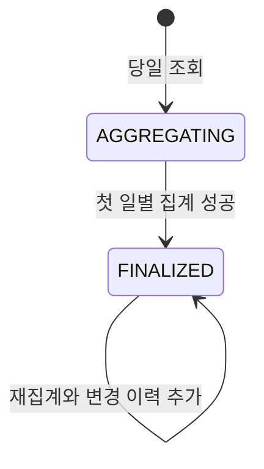
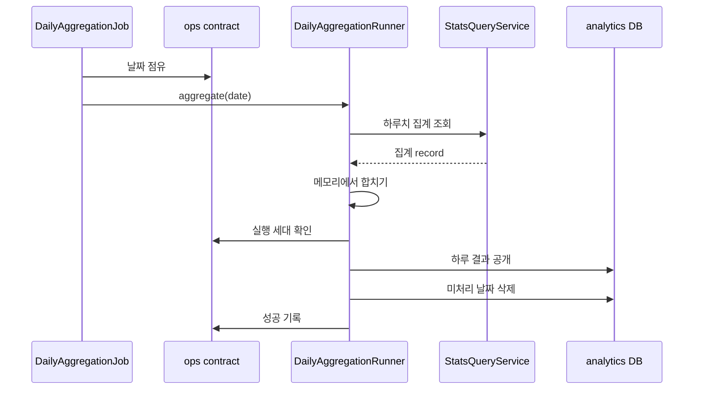
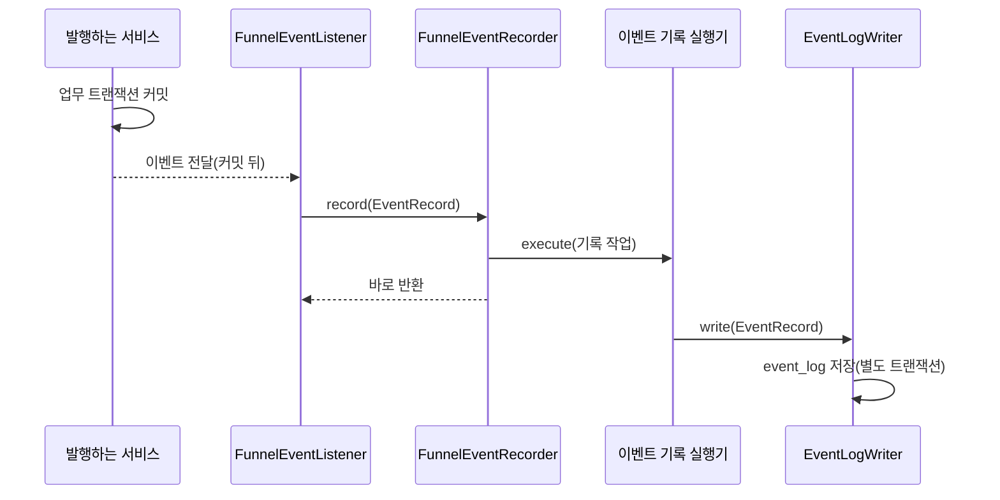

# analytics 구조와 동작 설계

## 1. 범위

| 맡는 것 | 근거 |
|---|---|
| 전환 퍼널 이벤트 로그 | [analytics API 명세](../../api-spec/analytics-api-spec.md)의 A-13과 [아키텍처 설계](../../architecture/런치캐치_도메인_구조와_의존성_설계.md) 2.4 |
| 이벤트 로그 기반 캠페인 성과 조회 | [analytics API 설계](./analytics-api-design.md#이벤트-로그-기반-캠페인-성과-509) |
| 관리자 대시보드, 매출, 부정 관리 조회 | [analytics API 명세](../../api-spec/analytics-api-spec.md) |
| 회원 사용 통계 | [analytics API 명세](../../api-spec/analytics-api-spec.md)의 A-12 |
| 일별 집계와 캠페인 리포트 | [analytics 배치 설계](./analytics-batch-design.md) |

| 맡지 않는 것 | 소유 도메인 |
|---|---|
| 노출 유효성, 무효 사유, 찜 원본 | adserving |
| 과금 판정, 원장, 잔액, 조정 | billing |
| 쿠폰 발급, 사용, 확정 할인액 | coupon |
| 캠페인 소유 관계와 상태 | campaign |
| 회원과 점주 상태 | member, owner |
| 가게 등록과 분류 | store |
| 배치 실행 점유와 이력 | ops |

## 2. 애그리거트와 패키지

| 애그리거트 | 테이블 | 지키는 규칙 | 나눈 근거 |
|---|---|---|---|
| 이벤트 로그 | `event_log` | 같은 `event_id`는 한 건이고 유형별 식별자 조합이 맞다 | 요청과 비동기 이벤트가 수시로 추가한다 |
| 일별 지표 | `daily_*_analytics`, `daily_owner_spend`, `daily_member_usage` | 영업일 단위로 통째로 교체할 수 있다 | 매일 다시 계산한다 |
| 캠페인 리포트 | `campaign_daily_report`와 자식 4종 | 리포트 ID와 변경 이력을 유지한다 | 확정 뒤 변경 이력이 필요하다 |
| 미처리 날짜 | `aggregation_pending_date` | 성공한 날짜만 목록에서 빠진다 | 실행 이력과 별개로 다음 집계 대상을 보존한다 |

```text
analytics/
├── config/
├── exception/
├── batch/
│   ├── job/
│   ├── service/
│   ├── service/step/
│   ├── repository/
│   └── entity/
├── query/
│   ├── controller/
│   ├── service/
│   ├── repository/
│   └── dto/
└── event/
    ├── controller/
    ├── dto/
    ├── listener/
    ├── service/
    ├── repository/
    └── entity/
```

`batch`만 다른 도메인의 집계 조회 contract를 부른다. `query`는 analytics 집계 테이블과 ops 실행 기록만 읽는다. `event`는 `event_log`의 쓰기와 요청 시 캠페인 성과 조회를 소유한다. 성과 조회는 캠페인 공개 계약으로 소유권만 확인한다.

### 규칙을 두는 곳

| 규칙 | 두는 곳 |
|---|---|
| 이벤트 유형별 식별자 조합 | DB CHECK와 `EventLogWriter` |
| 시계열 기간과 버킷 계산 | 순수 계산 클래스 |
| 소진액 계산 | `SpendFormula` 순수 계산 클래스 |
| 집계 단계 순서와 공개 트랜잭션 | `DailyAggregationRunner` |
| 조회 권한과 응답 조합 | `query`의 service |

## 3. 저장

analytics는 MySQL을 원본으로 사용하고 인메모리 저장소를 사용하지 않는다.

| 규칙 | 저장 방식 |
|---|---|
| 이벤트 멱등성 | `event_log.event_id` UNIQUE |
| 유형별 식별자 | `event_type`과 대상 ID의 CHECK |
| 일별 지표 | 영업일을 PK 또는 UNIQUE 일부로 사용 |
| 캠페인 리포트 | `(campaign_id, business_date)` UNIQUE |
| 변경 이력 | 리포트 ID와 차수로 추가 저장 |
| 다른 도메인 연관 | FK 없이 ID로만 참조 |

다른 도메인의 행을 복사하지 않는다. 일별 집계 결과는 analytics가 소유하는 공개용 파생 데이터다. 원천은 각 도메인에 남고 보존 기간 안에서는 다시 계산할 수 있다.

이벤트 저장소는 `event_id` UNIQUE 위반만 중복으로 분류한다. 다른 DB 제약 위반과 저장 실패는 성공으로 바꾸지 않고 호출자까지 전파한다.

## 4. 계산 로직

`SpendFormula`와 시계열 버킷 계산은 Spring, repository, 다른 도메인 contract를 참조하지 않는 순수 클래스로 둔다. 현재 시각, 설정값, 집계 record는 service가 구해 인자로 넘긴다.

소진액과 시계열 합산 규칙은 [analytics API 설계](./analytics-api-design.md)가 소유한다.

## 5. 모듈 연결

| 방향 | 대상 | 인터페이스 또는 이벤트 | 시점 |
|---|---|---|---|
| 읽기 | adserving | `AdservingStatsQueryService` | 일별 집계 |
| 읽기 | billing | `BillingStatsQueryService` | 일별 집계 |
| 읽기 | coupon | `CouponStatsQueryService` | 일별 집계 |
| 읽기 | campaign | `CampaignQueryService`와 상태 집계 조회 | 집계와 리포트 소유 확인 |
| 읽기 | member | `MemberStatsQueryService` | 일별 집계 |
| 읽기 | store | `StoreStatsQueryService` | 일별 집계 |
| 읽기 | owner | 점주 상태 집계 조회 | 일별 집계 |
| 읽기 | ops | 배치 실행과 플랫폼 설정 contract | 집계와 조회 |
| 받음 | adserving | `ImpressionServedEvent`, `SwipedEvent` | 원천 트랜잭션 커밋 뒤 |
| 받음 | coupon | 쿠폰 이벤트 4종 | 원천 트랜잭션 커밋 뒤 |
| 받음 | notification | `NotificationSentEvent` | 발송 요청 성공 뒤 |

analytics는 다른 도메인에 contract를 공개하지 않는다.

## 6. 구조와 동작 그림

### 모듈 구조


### 상태 변경

analytics 엔티티에는 요청으로 전이하는 업무 상태가 없다. 캠페인 리포트의 공개 상태는 아래처럼 바뀐다.



### 주요 흐름



| 실패 지점 | 남는 상태 | 다시 실행하면 |
|---|---|---|
| 원천 조회 | 이전 공개 결과와 미처리 날짜 | 하루 결과를 처음부터 다시 모은다 |
| 공개 트랜잭션 | 이전 공개 결과와 미처리 날짜 | 하루 결과를 다시 공개한다 |
| 실행 세대 확인 | 이전 공개 결과 | 새 실행 세대만 공개할 수 있다 |

## 7. 트랜잭션과 동시성

| 흐름 | 한 트랜잭션에 묶는 것 | 트랜잭션 밖 |
|---|---|---|
| 이벤트 기록 | HTTP 요청은 최대 50건을 함께 저장하고 내부 이벤트는 한 건을 저장 | 원천 도메인의 업무 트랜잭션 |
| 일별 집계 | 실행 세대 확인, 하루 결과 교체, 검증, 미처리 날짜 삭제 | 집계 조회 호출, 결과 계산, 재시도 대기 |
| 리포트 재집계 | 본문 갱신, 자식 교체, 변경 이력 추가 | 원천 조회와 결과 계산 |

같은 날짜의 정기 실행과 수동 재집계는 ops 실행 기록으로 하나만 점유한다. 같은 이벤트가 다시 오면 `event_id` UNIQUE로 한 건만 남긴다. 영업일은 `Asia/Seoul`로 계산한다.

### 퍼널 이벤트 수신과 비동기 기록

광고 서빙과 쿠폰이 발행한 이벤트 6종은 `FunnelEventListener`가 받는다. 리스너는 이벤트를 `EventRecord`로 바꿔 `FunnelEventRecorder`에 넘기고, 기록기는 자기가 가진 실행기(이하 이벤트 기록 실행기)에 기록 작업을 맡긴다. 실행기는 별도 스레드에서 `EventLogWriter`를 불러 `event_log`에 쓴다.



**수신 조건.** 수신 메서드 여섯 모두 `@TransactionalEventListener(phase = AFTER_COMMIT, fallbackExecution = true)`다. 커밋 뒤에만 받는 이유와 `fallbackExecution`을 켜는 이유는 [analytics 장애 처리 설계](./analytics_장애_처리_설계.md)의 "롤백 안 되는 효과: 퍼널 이벤트 기록"에 있다.

**실행기를 맡기는 이유.** 이벤트 수신은 기본이 동기라서 리스너가 발행한 쪽 스레드에서 돈다. 동기로 두면 두 가지가 발행한 쪽으로 번진다. 분석 DB 쓰기 시간이 노출과 발급 요청의 응답 시간에 들어가고, 기록 중 난 예외가 이미 커밋된 요청을 `500`으로 만든다. 실행기에 맡기면 호출한 쪽은 기다리지 않고 기록 예외는 다른 스레드에서 난다.

**기록기가 하는 일.**

| 일 | 방법 | 지표 `result` |
|---|---|---|
| 작업 맡기기 | `executor.execute`로 기록 작업을 던지고 바로 반환한다 | |
| 대기열이 가득 참 | 실행기가 거절하면 그 이벤트를 버리고 예외를 삼킨다 | `rejected` |
| 기록 성공 | `EventLogWriter.write`가 새 행을 저장한다 | `recorded` |
| 이미 있는 이벤트 | `event_id` UNIQUE가 중복으로 분류한 건수를 센다 | `duplicate` |
| 기록 실패 | 예외를 삼키고 경고 로그를 남긴다 | `failed` |

지표 이름은 `analytics_funnel_event_total`이다. 라벨은 `result` 하나이고 회원이나 캠페인 id를 넣지 않는다. 버린 건수가 유실률을 재는 근거다.

**이벤트 기록 실행기의 값.** 스레드 2개, 대기열 1000건, 가득 차면 거절(`AbortPolicy`)이다. 근거 없이 정한 예시값이라 측정한 뒤 확정한다. 스레드는 데몬이고 종료할 때 새 작업 받기를 멈춘다. 이미 대기열에 들어간 작업은 서버 종료 때 유실될 수 있다.

**`@Async`를 쓰지 않는 이유.** 이 실행기를 스프링 빈으로 노출하지 않고 기록기가 직접 든다. `Executor` 타입 빈이 하나라도 있으면 부트가 기본 작업 실행기(`applicationTaskExecutor`)를 만들지 않는다. 그러면 실행기를 지정하지 않은 `@Async`와 스프링 MVC의 비동기 요청 처리가 이 실행기로 간다. 이 실행기는 가득 차면 작업을 버리므로 성격이 다른 작업이 섞이면 조용히 사라지거나 서로를 막는다. 지금은 `@Async`를 쓰는 곳이 없어 영향이 없고, 이 규칙은 앞으로 생길 코드를 막는 예방이다. 같은 이유로 `AggregationRecalculationService`도 자기 실행기를 직접 든다.

**`@Async`로 바꾸는 조건.** 아키텍처 설계 2.4는 이 경로를 "`@Async` + `AFTER_COMMIT`"로 적는다. 구현은 `@Async` 없이 같은 효과를 낸다. 이 서비스 밖에서도 `@Async`를 쓰기 시작하면 아래 셋을 함께 바꾼다.

| 바꾸는 것 | 이유 |
|---|---|
| 이벤트 기록 실행기를 이름 있는 `Executor` 빈으로 등록하고 `@Async("이름")`으로 지정한다 | 퍼널 이벤트만 이 실행기를 쓰게 한다 |
| 기본 작업 실행기를 직접 등록한다 | 이름 없는 `@Async`와 MVC 비동기가 갈 곳을 둔다 |
| `@EnableAsync`를 켠다 | `@Async`가 동작하려면 필요하다 |

## 8. 외부 API

해당 없음. analytics는 외부 HTTP API를 호출하지 않는다. 다른 도메인은 같은 애플리케이션의 contract로 호출한다.

## 9. 실패 처리

의존 대상별 기본 처리와 예외는 [analytics 장애 처리 설계](./analytics_장애_처리_설계.md)가 갖는다. 돈과 맞아야 하는 집계가 실패하면 새 값을 공개하지 않고 이전 결과를 유지한다.

## 10. 배치

일별 집계, 퍼널 이벤트 수신, 보존 삭제의 상세는 [analytics 배치 설계](./analytics-batch-design.md)가 갖는다.

일별 집계의 실행기(`DailyAggregationRunner`)는 01:00 작업(`DailyAggregationJob`)과 수동 재계산(A-05)이 함께 쓴다. 단계(`AggregationStep`)가 없어도 날짜를 잡고 공개하고 닫는 흐름이 돈다. 단계는 원천 집계 조회가 생긴 단위에서 더한다. 수동 재계산은 날짜를 잡은 뒤 202를 주고, 집계는 이 서비스가 직접 만든 단일 스레드 실행기(대기열 4개)에서 돈다. 스프링 빈으로 노출하지 않는다. `Executor` 빈이 있으면 부트가 기본 작업 실행기를 만들지 않아 뒤에 붙을 `@Async`가 이 실행기를 쓰게 되기 때문이다.

**정산 지표 단계 (2026-10-17, #443).** `SettlementMetricsStep`(`@Order(100)`)이 `BillingStatsQueryService`의 점주와 캠페인별 합계를 더해 `daily_settlement_analytics`의 그날 한 행을 교체한다. 표의 CHECK가 금액을 0 이상으로 묶어 RESERVE, DEDUCT, REFUND는 절댓값으로 저장하고 조정액만 부호를 둔다. 정정이 가리키는 원래 영업일은 공개 때 `ADJUSTED`로 미처리 날짜에 남긴다. `SettlementConsistencyStep`(`@Order(900)`)은 같은 공개 트랜잭션에서 방금 쓴 행을 읽어 V-1, V-2, V-3, V-7을 확인하고 어긋나도 집계를 실패시키지 않으며 지표 `analytics_consistency_violations{check}`와 로그로 알린다. 점주 잔액 >= 0(V-4)은 점주별 잔액을 주는 집계 조회가 없어 하지 않는다. 소진액 계산은 `SpendFormula` 한 곳에 둔다. 매출 조회(A-07)는 집계가 끝나지 않은 구간의 금액을 `null`로 내린다.

**회원 지표 단계 (2026-10-17, #450).** `MemberMetricsStep`(`@Order(200)`)이 `MemberStatsQueryService.dailyStats`의 신규, 누적, 탈퇴 수와 자기 `event_log`의 활성 회원 수를 합쳐 `daily_member_analytics`의 그날 한 행으로 교체한다. 활성 회원은 영업일 하루(KST 자정 이상, 다음 자정 미만)에 `member_id`가 있는 이벤트를 남긴 회원을 중복 없이 센다. 모든 이벤트 유형을 센다. `issue_open`은 회원이 없어 빠진다. 정지 회원은 정지 기능이 구현 제외라 0을 쓴다. 회원 지표 조회(A-01)는 신규를 합계로, 누적과 탈퇴와 정지를 구간 마지막 날 값으로 내리고 활성 회원은 구간 안 합을 구간의 일수로 나눠 반올림한 정수로 내린다. 구간 마지막 날 행이 없으면 스냅샷 지표는 `null`이고 행이 빠진 날은 활성 0으로 센다. 집계가 끝나지 않은 구간의 수치는 `null`이다.

**가게 지표 단계 (2026-10-17, #452).** `StoreMetricsStep`(`@Order(300)`)이 `StoreStatsQueryService.finalizedStoreCounts`의 신규와 누적 입점 수, `CampaignStatsQueryService.activeCampaignCount`의 그날 말 집행 중 캠페인 수를 `daily_store_analytics`의 그날 한 행으로 교체한다. 누적 입점은 그날 말까지 최종 등록한 가게 수이고 점주 상태와 무관하다. 가게 지표 조회(A-02)는 신규를 합계로, 누적 입점과 집행 중 캠페인을 구간 마지막 날 값으로 내린다. 구간 마지막 날 행이 없으면 스냅샷 지표는 `null`이고 집계가 끝나지 않은 구간의 수치도 `null`이다. 캠페인 집계 조회는 오늘이나 미래 날짜를 받으면 예외를 던지는데 일별 집계는 전일 이전만 부르므로 걸리지 않는다.

**부정 관리 단계 (2026-10-19, #540).** `InvalidMetricsStep`(`@Order(500)`)은 `AdservingStatsQueryService.memberInvalidCounts`의 건수를 (캠페인, 회원, 사유) 행으로 옮긴다. `NotBilledMetricsStep`(`@Order(510)`)은 정산의 예산, 중단, 예산 계획 없음 건수와 광고 서빙의 쿠폰 소진 뒤 노출을 캠페인과 사유별로 합친다. `FraudMetricsStep`(`@Order(520)`)은 캠페인 통계와 `memberConcentrations`로 유효·무효 노출, 회원 수, 상위 회원의 노출 합과 집중 의심을 캠페인마다 한 행으로 만든다. 노출이 하나도 없는 캠페인은 행이 없다. 세 표 모두 다시 집계했을 때 사라진 행이 남지 않게 그날 행을 지우고 넣는다. 임계값은 `AnalyticsFraudProperties`(`analytics.fraud.*`)이고 범위를 벗어나면 기동이 실패한다. 무효 비율은 무효 ÷ 유효이고 그 식은 `InvalidRatio` 한 곳에 있다.

## 11. 성능

배치 지표 조회 API는 미리 계산한 일별 테이블만 읽는다. 이벤트 로그 기반 캠페인 성과의 조회 방식은 [API 설계](./analytics-api-design.md#이벤트-로그-기반-캠페인-성과-509)가 소유한다. 일별 집계는 원천 행이 아니라 도메인별로 묶은 결과를 받는다. 공개 트랜잭션은 외부 호출 없이 하루 결과를 쓰는 동안만 유지한다.

구현 뒤 MySQL 8.4 통합 테스트로 V1에서 V2 적용 시간과 일별 교체 시간을 측정한다. 회원 축처럼 1000행을 넘을 수 있는 집계는 한 트랜잭션을 유지하되 실제 행 수를 측정해 배치 설계에 허용 범위를 기록한다.

## 12. 테스트와 미정 사항

| Given | When | Then |
|---|---|---|
| V1 스키마가 적용됨 | V2를 적용함 | 모든 변경과 새 테이블이 생성됨 |
| 이벤트 유형별 식별자가 올바름 | 이벤트를 저장함 | 저장됨 |
| 이벤트 유형별 식별자가 어긋남 | 이벤트를 저장함 | CHECK 위반으로 거부됨 |
| 소진액이 음수임 | 일별 결과를 저장함 | 0으로 보정하지 않고 저장됨 |
| 같은 날짜 결과가 이미 있음 | 재집계함 | 조회가 비지 않고 같은 결과로 교체됨 |

| 미정 항목 | 어디까지 정해졌나 | 막는 것 |
|---|---|---|
| 원천 도메인 집계 조회 | 이슈 `#350`, `#352`, `#354`, `#356`, `#357`, `#363`이 소유한다 | 후속 집계 단계 |
| 실행 세대 확인 | 이슈 `#360`은 병합됐다. 일별 집계 실행기는 정상 경로에서 자기 세대를 알 방법이 없어 아직 `BatchAttemptGuard`를 부르지 않는다 | 여러 서버의 안전한 공개 |
| 집계 실행 조회(A-06)의 실행 기록이 없는 날짜 | 임시로 `200`과 `data: null`을 돌려준다. 테스트 `실행_기록이_없는_날짜의_조회는_data가_null이다`가 기록한다 | A-06 계약 확정 |
| 회원 사용 통계 최종 확인 | 일별 집계안을 사용한다 | A-12 구현 |
| 무효 비율 분모 | 유효 노출 수로 정했다(요구사항 BR-054, 2026-10-19). 화면 동작 확인(R-25)이 남았다 | 없음 |
