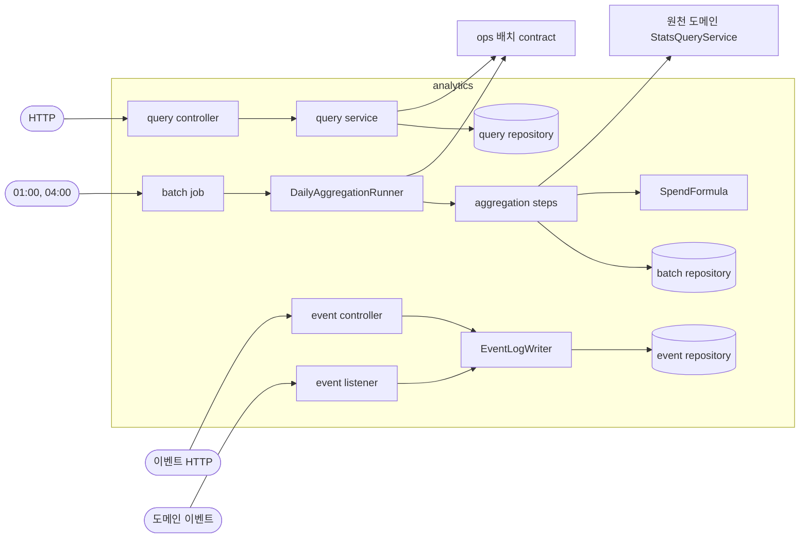
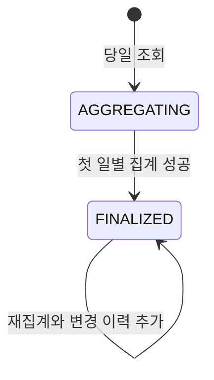
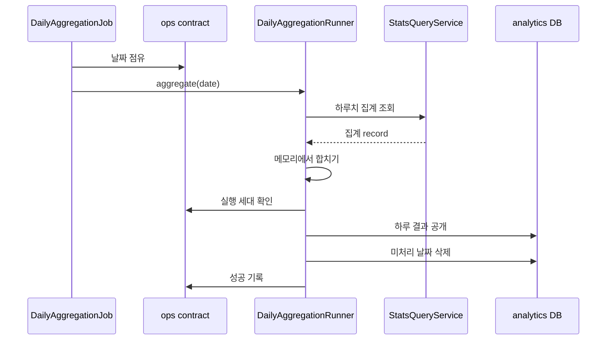

# analytics 구조와 동작 설계

## 1. 범위

| 맡는 것 | 근거 |
|---|---|
| 전환 퍼널 이벤트 로그 | [analytics API 명세](../../api-spec/analytics-api-spec.md)의 A-13과 [아키텍처 설계](../../architecture/런치캐치_도메인_구조와_의존성_설계.md) 2.4 |
| 관리자 대시보드, 매출, 부정 관리 조회 | [analytics API 명세](../../api-spec/analytics-api-spec.md) |
| 회원 사용 통계 | [analytics API 명세](../../api-spec/analytics-api-spec.md)의 A-12 |
| 일별 집계와 캠페인 리포트 | [analytics 배치 설계](./analytics-batch-design.md) |

| 맡지 않는 것 | 소유 도메인 |
|---|---|
| 노출 유효성, 무효 사유, 찜 원본 | adserving |
| 과금 판정, 원장, 잔액, 조정 | billing |
| 쿠폰 발급, 사용, 확정 할인액 | coupon |
| 캠페인 소유 관계와 상태 | campaign |
| 회원과 점주 상태 | member, owner |
| 가게 등록과 분류 | store |
| 배치 실행 점유와 이력 | ops |

## 2. 애그리거트와 패키지

| 애그리거트 | 테이블 | 지키는 규칙 | 나눈 근거 |
|---|---|---|---|
| 이벤트 로그 | `event_log` | 같은 `event_id`는 한 건이고 유형별 식별자 조합이 맞다 | 요청과 비동기 이벤트가 수시로 추가한다 |
| 일별 지표 | `daily_*_analytics`, `daily_owner_spend`, `daily_member_usage` | 영업일 단위로 통째로 교체할 수 있다 | 매일 다시 계산한다 |
| 캠페인 리포트 | `campaign_daily_report`와 자식 4종 | 리포트 ID와 변경 이력을 유지한다 | 확정 뒤 변경 이력이 필요하다 |
| 미처리 날짜 | `aggregation_pending_date` | 성공한 날짜만 목록에서 빠진다 | 실행 이력과 별개로 다음 집계 대상을 보존한다 |

```text
analytics/
├── config/
├── exception/
├── batch/
│   ├── job/
│   ├── service/
│   ├── service/step/
│   ├── repository/
│   └── entity/
├── query/
│   ├── controller/
│   ├── service/
│   ├── repository/
│   └── dto/
└── event/
    ├── controller/
    ├── listener/
    ├── service/
    ├── repository/
    └── entity/
```

`batch`만 다른 도메인의 집계 조회 contract를 부른다. `query`는 analytics 집계 테이블과 ops 실행 기록만 읽는다. `event`는 `event_log` 쓰기를 소유한다.

### 규칙을 두는 곳

| 규칙 | 두는 곳 |
|---|---|
| 이벤트 유형별 식별자 조합 | DB CHECK와 `EventLogWriter` |
| 시계열 기간과 버킷 계산 | 순수 계산 클래스 |
| 소진액 계산 | `SpendFormula` 순수 계산 클래스 |
| 집계 단계 순서와 공개 트랜잭션 | `DailyAggregationRunner` |
| 조회 권한과 응답 조합 | `query`의 service |

## 3. 저장

analytics는 MySQL을 원본으로 사용하고 인메모리 저장소를 사용하지 않는다.

| 규칙 | 저장 방식 |
|---|---|
| 이벤트 멱등성 | `event_log.event_id` UNIQUE |
| 유형별 식별자 | `event_type`과 대상 ID의 CHECK |
| 일별 지표 | 영업일을 PK 또는 UNIQUE 일부로 사용 |
| 캠페인 리포트 | `(campaign_id, business_date)` UNIQUE |
| 변경 이력 | 리포트 ID와 차수로 추가 저장 |
| 다른 도메인 연관 | FK 없이 ID로만 참조 |

다른 도메인의 행을 복사하지 않는다. 일별 집계 결과는 analytics가 소유하는 공개용 파생 데이터다. 원천은 각 도메인에 남고 보존 기간 안에서는 다시 계산할 수 있다.

이벤트 저장소는 `event_id` UNIQUE 위반만 중복으로 분류한다. 다른 DB 제약 위반과 저장 실패는 성공으로 바꾸지 않고 호출자까지 전파한다.

## 4. 계산 로직

`SpendFormula`와 시계열 버킷 계산은 Spring, repository, 다른 도메인 contract를 참조하지 않는 순수 클래스로 둔다. 현재 시각, 설정값, 집계 record는 service가 구해 인자로 넘긴다.

소진액과 시계열 합산 규칙은 [analytics API 설계](./analytics-api-design.md)가 소유한다.

## 5. 모듈 연결

| 방향 | 대상 | 인터페이스 또는 이벤트 | 시점 |
|---|---|---|---|
| 읽기 | adserving | `AdservingStatsQueryService` | 일별 집계 |
| 읽기 | billing | `BillingStatsQueryService` | 일별 집계 |
| 읽기 | coupon | `CouponStatsQueryService` | 일별 집계 |
| 읽기 | campaign | `CampaignQueryService`와 상태 집계 조회 | 집계와 리포트 소유 확인 |
| 읽기 | member | `MemberStatsQueryService` | 일별 집계 |
| 읽기 | store | `StoreStatsQueryService` | 일별 집계 |
| 읽기 | owner | 점주 상태 집계 조회 | 일별 집계 |
| 읽기 | ops | 배치 실행과 플랫폼 설정 contract | 집계와 조회 |
| 받음 | adserving | `ImpressionServedEvent`, `SwipedEvent` | 원천 트랜잭션 커밋 뒤 |
| 받음 | coupon | 쿠폰 이벤트 4종 | 원천 트랜잭션 커밋 뒤 |
| 받음 | notification | `NotificationSentEvent` | 발송 요청 성공 뒤 |

analytics는 다른 도메인에 contract를 공개하지 않는다.

## 6. 구조와 동작 그림

### 모듈 구조



### 상태 변경

analytics 엔티티에는 요청으로 전이하는 업무 상태가 없다. 캠페인 리포트의 공개 상태는 아래처럼 바뀐다.



### 주요 흐름



| 실패 지점 | 남는 상태 | 다시 실행하면 |
|---|---|---|
| 원천 조회 | 이전 공개 결과와 미처리 날짜 | 하루 결과를 처음부터 다시 모은다 |
| 공개 트랜잭션 | 이전 공개 결과와 미처리 날짜 | 하루 결과를 다시 공개한다 |
| 실행 세대 확인 | 이전 공개 결과 | 새 실행 세대만 공개할 수 있다 |

## 7. 트랜잭션과 동시성

| 흐름 | 한 트랜잭션에 묶는 것 | 트랜잭션 밖 |
|---|---|---|
| 이벤트 기록 | HTTP 요청은 최대 50건을 함께 저장하고 내부 이벤트는 한 건을 저장 | 원천 도메인의 업무 트랜잭션 |
| 일별 집계 | 실행 세대 확인, 하루 결과 교체, 검증, 미처리 날짜 삭제 | 집계 조회 호출, 결과 계산, 재시도 대기 |
| 리포트 재집계 | 본문 갱신, 자식 교체, 변경 이력 추가 | 원천 조회와 결과 계산 |

같은 날짜의 정기 실행과 수동 재집계는 ops 실행 기록으로 하나만 점유한다. 같은 이벤트가 다시 오면 `event_id` UNIQUE로 한 건만 남긴다. 영업일은 `Asia/Seoul`로 계산한다.

## 8. 외부 API

해당 없음. analytics는 외부 HTTP API를 호출하지 않는다. 다른 도메인은 같은 애플리케이션의 contract로 호출한다.

## 9. 실패 처리

의존 대상별 기본 처리와 예외는 [analytics 장애 처리 설계](./analytics_장애_처리_설계.md)가 갖는다. 돈과 맞아야 하는 집계가 실패하면 새 값을 공개하지 않고 이전 결과를 유지한다.

## 10. 배치

일별 집계, 퍼널 이벤트 수신, 보존 삭제의 상세는 [analytics 배치 설계](./analytics-batch-design.md)가 갖는다.

일별 집계의 실행기(`DailyAggregationRunner`)는 01:00 작업(`DailyAggregationJob`)과 수동 재계산(A-05)이 함께 쓴다. 단계(`AggregationStep`)가 없어도 날짜를 잡고 공개하고 닫는 흐름이 돈다. 단계는 원천 집계 조회가 생긴 단위에서 더한다. 수동 재계산은 날짜를 잡은 뒤 202를 주고, 집계는 이 서비스가 직접 만든 단일 스레드 실행기(대기열 4개)에서 돈다. 스프링 빈으로 노출하지 않는다. `Executor` 빈이 있으면 부트가 기본 작업 실행기를 만들지 않아 뒤에 붙을 `@Async`가 이 실행기를 쓰게 되기 때문이다.

## 11. 성능

조회 API는 미리 계산한 일별 테이블만 읽는다. 일별 집계는 원천 행이 아니라 도메인별로 묶은 결과를 받는다. 공개 트랜잭션은 외부 호출 없이 하루 결과를 쓰는 동안만 유지한다.

구현 뒤 MySQL 8.4 통합 테스트로 V1에서 V2 적용 시간과 일별 교체 시간을 측정한다. 회원 축처럼 1000행을 넘을 수 있는 집계는 한 트랜잭션을 유지하되 실제 행 수를 측정해 배치 설계에 허용 범위를 기록한다.

## 12. 테스트와 미정 사항

| Given | When | Then |
|---|---|---|
| V1 스키마가 적용됨 | V2를 적용함 | 모든 변경과 새 테이블이 생성됨 |
| 이벤트 유형별 식별자가 올바름 | 이벤트를 저장함 | 저장됨 |
| 이벤트 유형별 식별자가 어긋남 | 이벤트를 저장함 | CHECK 위반으로 거부됨 |
| 소진액이 음수임 | 일별 결과를 저장함 | 0으로 보정하지 않고 저장됨 |
| 같은 날짜 결과가 이미 있음 | 재집계함 | 조회가 비지 않고 같은 결과로 교체됨 |

| 미정 항목 | 어디까지 정해졌나 | 막는 것 |
|---|---|---|
| 원천 도메인 집계 조회 | 이슈 `#350`, `#352`, `#354`, `#356`, `#357`, `#363`이 소유한다 | 후속 집계 단계 |
| 실행 세대 확인 | 이슈 `#360`은 병합됐다. 일별 집계 실행기는 정상 경로에서 자기 세대를 알 방법이 없어 아직 `BatchAttemptGuard`를 부르지 않는다 | 여러 서버의 안전한 공개 |
| 집계 실행 조회(A-06)의 실행 기록이 없는 날짜 | 임시로 `200`과 `data: null`을 돌려준다. 테스트 `실행_기록이_없는_날짜의_조회는_data가_null이다`가 기록한다 | A-06 계약 확정 |
| 회원 사용 통계 최종 확인 | 일별 집계안을 사용한다 | A-12 구현 |
| 무효 비율 분모 | API 명세 계산을 임시 기준으로 사용한다 | A-10 계약 확정 |
