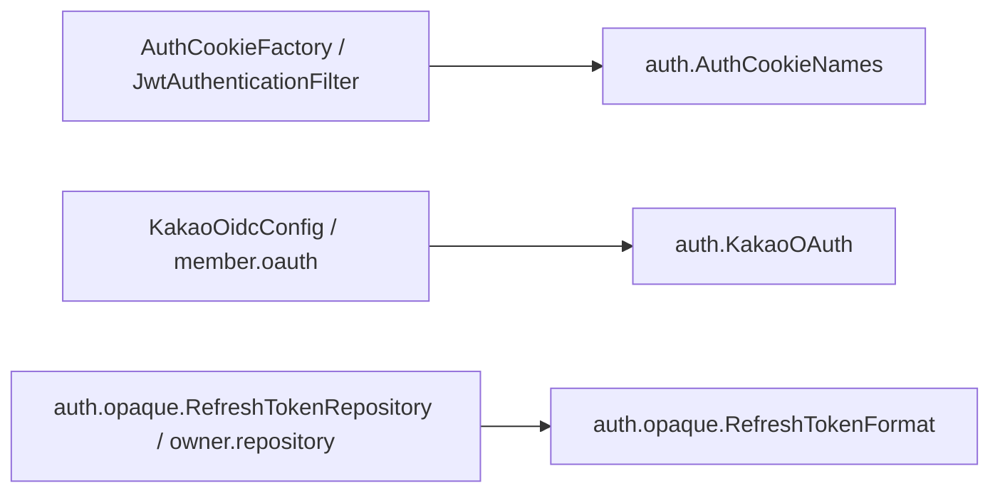

# auth 구조와 동작 설계

이 문서는 인증 공통 상수와 회원 RT 회전의 상태 구분을 다룬다. 인증 모듈 전체의 구조는 아직 훑지 않았다. 요청별 처리와 기존 토큰 정책은 [auth API 설계](./auth-api-design.md)가 갖는다.

## 1. 범위

| 구분 | 내용과 근거 |
|---|---|
| 맡는 기능 | #655에 따라 여러 클래스가 함께 사용하는 Java 상수를 auth에 둔다 |
| 맡는 기능 | 회원 RT 회전 중의 중복 요청과 DB 반영이 끝난 토큰의 재사용을 구분한다 |
| 맡지 않는 기능 | 계정 상태와 DB 토큰 정보는 각 계정 도메인이 소유한다. 인증 요청별 처리는 auth API 설계를 따른다 |

## 2. 애그리거트와 패키지

auth는 [도메인 구조 설계](../../architecture/런치캐치_도메인_구조와_의존성_설계.md)의 공용 인증 모듈이다. 이번 상수 통합은 애그리거트나 테이블을 추가하지 않는다.

```text
auth/
├── AuthCookieNames.java
├── KakaoOAuth.java
└── opaque/
    └── RefreshTokenFormat.java
```

### 규칙을 두는 곳

| 규칙 | 두는 곳 |
|---|---|
| Access Token 쿠키 이름 | `AuthCookieNames.ACCESS_TOKEN_COOKIE_NAME` |
| Kakao OAuth 등록 ID | `KakaoOAuth.REGISTRATION_ID` |
| RT 기본 키, 활성 포인터와 발급 순번 키의 접두사, 폐기 마커 | `RefreshTokenFormat` |

상수 클래스는 인스턴스를 만들 수 없는 final 클래스로 둔다. auth가 member나 owner의 상수를 역으로 참조하지 않는다.

## 3. 저장

`RefreshTokenFormat`은 기존 RT 저장 형식의 Java 정의를 소유한다. 배포 전 점주 단일 토큰의 재발급과 로그아웃은 기존 공용 키 공간을 사용한다. 신규 점주 로그인은 세션별 전용 저장소와 키 공간을 사용하며 [점주 세션 설계](../owner/owner-sessions.md)를 따른다. 관리자 신규 세션은 `RefreshTokenRepository.scoped()`로 별도 키 공간을 사용한다.

Lua의 폐기 마커와 YAML의 OAuth 등록 이름은 Java 상수와 호환되어야 한다. #655는 해당 값과 스크립트 인자 순서를 바꾸지 않는다. 키별 만료와 DB 백업 정책은 [auth API 설계](./auth-api-design.md)를 따른다.

### 회원 RT 회전 상태

회원의 옛 RT 레코드는 회전할 때 `|ROTATING:{새 토큰 해시}`를 붙여 남긴다. `RefreshTokenRepository`는 이 레코드로 온 중복 요청을 회전 실패로 반환한다. `OpaqueRefreshTokenLifecycle`은 중복 요청만 `AUTH-003`으로 거부하며 DB 해시나 AT 폐기 기준을 바꾸지 않는다.

DB 백업의 새 해시가 확정되면 `refresh_token_complete_rotation.lua`가 이번 요청의 새 해시와 일치하는 처리 중 표시만 `|REVOKED`로 바꾼다. 이후 옛 토큰을 다시 쓰면 기존 재사용 탐지와 전체 폐기를 수행한다. 처리 중 표시와 확정 표시는 옛 토큰의 남은 TTL을 유지한다. 관리자 회전은 기존 `|REVOKED` 표시를 그대로 사용한다.

## 4. 계산 로직

상수 통합에는 계산 로직이 없다. 기존 인증 모듈의 계산 로직 전체는 아직 훑지 않았다.

## 5. 모듈 연결

| 사용하는 쪽 | 참조하는 정의 | 참조하는 때 |
|---|---|---|
| `AuthCookieFactory`, `JwtAuthenticationFilter` | `AuthCookieNames` | 쿠키 발급·삭제와 요청 인증 |
| `KakaoOidcConfig`, member의 `KakaoAuthorizationService`, `KakaoIdTokenExchanger` | `KakaoOAuth` | 검증기 구성과 카카오 인가·토큰 교환 |
| `RefreshTokenRepository`, owner의 `OwnerRefreshTokenRepository`, `OwnerLogoutTokenRepository` | `RefreshTokenFormat` | RT 저장·소비·회전·폐기 |

## 6. 구조와 동작 그림

### 모듈 구조



상수 의존만 그렸다. 기존 요청에서 저장소까지의 흐름은 auth API 설계를 따른다.

### 상태 변경

상수 클래스에는 상태가 없다. 기존 토큰의 상태 전이는 auth API 설계를 따른다.

### 주요 흐름

기존 점주 단일 토큰의 키 공간 공유는 3장이 갖는다. 신규 점주 세션의 로그인·재발급·로그아웃은 [점주 세션 설계](../owner/owner-sessions.md)가 소유한다.

## 7. 트랜잭션과 동시성

상수 참조에는 트랜잭션과 가변 상태가 없다. 회원 RT는 Redis 원자 회전, 별도 DB 트랜잭션의 해시 CAS, Redis 확정 표시 순서로 처리한다. DB 반영 중 같은 RT로 온 요청은 새 토큰을 만들지 않고 현재 세션도 폐기하지 않는다. DB 반영 실패가 확인되면 이번 요청의 새 해시와 활성 포인터가 일치할 때만 처리 중 표시를 옛 레코드로 복구한다. 나머지 RT 처리의 잠금과 커밋 순서는 auth API 설계를 따른다.

## 8. 외부 API

Kakao 등록 ID의 소유 위치만 옮긴다. 외부 호출의 소유 도메인, 타임아웃과 재시도는 변경하지 않는다. 해당 정책 전체는 이번 작업에서 아직 훑지 않았다.

## 9. 실패 처리

상수 참조는 실패 분기를 추가하지 않는다. 회원 RT 확정 표시의 실패와 중단 시 남는 상태는 [auth 장애 처리 설계](./auth_장애_처리_설계.md)가 갖는다.

## 10. 배치

상수 통합이 등록하거나 변경하는 배치는 없다. 기존 인증 관련 배치 전체는 아직 훑지 않았다.

## 11. 성능

문자열 리터럴을 같은 값의 상수 참조로 옮긴다. DB·Valkey·외부 API 호출 수를 바꾸지 않는다. 기존 인증 처리량은 아직 계산하지 않았다.

## 12. 테스트와 미정 사항

공통 상수는 기존 `JwtAuthenticationFilterTest`, `KakaoAuthorizationServiceTest`, `KakaoIdTokenExchangerTest`, `OwnerRefreshTokenRepositoryIntegrationTest`, `OwnerLogoutTokenRepositoryIntegrationTest`의 동작 단언을 유지한다.

`RefreshTokenRepositoryTest`와 `OpaqueRefreshTokenLifecycleTest`는 처리 중 중복 요청이 재사용 폐기로 이어지지 않는지 검증한다. `MemberTokenRefreshIntegrationTest`는 회원 HTTP 재발급을 겹쳐 보내 DB 해시와 Redis 활성 토큰이 살아 있는지 확인한다. 같은 통합 테스트에서 완료 후 재사용 폐기와 DB 실패 뒤 옛 토큰 복구도 검증한다.

상수의 소유 위치와 RT 키 공간 공유에는 미정 사항이 없다. 인증 모듈 전체에서 아직 정하지 못한 것은 auth API 설계의 해당 절을 따른다.
