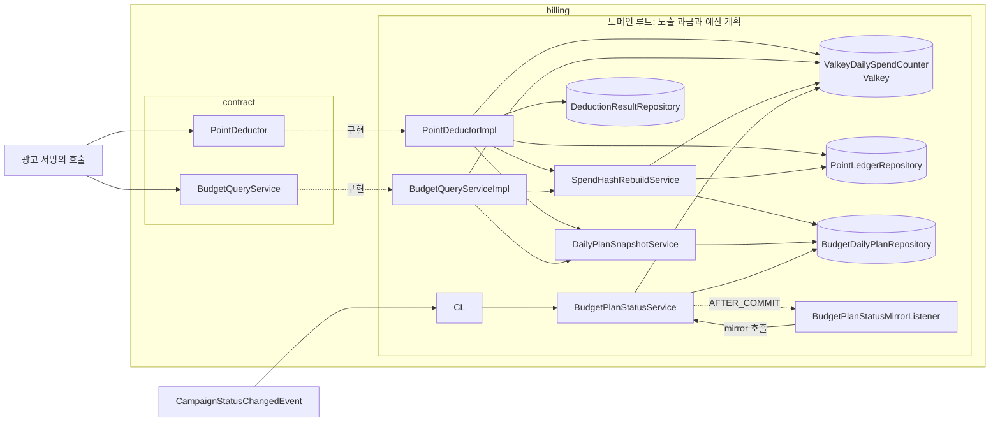
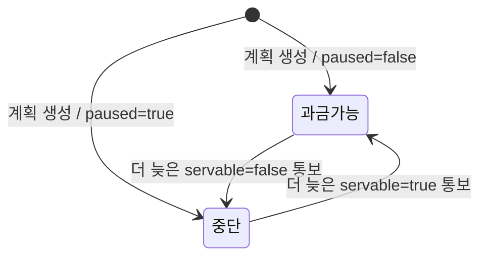
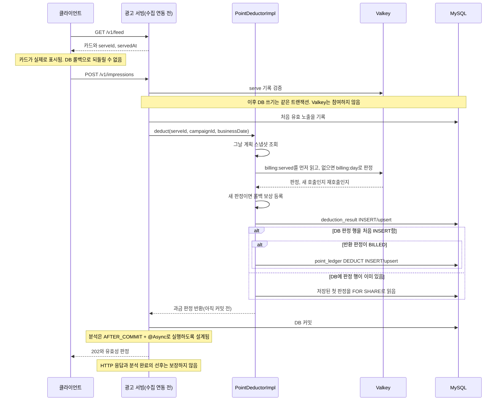
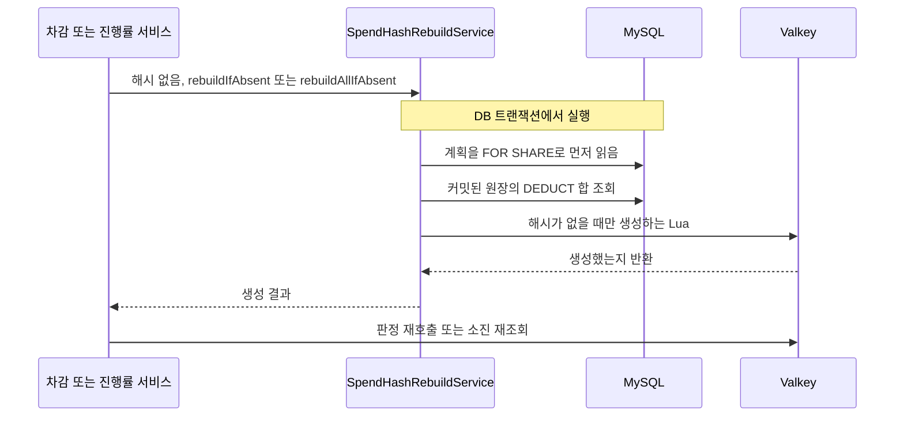

# billing 구조와 동작 설계

[구조와 동작 설계 가이드](../구조와_동작_설계_가이드.md)의 목차를 따른다. 2026-10-14에 확인한 노출 차감과 진행률 경로를 설명한다. 정산 전체의 결제·환불·관리자 설계는 이번 범위에서 검토하지 않았다.

2026-10-16에 `develop` 코드와 맞춰 예약·해제·대사 작업, 충전 직후 재예약, `PG_VS_CHARGE` 대사, 분석 집계 조회(`BillingStatsQueryService`), 스키마 V3~V7의 서술을 고쳤다. 이 갱신은 그 부분의 구현 사실만 반영한 것이고 결제·환불·관리자 기능의 설계 검토를 뜻하지 않는다.

커밋 뒤 작업의 설명은 `origin/develop`의 `e25cb2a`에 반영된 가이드 7장을 적용해 보완했다. 실행을 미루는 시점과 실제 실행 수단을 구분하며, 비동기 방식의 선택도 트레이드오프에 포함한다.

장애 정책과 복구의 한계는 [장애 처리 설계](./billing_장애_처리_설계.md)가 소유한다. 공개 계약은 `billing.contract` 패키지(`PointDeductor`, `BudgetQueryService`, `BillingStatsQueryService`), 예약·해제·대사 정책은 [정산 배치 설계](./billing-batch-design.md)가 소유한다. 이 문서의 그림에서 광고 서빙의 노출 수집은 아직 연동하지 않은 계약상 흐름이다.

### 확인 기준과 범위

현재 체크아웃에 없는 구현은 Git 커밋에 고정한 링크를 쓴다.

| 대상 | 이 문서에서 사용하는 확인 기준 |
|---|---|
| 정산의 차감·재구성·진행률 | `feat/193-billing-impression-deduct`의 `b7f9a104ba302888b4821f62b7080cbbcbc4b883`을 읽었다 |
| 광고 서빙의 키·피드 배정 | #230의 `8241485a23bff71cc36df390cd47788f8018d789`을 읽었다. 그 스냅샷에는 노출 수집의 전체 연동이 없다 |
| 예약·해제·소진 대사 | 2026-10-19에 #497 브랜치의 `job/`과 `service/`를 읽었다. 00:00 묶음의 4개 단계와 `PG_VS_CHARGE` 대사가 있다. 서빙이 하루 종일이 되어 13:30 해제 작업은 없앴다. 자정을 지나는 전체 정상 흐름을 연결해 돌린 검증은 없다 |
| HTTP 오류 변환 | 차감 예외를 그대로 전파할 때의 전역 처리기를 확인했다. 아직 없는 노출 수집 컨트롤러의 실제 응답을 테스트한 결과는 아니다 |

브랜치가 바뀌면 위 확인 기준도 갱신해야 한다. 과거 확인 상태를 현재 배포 상태로 읽지 않는다.

## 1. 범위

| 맡는 기능 | 근거 |
|---|---|
| 유효 노출의 과금 여부를 판정하고 원장에 기록한다 | [PointDeductor 계약](../../../src/main/java/com/launchcatch/billing/contract/PointDeductor.java), `deduction_result`, `point_ledger` |
| 광고 서빙이 진행률을 계산할 예약액·단가·당일 소진액을 돌려준다 | [BudgetQueryService 계약](../../../src/main/java/com/launchcatch/billing/contract/BudgetQueryService.java) |
| 영업일별 원장 합계와 과금 상태 수, 그날 예산과 단가, 미소진 잔액을 분석에 집계해 준다 | [BillingStatsQueryService 계약](../../../src/main/java/com/launchcatch/billing/contract/BillingStatsQueryService.java) |
| 캠페인의 중단 여부를 그날 계획과 Valkey에 반영한다 | 아키텍처 2.4와 `CampaignStatusChangedEvent`, `BudgetPlanStatusService` |
| 해시가 사라지면 DB 정본으로 재구성한다 | #193의 `SpendHashRebuildService` |

| 맡지 않는 기능 | 소유 도메인 |
|---|---|
| 카드를 배정하고 실제 표시 요청의 사용자와 serve 기록을 검증한다 | adserving. [피드 설계](../adserving/feed-api-design.md)를 따른다 |
| 유효 노출·품절 여부를 기록하고 노출 상한으로 후보를 제외한다 | adserving. 정산의 미과금과 노출의 무효를 구분한다 |
| 캠페인을 중단하거나 재개한다 | campaign. 정산은 통보받은 상태를 과금 입력에 반영한다 |
| 쿠폰 소진을 판정한다 | coupon. 광고 서빙이 소진 표시를 받는다 |
| 분석 퍼널을 기록한다 | analytics. 원장 기록을 분석 이벤트에 맡기지 않는다 |

## 2. 애그리거트와 패키지

### 결제 서비스의 공통 상수

#656에서 `billing.PaymentConstants`가 `PG_TID_UNIQUE`와 `FAILED_WITHOUT_REASON`의 Java 정의를 소유하도록 정했다. 승인 확정·웹훅·재조회 서비스가 참조하므로 특정 서비스의 상수로 두지 않는다. 저장소나 외부 API를 호출하지 않는 정의라 billing 루트에 둔다.

제약 이름은 기존 billing V1의 결제 식별자 UNIQUE와 일치해야 한다. 승인 거절의 기본 문구는 조회 실패와 의미가 달라 승인 확정 서비스에 남긴다. 서비스의 처리 순서와 예외 분기는 [billing API 설계](./billing-api-design.md)를 따른다.

### 노출 차감부터 대사까지의 패키지

| 데이터 묶음 | 지키는 규칙과 경계 |
|---|---|
| 그날 계획 | `(campaign_id, business_date)`마다 예약액과 단가를 갖는다. 상태 수신과 재구성이 이 계획을 공유한다 |
| 과금 판정과 포인트 원장 | 새 유효 노출의 판정과 `DEDUCT`가 노출 저장과 같은 DB 트랜잭션에서 확정된다. 판정과 원장은 정산이 소유한다 |
| Valkey의 그날 해시와 처리 표시 | DB 트랜잭션에 참여하지 않는다. 과금 판정 입력과 빠른 중복 처리를 맡는다 |

위 표는 이 경로의 데이터 묶음을 설명한다. 아직 검토하지 않은 정산 전체를 새 애그리거트로 재분할하지 않는다. 다른 도메인의 엔티티는 가져오지 않는다. 캠페인·점주·서빙 기록은 ID로 연결한다.

```text
billing/
├── contract/  PointDeductor, DeductionStatus, BudgetQueryService, BudgetProgress,
│              BillingStatsQueryService, OwnerCampaignLedgerSum, CampaignBillingCount,
│              CampaignDailyBudget, DailyLedgerTotals
├── cache/     DailySpendCounter, ValkeyDailySpendCounter, DeductOutcome, DailySpend
├── service/   PointDeductorImpl, DailyPlanSnapshotService, SpendHashRebuildService,
│              BudgetQueryServiceImpl, BudgetPlanStatusService,
│              BillingStatsQueryServiceImpl,
│              DailyReservationService, DailyReleaseMarker, SpendReconciliationService,
│              FundingJudgementService, RechargeReservationService,
│              PgChargeReconciliationService
├── job/       PreviousDaySpendReconciliationJob, DailyReservationJob, FundingJudgementJob (00:00 묶음의 DailyJob),
│              PgChargeReconciliationScheduler (01:30),
│              PaymentRecheckWorker
├── listener/  CampaignStatusChangedListener, BudgetPlanStatusMirrorListener, PointChargedListener
├── repository/ BudgetDailyPlanRepository,
│               DeductionResultRepository, PointLedgerRepository, SettlementMismatchRepository
├── entity/    BudgetDailyPlan, DeductionResult, PointLedger, SettlementMismatch
├── dto/       PlanSnapshot, PlanSnapshotKey, CampaignSpend, BudgetPlanStatusChanged
└── config/    PlanSnapshotCacheProperties
```

위 나무는 노출 차감부터 대사까지의 클래스만 적었다. `client/`(Toss), `controller/`(점주·관리자·웹훅), 결제·환불 서비스와 엔티티는 이 문서의 범위 밖이라 적지 않았다.

노출 차감과 진행률의 입구는 다른 도메인의 호출이다. 중단 반영의 입구는 캠페인 이벤트다. 예약·해제·대사의 입구는 시각이다. 00:00 묶음의 세 단계는 운영의 `DailyJob`으로 등록돼 `@Order` 40, 50, 60으로 순서대로 돈다. 전날 해제는 50단계가 한다. 01:30 `PG_VS_CHARGE` 대사는 정산의 스케줄 작업이며 `batch_execution_log` 점유로 배치 서버 두 대가 겹치지 않게 한다. 작업명과 시각은 10장이 갖는다. 노출 차감·진행률 경로에는 정산의 HTTP 입구가 없다. 결제·환불·조정의 HTTP 입구는 이 문서의 범위 밖이다.

## 3. 저장

[정산 V1](../../../src/main/resources/db/migration/billing/V1__billing_init.sql)에서 [V7](../../../src/main/resources/db/migration/billing/V7__billing_adjust_target_date.sql)까지가 스키마의 기준이다.

| 버전 | 바꾼 것 |
|---|---|
| V1 | 결제, 원장, 계획, 판정, 대사 테이블 |
| V2 | 계획의 `paused`, `status_changed_at`, 예약액 0 허용, 대사의 `business_date` |
| V3 | 점주 계정 행 `point_account`(잔액을 읽고 쓰는 작업의 점주 단위 직렬화 기준), 시스템이 닫은 대사의 해결자 NULL 허용, 최초 정책 행 |
| V4 | `budget_daily_plan(business_date)` 인덱스 |
| V5 | 대사 종류 `CAMPAIGN_OVERSPEND` |
| V6 | 재예약 RESERVE의 멱등 키를 결제×캠페인으로 나눔 |
| V7 | `point_ledger.adjust_target_date`와 CHECK |
| V9 | PG 대사 재검증 대기 행과 `payment` FK |

| 데이터 | 원본과 의미 | 중복 또는 범위 제약 |
|---|---|---|
| 그날 계획 | `budget_daily_plan.daily_budget`은 설정 예산이 아니라 실제 예약액이다. 단가·점주·중단 여부도 갖는다 | 캠페인·영업일 UNIQUE를 두고 V2에서 예약액 0을 허용한다 |
| 과금 판정 | `deduction_result`에 유효 노출의 정산 판정과 서빙 영업일을 둔다 | `serve_id` UNIQUE로 중복을 막는다 |
| 확정 과금 | `point_ledger`의 `DEDUCT`를 음수 단가로 기록한다 | `(serve_id, entry_type)` UNIQUE와 금액 부호 CHECK를 둔다 |
| PG 대사 재검증 대기 | `pg_charge_reconciliation_pending`은 PENDING 또는 조회·기록 실패 결제의 재조회 대상이다 | 결제당 한 행이며 `payment_id`는 같은 billing 도메인의 `payment`를 FK로 참조한다 |

`DEDUCT.business_date`는 스키마 규칙에 따라 NULL이다. 캠페인·영업일의 실제 과금액은 `serve_id`로 판정 기록과 원장을 연결해 구한다. 수신 시각의 날짜로 대체하지 않는다. 원장 전체를 업데이트해서 잔액을 맞추지 않고 거래 행을 추가한다.

### 노출부터 과금까지 사용하는 Valkey 키

아래 두 종류는 billing이 노출 과금 경로에서 사용하는 키다. 피드 배정과 serve 검증에 쓰는 키는 [광고 서빙 설계 3장](../adserving/adserving_구조와_동작_설계.md#3-저장)이 소유한다. `{...}`는 치환할 값의 자리표시이며 실제 키의 중괄호가 아니다. 예를 들어 `billing:day:2026-10-14:101`이다. `StringRedisTemplate`을 사용하므로 숫자와 시각도 문자열로 저장한다.

| 키 | 자료형과 값 | 생성·갱신·만료 | 용도 |
|---|---|---|---|
| `billing:day:{businessDate}:{campaignId}` | Hash에 예약액·소진액·중단 여부·전이 시각을 둔다 | 해시 생성 시 TTL 3일을 설정한다. 차감과 상태 갱신으로 TTL을 연장하지 않는다 | 처음 처리하는 `serveId`의 과금 가능 여부를 판정한다 |
| `billing:served:{serveId}` | String에 첫 판정 이름 하나를 둔다 | 첫 Lua 판정 때 TTL 2일을 설정한다. 재호출은 연장하지 않는다. 새 판정의 롤백 보상은 표시를 삭제한다 | 같은 `serveId`의 Redis 재판정과 소진 증가를 막는다 |

| `billing:day` 필드 | 저장값 예 | 원본과 갱신 |
|---|---|---|
| `reserved` | `"10000"` | 정산 계획의 실제 예약액이다. 설정 하루 예산이나 점주 전체 잔액과 다르다 |
| `spend` | `"90"` | 과금 판정이 사용한 포인트다. 처음 `BILLED`로 판정하면 단가만큼 올린다 |
| `paused` | `"0"` 또는 `"1"` | `1`이면 과금을 중단한다. 캠페인 통보를 반영한다 |
| `changedAt` | `"0"` 또는 epoch 마이크로초 문자열 | 마지막 상태 전이 시각이다. 계획의 시각이 NULL이면 재구성 때 0을 넣는다 |

`changedAt`은 `CampaignStatusChangedEvent.changedAt`이 기존 시각보다 늦을 때 바뀐다. 같은 시각이나 더 오래된 통보는 무시한다. `paused = !servable`이며, 노출 차감으로 `spend`가 늘어도 전이 시각은 바꾸지 않는다. DB 상태를 먼저 변경하고 커밋 뒤 해시에 같은 비교를 적용한다. 감지·실패 후처리는 장애 설계 3장이 소유한다.

당일 해시가 없을 때 예약액·중단·전이 시각은 `budget_daily_plan`, 소진은 커밋된 `DEDUCT` 합으로 채운다. 재구성으로 새 해시를 만든 시점부터 72시간을 설정한다. 이미 있으면 값과 TTL을 모두 그대로 둔다. **Redis 연결 장애에서 DB만으로 과금하는 경로는 없다.** 구분과 HTTP 결과는 장애 설계 1장이 소유한다.

계획 스냅샷은 Valkey 키가 아니라 Caffeine 캐시다. `(businessDate, campaignId)`로 읽으며 기본 만료는 24시간이다. 점주와 단가를 DB에서 읽는다. `unitPrice`와 `ownerId`는 `billing:day`에 저장하지 않는다.

계획 캐시의 기본 크기 100,000과 만료는 측정 전 임시값이다. 장중에 바뀌는 예약액과 중단 여부를 계획 스냅샷에 넣지 않는다. 광고 서빙의 serve 캐시 30분과 정산 처리 표시 2일은 목적이 다른 값이다.

**`spend`는 표시 횟수가 아니다.** `BILLED` 판정이 소비한 포인트를 누적한다. 커밋 전에는 진행 중인 과금도 포함할 수 있다. 정상 커밋 뒤에는 원장의 확정 과금액과 같아야 하며, 어긋나는 경우는 장애 설계가 설명한다.

원장 기준 검증식은 다음과 같다. 예약 한도는 장애 때도 무조건 성립하는 보장이 아니다.

```text
확정 과금액 = -SUM(DEDUCT.amount), 판정 기록의 영업일로 한정
확정 BILLED 수 = 그 노출들에 대응하는 DEDUCT 행 수
정상 커밋 뒤 Redis spend = 확정 과금액
정상 해시에서 새 과금 판정: spend + unitPrice <= reserved
```

점주의 사용 가능한 잔액은 부호 있는 원장 금액을 더하되 `DEDUCT`를 제외한다. 예약할 때 이미 사용 가능한 잔액에서 빠졌으므로 노출별 차감을 다시 빼면 같은 비용을 두 번 뺀다. [잔액 합계 쿼리](../../../src/main/java/com/launchcatch/billing/repository/PointLedgerRepository.java)가 이 규칙을 갖는다.

아래는 하루 동안 원장에 쌓이는 금액의 예다. 예약은 그날 00:00, 해제는 다음 날 00:00 예약 단계가 기록한다.

| 기록 | 금액 | 사용 가능한 잔액에 미치는 영향 |
|---|---:|---|
| 충전 `CHARGE` | +50,000 | 잔액을 50,000으로 만든다 |
| 그날 예약 `RESERVE` | -10,000 | 잔액을 40,000으로 내리고 캠페인 집행 한도를 배정한다 |
| 노출별 `DEDUCT` 합 | -6,000 | 실제 광고 비용을 기록한다. 사용 가능한 잔액 40,000은 다시 내리지 않는다 |
| 미소진액 `RELEASE` | +4,000 | 쓰지 않은 금액을 돌려 잔액을 44,000으로 만든다 |

## 4. 계산 로직

시간대별 목표와 진행률은 광고 서빙이 이 도메인이 준 예약액과 소진액으로 계산한다(#828). 식과 가중치는 [adserving 구조와 동작 설계](../adserving/adserving_구조와_동작_설계.md) 4장 "예산 소진 진행률"이 갖는다. `budget_hourly_target` 테이블은 시드 base V8 이 지웠다(#829).

Lua의 예산 비교는 원자적 갱신이 필요한 저장소 연산이다. 이 연산을 순수 계산 클래스에서 따로 계산한 뒤 갱신하지 않는다.

### 카드 배정 중단과 과금 중단

실제 화면 표시가 과금 확정보다 앞선다. 현재 정책은 배정할 때 예산을 예약해 두는 방식이 아니다. 광고 서빙이 후보를 조회할 때의 조건과 표시 뒤 정산 조건은 다음처럼 다르다.

| 시점 | 조건과 동작 |
|---|---|
| 피드 배정 | 진행률 1.2 초과 또는 유효 노출 수가 `예약액 / 단가 × 1.05` 상한에 도달하면 후보에서 뺀다 |
| 실제 표시 뒤 과금 | `spend + unitPrice <= reserved`일 때만 과금한다. 예산 소진은 `NOT_BILLED_BUDGET`이며 캠페인 상태를 바꾸지 않는다 |

예약 1,000, 단가 10이면 정상 조건에서 과금 가능한 수는 100건이고 배정 제외에 쓰는 노출 상한은 105건이다. 이 5%는 과금 예산을 늘리는 규칙이 아니다. 이미 배정한 카드가 뒤늦게 표시되면 예산이 소진돼 미과금일 수 있다. 피드 배정만으로 실제 표시의 상한을 원자적으로 지키는 구조도 아니다. [피드의 예산 조건](../adserving/feed-api-design.md)이 정책을 소유한다.

소진 990에서 카드 A와 B를 이미 내려줬다면 A가 먼저 마지막 10을 사용할 수 있다. 뒤에 도착한 B는 실제로 표시됐어도 예산 미과금으로 남는다. 표시 전에 반드시 예산을 확보하게 바꾸려면 미표시 카드의 예산 해제와 만료까지 새로 설계해야 한다. 이번 문서는 그 정책을 바꾸지 않는다.

## 5. 모듈 연결

| 방향 | 접점 | 시점과 호출 비용 |
|---|---|---|
| adserving이 호출한다 | `PointDeductor` | 처음 저장한 유효 노출마다 부른다. 반환과 입력은 [계약](../../../src/main/java/com/launchcatch/billing/contract/PointDeductor.java)이 소유한다 |
| adserving이 조회한다 | `BudgetQueryService` | 캠페인 목록으로 한 번에 조회한다. 부르는 시점은 [adserving 구조와 동작 설계](../adserving/adserving_구조와_동작_설계.md) 5장이 갖는다. 캐시가 데워진 뒤 원장 합계를 읽지 않는다 |
| analytics가 조회한다 | `BillingStatsQueryService` | 분석의 일별 집계 배치가 영업일마다 부른다. 읽기 전용 트랜잭션에서 원장과 판정을 날짜로 묶어 읽는다. 아래 "집계 조회의 영업일 귀속"을 따른다 |
| owner의 점주 상태를 조회한다 | `OwnerStatusQuery.findCurrentStatus` | 점주 결제·포인트·환불 API 요청마다 한 번 부른다. 캐시를 우회한 DB 조회 한 번이다. `ACTIVE`가 아니거나 점주를 찾지 못하면 `BILLING-023`(`403`)으로 끝낸다. 검사는 서비스가 아니라 `OwnerActiveInterceptor`가 맡고, 경로는 `BillingSecurityConfig.OWNER_PATHS`를 그대로 쓴다. 서비스마다 흩어 넣으면 서비스 일곱 곳과 그 테스트를 함께 고쳐야 하고 새 점주 경로에서 빠뜨리기 쉽다(#485) |
| campaign의 이벤트를 받는다 | `CampaignStatusChangedEvent` | 발행자의 같은 트랜잭션에서 계획을 변경한다. 커밋 뒤 해시에 반영한다 |
| 정산 내부에서 전달한다 | `BudgetPlanStatusChanged` | DB 변경이 커밋된 경우에만 Redis 상태 미러를 실행한다 |

### 집계 조회의 영업일 귀속

`BillingStatsQueryService`는 합계만 내주고 소진액(`DEDUCT` 합에서 양수 `ADJUST` 합을 뺀 값)은 분석이 계산한다. 영업일에 귀속하는 기준은 유형마다 다르다.

| 값 | 영업일 기준 | 상태 |
|---|---|---|
| `RESERVE`, `RELEASE` | 원장의 `business_date` | 확정 |
| `DEDUCT` | `deduction_result`의 `business_date`(`serve_id`로 맞춘다) | 확정 |
| `CHARGE`, `REFUND` | 기록 시각의 KST 날짜 | 확정 |
| `ADJUST` | `point_ledger.adjust_target_date`. 값이 없는 행(캠페인 없는 조정과 컬럼을 두기 전 행)은 기록 시각의 KST 날짜 | 확정. 이슈 #402 |
| 미소진 잔액 | 영업일 다음 날 00:00 이전에 기록된 `CHARGE`, `REFUND`, `ADJUST`, `DEDUCT` 의 누적 합. 점주 잔액에 예약 중 포인트를 더한 값과 같다 | 확정. analytics 의 `unspent_balance` 정의를 따른다 |
| 원장 대조용 합계 | 그 영업일의 기록 시각에 기록된 같은 네 유형의 합. 전날 말 미소진 잔액에 더하면 그날 말 값이 된다 | **임시.** 이슈 #352 |
| 원장 불일치 건수 | `settlement_mismatch.business_date`가 그날인 행 수. 해결 여부는 가리지 않는다 | **임시.** 이슈 #352 |

`correctionTargetDates(기록 영업일)`는 그 기록 영업일에 기록된 양수 `ADJUST`가 가리키는 정정 대상 영업일을 날짜 오름차순으로 중복 없이 돌려준다. 분석이 이미 집계한 날 중 다시 집계할 날을 찾는 데 쓴다. 대상이 없는 `ADJUST`는 목록에 없고, 기록 영업일과 같은 날을 가리키는 정정은 들어간다.

미소진 잔액과 원장 대조용 합계는 돈이 움직인 시점이 기준이라 `ADJUST`도 정정 대상 영업일이 아니라 기록 시각으로 센다. 그래서 한 정정이 영업일 합계에서는 대상 영업일에, 미소진 잔액에서는 기록한 날에 들어간다.

### 정정 대상 영업일

관리자 포인트 조정(`POST /v1/admin/point-adjustments`)은 정정이 가리키는 원래 영업일을 `targetBusinessDate`로 받아 `point_ledger.adjust_target_date`에 저장한다. 요청 필드와 검증 규칙, 오류 코드는 [billing 명세서](../../api-spec/billing-api-spec.md#포인트-수동-조정)가 소유하고 여기서 다시 적지 않는다.

이 절은 서버가 정한 이유만 갖는다.

| 결정 | 이유 |
|---|---|
| 새 컬럼 `adjust_target_date`를 둔다 | `business_date`는 `RESERVE`와 `RELEASE`의 예약 영업일이고 `chk_point_ledger_business_date`가 그 둘로 묶는다. 의미가 다른 값을 같은 컬럼에 섞지 않는다 |
| `ADJUST` 행에만 값을 갖게 `chk_point_ledger_adjust_target_date`로 막는다 | 다른 유형의 행이 정정 대상을 갖는 일을 DB가 막는다 |
| 기존 행을 마이그레이션으로 채우지 않는다 | 원장은 추가만 하는 설계이고 `created_at`의 시간대 해석에 따라 날짜가 달라질 수 있다. 값이 없는 행은 집계가 기록 시각의 KST 날짜에 붙여 #352의 결과와 같다 |
| 같은 키 재요청의 비교에 `targetBusinessDate`를 넣는다 | 날짜만 다른 요청이 처음 기록을 그대로 돌려받으면 관리자가 다른 날을 고쳤다고 착각한다 |
| 클라이언트가 아직 없는 때 필수로 확정했다 | 날짜 없는 캠페인 정정이 조용히 기록일에 붙는 오류를 처음부터 막는다. 이슈 #402에서 정했다 |

기록 시각의 하루는 날짜를 DB 함수로 자르지 않고 `[당일 00:00, 다음 날 00:00)` 범위로 묻는다. `created_at`은 Asia/Seoul 기준이라 영업일 경계와 같다.

전환 퍼널 분석의 비동기 처리와 도메인 의존 방향은 [아키텍처 2.4](../../architecture/런치캐치_도메인_구조와_의존성_설계.md#24-도메인-간-상태-변경과-이벤트)를 따른다. 정산의 원장 쓰기는 분석 이벤트의 소비자가 실행하는 작업이 아니다.

## 6. 구조와 동작 그림

### 모듈 구조



상태 미러 리스너는 `@TransactionalEventListener(AFTER_COMMIT)`으로 내부 통보를 받아 `BudgetPlanStatusService.mirror`를 호출한다. `@Async`나 별도 실행기가 없어서 트랜잭션을 끝내는 스레드에서 실행한다. 점선은 커밋 뒤 통보이고 실선은 호출이다.

### 상태 변경

노출별 과금 판정은 처음 기록한 결과를 유지한다. `BILLED`에서 미과금으로 바꾸는 엔티티 전이는 없다. 롤백은 새 판정 행을 취소하며 판정 상태를 수정하는 일이 아니다.

그날 계획의 `paused`는 캠페인 통보로 바뀐다.



계획은 00:00 예약이 만든다(`DailyReservationService`). 같은 시각이나 더 오래된 통보는 현재 값을 바꾸지 않는다. 예산 소진은 이 그림의 상태 전이가 아니다.

### 주요 흐름 1. 실제 표시부터 확정 과금까지



무효 노출과 품절 노출은 정산 호출 전 광고 서빙에서 처리한다. 그 조건과 응답은 피드 설계가 소유한다.

실제 차감 호출의 순서는 다음과 같다. [구현](https://github.com/lunch-catch/lc-backend/blob/b7f9a104ba302888b4821f62b7080cbbcbc4b883/src/main/java/com/launchcatch/billing/service/PointDeductorImpl.java#L63)을 기준으로 적었다.

1. 계획 캐시에서 점주·단가를 구한다. 영업일은 노출 요청을 서버가 받은 날이다. 계획이 없으면 캠페인의 점주와 운영 단가로 `NOT_BILLED_NO_PLAN` 판정 행만 남기고 끝낸다(#497). 아래 단계는 돌지 않는다.
2. Lua가 `GET billing:served:{serveId}`를 먼저 실행한다. 값이 있으면 `REPLAY:<첫 판정>`을 반환한다. 예산 재판정과 소진 증가는 하지 않는다.
3. 표시가 없고 당일 해시도 없으면 `HASH_MISSING`을 반환한다. 서비스는 DB 정본으로 해시를 만들고 같은 요청에서 Lua를 한 번 더 호출한다.
4. 표시가 없고 해시가 있으면 중단 여부와 예산을 판정한다. `BILLED`일 때만 소진을 올린다.
5. 같은 Lua가 `SET billing:served:{serveId} <판정> EX 172800`을 실행한다. 정상적인 첫 처리에도 이 표시를 남긴다.
6. 서비스는 `replayed=false`일 때만 새 Redis 판정의 롤백 보상을 등록한다.
7. 반환된 상태로 DB 판정 INSERT를 시도한다. Redis에서 첫 결과를 재사용했어도 DB 처리는 이어진다.
8. INSERT 영향 행 수가 1이 아니면 DB의 첫 판정을 `FOR SHARE`로 읽어 반환한다. 원장은 추가하지 않는다.
9. DB 판정 행을 처음 넣었고 상태가 `BILLED`이면 원장에 `source=REALTIME`, `amount=-unitPrice`를 기록한다.
10. 호출자가 DB 트랜잭션을 커밋한다. service 반환이나 Redis 표시의 존재만으로 확정 과금이 되지는 않는다.

### 처리 표시의 저장값과 Lua 반환값

`billing:served`에는 다음 세 판정 이름만 저장한다. 키 존재 여부는 재판정할지를 결정하며, 저장값은 재사용할 판정과 미과금 사유를 결정한다. `REPLAY:`와 `HASH_MISSING`은 키에 저장하지 않는 반환 신호다.

| Lua 반환 | `billing:served`에 남는 값 | 내부 `status` / `replayed` | 이번 Redis 호출의 효과 |
|---|---|---|---|
| `BILLED` | `BILLED` | `BILLED` / false | 소진을 단가만큼 올리고 표시를 만든다 |
| `NOT_BILLED_BUDGET` | `NOT_BILLED_BUDGET` | 같은 판정 / false | 소진은 유지하고 미과금 표시를 만든다 |
| `NOT_BILLED_PAUSED` | `NOT_BILLED_PAUSED` | 같은 판정 / false | 소진은 유지하고 미과금 표시를 만든다 |
| `REPLAY:BILLED` | 기존 `BILLED` | `BILLED` / true | 값과 소진과 TTL을 바꾸지 않는다 |
| `REPLAY:NOT_BILLED_BUDGET` | 기존 예산 미과금 판정 | `NOT_BILLED_BUDGET` / true | 예산이 늘었어도 다시 판정하지 않는다 |
| `REPLAY:NOT_BILLED_PAUSED` | 기존 중단 미과금 판정 | `NOT_BILLED_PAUSED` / true | 재개됐어도 같은 카드의 판정을 바꾸지 않는다 |
| `HASH_MISSING` | 표시를 만들지 않는다 | null / false | 과금 판정 전의 재구성 신호다. 외부 계약의 판정 enum이 아니다 |

DB에 판정이 없으면 반환 상태를 기록하고 `BILLED`이면 원장도 쓴다. DB에 이미 판정이 있으면 **DB의 첫 판정이 최종 기준**이다. 처리 표시 만료 후 Lua가 다른 판정을 내도 DB의 첫 판정을 덮지 않는다. 그때의 카운터 오차는 장애 설계 4장이 설명한다.

### 같은 `serveId`의 요청 재전송

이 문서에서 중복은 같은 카드 건의 요청 재전송을 뜻한다. 실제로 화면을 두 번 봤다는 뜻으로 사용하지 않는다.

| 상황 | 동일 요청 여부와 처리 |
|---|---|
| DB 커밋은 성공했지만 응답이 유실돼 같은 A를 재전송함 | 같은 `serveId`다. 표시가 있으면 첫 판정을 재사용한다. DB도 첫 기록을 유지한다 |
| 첫 요청이 처리 중인데 시간 초과로 A를 다시 보냄 | 같은 `serveId`의 동시 요청이 될 수 있다. 첫 호출의 롤백까지 겹치면 장애 설계 L-4가 남는다 |
| 화면 콜백이 같은 A를 두 번 전송함 | 같은 `serveId`다. 실제 프론트에서 발생하는지 확인한 것은 아니며 가능한 재전송 원인이다 |
| 같은 캠페인이 다른 피드에서 A와 B로 각각 배정됨 | 다른 `serveId`라 각각 판정한다. 캠페인이 같다는 이유로 멱등 중복은 아니다 |

광고 서빙이 DB 중복을 먼저 발견하면 정산 호출 전에 끝날 수 있다. `billing:served`는 같은 카드 건이 정산까지 다시 들어온 경우의 방어다. 그 키가 있다고 호출을 그냥 끝내거나 DB 커밋 완료로 간주하지 않는다.

| 예산 상태 | 처음 판정한 노출의 정상 결과 |
|---|---|
| 예약 100, 소진 90, 단가 10, 중단 아님 | 소진 100으로 올린다. 판정과 `DEDUCT -10`을 기록한다 |
| 위 요청 뒤 다음 노출 | 예산 미과금 판정만 기록한다. 소진 100을 유지한다 |
| `paused=true` | 중단 미과금 판정만 기록한다. 소진을 올리지 않는다 |
| 이미 커밋된 같은 `serveId`와 살아 있는 처리 표시 | 첫 판정을 돌려준다. 소진과 원장의 과금 건수는 늘지 않는다 |

### 주요 흐름 2. 해시를 다시 만들고 판정하기



진행률의 여러 캠페인은 계획 IN 조회 1회와 원장 그룹 합 1회로 재구성한다. 계획 잠금은 캠페인 ID 순으로 잡는다. 공유 잠금은 상태 갱신의 배타 잠금을 기다리게 한다. 진행 중인 차감까지 동결하는 잠금은 아니므로 장애 설계의 재구성 경합은 남는다.

### 흐름별 실패 후 남는 상태

단계별 상세 처리는 장애 문서의 해당 절이 소유한다. 이 표는 실제 표시와 DB 확정을 혼동하지 않기 위한 흐름의 경계다.

| 실패 지점 | 남는 상태 | 재요청 또는 복구 |
|---|---|---|
| 노출 전송 또는 serve 검증 | 카드가 표시됐어도 과금 기록이 없을 수 있다 | [장애 설계 5장](./billing_장애_처리_설계.md#5-무료-노출과-복구-범위)을 따른다 |
| Lua 요청의 응답을 알 수 없음 | DB는 롤백될 수 있다. Redis 실행 여부는 알 수 없다 | [장애 설계 1장](./billing_장애_처리_설계.md#1-valkey에서-판정하지-못한-경우)을 따른다 |
| Lua 성공 뒤 DB 롤백 | 실제 표시는 남는다. 새 DB 기록은 취소된다 | [장애 설계 2장](./billing_장애_처리_설계.md#2-lua-판정-뒤-db가-롤백된-경우)을 따른다 |
| DB 커밋 뒤 HTTP 응답 유실 | 확정 판정과 원장은 남는다 | 같은 노출의 중복 처리로 첫 결과를 돌려준다 |
| 해시 재구성 도중 중단 또는 손실 | DB 원본은 남는다. Redis 상태는 실행 시점에 따라 다르다 | [장애 설계 3장](./billing_장애_처리_설계.md#3-해시-재구성과-상태-미러)을 따른다 |

## 7. 트랜잭션과 동시성

| 흐름 | DB 트랜잭션에 포함되는 것 | DB가 되돌리지 못하는 것 |
|---|---|---|
| 노출 과금 | 계약상 노출 저장·판정·원장 쓰기를 호출자의 트랜잭션에 묶는다 | 화면 표시, Redis 판정·증가와 처리 표시 |
| 해시 재구성 | 계획 잠금 읽기와 원장 합을 조회한다 | 재구성 Lua가 생성한 해시 |
| 캠페인 상태 수신 | 발행자와 함께 계획의 상태를 갱신한다 | 커밋 뒤 상태 미러가 바꾼 해시 |
| 진행률 조회 | 일반 조회 전체를 트랜잭션으로 묶지 않는다. 필요한 재구성만 트랜잭션을 쓴다 | 캐시와 Redis 조회 |

### 트랜잭션 종료 뒤 실행하는 수단

`AFTER_COMMIT`은 실행 시점이고 `@Async`는 별도 스레드로 넘기는 수단이다. 커밋 뒤에 실행한다고 모두 비동기는 아니다. 이 경로의 원장 쓰기는 종료 콜백이나 실행기로 미루지 않고 같은 DB 트랜잭션에서 수행한다.

| 작업 | 실행 수단과 스레드 | 실행 조건과 기록 | 순서와 재처리 |
|---|---|---|---|
| 그날 계획의 상태 미러 | `BudgetPlanStatusMirrorListener`의 `@TransactionalEventListener(AFTER_COMMIT)`을 쓴다. `@Async` 없이 트랜잭션을 끝내는 스레드에서 실행한다 | DB 커밋 뒤에만 실행한다. 내부 이벤트 등록은 메모리에 있으며 별도 작업 테이블은 없다 | 여러 트랜잭션의 미러 도착 순서를 보장하지 않는다. `changedAt`으로 낡은 변경을 거른다. 실패 후 처리는 [장애 설계 3장](./billing_장애_처리_설계.md#3-해시-재구성과-상태-미러)이 소유한다 |
| 새 판정의 롤백 보상 | `TransactionSynchronizationManager.registerSynchronization`으로 등록한 `afterCompletion`을 쓴다. 별도 실행기 없이 트랜잭션을 끝내는 스레드에서 `undo`를 호출한다 | `STATUS_ROLLED_BACK`일 때만 실행한다. 메모리 콜백이므로 프로세스 종료 뒤 다시 집어 올릴 기록이 없다 | DB 롤백 뒤 보상 호출의 순서는 지킨다. 다른 요청의 재호출·커밋과 전역 순서는 지키지 않는다. 실패와 경합은 [장애 설계 2장](./billing_장애_처리_설계.md#2-lua-판정-뒤-db가-롤백된-경우)이 소유한다 |
| 분석의 `ImpressionServedEvent` 기록 | 아키텍처는 `@TransactionalEventListener(AFTER_COMMIT)`과 `@Async`를 함께 쓰도록 정했다. 분석 기록은 실행기 스레드에서 처리하는 설계이며 노출 수집 연동은 아직 없다 | DB 커밋 뒤 실행기에 넘긴다. 발행·대기 작업을 내구성 있게 보존하는 방식으로 정하지 않았다. 실행기 이름·크기·대기열은 이번 범위에서 확인하지 않았다 | 이벤트 처리 완료 순서는 보장하지 않는다. 유실 허용과 일별 원본 집계 복구는 [아키텍처 2.4](../../architecture/런치캐치_도메인_구조와_의존성_설계.md#24-도메인-간-상태-변경과-이벤트)가 소유한다. 누락 과금 복구로 사용하지 않는다 |

광고 서빙의 진단 로그는 트랜잭션 커밋 뒤 이벤트와 다른 경로다. #230의 [광고 서빙 장애 설계](https://github.com/lunch-catch/lc-backend/blob/8241485a23bff71cc36df390cd47788f8018d789/docs/design/adserving/adserving_%EC%9E%A5%EC%95%A0_%EC%B2%98%EB%A6%AC_%EC%84%A4%EA%B3%84.md)는 별도 서빙 로그 스레드 풀의 대기열로 쓰기를 넘긴다. 피드 조회에는 DB 트랜잭션이 없으며 진단 로그 저장은 과금 원장과 묶이지 않는다. 대기열이 찼을 때의 폐기와 종료 시 대기는 광고 서빙 문서가 소유한다.

**결정: 상태 미러를 커밋 뒤 리스너에서 직접 실행한다.**

| 선택지 | 얻는 것 | 잃는 것 |
|---|---|---|
| 현재처럼 `AFTER_COMMIT` 리스너가 직접 Valkey를 부른다 | DB 롤백된 상태를 미러에 쓰지 않는다. 별도 실행기 대기열 없이 커밋 직후 호출한다 | Valkey가 느리면 트랜잭션을 끝내는 스레드의 반환이 늦어진다. 프로세스 종료 때 이벤트를 다시 실행할 기록이 없다 |
| 리스너에 `@Async`를 붙여 실행기에 넘긴다 | 상태 미러의 외부 호출을 요청 스레드에서 뺀다 | 대기열 지연과 거절 정책을 새로 정해야 한다. 작업 순서와 유실 문제는 남는다 |
| 상태 미러 작업을 DB 아웃박스에 기록하고 별도 작업자가 실행한다 | 커밋된 미러 작업을 프로세스 종료 뒤에도 다시 읽을 수 있다 | 같은 트랜잭션의 추가 쓰기와 작업자·멱등·재시도 설계가 필요하다. 워커 처리 지연은 남는다 |

현재 구현은 첫 선택지다. [상태 리스너](https://github.com/lunch-catch/lc-backend/blob/b7f9a104ba302888b4821f62b7080cbbcbc4b883/src/main/java/com/launchcatch/billing/listener/BudgetPlanStatusMirrorListener.java)가 그 수단을 명시한다. 두 번째와 세 번째 선택지는 비용을 비교하기 위한 대안이며 구현 변경을 결정한 것은 아니다.

롤백 보상을 `@Async`나 실행기로 넘기면 실패한 과금이 예산을 점유하는 시간이 늘 수 있다. 실행기 거절과 재실행도 새로 정해야 한다. 현재 구현은 종료 콜백에서 직접 보상하며, 그 수단의 유실과 재호출 경합은 장애 설계 2·4장이 소유한다.

**결정: 판정과 원장을 노출 저장과 함께 기록한다.**

| 선택지 | 얻는 것 | 잃는 것 |
|---|---|---|
| 현재처럼 같은 DB 트랜잭션으로 기록한다 | 노출·판정·원장이 부분 커밋되지 않는다 | 노출 수집이 DB 쓰기와 커밋을 기다린다. 실패한 실제 표시를 별도 서버 작업자가 복구하지 않는다 |
| 큐에 남기고 별도 작업자가 원장을 쓴다 | 묶음 쓰기로 처리량을 높일 여지가 있다 | 현재 계약의 같은 트랜잭션을 바꿔야 한다. 큐 유실·재처리·마감 순서를 추가로 설계해야 한다 |

현재 구현은 첫 선택지를 사용한다. 소진 판정은 Redis에서 먼저 실행하므로 DB와 Redis가 함께 원자적으로 커밋되는 구조는 아니다. 그 대가와 보상은 장애 문서에 기록한다.

| 동시성 상황 | 현재 처리 |
|---|---|
| 같은 노출의 재요청 | 처리 표시와 판정·원장 UNIQUE를 사용한다. DB 중복 INSERT는 upsert로 흡수한다 |
| 여러 회원이 같은 캠페인에 노출됨 | 해시가 정상인 구간에서 Lua가 비교와 증가를 한 번에 실행한다 |
| 같은 회원이 같은 노출을 동시에 보냄 | 정산의 키는 `serveId`다. 광고 서빙의 `(serveId, memberId)` 중복 처리와 연결되어야 한다 |
| 상태 이벤트가 늦거나 중복됨 | DB 조건부 UPDATE와 상태 미러 Lua가 더 늦은 `changedAt`만 반영한다 |
| 해시 재구성과 상태 갱신이 겹침 | 계획을 먼저 공유 잠금으로 읽는다. 여러 계획은 ID 순서로 읽는다 |

DB 중복 판정은 `updated_at`을 갱신하고 영향 행 수로 새 INSERT와 구분한다. 저장된 첫 판정은 `FOR SHARE`로 읽는다. 일반 SELECT가 앞서 잡은 스냅샷을 볼 수 있기 때문이다. Redis 처리 표시가 만료된 경우와 롤백을 동반한 동시 요청은 장애 문서의 경합 표를 따른다.

Lua는 당일 해시와 처리 표시 두 키를 사용한다. 현재 구현은 비클러스터 Valkey를 전제한다. 클러스터로 바꾸려면 두 키가 같은 슬롯에 있도록 키 설계를 바꿔야 한다.

## 8. 외부 API

노출 차감·진행률 경로에는 결제대행사나 다른 HTTP API 호출이 없다. Valkey와 MySQL은 장애 문서의 저장소 대상이다. 전일 결제를 PG 조회로 대사하는 `PG_VS_CHARGE`(#391)의 외부 API 처리는 [장애 처리 설계 7장](./billing_장애_처리_설계.md#7-pg_vs_charge-대사391의-외부-api-처리)이 갖는다.

### 결제 승인 결과의 재조회

승인 확정의 동기 재조회와 `PaymentRecheckService`의 워커·관리자 판정은 저장한 `payment.pg_tid`를 `PaymentGateway.inquireByPaymentKey`에 넘긴다. 결제위젯은 결제 키 조회가 성공해도 주문 번호 조회가 상점 오류로 실패할 수 있으므로 주문 번호 조회로 대체하지 않는다. 조회 결과의 주문 번호와 금액이 저장값과 일치해야 충전한다.

승인 전에 결제 키를 커밋하는 순서와 결과 기록은 [billing API 설계](./billing-api-design.md#결제-주문과-승인-확정)가 갖는다. 재조회 일정과 아웃박스는 [재조회 워커 설계](./billing-batch-design.md#i-04-결제-재조회-워커--아웃박스)를 따른다.

## 9. 실패 처리

이 장은 돈이 걸린 경로에서 남는 손해만 설명한다. 대상별 처리와 보상 순서는 [장애 설계](./billing_장애_처리_설계.md)를 따른다.

| 흐름 | 불리하게 남는 결과 | 손해를 부담하는 쪽 | 현재 제한과 남은 일 |
|---|---|---|---|
| 실제 표시 뒤 과금 저장 실패 | 재처리가 끝내 성공하지 않으면 무료 노출이 된다 | 플랫폼 | 보상은 예산을 풀 뿐이다. 과금 복구 경로는 아직 없다 |
| Redis 소진이 원장보다 커짐 | 확정 과금액보다 일찍 예산이 소진됐다고 판단한다 | 캠페인의 집행 기회를 잃는 점주와 플랫폼 | 롤백 보상이 오차를 줄인다. 남은 오차는 그날 안에 고쳐지지 않는다. 다음 00:00 전일 대사가 불일치로 기록한다 |
| Redis 소진이 원장보다 작아짐 | 예약액을 넘게 과금할 수 있다 | 점주 | 재구성·동시 롤백 경합이 남는다. 대사는 이미 기록된 과금을 자동 취소하지 않는다 |
| 중단 상태 미러가 실패하고 삭제도 실패함 | 낡은 상태로 과금할 수 있다 | 점주 | ERROR로 기록한다. 완전히 막는 복구 경로는 정하지 않았다 |

## 10. 배치

배치 정책은 [정산 배치 설계](./billing-batch-design.md)가 소유한다. 작업 상태는 해당 이슈(#193, #306, #317, #391)가 갖는다. 아래 작업은 #497(2026-10-19) 기준이다. 자정을 지나는 전체 정상 흐름을 연결해 돌린 검증은 없다.

| 작업 | 작업명과 실행 | 하는 일 | 같은 날 다시 돌 때 필요한 조건 |
|---|---|---|---|
| 전일 대사 | `BILLING_SPEND_RECON_PREV`, 00:00 묶음 `@Order(40)` | 전일 카운터를 원장과 견주고 어긋나면 카운터를 다시 만든다. 이어서 이틀 전 날짜가 해제를 마친 뒤 소진과 해제의 합이 예약액을 넘는 캠페인을 `CAMPAIGN_OVERSPEND`로 기록한다 | 전일 영업일을 유지해야 한다 |
| 00:00 해제·예약 | `BILLING_RESERVE`, 묶음 `@Order(50)` | 전날 남은 예약을 `RELEASE`하고(전날의 정식 해제), 그날 계획과 `RESERVE`를 만든 뒤 해시를 준비한다. 날짜마다 해제를 마치는 즉시 `(BILLING_DAILY_RELEASE, 그 날짜)`를 SUCCESS로 남겨(전날 포함) 분석의 원천 확정에 쓰며 오늘 예약의 성공과 무관하다. 남은 해제액이 0인 계획은 해제를 마친 것으로 보고 다시 찾지 않는다 | 원장 멱등 제약(`uk_point_ledger_day_reserve_dedup`)과 작업 실행 이력을 지켜야 한다. 같은 예약을 두 번 해제하지 않는다 |
| 잔액 부족 판정 | `BILLING_FUNDING_JUDGE`, 묶음 `@Order(60)` | 예약액이 단가보다 작은 캠페인을 판정해 캠페인에 통보한다 | 같은 판정을 두 번 통보해도 캠페인 상태가 같아야 한다 |
| 01:30 `PG_VS_CHARGE` 대사(#391) | `BILLING_PG_VS_CHARGE_RECON`, 독립 `@Scheduled`(01:30, Asia/Seoul) | 전일 생성 결제와 재검증 대기 결제를 PG 조회로 대사하고 빠진 `CHARGE`를 보정한다. PG 응답의 주문번호가 결제와 다르면 보정하지 않고 재검증 대기로 남기며, 대기 행은 불일치 기록이 끝난 뒤에 지운다 | 결제당 `CHARGE` 멱등 제약(`uk_point_ledger_payment_entry`)과 대사 불일치 UNIQUE를 지켜야 한다. 외부 API(PG 조회)의 처리는 [장애 처리 설계 7장](./billing_장애_처리_설계.md#7-pg_vs_charge-대사391의-외부-api-처리)이 갖는다 |

`PG_VS_CHARGE` 작업은 00:00 묶음이 아니라서 `batch_execution_log` 점유(`claim`)로 배치 서버 두 대가 같은 날을 겹쳐 돌지 않게 한다. 충전 직후 재예약은 시각이 아니라 `PointCharged` 커밋 뒤 리스너가 입구다.

카운터 대사는 실제 표시를 읽어 누락 과금을 찾아내는 작업이 아니다. 원장과 카운터의 비교만으로 원장에도 없는 무료 노출을 복구할 수 없다. 그날 계획이 없는 캠페인의 노출은 `NOT_BILLED_NO_PLAN`으로 기록되고 과금되지 않는다. 00:00 예약이 돌지 않으면 그날 노출 전부가 그렇게 된다.

## 11. 성능

목표 TPS와 측정 계획은 [정산 배치 설계](./billing-batch-design.md)가 소유하고, 측정 뒤에 고를 개선 후보와 집계 조회의 쿼리 비용은 [성능 개선](./billing_성능_개선.md)이 소유한다. 부하 측정은 아직 별도 문서가 없고 `PointDeductorImpl`의 `TODO(부하 테스트 실행)`로만 남아 있다. 아래는 요청 비용이며 성능 달성을 입증하는 측정값이 아니다.

| 경로 | 요청 하나의 비용 |
|---|---|
| 새 BILLED, 캐시·해시 적중 | Redis Lua 1회, 판정 INSERT 1회, 원장 INSERT 1회, 호출자 DB 커밋 1회 |
| 새 미과금 | Lua 1회, 판정 INSERT 1회, 호출자 커밋 1회 |
| 롤백 보상 | 확정 롤백 뒤 Lua 1회를 추가한다 |
| 단일 해시 누락 | 최초 판정과 재판정 사이에 계획·원장 조회와 생성 Lua를 추가한다 |
| 진행률 캐시 적중 | Redis 파이프라인 조회와 순수 계산을 한다. DB 읽기는 없다 |
| 진행률의 다수 해시 누락 | 계획 조회 1회와 원장 그룹 합 1회를 한다. 생성 Lua는 캠페인 수만큼 호출한다 |

과금 10,000건/초면 정산 INSERT만 최대 20,000건/초다. 광고 서빙의 노출 저장까지 연결하면 추가 DB 쓰기가 생긴다. 캐시가 비는 시점의 재구성 비용과 롤백 비율도 측정해야 한다. 부하 테스트 도구와 측정은 #193의 TODO로 남아 있다.

## 12. 테스트와 미정 사항

테스트 내용을 이 문서에 복제하지 않는다. [차감 통합 테스트](https://github.com/lunch-catch/lc-backend/blob/b7f9a104ba302888b4821f62b7080cbbcbc4b883/src/test/java/com/launchcatch/billing/ImpressionDeductionIntegrationTest.java)와 [차감 단위 테스트](https://github.com/lunch-catch/lc-backend/blob/b7f9a104ba302888b4821f62b7080cbbcbc4b883/src/test/java/com/launchcatch/billing/service/PointDeductorImplTest.java)가 정상 과금·미과금, 중복, 롤백, 재구성과 잠금의 검증 근거다. 이번 문서 작성에서는 테스트를 재실행하지 않았다.

| 미정 항목 | 결정 또는 검증이 필요한 것 |
|---|---|
| 광고 서빙 수집 연동 | 같은 트랜잭션 호출, serve 검증 근거의 수명, 저장된 첫 유효성 반환 순서를 확인해야 한다 |
| 장애 후 복구 | 장애 설계의 미정 사항을 닫아야 한다. 이미 표시된 광고와 확정 과금의 차이를 줄이는 정책이 필요하다 |
| 예약·대사 | 작업은 구현돼 있다. 자정 직전 서빙, 00:00 묶음의 해제와 예약, 자정 직후 노출까지 전체 정상 흐름을 연결해 검증해야 한다 |
| 성능 | 목표 부하와 해시 복구 구간을 실제 환경에서 측정해야 한다 |
| 집계 조회의 쿼리 비용 | 기록 시각 범위와 영업일만의 집계는 날짜가 선두인 인덱스가 없다. 지금은 두지 않았고 선택지와 순서는 [성능 개선](./billing_성능_개선.md) 3장이 소유한다 |

이미 구현된 동작을 변경하는 정책은 이 문서 작성만으로 승인하거나 확정하지 않는다.
