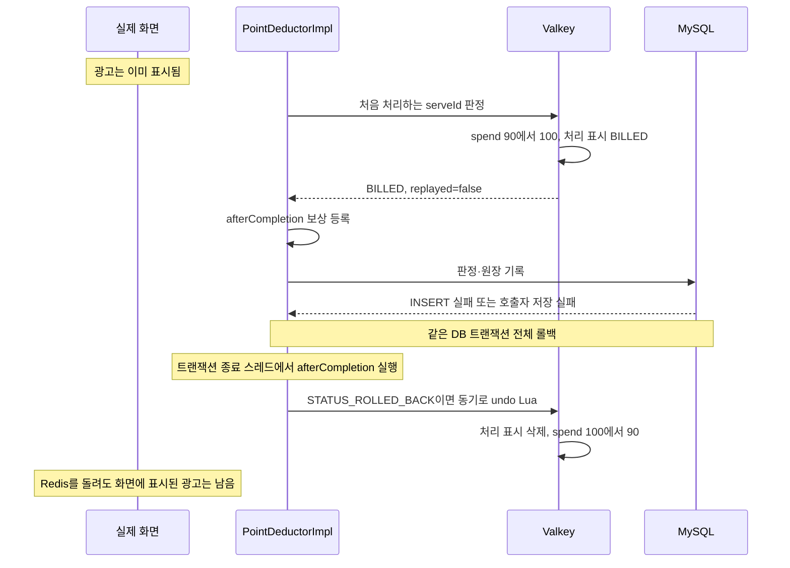

# billing 장애 처리 설계

[장애 처리 설계 가이드](../장애_처리_설계_가이드.md)를 따른다. 노출 차감·진행률·상태 미러의 장애 결정을 기록한다. 결제대행사의 설정 오류 분류는 아래 절에서 다룬다. 환불과 나머지 관리자 기능의 장애는 이 문서의 범위가 아니다. 정상 호출 순서는 [구조와 동작 설계 6장](./billing_구조와_동작_설계.md#6-구조와-동작-그림)이 소유한다.

이 문서는 현재 구현의 동작과 남은 위험을 설명한다. 새 재시도 작업자나 자동 정정 정책을 추가한 것으로 읽지 않는다. [구조 설계의 확인 기준](./billing_구조와_동작_설계.md#확인-기준과-범위)을 따른다. 작업 상태는 해당 이슈가 갖는다. 대사는 00:00 전일 대사와 `PG_VS_CHARGE` 대사다. 아래 "후속 대사"는 이 두 대사를 뜻한다. 대사는 자동 정정이나 누락 과금을 만들지 않는다.

## 결제 상수를 통합하며 확인한 범위

#656은 승인 확정·웹훅·재조회에서 사용하는 제약 이름과 기본 실패 문구의 Java 정의만 옮긴다. DB 제약, 실패 사유 조합과 외부 API 예외 처리는 변경하지 않는다. 이번 변경으로 기본 장애 처리를 벗어나는 대상은 없다. 기존 결제 처리와 HTTP 응답은 [billing API 설계](./billing-api-design.md)를 따른다.

## 기대는 대상

| 대상 | 용도 | 기본 처리와의 관계 |
|---|---|---|
| 결제대행사(Toss) 승인·결과 재조회 | 충전 승인을 요청하고 불명확한 결과를 확인한다 | 외부 API의 기본 처리를 따른다. 설정 오류는 미처리로 구분한다 |
| MySQL 계획 읽기 | 그날 단가·점주·예약액·상태를 읽는다 | 기본대로 오류를 전파한다 |
| MySQL 판정·원장 쓰기 | 과금을 확정한다 | 기본대로 호출자의 DB 트랜잭션을 롤백한다. Redis 효과는 2장 보상이 필요하다 |
| MySQL 집계 읽기(`BillingStatsQueryService`) | 분석의 일별 배치가 원장·판정·계획을 날짜로 묶어 읽는다 | 기본대로 오류를 전파한다. 대체값 없이 호출한 배치가 실패하고 분석이 재집계한다 |
| Valkey 소진 해시·처리 표시 | 과금 여부를 판정한다 | 일반 캐시와 달리 장애 때 통과시키지 않는다. 대체값 없이 실패한다 |
| Caffeine 계획 캐시 | DB 읽기를 줄인다 | 캐시 미스는 DB에서 읽는다. 임의의 금액을 만들지 않는다 |
| 상태 미러의 커밋 뒤 리스너 | 커밋된 중단 여부를 Valkey에 반영한다 | 커밋 뒤 실패는 이미 확정된 캠페인 상태를 되돌릴 수 없다. 3장을 따른다 |
| 재예약 예약액 미러의 커밋 뒤 리스너 | 충전 직후 늘어난 예약액을 Valkey에 반영한다 | **벗어난다.** 실패해도 해시를 지우지 않고 ERROR로만 남긴다. 3장을 따른다 |
| 충전 직후 재예약 리스너(`PointChargedListener`) | 커밋된 충전을 받아 재예약을 새 트랜잭션으로 연다 | **벗어난다.** 실패를 전파하지 않고 ERROR로만 남긴다. 충전은 이미 커밋돼 있어 올리면 승인 확정 API가 성공한 충전에 실패를 돌려준다 |
| `afterCompletion` 콜백 | 롤백된 새 판정의 Redis 효과를 되돌린다 | 메모리 콜백이다. 실행을 내구성 있게 보장하는 작업 기록은 없다 |
| MySQL 점주 상태 읽기(`OwnerStatusQuery.findCurrentStatus`) | 점주 결제·포인트·환불 API가 요청마다 점주가 `ACTIVE`인지 확인한다 | 기본대로 오류를 전파한다. 조회가 실패하면 요청이 실패하고 통과시키지 않는다. 캐시를 쓰지 않으므로 낡은 상태로 정지된 점주를 통과시키지 않는다 |
| 광고 서빙의 serve 기록·노출 전달 | 과금 호출 전에 실제 노출을 검증한다 | 광고 서빙이 소유한다. 정산이 복구하지 않는다. 5장의 과금 누락과 연결된다 |
| 결제대행사(Toss) 결제 조회 | `PG_VS_CHARGE` 대사(#391)가 전일 승인 결제를 PG와 대사한다 | **벗어난다.** 7장을 따른다 |

### 결제대행사의 설정 오류

`NOT_FOUND_MERCHANT`는 상점 정보가 없어 요청을 처리하지 못한 설정 오류다. 승인에서는 `PgNotSentException`으로 분류해 `REQUESTED`를 유지하고 `503 BILLING-007`을 반환한다. `UNKNOWN`과 재조회 아웃박스를 만들지 않으므로 설정을 고친 뒤 같은 주문으로 승인할 수 있다.

결제 조회에서 같은 오류를 받아도 `NOT_FOUND_PAYMENT`와 구분한다. 이미 결과가 불명확한 결제는 조회의 설정 오류만으로 실패나 취소로 닫지 않는다. 설정 오류는 `TOSS_AUTH_FAILED` 로그를 남기고 기존 인증 오류와 같은 기준으로 서킷 실패에 집계한다.

## 1. Valkey에서 판정하지 못한 경우

금액에 쓰는 카운터라서 연결 실패를 `spend=0`이나 예약액 무제한으로 바꾸지 않는다. 차감은 예외를 전파하고 호출자의 노출 저장까지 롤백한다. 진행률도 예외를 전파한다. 피드를 계속 내려줄지는 광고 서빙의 정책이다.

**결정: 진행률 조회는 카운터 장애를 전용 타입으로 던진다(#324).** `BudgetQueryService.getProgress`가 당일 소진 카운터를 읽거나 재구성하다 실패하면 `billing.exception.BudgetCounterUnavailableException`으로 바꿔 던진다. 전파하는 결정 자체는 바뀌지 않는다. 호출하는 도메인이 이 장애와 프로그래밍 오류(재구성한 뒤에도 해시가 없는 `IllegalStateException` 등)를 구분해 잡을 수 있게 이름만 둔 것이다. `billing.contract`에는 인터페이스·record·enum만 두므로 이 타입은 `billing.exception`에 있고, 다른 도메인은 `billing.contract`만 참조하는 규칙 때문에 adserving은 이 타입으로 좁혀 잡지 않는다.

**해시 없음과 Redis 서버 장애의 경로는 다르다.** `HASH_MISSING`은 Redis가 정상적으로 응답한 결과다. 연결 실패나 시간 초과는 예외라서 해시 재구성 분기로 들어가지 않는다. 재구성도 마지막에는 Redis 쓰기와 Lua 재판정이 필요하다. 현재 구현에는 DB만으로 과금하는 대체 경로가 없다.

DB 원장 합을 읽고 단가를 비교하는 것만으로 대체하면 동시 요청이 같은 잔여 예산을 함께 쓸 수 있다. DB 대체 판정에는 캠페인·영업일 단위의 원자적 갱신 또는 공통 잠금이 필요하다. Redis 정상 처리와 DB 대체 처리의 전환도 함께 설계해야 한다. 그래서 이 대안은 택하지 않았다.

차감의 Redis 예외를 HTTP 경계까지 그대로 전파하면 [전역 예외 처리기](../../../src/main/java/com/launchcatch/global/exception/GlobalExceptionHandler.java)가 `500 / COMMON-001`로 바꾼다. 메시지는 `서버 오류가 발생했습니다.`다. 이 차감 경로에는 해당 예외를 `503`으로 변환하는 처리가 없다. 응답 유실이나 게이트웨이 시간 초과까지 모두 이 HTTP 응답이 전달된다는 뜻은 아니다.

| 상황 | 현재 동작과 남는 상태 | 다시 처리할 때 |
|---|---|---|
| 요청이 Valkey에 전달되지 않은 것이 확실함 | Redis 효과는 없다. DB는 실패를 전파해 롤백한다 | 연결이 회복된 뒤 같은 노출로 다시 호출할 수 있다. 정산이 자동 재시도하지는 않는다 |
| Lua가 `HASH_MISSING`을 반환함 | 새 호출에서는 처리 표시나 소진을 쓰지 않는다 | 3장의 재구성 뒤 Lua를 한 번 더 호출한다 |
| 재구성 뒤에도 해시가 없음 | `IllegalStateException`을 던진다 | 정상 미과금으로 숨기지 않는다. 계획·해시 생성 실패를 확인해야 한다 |
| Lua가 실행됐을 수 있으나 응답을 받지 못함 | DB는 롤백될 수 있다. Redis 표시와 소진은 남았을 수 있다 | 같은 노출의 처리 표시를 재사용할 수 있으나 항상 한 번 과금됐다고 결론낼 수 없다 |

마지막 행은 코드 순서에서 확인되는 위험이다. [차감 서비스](https://github.com/lunch-catch/lc-backend/blob/b7f9a104ba302888b4821f62b7080cbbcbc4b883/src/main/java/com/launchcatch/billing/service/PointDeductorImpl.java#L72)는 Lua 결과를 받은 뒤 보상 콜백을 등록한다. `deduct`가 그 전에 예외를 던지면 해당 호출에는 보상 콜백이 없다. 호출 시간 초과를 Redis 미실행으로 단정하면 안 된다.

두 키를 읽고 쓰는 Lua는 비클러스터 Valkey를 전제한다. 클러스터 전환 때 생기는 슬롯 오류를 연결 장애의 대체값으로 숨기지 않는다.

## 2. Lua 판정 뒤 DB가 롤백된 경우

DB 쓰기 롤백은 공통 기본 처리다. 여기에는 DB가 되돌리지 못하는 Redis 효과와 실제 화면 표시만 추가로 기록한다.

예약 100, 기존 소진 90, 단가 10인 처음 처리하는 `serveId`를 예로 든다.



보상 [Lua](https://github.com/lunch-catch/lc-backend/blob/b7f9a104ba302888b4821f62b7080cbbcbc4b883/src/main/resources/scripts/billing_deduct_undo.lua)는 처리 표시를 지운다. 그 표시가 `BILLED`였고 해시가 있으면 소진을 단가만큼 내린다. 미과금 표시는 삭제만 한다. 표시가 없으면 아무것도 하지 않는다. 해시가 없으면 소진을 갱신하지 않는다.

실행 수단은 [구조 설계 7장의 표](./billing_구조와_동작_설계.md#트랜잭션-종료-뒤-실행하는-수단)가 소유한다. 보상은 `afterCompletion`에서 직접 호출하므로 Valkey가 느리면 트랜잭션 종료 처리의 반환도 늦어질 수 있다. 이를 별도 비동기 작업으로 완료된 것처럼 응답하는 경로는 없다. DB는 이미 롤백됐으므로 보상 실패를 DB 재롤백으로 해결할 수 없다.

| 트랜잭션 종료와 판정 | 보상 |
|---|---|
| 이번 호출이 새로 판정했고 `STATUS_ROLLED_BACK`임 | `undo`를 호출한다 |
| 기존 처리 표시를 돌려받은 재호출임 | 보상을 등록하지 않는다. 앞서 처리된 노출의 효과를 지우면 안 된다 |
| 정상 커밋됨 | 되돌리지 않는다 |
| 종료 상태가 `UNKNOWN`임 | 커밋됐을 수 있어 되돌리지 않는다 |
| 보상 호출이 실패함 | 예외를 다시 올리지 않는다. ERROR와 실패 지표를 남긴다. 내구성 있는 보상 재실행은 없다 |
| 보상 등록 뒤 프로세스가 종료됨 | DB와 Redis 결과는 종료 시점에 따라 달라진다. 콜백 실행을 보장하지 못한다 |

보상이 완료되면 재요청은 현재 예산과 중단 여부로 새로 판정한다. 앞 호출 당시 `BILLED`였어도 다른 노출이 예산을 썼다면 미과금일 수 있다. 보상 성공이 과금 복구 성공을 뜻하지 않는다.

DB 커밋은 성공했지만 응답만 유실된 경우에는 같은 노출의 재요청이 기존 판정을 반환한다. 확정 원장을 취소하지 않는다. DB 커밋 결과 자체가 불명인 경우와 구분해야 한다.

**결정: 실패한 과금의 예산 점유를 롤백 뒤 즉시 풀어준다.**

| 선택지 | 얻는 것 | 잃는 것 |
|---|---|---|
| 현재처럼 소진과 표시를 보상한다 | 롤백된 과금 때문에 다음 노출이 조기에 예산 소진으로 거부되는 일을 줄인다 | 메모리 콜백과 보상이 실패할 수 있다. 동시 재호출과 겹치면 4장의 경합이 생긴다 |
| Redis 증가를 남기고 대사만 기다린다 | 롤백 직후 보상 왕복과 그 경합이 없다 | 무료 노출은 그대로다. 원장에 없는 금액이 예산을 점유해 조기 소진을 만든다 |

현재 구현은 첫 선택지를 사용한다. 둘째 선택지를 택해도 누락된 원장이 자동으로 생기지 않는다. 보상의 목적은 과금되지 않은 예산 점유를 푸는 것이다.

## 3. 해시 재구성과 상태 미러

### 연결은 살아 있지만 해시가 사라짐

재구성 입력은 구조 설계 3장과 6장이 소유한다. 이미 있는 해시는 덮어쓰지 않는다. 여러 요청이 동시에 복구해도 먼저 생성한 해시를 사용한다. 재구성은 커밋된 원장을 읽으므로 아직 커밋하지 않은 차감은 알 수 없다.

공유 잠금은 재구성 중 계획의 중단 갱신 순서를 지킨다. 모든 차감을 멈추거나 DB·Redis를 함께 잠그지는 않는다. 따라서 해시 유실 직전 진행 중이던 과금의 증가분까지 복구한다고 주장할 수 없다.

재구성 Lua가 성공한 뒤 DB 조회 트랜잭션이 롤백돼도 생성한 해시는 자동 삭제되지 않는다. DB 값은 읽었으며 외부 쓰기는 Valkey에 이미 나갔다.

### 중단 통보를 커밋한 뒤 해시 갱신에 실패함

[상태 서비스](../../../src/main/java/com/launchcatch/billing/service/BudgetPlanStatusService.java)는 DB 상태를 먼저 확정하고 커밋 뒤 Redis에 반영한다. 미러의 `DataAccessException`을 받으면 해시를 삭제한다. 다음 호출이 DB 정본으로 다시 만들게 하려는 것이다. 실행 수단과 대안의 비용은 [구조 설계 7장](./billing_구조와_동작_설계.md#트랜잭션-종료-뒤-실행하는-수단)이 소유한다.

해시 삭제마저 실패하면 `BUDGET_STATUS_HASH_EVICT_FAILED` ERROR를 남긴다. 낡은 `paused` 값이 남을 수 있다. 미러 이벤트를 내구성 있게 다시 실행하는 작업자는 없다. 상태 커밋과 미러 실행 사이의 짧은 구간도 남으므로 중단 커밋 즉시 모든 과금이 차단된다는 보장은 아니다.

DB 커밋 뒤 리스너 실행 전에 프로세스가 종료되면 내부 통보도 사라진다. 기존 해시가 남았다면 다음 차감은 해시 없음 재구성을 시작하지 않아 낡은 상태를 계속 사용할 수 있다. 따라서 재구성 기능이 있다는 이유로 누락된 상태 미러가 반드시 자동 복구된다고 설명하지 않는다.

리스너는 같은 스레드에서 실행해도 다른 트랜잭션의 차감과 경쟁한다. 커밋 뒤 호출을 별도 실행기로 넘기지 않았다는 사실이 전체 요청의 순서를 직렬화하지는 않는다.

오래된 상태 이벤트가 뒤늦게 도착한 경우에는 저장된 전이 시각보다 늦을 때만 갱신한다. 시간 순서가 바뀌었다는 이유로 최신 상태를 되돌리지 않는다.

### 충전 직후 재예약을 커밋한 뒤 해시 갱신에 실패함(#319)

`RechargeReservationService`도 DB 상태(계획의 `daily_budget`)를 먼저 확정하고 커밋 뒤 `BudgetPlanStatusService.mirrorReserve`로 Valkey에 반영한다. **중단 표시 미러와 다르게 실패해도 해시를 지우지 않는다.** `increaseReserved`는 해시가 있고 지금 값보다 큰 값일 때만 올리므로, 지워서 다음 차감이 DB 정본으로 재구성하게 하는 것과 실패를 ERROR로만 남기고 낡은(더 작은) 값을 그대로 두는 것 사이에서 후자를 골랐다. 예약액이 실제보다 작게 보이면 그 캠페인은 과금이 일찍 멈출 뿐이고, 크게 보이면(이 경로에는 없지만 재구성이 겹치면) 예약액을 넘겨 과금할 수 있어서다. 상한을 넘기지 않는 쪽의 안전을 택한 결정이다. 낡은 해시는 그 영업일이 끝날 때까지 남는다. 다음 00:00 해제는 해시가 아니라 계획 행을 읽으므로 해제액은 맞다.

리스너(`PointChargedListener`)는 커밋 뒤에 돌고 재예약 전체가 실패해도 예외를 전파하지 않는다. 충전은 이미 커밋돼 있어 올리면 승인 확정 API·웹훅·재조회 워커가 성공한 충전에 실패를 돌려준다. 놓친 재예약은 다음 00:00 예약(`DailyReservationService.reserve`)이 그 영업일 잔액으로 다시 배분한다.

## 4. 카운터와 원장이 달라지는 경합

아래 L-1~L-5는 확인한 기존 구현 기록의 한계를 받아 적었다. 예산 한도가 모든 장애에서 보장된다는 설명을 하지 않는다.

| ID | 상황 | 카운터와 확정 과금의 차이 | 현재 처리와 남은 한계 |
|---|---|---|---|
| L-1 | 롤백 보상이 실패하거나 프로세스가 종료됨 | Redis가 더 크다 | 정상 보상은 차이를 줄인다. 남은 차이는 그날 안에 고쳐지지 않는다. 서빙이 하루 종일이라 장중 대사가 없고 다음 00:00 전일 대사가 불일치로 기록한다(#497). 원장은 정확해 과다 청구는 없고 그 캠페인의 과금이 일찍 멈춘다 |
| L-2 | 해시 재구성이 커밋 전 과금분을 놓치거나 롤백된 표시만 남음 | Redis가 더 작아질 수 있다 | 예약액 초과 과금이 가능하다. 계획 공유 잠금만으로 해결되지 않는다 |
| L-3 | 처리 표시 만료 뒤 같은 `serveId`를 정산에 다시 넘김 | Lua가 새로 증가하면 Redis가 더 크다 | DB의 첫 판정과 원장 중복은 막지만 이 증가분은 즉시 내리지 않는다 |
| L-4 | 같은 노출의 첫 요청이 새 판정 뒤 롤백되고 다른 요청이 재호출 판정으로 커밋됨 | 첫 요청의 보상이 Redis만 내려 더 작아질 수 있다 | 처리 표시의 소유권이나 인수 절차가 없다. 정상 동시 중복 테스트만으로 이 경합을 해결했다고 볼 수 없다 |
| L-5 | 자정 직전에 시작한 전날 차감이 00:00 해제 뒤에 커밋됨 | 해제는 그 차감을 모르고 계산돼 소진과 해제의 합이 예약액을 넘는다. 소진 자체는 예약액보다 작을 수 있다 | 차감은 계정 잠금을 잡지 않는다(핫패스 지연을 늘리지 않기 위해서다). 이틀 뒤 00:00 전일 대사 단계가 소진과 해제의 합이 예약액을 넘는 캠페인을 `CAMPAIGN_OVERSPEND`로 기록한다. 이미 커밋된 과금이라 자동 취소하지 않고 관리자가 조정한다. 초과분은 자정에 진행 중이던 요청 수만큼이다 |

L-4의 한 예는 다음과 같다.

```text
A가 해당 serveId를 처음 BILLED로 판정하고 spend를 10 올림
B가 같은 serveId의 처리 표시를 읽어 증가 없이 BILLED를 받음
A가 DB 롤백됨
B는 판정 UNIQUE 대기 뒤 DB 기록을 커밋할 수 있음
A의 보상이 처리 표시를 지우고 spend를 10 내림
결과: B의 DEDUCT는 남았지만 Redis에는 증가분이 없을 수 있음
```

대사의 시각은 [정산 배치 설계](./billing-batch-design.md)가 소유한다. 구현은 `SpendReconciliationService`가 갖고 작업 상태는 해당 이슈(#317, #306)가 갖는다. 예약액을 넘은 소진은 `CAMPAIGN_OVERSPEND` 불일치로 남는다. 대사가 카운터를 원장에 맞추는 것과 이미 발생한 초과 과금을 취소하는 것은 별개다. 원장이 예약액을 넘은 건은 불일치로 남기며 음수 `RELEASE`를 만들면 안 된다. 자동 과금 취소는 현재 설계의 기능이 아니다.

## 5. 무료 노출과 복구 범위

**실제 광고 표시와 확정 과금은 서로 다른 사실이다.** Redis의 `BILLED` 응답은 DB 확정 전의 판정이다. Redis 보상이나 DB 롤백으로 사용자가 이미 본 광고를 되돌릴 수 없다.

다음 경우에는 표시가 있었어도 확정 과금이 없을 수 있다.

| 상황 | 과금이 남지 않는 이유 |
|---|---|
| 노출 전송이 서버에 닿지 않음 | 서버에 복구할 노출 기록이 없다 |
| serve 캐시를 쓰지 못했거나 검증 전에 사라짐 | 광고 서빙의 설계는 `EXPIRED_OR_UNKNOWN`으로 처리한다. 정산을 부르지 않는다 |
| Lua 뒤 DB 롤백, 재처리도 실패함 | 새 판정과 원장이 없다. 보상이 예산을 복구해도 과금은 복구되지 않는다 |
| 보상 뒤 재요청 시 예산 소진 또는 중단됨 | 새 판정이 미과금일 수 있다. 처음 실패한 판정을 영구 보존해 재과금하지 않는다 |

앞 두 경우의 손해를 플랫폼이 부담하는 방향은 [피드 설계의 유실 목표](../adserving/feed-api-design.md#유실-목표)에 있다. 이를 모든 장애의 무료 노출을 무제한 허용한다는 정책으로 확장하지 않는다.

같은 노출의 재요청이 유효성 검증을 통과하고 DB 커밋까지 성공하면 이미 일어난 표시를 과금할 수 있다. 카드를 다시 표시할 필요는 없다. 클라이언트는 [공통 계약](../../api-spec/api-spec.md#클라이언트가-응답을-기다리지-않는-요청)에 따라 실패 시 1회 재시도한 뒤 포기한다. 정산에는 그 뒤 미처리 노출을 다시 찾는 서버 작업자가 없다.

광고 서빙이 첫 처리 때 serve 기록을 지운다면 롤백 뒤 재요청이 무효가 될 수 있다. serve 기록의 삭제 시점과 보존은 [광고 서빙 설계](../adserving/adserving_구조와_동작_설계.md)가 갖는다.

원장과 카운터의 대사는 양쪽에 없는 노출을 발견하지 못한다. 따라서 이 대사는 무료 노출의 사후 과금 복구 경로가 아니다. 노출과 같은 트랜잭션에 아웃박스를 넣더라도 그 트랜잭션이 롤백되면 아웃박스도 사라진다. 무료 노출을 복구하는 경로는 없다.

## 6. 장애 시점별 후처리와 대사 범위

### 표를 읽는 기준

이 절은 장애 직전까지 완료된 단계에 따라 결과를 나눈다. 같은 트랜잭션의 DB 쓰기는 전체가 함께 확정되거나 롤백된다. Redis는 그 트랜잭션에 참여하지 않는다. DB 저장 메서드를 먼저 호출했다는 사실만으로 실제 INSERT도 Lua 전에 실행됐다고 가정하지 않는다. 아래 표는 실제 SQL 실패가 확인된 시점을 기준으로 읽는다.

| 구분 | 의미 |
|---|---|
| 무효 | 카드 검증 실패를 `INVALID`와 사유로 기록한다. DB 저장 성공이 필요하다 |
| 유효한 미과금 | 카드 검증은 통과했지만 예산·중단·품절 때문에 과금하지 않는다 |
| 처리 실패·롤백 | 저장을 완료하지 못했다. 무효나 미과금을 정상적으로 확정한 것이 아니다 |
| 즉시 보상 | 새 Redis 판정 뒤 DB 롤백이 확정되면 소진과 표시를 되돌리는 것을 시도한다 |
| 즉시 재구성 | Redis는 살아 있고 당일 해시가 없으면 같은 요청에서 DB 정본으로 해시를 만든다 |
| 후속 대사 | 원장의 확정 과금 합과 Redis 소진을 비교한다. 누락된 실제 표시를 찾아 과금하는 작업은 아니다 |

정상 순서는 카드 배정, 실제 표시, 노출 요청, 검증, DB 노출 저장, Lua, 보상 등록, DB 판정·원장 저장, 커밋이다. Redis 처리 표시의 저장값과 반환값은 구조 설계 6장이 소유한다.

### 6.1. 카드 배정과 유효성 검증에서 발생한 장애

| 장애 시점·조건 | 실제 표시 | 남는 상태 | 즉시 처리 | 이후 처리와 대사 |
|---|---|---|---|---|
| 후보 DB 조회가 실패함 | 이 요청의 새 카드는 아직 없다 | 정상 피드 응답을 만들지 못한다 | 피드 요청을 오류로 끝낸다 | 과금이 발생하지 않아 소진 대사 대상이 아니다 |
| serve 기록을 Redis에 쓰지 못했으나 카드는 내려감 | 이후 표시될 수 있다 | 해당 카드의 검증 키가 없을 수 있다 | 광고 서빙이 실패를 센다. 이후 키 없음이 확인되면 무효로 기록한다 | 대사는 serve 기록이나 누락 과금을 만들지 않는다 |
| 피드 기록 파이프라인이 중간에 실패함 | 카드가 내려갔을 수 있다 | 일부 카드 키·회원 이력만 남을 수 있다 | 카드별 존재 여부가 다를 수 있다. 전체 성공·전체 취소로 간주하지 않는다 | 소진 대사가 회원 이력이나 검증 키를 복원하지 않는다 |
| 표시 뒤 요청이 서버에 닿지 않음 | 이미 표시됐다 | 노출·판정·원장이 모두 없을 수 있다 | 클라이언트의 제한된 재시도에 의존한다 | 양쪽에 기록이 없어 카운터·원장 비교로 발견하지 못한다 |
| 기존 확정 판정이 없고 serve 키가 없음·만료됨 | 이미 표시됐을 수 있다 | 검증 근거가 없다 | `INVALID / EXPIRED_OR_UNKNOWN`을 기록하고 정산을 부르지 않는 설계다 | 대사로 소급 과금하지 않는다 |
| serve 키의 회원이 요청 회원과 다름 | 정상 배정받은 카드로 인정하지 않는다 | 다른 사용자의 카드라는 근거가 있다 | `INVALID / NOT_OWNER`를 기록한다 | 대사로 소급 과금하지 않는다 |
| 검증 키 읽기 자체가 연결 오류로 실패함 | 이미 표시됐다 | 키가 있는지조차 모른다 | 처리는 [광고 서빙 장애 설계](../adserving/adserving_장애_처리_설계.md)가 갖는다. 정산은 이 노출을 부르지 않는다 | 대사는 카드 검증을 대신하지 않는다 |
| 무효 판정 뒤 무효 로그의 DB 쓰기가 실패함 | 이미 표시됐을 수 있다 | 확정된 무효 기록도 없다 | 저장 실패로 처리한다 | 무효 처리 완료가 아니다. 대사가 무효 로그를 생성하지 않는다 |
| 응답 뒤 비동기 `serve_log` 쓰기가 실패함 | 표시될 수 있다 | 진단 DB 로그가 빠지지만 serve 캐시는 남을 수 있다 | 광고 서빙은 로그를 버리고 실패를 센다 | serve 캐시가 있으면 검증 근거는 남는다. 과금 대사는 진단 로그를 복원하지 않는다 |

`GET`이 정상적으로 없음이라고 응답한 것과 `GET` 자체가 실패한 것은 다르다. 무효 노출도 DB 저장이 실패하면 기록되지 않은 요청으로 남는다.

이미 DB에 유효성 판정을 확정한 요청의 재전송은 명세상 첫 판정을 반환해야 한다. serve 키가 이후 만료됐다는 이유만으로 기존 `VALID`를 `INVALID`로 덮어쓰면 안 된다. 첫 DB 판정 확인과 serve 검증의 순서는 아직 없는 노출 수집 연동에서 지켜야 할 조건이다.

### 6.2. DB가 실패한 시점에 따른 처리

아래 롤백 행은 `STATUS_ROLLED_BACK`으로 종료가 확인된 경우다. 연결 단절로 커밋 결과가 불명인 경우는 별도 행으로 둔다. 이미 화면에 표시된 광고는 어느 롤백도 되돌리지 못한다.

| DB 실패 시점 | DB에 확정되는 새 기록 | Redis 상태 | 즉시 후처리 | 재요청 또는 후속 대사 |
|---|---|---|---|---|
| 실제 노출 로그 INSERT가 Lua 전에 실패함 | 새 노출 기록이 취소된다 | 이 정산 호출은 아직 쓰지 않았다 | 예외를 전파하고 롤백한다 | 같은 요청을 다시 처리할 수 있다. 끝내 실패하면 무료 노출이 남는다 |
| 계획 캐시 미스 뒤 DB 읽기가 실패함 | 호출자의 새 노출 기록도 롤백된다 | 아직 과금 Lua를 호출하지 않았다 | 예외를 전파한다 | 카운터 보상은 필요 없다. 대사는 누락 과금을 만들지 않는다 |
| 그날 계획 행이 없음 | 노출과 `NOT_BILLED_NO_PLAN` 판정이 커밋된다 | 쓰지 않는다 | 캠페인의 점주와 운영 단가로 판정 행만 남긴다(#497). 캠페인 자체가 없으면 `IllegalStateException` | 00:00 예약 전이거나 전날 집행이 끝난 캠페인이라 과금하지 않는 것이 맞다. `billing_deduct_no_plan_total`이 자정 직후 30분 밖에서도 오르면 예약 실패를 의심한다 |
| 새 `BILLED` 뒤 판정 INSERT가 실패함 | 새 노출·판정·원장이 함께 롤백된다 | 소진 증가와 표시가 먼저 남는다 | 새 판정의 종료 콜백에서 표시 삭제·소진 감소를 시도한다 | 보상 실패로 남은 카운터 오차는 대사 대상이다. 누락된 과금은 생성하지 않는다 |
| 판정 INSERT 뒤 원장 INSERT가 실패함 | 판정도 함께 롤백된다 | 소진과 표시가 남는다 | 같은 즉시 보상을 시도한다 | 판정만 과금으로 확정되는 정상 경로는 아니다 |
| 차감 service 반환 뒤 호출자의 DB 작업이 실패함 | 같은 트랜잭션의 새 쓰기가 함께 롤백된다 | Redis는 이미 판정했을 수 있다 | 새 판정에 등록된 보상을 실행한다 | service 반환은 커밋 완료가 아니다. 보상 실패분은 후속 대사 대상이다 |
| 새 미과금 판정 뒤 DB 저장이 실패함 | 노출·미과금 판정이 롤백된다 | 미과금 표시만 있다. 소진은 늘리지 않았다 | 표시를 삭제한다 | 재요청 시점의 예산·상태로 다시 판정한다 |
| 기존 커밋 건의 `REPLAY` 재호출이 DB에서 실패함 | 이번 변경만 롤백된다. 기존 과금은 유지된다 | 이번 호출은 소진·표시를 바꾸지 않았다 | 이번 호출의 보상은 등록하지 않는다 | 기존 과금을 취소하면 안 된다. 첫 판정은 남는다 |
| DB 커밋은 성공했지만 HTTP 응답이 유실됨 | 노출·판정·원장이 확정된다 | 표시와 소진이 남을 수 있다 | 롤백 보상하지 않는다 | 같은 요청의 재전송은 첫 DB 판정을 유지한다 |
| DB 커밋 중 종료 결과가 `UNKNOWN`임 | 커밋했을 수도, 아닐 수도 있다 | Redis 판정이 남았을 수 있다 | 즉시 감소시키지 않는다 | 결과 확인이 필요하다. 대사는 확정 원장 기준의 카운터 차이만 조정할 수 있다 |

보상이 성공해도 같은 요청의 재처리가 반드시 `BILLED`인 것은 아니다. 다른 요청이 남은 예산을 썼거나 캠페인이 중단되었다면 미과금으로 기록될 수 있다.

### 6.3. Redis 장애의 형태와 시점에 따른 처리

| Redis 장애·시점 | 남는 상태 | 즉시 후처리 | 이후 처리와 대사 |
|---|---|---|---|
| Lua가 전달되지 않은 것이 확실함 | 이번 호출의 소진·표시는 없다 | 예외를 전파해 DB 트랜잭션을 롤백한다 | 연결 복구 뒤 재요청할 수 있다. 대사는 누락 과금을 만들지 않는다 |
| 연결은 정상이고 `billing:day`만 없음 | 새 요청은 아직 표시·소진을 쓰지 않았다 | DB 자료로 해시를 만들고 같은 요청에서 재판정한다 | 대사 시각을 기다리지 않는다. 해시 생성 때 3일 TTL을 설정한다 |
| 재구성 중 필요한 DB 조회가 실패함 | 해시를 만들 근거가 없다 | 오류를 전파한다 | 소진을 0으로 가정하거나 예산을 무제한으로 바꾸지 않는다 |
| DB 자료는 읽었지만 해시 생성 Lua가 실패함 | 생성 여부는 실패 형태에 따라 불명일 수 있다 | 오류를 전파한다 | 다음 요청이 실제 키 존재 여부를 확인해야 한다 |
| 재판정에서도 해시 없음이 반환됨 | 과금 판정이 없다 | 한 번 재판정 뒤 예외로 끝낸다 | 무한 재구성하지 않는다 |
| Lua는 실행됐을 수 있으나 응답을 못 받음 | 소진·표시가 남았을 수 있다 | 반환 전 예외면 보상 등록 전일 수 있다. DB는 실패를 전파한다 | 표시 재사용과 원장 확인이 필요하다. Redis 미실행으로 단정하지 않는다 |
| Lua 응답을 받은 뒤 Redis가 내려감 | Redis 값의 유지 여부는 장애 형태에 달렸다 | 그 이후 DB가 정상이라면 판정·원장을 커밋할 수 있다 | Redis는 커밋 참여자가 아니다. DB가 커밋되고 키가 사라졌으면 이후 재구성한다 |
| DB 롤백 뒤 보상 Lua 호출이 실패함 | 원장은 없지만 증가가 남을 수 있다 | ERROR와 실패 지표를 기록한다 | 자동 보상 작업자는 없다. 후속 대사로 카운터를 맞춘다 |
| 보상 전에 프로세스가 종료됨 | 종료 시점에 따라 DB·Redis 상태가 달라진다 | 메모리 콜백은 실행을 보장하지 못한다 | 카운터 차이는 후속 대사 대상이며 콜백 누락은 지표에도 없을 수 있다 |
| 커밋된 과금의 당일 해시만 유실됨 | DB 과금 기록은 남는다 | 다음 새 판정·진행률 조회에서 재구성할 수 있다 | 대사 전에 복구할 수 있다. 진행 중인 차감을 놓치는 L-2는 별도다 |
| 처리 표시만 유실·만료된 뒤 같은 요청이 옴 | DB 첫 판정은 남고 Lua는 새로 판정할 수 있다 | DB 중복은 원장 추가를 막는다. 증가분은 즉시 내리지 않는다 | 커진 카운터는 L-3의 후속 대사 대상이다 |
| 처리 표시는 있는데 당일 해시가 없음 | Lua가 먼저 표시를 읽고 `REPLAY`를 반환한다 | 해당 호출은 해시 재구성을 시작하지 않을 수 있다 | 표시가 커밋된 판정인지 롤백 뒤 잔여 표시인지에 따라 결과가 다르다 |

소진 해시 재구성은 커밋된 DB 기록만 읽는다. 키 생성 성공이 모든 진행 중인 과금의 복원 성공이라는 뜻은 아니다. Redis 전체 연결 장애 때는 재구성도 완료할 수 없다.

### 6.4. 상태 미러의 실패 시점

이 경로는 중단·재개 통보가 올 때 실행한다. 몇 초마다 불일치를 검사하는 주기적 감시 작업이 아니다.

| 실패 시점 | DB·Redis 상태 | 즉시 후처리 | 이후 복구 |
|---|---|---|---|
| 상태 변경 DB 트랜잭션이 롤백됨 | 새 상태는 확정되지 않는다 | `AFTER_COMMIT` 미러를 실행하지 않는다 | 미러 보상은 필요 없다 |
| 상태 DB 커밋 후 Redis 갱신이 실패함 | DB는 새 상태이고 해시는 이전 상태일 수 있다 | WARN 뒤 해시 삭제를 시도한다 | 삭제되면 다음 요청이 DB 정본으로 재구성한다 |
| 상태 갱신 뒤 삭제도 실패함 | 낡은 해시가 남을 수 있다 | ERROR를 기록한다 | 자동 미러 재시도는 없다. 소진 대사와 상태 재반영은 별개다 |
| 커밋 뒤 리스너 실행 전 프로세스가 종료됨 | DB는 새 상태이고 기존 해시는 남을 수 있다 | 콜백을 실행하지 못한다 | 기존 해시가 있으면 해시 없음 재구성이 시작되지 않을 수 있다 |
| 오래되거나 같은 시각의 이벤트가 도착함 | 최신 상태를 유지한다 | `changedAt` 비교로 무시한다 | 장애나 대사 대상이 아니다 |

### 6.5. 즉시 처리하지 못해 대사에 맡기는 차이

[정산 배치 설계](./billing-batch-design.md)의 `CAMPAIGN_SPEND_VS_LEDGER`는 확정 원장과 소진 카운터를 비교한다. 실행 시각은 그 문서를 따르고 구현 상태는 해당 이슈가 갖는다. 소진 비교가 모든 `billing:served` 표시나 `paused`까지 복구한다는 뜻은 아니다.

| 원인 | 대사 전 차이 | 후속 대사로 가능한 처리 | 자동으로 해결하지 못하는 결과 |
|---|---|---|---|
| 롤백 보상 실패·콜백 누락 | Redis가 원장보다 크다 | 원장 기준으로 소진을 내린다 | 저장되지 않은 실제 표시를 과금하지 못한다 |
| 표시 만료 뒤 동일 요청의 Lua 재판정 | 원장 과금은 한 번이고 Redis는 더 클 수 있다 | 소진을 원장 합으로 맞춘다 | 그 사이 조기 소진으로 잃은 배정 기회를 되살리지 못한다 |
| Lua 응답 유실로 원장 없는 증가가 남음 | Redis가 더 클 수 있다 | 커밋된 원장 합으로 조정한다 | 실제 표시의 검증과 누락 원장 생성은 하지 않는다 |
| 재구성이 커밋 전 증가를 놓침 | Redis가 원장보다 작아질 수 있다 | 원장 합에 맞춰 카운터를 올린다 | 이미 발생한 예약액 초과 과금을 자동 취소하지 않는다 |
| 동일 요청의 한쪽 커밋과 다른 쪽 롤백 보상이 겹침 | 원장은 남고 Redis가 작아질 수 있다 | 카운터를 원장 기준으로 맞춘다 | L-4로 생긴 초과 과금을 자동 정정하지 않는다 |
| DB 종료 결과 불명 | 실제 DB 커밋 결과에 따라 다르다 | 확인된 원장과 카운터의 차이를 맞출 수 있다 | 호출 결과 불명이나 노출 유실을 모두 해결하지 않는다 |

소진을 원장보다 크게 보는 경우에는 조기에 예산 소진으로 판정한다. 작게 보는 경우에는 남은 예산을 과대평가해 추가 과금할 수 있다. 후자가 점주 과금에 직접 영향을 준다. 과오 과금의 수동 `ADJUST`와 카운터 재구성은 서로 다른 처리다.

### 6.6. 대사로 과금하지 않는 무효·미과금·유실

| 조건 | 최종 분류 | DB 저장이 성공했을 때의 기록 | 대사로 과금하는가 |
|---|---|---|---|
| 기존 확정 판정이 없고 serve 키 없음·만료 | `INVALID / EXPIRED_OR_UNKNOWN`이다 | 무효 노출 로그를 남긴다 | 하지 않는다 |
| 다른 사용자의 serve 기록 | `INVALID / NOT_OWNER`다 | 무효 노출 로그를 남긴다 | 하지 않는다 |
| 검증은 통과했지만 예산 소진 | 유효한 예산 미과금이다 | 노출과 `NOT_BILLED_BUDGET`을 남기고 원장은 쓰지 않는다 | 소급 과금하지 않는다 |
| 검증은 통과했지만 캠페인 중단 | 유효한 중단 미과금이다 | 노출과 `NOT_BILLED_PAUSED`를 남긴다 | 재개돼도 소급 과금하지 않는다 |
| 검증은 통과했지만 쿠폰 소진 | 유효한 품절 미과금이다 | 노출의 `sold_out`을 남기고 정산을 부르지 않는다 | 하지 않는다 |
| 노출 요청이 서버에 닿지 않음 | 기록되지 않은 노출이다 | 기록이 없을 수 있다 | 대사로 찾지 못한다 |
| DB 롤백 후 재처리가 끝내 실패함 | 처리되지 않은 노출이다 | 확정 노출·판정·원장이 없다 | 누락 과금을 생성하지 않는다 |
| 보상 뒤 재처리 시 예산 소진·중단 | 재요청의 새 미과금 판정이다 | 재요청 시점의 판정을 남긴다 | 처음 실패한 `BILLED`로 소급 과금하지 않는다 |
| 무효 로그 저장 자체가 실패함 | 무효 판정 저장 실패다 | 확정 무효 기록도 없다 | 대사가 대신 기록하지 않는다 |

### 6.7. 후처리 선택의 요약

| 후처리 | 적용 조건 |
|---|---|
| 즉시 보상 | 새 Redis 판정 뒤 보상 등록이 됐고 DB 롤백이 확인되면 실행을 시도한다 |
| 같은 요청에서 재구성 | Redis는 정상 응답했고 당일 해시 없음이 반환되면 DB 정본으로 만든다 |
| 다음 요청에서 재구성 | 커밋된 과금의 해시가 사라졌거나 상태 미러 실패 뒤 삭제에 성공했다 |
| 후속 대사 | 즉시 보상으로 못 고친 소진 차이와 L-2~L-4의 카운터 오차를 확인한다 |
| 무효로 기록 | 검증 키 없음·만료·사용자 불일치가 확인되며 DB 저장이 가능하다 |
| 유효한 미과금으로 기록 | 검증은 통과했지만 예산·중단·품절 조건이다 |
| 자동 복구 보장 없음 | 요청 유실, 최종 저장 실패, 결과 불명, 미러 콜백 유실 등 복구 근거가 없는 경우다 |

## 7. PG_VS_CHARGE 대사(#391)의 외부 API 처리

`PgChargeReconciliationService`가 전일 생성 결제를 `PaymentGateway.inquireByPaymentKey`로 건별 조회한다. 조회는 읽기 전용(멱등)이라 [기본 처리](../장애_처리_설계_가이드.md#기본-처리)의 "멱등한 연산의 재시도 가능한 오류만 재시도하고 한도에서 포기한다"를 따른다. **벗어나는 지점은 포기한 뒤다.**

- 조회가 `PgUnknownException`이나 `PgNotSentException`(서킷 오픈 포함)으로 실패하면 그 결제만 짧게 1회 재시도한다. 재시도까지 실패하면 그 결제는 이번 실행에서 건너뛴다.
- **기본 처리라면 결과를 불일치로 남기거나 알림을 울렸겠지만, 여기서는 `settlement_mismatch`에 아무 행도 남기지 않는다.** PG의 답을 받지 못해 "불일치"인지 "일치"인지조차 모르기 때문이다. 대신 그 결제를 재검증 대기 행(`pg_charge_reconciliation_pending`)으로 남겨 다음 실행이 다시 조회하게 한다. `event=BILLING_PG_RECON_INQUIRY_FAILED` ERROR 로그와 `billing.pg.recon{result="inquiry_failed"}` 지표도 남긴다.
- **대상은 전일 생성 결제와 재검증 대기 행의 결제를 합친 것이다.** 조회를 포기한 결제, PG가 `PENDING`으로 답한 결제, 대사 중 기록이 실패한 결제는 재검증 대기 행으로 남고, 다음 실행이 영업일과 무관하게 다시 조회한다. 대사가 끝나 비교와 필요한 기록을 마치면 그 결제의 대기 행을 지운다. 대기 행은 결제당 한 행이고 `payment_id`가 같은 도메인의 `payment`를 FK로 참조한다(V9).
- 별도 워커나 큐는 두지 않았다. 대기 행은 이 대사가 다음에 돌 때 함께 읽는 목록이다. 대기 행이 남아 있는 동안은 해소되지 않은 결제가 있다는 뜻이라, 오래 남은 행은 수동으로 확인해야 한다.
- 기록 쓰기(`PgChargeMismatchRecorder`) 자체가 실패해도 예외를 밖으로 올리지 않는다. `billing.pg.recon{result="error"}`로 세고, 그 결제를 재검증 대기 행으로 남긴 뒤 다음 결제를 계속 처리한다. 대기 행은 비교와 기록이 끝난 뒤에 지우므로, 기록이 실패하면 대기 행이 남아 다음 실행이 다시 대사한다. PG 응답의 주문번호가 결제의 주문번호와 다르면 보정하지 않고 같은 방식으로 대기 행에 남긴다(PG에 결제가 없다는 응답은 주문번호가 비어 있어 이 검증에서 제외하고 불일치로 기록한다).
- **실행 중에 배치 서버가 멈추면 다른 서버가 이어받아 같은 영업일로 다시 대사한다.** `PgChargeReconciliationScheduler`가 `StandaloneJob`을 구현해 등록돼 있다(`#623`). `FAILED`로 닫힌 행은 관리자가 다시 실행할 수 있다. 다시 돌아도 결과가 같다. 빠진 `CHARGE`는 결제당 한 줄(`uk_point_ledger_payment_entry`)이고, 불일치는 같은 `(check_type, target_id, business_date)`가 있으면 넣지 않는다. 기록이 덮어쓰기가 아니라서 늦게 깨어난 이전 시도가 새 시도의 결과를 덮지 못하므로 `BatchAttemptGuard`로 세대를 확인하지 않는다.

## 유형별 점검

공통대로 DB 읽기 오류와 DB 쓰기 롤백을 처리하는 코드를 반복 설명하지 않는다. 아래는 점검 범위와 기본에서 벗어나는 자리다.

| 유형 | 점검한 상황 | 이 경로의 적용 |
|---|---|---|
| 캐시 | 다운·응답 불명 | 1장을 따른다. 시간 초과 뒤 실행 결과를 확인하는 경로는 없다 |
| 캐시 | 만료 직후 요청 집중 | 재구성 쿼리를 묶었지만 요청 사이 중복 재구성과 캠페인별 Lua 비용은 남는다 |
| 캐시 | 분산 락 | 이 경로는 Valkey 분산 락을 사용하지 않는다. 해당 없음이다 |
| 캐시 | 낡은 상태 | 3장의 상태 미러와 삭제 실패를 따른다 |
| DB | 다운·연결 거부 | 공통 오류 전파·롤백을 따른다 |
| DB | 슬로우 쿼리·풀 고갈 | 공통 연결 설정을 사용한다 |
| DB | 데드락·락 대기 | 예외를 전파한다. 같은 노출을 자동 재실행하는 정책은 정산에 없다 |
| DB | 제약 위반·불일치 | 예상한 중복만 upsert로 흡수한다. 다른 제약 위반을 정상 미과금으로 숨기지 않는다 |
| DB | Primary 전환·커밋 결과 불명 | `UNKNOWN`이면 Redis를 되돌리지 않는다. 결과를 확인하는 경로는 없다 |
| DB | 복제 지연 | 확인한 경로는 별도 읽기 복제본을 선택하지 않는다. 도입하면 현재 읽기·잠금 조건을 다시 확인해야 한다 |
| 외부 API | 타임아웃·5xx·인증 거부·응답 불명 | `PG_VS_CHARGE` 대사(#391)가 PG 조회를 건다. 처리는 7장을 따른다. 승인 확정과 재조회의 설정 오류는 위의 설정 오류 절을 따른다 |
| 애플리케이션 | 요청 집중·대량 조회 | 진행률 후보 수를 5,000개로 제한한다 |
| 애플리케이션 | 배포·강제 종료 | 처리 중 종료와 보상 콜백 누락을 2장에 적었다 |
| 애플리케이션 | 여러 서버의 배치 중복 | 00:00 묶음은 운영의 실행 점유를 따른다. `PG_VS_CHARGE` 대사는 `batch_execution_log` 점유로 두 서버가 같은 날을 겹쳐 돌지 않게 한다 |
| 롤백 안 되는 효과 | 커밋 전 Redis 성공 | 2장의 보상을 사용한다. DB와 함께 롤백된다고 표현하지 않는다 |
| 롤백 안 되는 효과 | 커밋 뒤 상태 미러 실패 | 3장을 따른다. 분석 이벤트 유실은 광고 서빙·분석이 소유한다 |
| 롤백 안 되는 효과 | 보상 실패 | L-1과 지표로 확인한다. 내구성 있는 재실행은 없다 |

## 관측과 검증 근거

| 관측 | 현재 의미와 한계 |
|---|---|
| `billing_deduct_undo_total{result="failed"}` | 보상 호출에서 예외가 났다. 프로세스가 콜백 전에 종료된 건은 이 지표에 남지 않는다 |
| `billing_deduct_undo_total{result="ok"}` | 보상 호출이 예외 없이 반환했다. 구현은 `undo`의 boolean을 확인하지 않으므로 실제 소진 감소 건수와 같다고 볼 수 없다 |
| `billing_spend_hash_rebuild_total` | 새 해시를 생성했다. 복구 중 진행 중인 과금까지 모두 포함했다는 증거는 아니다 |
| `BUDGET_STATUS_MIRROR_FAILED`, `BUDGET_STATUS_HASH_EVICT_FAILED` | 커밋 뒤 상태 반영과 삭제의 실패를 기록한다 |

검증의 기준은 [통합 테스트](https://github.com/lunch-catch/lc-backend/blob/b7f9a104ba302888b4821f62b7080cbbcbc4b883/src/test/java/com/launchcatch/billing/ImpressionDeductionIntegrationTest.java)와 관련 단위 테스트다. 테스트의 정상 중복·예산 제한·롤백 보상·재구성 결과를 이 문서에 다시 나열하지 않는다.

## 아직 정하지 못한 것

없다.

복구 시간과 데이터 손실 한도, 경보 뒤 사람이 수행할 절차는 이 문서에서 임의의 수치로 정하지 않는다. 공통 품질·인시던트 문서와 해당 운영 결정이 소유한다.
