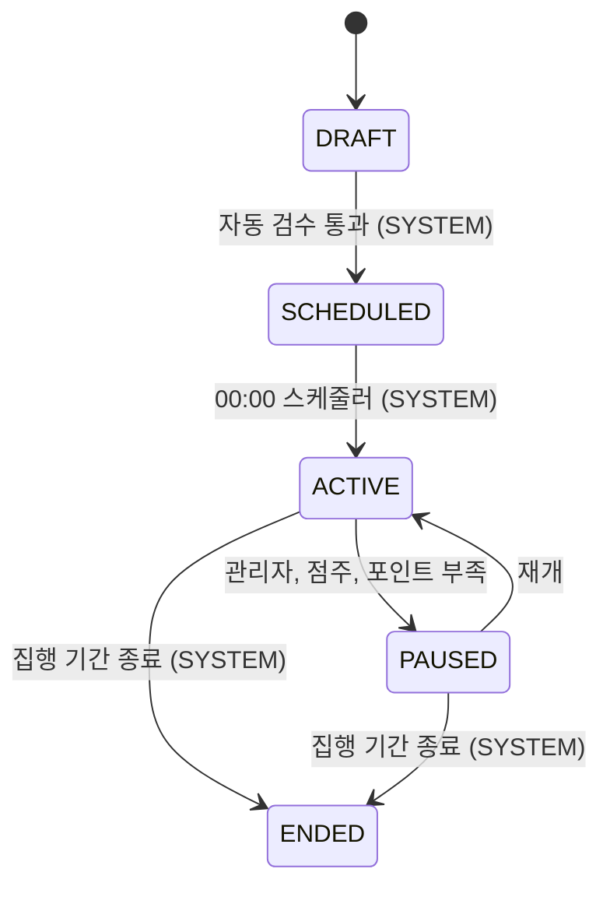

# campaign 구조와 동작 설계

## 1. 범위

| 적을 것 | 내용 |
|---|---|
| 맡는 기능과 근거 | 캠페인의 상태 전이(95행)와 그 이력, 다른 도메인에 캠페인 정보를 공개하는 `CampaignQueryService` 구현 |
| 맡지 않는 것과 그 소유 도메인 | 등록 화면 API(점주, 아직 이슈 없음), 예산 집행과 소진(billing), 광고 배정(adserving), 템플릿과 포스터(같은 campaign 도메인의 다른 애그리거트, [`poster-api-design.md`](./poster-api-design.md)가 따로 가짐) |

이 문서는 `campaign` 애그리거트(도메인 이름과 같은 루트 애그리거트)만 다룬다. `template`, `poster`, `store_audience`는 범위 밖이다.

## 2. 애그리거트와 패키지

| 애그리거트 | 테이블 | 지키는 규칙 | 나눈 근거 |
|---|---|---|---|
| `campaign` | `campaign`, `campaign_status_log` | 95행의 허용 전이 5개만 받고, 모든 전이를 `campaign_status_log`에 남긴다 | 도메인 이름과 같은 루트 애그리거트라 한 겹을 더 두지 않는다 |

```
campaign/
├── contract/
│   └── PauseReason.java           campaign.paused_reason 값. CampaignStatus/TargetGender와 같은 이유로 contract에 둔다
├── entity/
│   ├── Campaign.java              캠페인 전체 필드와 전이 5개
│   ├── CampaignStatusLog.java     전이 이력(쓰고 잊는 로그, ops.AuditLog와 같은 방식)
│   ├── ActorType.java             campaign_status_log.actor_type 값
│   └── AgeGroupListConverter.java target_age_groups 콤마 문자열 <-> List<AgeGroup> 변환
├── repository/
│   ├── CampaignRepository.java
│   └── CampaignStatusLogRepository.java
└── service/
    ├── CampaignStatusService.java      전이 5개, 로그 기록, 낮 전이의 이벤트 발행
    └── CampaignQueryServiceImpl.java   CampaignQueryService 구현
```

`CampaignStatusLog`는 `Campaign`을 `@ManyToOne` 연관관계가 아니라 `campaignId`(원시 `Long`)로만 참조한다. `Campaign`이 자기 로그 목록을 조회할 기능이 이 이슈에 없어서, `ops.AuditLog`가 쓰는 방식을 그대로 따랐다(제가 정한 것).

`PauseReason`은 처음엔 `campaign.entity`에 뒀다가 `campaign.contract`로 옮겼다(2026-10-12). `CampaignStatus`, `TargetGender`, `DiscountTargetType`, `DiscountType`, `AgeGroup`처럼 캠페인 테이블 CHECK 제약과 1:1로 대응하는 enum은 전부 contract에 두고 엔티티가 그대로 쓰는 게 이미 있는 패턴인데, `PauseReason`만 거기서 벗어나 있었다. 다른 도메인(billing)이 `CampaignInfo.pauseReason` 필드로 이 타입을 그대로 쓰려는 계획이 나오면서, `ArchitectureTest`의 `contract는_entity와_repository를_참조하지_않는다`가 그 자리를 막는다는 게 드러나 옮겼다.

입구 넷 가운데 이 이슈에서 실제로 연결된 것은 "다른 도메인의 호출"(`CampaignQueryService`)뿐이다. `CampaignStatusService`의 다섯 메서드는 아직 아무도 부르지 않는다. `schedule`/`activate`/`end`는 "스케줄러 캠페인 담당 스텝" 이슈가, `pause`/`resume`은 "캠페인 수동 중단과 재개(점주)" 이슈와 billing의 `CampaignFundingUpdater` 구현이 각각 부를 자리다.

## 3. 저장

| 적을 것 | 내용 |
|---|---|
| DB 제약으로 막을 것과 코드로 막을 것 | 마이그레이션의 CHECK 6개(`chk_campaign_discount_target`, `_discount_value`, `_paused_reason`, `_period`, `_quantity_budget`, `_usable_time`, `_target_age_groups`)를 `Campaign.create()`와 전이 메서드가 Java 레벨에서 그대로 한 번 더 검사한다([`entity-creation-guideline.md`](../../code-convention/entity-creation-guideline.md) R4-1) |
| 다른 도메인 데이터의 사본 | 해당 없음 |
| 이력 | 상태 변경마다 `CampaignStatusLog` 한 행. 현재 상태는 `campaign.status`가 그대로 가진다 |
| 복잡한 조회 | `findServableOn`은 `campaign` 테이블 하나만 조회한다. billing의 "예약" 데이터(`budget_daily_plan`)는 `campaign -> billing` 간선이 없어 조인할 수 없다([설계 문서](../../architecture/런치캐치_도메인_구조와_의존성_설계.md) 2.2, 역방향은 순환). 95행의 전이 규칙상 `PAUSED(OWNER, NO_POINTS)`는 그날 `ACTIVE`였다가 멈춘 것만 존재하므로 campaign 자신의 컬럼(`status`, `paused_reason`, `start_date`, `end_date`)만으로 조건이 성립한다고 보았다(제가 추론한 것, 문서에 명시돼 있지 않음) |

## 4. 계산 로직

해당 없음. 이 이슈는 조건으로 거르는 조회와 상태 전이뿐이라, 뺄 순수 계산 공식이 없다.

## 5. 모듈 연결

| 방향 | 대상 도메인 | 인터페이스 | 시점 |
|---|---|---|---|
| 공개 | 모든 도메인 | `CampaignQueryService`(`findByStoreIdIn`, `findAllById`, `findServableOn`) | 요청마다 |
| 쓰기(미연결) | store | `StoreCampaignSummaryUpdater` | `pause`/`resume`/`end` 때 호출해야 하지만([설계 문서](../../architecture/런치캐치_도메인_구조와_의존성_설계.md) 2.4), store 쪽에 그 인터페이스가 아직 없어 이번 이슈는 호출을 빼고 넘어간다. 생기면 `CampaignStatusService`에 이어 붙인다 |

받는 이벤트는 해당 없음(`CampaignFundingUpdater` 구현은 billing 쪽 확인 질문이 남아 이 이슈 범위 밖).

## 6. 상태와 흐름



| 전이 | 일으키는 쪽 | 나가는 이벤트 | 금지일 때 응답 |
|---|---|---|---|
| DRAFT -> SCHEDULED | SYSTEM | 없음(00:00 배치가 같은 흐름에서 다시 조회) | `IllegalStateException` |
| SCHEDULED -> ACTIVE | SYSTEM | 없음(위와 같음) | `IllegalStateException` |
| ACTIVE -> PAUSED | ADMIN, OWNER, SYSTEM(포인트 부족) | `CampaignStatusChangedEvent`(servable=false) | `IllegalStateException` |
| PAUSED -> ACTIVE | OWNER, SYSTEM(충전 재예약) | `CampaignStatusChangedEvent`(servable=true) | `IllegalStateException` |
| ACTIVE/PAUSED -> ENDED | SYSTEM | `CampaignStatusChangedEvent`(servable=false), `CampaignEndedEvent` | `IllegalStateException` |

이 이슈엔 HTTP 엔드포인트가 없어 "금지일 때 응답"은 전부 엔티티의 `IllegalStateException`이다. 409로 바꿔 응답하는 일은 이 전이를 실제로 호출하는 컨트롤러가 생기는 이슈(점주 API 등)가 맡는다.

## 7. 트랜잭션과 동시성

| 흐름 | 한 트랜잭션에 묶는 것 | 트랜잭션 밖 |
|---|---|---|
| 전이 5개 | `Campaign` 상태 변경, `CampaignStatusLog` 저장, 이벤트 발행 | 없음(외부 API 호출 없음) |

| 상황 | 확인할 것 | 이 이슈의 처리 |
|---|---|---|
| 같은 캠페인에 동시 전이 요청 | 비관 잠금 여부 | 안 걸었다. 설계 문서 2.4의 `CampaignStatusService` 예시가 `findById`만 쓰고 잠금이 없어 그대로 따랐다. 실제 동시 호출자가 생기는 이슈에서 다시 본다(12장 미정 사항) |
| 늦은 이벤트가 최신 상태를 덮는지 | `changedAt` 비교 | `CampaignStatusChangedEvent.changedAt`을 받는 쪽(광고 서빙 등)이 자기보다 늦은 것만 반영하기로 이미 계약에 적혀 있다(`CampaignStatusChangedEvent` Javadoc) |

영업일은 이 서비스가 직접 판단하지 않는다. `pause`/`resume`/`end`를 부르는 쪽이 `businessDate`를 넘긴다.

## 8. 외부 API

해당 없음.

## 9. 실패 처리

해당 없음. 이 이슈는 돈을 직접 다루지 않는다(예약, 차감, 환불은 billing 소유). 포인트 부족 판정에 따른 `PAUSED(NO_POINTS)` 전이 자체의 실패 처리는 billing의 `CampaignFundingUpdater` 구현 이슈가 다룬다.

## 10. 배치

해당 없음. 이 이슈는 배치 작업을 등록하지 않는다. `schedule`/`activate`/`end`를 00:00 배치에서 부르는 일은 "스케줄러 캠페인 담당 스텝" 이슈(뒤로 미룸, `project_lunchcatch_issue_roadmap`)가 맡는다.

## 11. 성능

해당 없음. 이 이슈엔 HTTP 엔드포인트가 없어 응답 시간 목표를 세울 자리가 없다.

## 12. 테스트와 미정 사항

| 미정 항목 | 어디까지 정해졌나 | 막는 것 |
|---|---|---|
| `StoreCampaignSummaryUpdater` 호출 | 설계 문서 2.4에 간선은 있으나 store 쪽 인터페이스가 아직 없다 | store 도메인이 인터페이스를 만들어야 이어 붙일 수 있다 |
| 동시 전이 경쟁의 잠금 여부 | 지금은 잠금 없이 구현(설계 문서 예시를 따름) | 실제 동시 호출자(점주 API, billing 연동)가 생기는 이슈에서 필요한지 다시 본다 |
| "예약이 있는 PAUSED"의 정확한 의미 | 상태 전이 규칙으로 추론해 구현(3장) | billing의 `budget_daily_plan`을 직접 볼 수 없어 billing 쪽 확인이 없으면 확정할 수 없다 |
| `newPriorityUntil` | `ad_candidate`에만 컬럼이 있고 `campaign`엔 없다(#156 결정). `CampaignInfo`엔 항상 `null`로 채워 보낸다 | "신규 우선 노출" 계산 규칙 자체가 문서에 없다. campaign에 컬럼을 추가할지부터 정해야 한다 |
