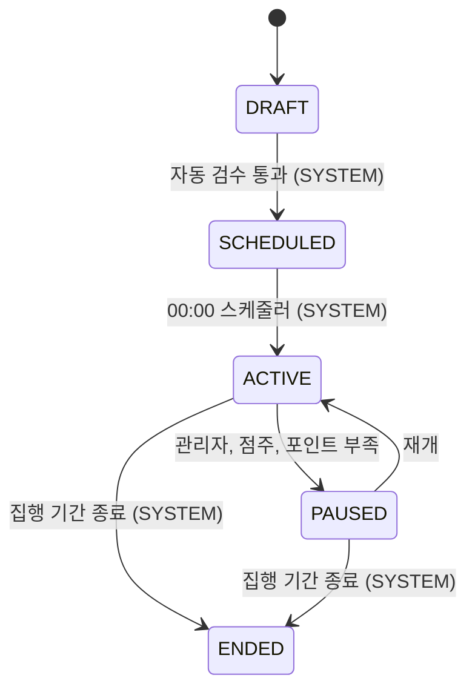

# campaign 구조와 동작 설계

## 1. 범위

| 적을 것 | 내용 |
|---|---|
| 맡는 기능과 근거 | 캠페인의 상태 전이(95행)와 그 이력, 다른 도메인에 캠페인 정보를 공개하는 `CampaignQueryService` 구현, 정산의 예산 판정을 상태 전이로 옮기는 `CampaignFundingUpdater` 구현(#198) |
| 맡지 않는 것과 그 소유 도메인 | 등록 화면 API 1단계(쿠폰 조건)는 [`campaign-api-design.md`](./campaign-api-design.md)가 가짐(`#244`), 나머지 단계(노출 대상, 하루 예산과 집행 기간)는 [Feat] 노출 대상 설정(점주)과 [Feat] 하루 예산과 집행 기간 설정(점주)이 가짐(아직 이슈 번호 없음), 예산 집행과 소진(billing), 광고 배정(adserving), 템플릿과 포스터(같은 campaign 도메인의 다른 애그리거트, [`poster-api-design.md`](./poster-api-design.md)가 따로 가짐) |

이 문서는 `campaign` 애그리거트(도메인 이름과 같은 루트 애그리거트)만 다룬다. `template`, `poster`, `store_audience`는 범위 밖이다.

## 2. 애그리거트와 패키지

| 애그리거트 | 테이블 | 지키는 규칙 | 나눈 근거 |
|---|---|---|---|
| `campaign` | `campaign`, `campaign_status_log` | 95행의 허용 전이 5개만 받고, 모든 전이를 `campaign_status_log`에 남긴다 | 도메인 이름과 같은 루트 애그리거트라 한 겹을 더 두지 않는다 |

```
campaign/
├── contract/
│   ├── PauseReason.java           campaign.paused_reason 값. CampaignStatus/TargetGender와 같은 이유로 contract에 둔다
│   ├── Judgement.java             billing의 FundingJudgement.judgement 값(NO_POINTS/RESUME/OK)
│   ├── Cause.java                 billing의 FundingJudgement.cause 값(DAILY/RECHARGE)
│   └── FundingJudgement.java      billing이 CampaignFundingUpdater에 보내는 판정 record
├── entity/
│   ├── Campaign.java              캠페인 전체 필드와 전이 5개
│   ├── CampaignStatusLog.java     전이 이력(쓰고 잊는 로그, ops.AuditLog와 같은 방식)
│   ├── ActorType.java             campaign_status_log.actor_type 값
│   └── AgeGroupListConverter.java target_age_groups 콤마 문자열 <-> List<AgeGroup> 변환
├── repository/
│   ├── CampaignRepository.java
│   └── CampaignStatusLogRepository.java
└── service/
    ├── CampaignStatusService.java        전이 5개 + pauseFromFunding/resumeFromFunding, 로그 기록, 이벤트 발행
    ├── CampaignQueryServiceImpl.java     CampaignQueryService 구현
    └── CampaignFundingUpdaterImpl.java   CampaignFundingUpdater 구현. FundingJudgement를 상태 전이 호출로 옮긴다
```

`CampaignStatusLog`는 `Campaign`을 `@ManyToOne` 연관관계가 아니라 `campaignId`(원시 `Long`)로만 참조한다. `Campaign`이 자기 로그 목록을 조회할 기능이 이 이슈에 없어서, `ops.AuditLog`가 쓰는 방식을 그대로 따랐다(제가 정한 것).

`PauseReason`은 처음엔 `campaign.entity`에 뒀다가 `campaign.contract`로 옮겼다(2026-10-12). `CampaignStatus`, `TargetGender`, `DiscountTargetType`, `DiscountType`, `AgeGroup`처럼 캠페인 테이블 CHECK 제약과 1:1로 대응하는 enum은 전부 contract에 두고 엔티티가 그대로 쓰는 게 이미 있는 패턴인데, `PauseReason`만 거기서 벗어나 있었다. 다른 도메인(billing)이 `CampaignInfo.pauseReason` 필드로 이 타입을 그대로 쓰려는 계획이 나오면서, `ArchitectureTest`의 `contract는_entity와_repository를_참조하지_않는다`가 그 자리를 막는다는 게 드러나 옮겼다.

입구 넷 가운데 이 이슈에서 실제로 연결된 것은 "다른 도메인의 호출"(`CampaignQueryService`, `CampaignFundingUpdater`)뿐이다. `CampaignStatusService`의 `schedule`/`activate`/`pause`/`resume`/`end`는 아직 아무도 부르지 않는다. `schedule`/`activate`/`end`는 "스케줄러 캠페인 담당 스텝" 이슈가, `pause`/`resume`은 "캠페인 수동 중단과 재개(점주)" 이슈가 부를 자리다.

`#198`이 더한 `pauseFromFunding`/`resumeFromFunding`은 billing의 `CampaignFundingUpdaterImpl`이 바로 부른다(간접 전이). `pause`/`resume`과 다른 점 하나는, 지금 상태가 그 판정을 받을 자리가 아니면 `IllegalStateException`이 아니라 조용히 무시한다는 것이다(12장 "정산 확인 질문 5개" 중 질문 4 답변). 정산의 00:00 배치나 재시도가 "그 상태에서는 무시된다"는 것 때문에 멈출 이유가 없다.

## 3. 저장

| 적을 것 | 내용 |
|---|---|
| DB 제약으로 막을 것과 코드로 막을 것 | 마이그레이션의 CHECK 6개(`chk_campaign_discount_target`, `_discount_value`, `_paused_reason`, `_period`, `_quantity_budget`, `_usable_time`, `_target_age_groups`)를 `Campaign.create()`와 전이 메서드가 Java 레벨에서 그대로 한 번 더 검사한다([`entity-creation-guideline.md`](../../code-convention/entity-creation-guideline.md) R4-1) |
| 다른 도메인 데이터의 사본 | 해당 없음 |
| 이력 | 상태 변경마다 `CampaignStatusLog` 한 행. 현재 상태는 `campaign.status`가 그대로 가진다 |
| 복잡한 조회 | `findServableOn`은 `campaign` 테이블 하나만 조회한다. billing의 "예약" 데이터(`budget_daily_plan`)는 `campaign -> billing` 간선이 없어 조인할 수 없다([설계 문서](../../architecture/런치캐치_도메인_구조와_의존성_설계.md) 2.2, 역방향은 순환). 95행의 전이 규칙상 `PAUSED(OWNER, NO_POINTS)`는 그날 `ACTIVE`였다가 멈춘 것만 존재하므로 campaign 자신의 컬럼(`status`, `paused_reason`, `start_date`, `end_date`)만으로 조건이 성립한다고 보았다(제가 추론한 것, 문서에 명시돼 있지 않음) |
| `findServableOn`과 billing의 00:00 예약 조회 공유(#198) | billing이 요청한 `findForReservation(businessDate)`의 조건이 `findServableOn`과 같다(위 행). 메서드를 따로 두면 "예약이 있는 PAUSED"의 해석이 두 곳에 흩어져 한쪽만 바뀌면 어긋난다. 그래서 새 메서드를 만들지 않고 billing이 `findServableOn`을 그대로 부르기로 했다 |

## 4. 계산 로직

해당 없음. 이 이슈는 조건으로 거르는 조회와 상태 전이뿐이라, 뺄 순수 계산 공식이 없다.

## 5. 모듈 연결

| 방향 | 대상 도메인 | 인터페이스 | 시점 |
|---|---|---|---|
| 공개 | 모든 도메인 | `CampaignQueryService`(`findByStoreIdIn`, `findAllById`, `findServableOn`, `findEligibleCampaigns`, `findByOwnerIdAndStatusIn`, `hasLiveCampaign`, `findOwnerIdsWithLiveCampaign`) | 요청마다 |
| 받음(직접 호출) | billing | `CampaignFundingUpdater.applyFundingJudgement` | 정산의 00:00 예산 판정, 충전 직후 재예약 판정 때마다. 이벤트가 아니라 정산의 트랜잭션 안에서 직접 부른다 |
| 쓰기(미연결) | store | `StoreCampaignSummaryUpdater` | `activate`/`pause`/`resume`/`end`뿐 아니라 `pauseFromFunding`/`resumeFromFunding` 때도 호출해야 한다(잔액 부족 중단과 충전 후 재개도 가게 요약에 반영돼야 함, 가게 담당 회신 2026-10-13). store 쪽에 그 인터페이스가 아직 없어([설계 문서](../../architecture/런치캐치_도메인_구조와_의존성_설계.md) 2.4에 간선만 있음) 이번 이슈는 호출을 빼고 넘어간다. 생기면 `CampaignStatusService`에 이어 붙인다 |

받는 이벤트는 해당 없음.

## 6. 상태와 흐름



| 전이 | 일으키는 쪽 | 나가는 이벤트 | 금지일 때 응답 |
|---|---|---|---|
| DRAFT -> SCHEDULED | SYSTEM | 없음(00:00 배치가 같은 흐름에서 다시 조회) | `IllegalStateException` |
| SCHEDULED -> ACTIVE | SYSTEM | 없음(위와 같음) | `IllegalStateException` |
| ACTIVE -> PAUSED | ADMIN, OWNER, SYSTEM(포인트 부족) | `CampaignStatusChangedEvent`(servable=false) | `IllegalStateException` |
| PAUSED -> ACTIVE | OWNER, SYSTEM(충전 재예약) | `CampaignStatusChangedEvent`(servable=true) | `IllegalStateException` |
| ACTIVE/PAUSED -> ENDED | SYSTEM | `CampaignStatusChangedEvent`(servable=false), `CampaignEndedEvent` | `IllegalStateException` |

이 이슈엔 HTTP 엔드포인트가 없어 "금지일 때 응답"은 전부 엔티티의 `IllegalStateException`이다. 409로 바꿔 응답하는 일은 이 전이를 실제로 호출하는 컨트롤러가 생기는 이슈(점주 API 등)가 맡는다.

## 7. 트랜잭션과 동시성

| 흐름 | 한 트랜잭션에 묶는 것 | 트랜잭션 밖 |
|---|---|---|
| 전이 5개 | `Campaign` 상태 변경, `CampaignStatusLog` 저장, 이벤트 발행 | 없음(외부 API 호출 없음) |

| 상황 | 확인할 것 | 이 이슈의 처리 |
|---|---|---|
| 같은 캠페인에 동시 전이 요청 | 비관 잠금 여부 | `CampaignRepository.findByIdForUpdate`(`PESSIMISTIC_WRITE`)로 행 잠금을 건다. `CampaignStatusService.findOrThrow`가 이걸 쓴다. `TemplateRepository.findByIdForUpdate`와 같은 이유다 |
| 늦은 이벤트가 최신 상태를 덮는지 | `changedAt` 비교 | `CampaignStatusChangedEvent.changedAt`을 받는 쪽(광고 서빙 등)이 자기보다 늦은 것만 반영하기로 이미 계약에 적혀 있다(`CampaignStatusChangedEvent` Javadoc) |

영업일은 이 서비스가 직접 판단하지 않는다. `pause`/`resume`/`end`를 부르는 쪽이 `businessDate`를 넘긴다.

## 8. 외부 API

해당 없음.

## 9. 실패 처리

이 도메인은 돈을 직접 다루지 않는다(예약, 차감, 환불은 billing 소유). `applyFundingJudgement`가 처리할 돈이 걸린 경로는 하나다.

| 경로 | 처리 |
|---|---|
| `FundingJudgement`가 지금 상태와 안 맞을 때(NO_POINTS가 이미 PAUSED(ADMIN/OWNER)에, RESUME이 PAUSED(ADMIN/OWNER)나 ENDED에 온 경우) | 예외 대신 조용히 무시한다. 캠페인 상태는 바뀌지 않고 로그도 남지 않는다. billing의 00:00 배치나 재시도가 이 경로 때문에 멈출 이유가 없다고 판단했다(billing 확인 질문 4 답변, 12장) |
| 같은 `FundingJudgement`가 두 번 와도(재시도, 재실행) | `pauseFromFunding`/`resumeFromFunding`이 먼저 "이미 그 상태인가"를 보고 멱등하게 반환한다. `pause`/`resume`과 같은 패턴이다 |
| 점주의 직접 재개와 billing의 RESUME 판정이 같은 캠페인에 동시에 옴 | `CampaignRepository.findByIdForUpdate`(비관 잠금)가 순서를 정한다. 늦게 온 쪽은 갱신된 상태를 보고 자기 멱등/무시 조건을 그대로 적용해 추가 코드 없이 풀린다(billing 확인 질문 4 답변) |

## 10. 배치

해당 없음. 이 이슈는 배치 작업을 등록하지 않는다. `schedule`/`activate`/`end`를 00:00 배치에서 부르는 일은 "스케줄러 캠페인 담당 스텝" 이슈(뒤로 미룸, `project_lunchcatch_issue_roadmap`)가 맡는다.

## 11. 성능

해당 없음. 이 이슈엔 HTTP 엔드포인트가 없어 응답 시간 목표를 세울 자리가 없다.

## 12. 테스트와 미정 사항

| 미정 항목 | 어디까지 정해졌나 | 막는 것 |
|---|---|---|
| `StoreCampaignSummaryUpdater` 호출 | 전달 필드, 트랜잭션 기준, 호출 지점까지 가게 담당과 전부 확정했다(아래 "가게·분석 확정 사항" 참고) | `store.contract`에 그 인터페이스가 아직 없다(`com.launchcatch.store` 패키지 자체가 없음). store가 만들어 develop에 올려야 `CampaignStatusService`에 이어 붙일 수 있다 |
| 사용자(MEMBER)용 저장 포스터 조회 API 구현 | 계약(경로, 권한, 응답, 공개 상태, 오류 처리)을 가게 담당과 전부 확정하고 명세·설계까지 썼다(`poster-api-spec.md`, `poster-api-design.md`) | `Poster` 엔티티·레포지토리·컨트롤러 구현이 아직 없다. 명세가 merge된 뒤 별도 PR로 진행한다 |
| `newPriorityUntil` | `ad_candidate`에만 컬럼이 있고 `campaign`엔 없다(#156 결정). `CampaignInfo`엔 항상 `null`로 채워 보낸다 | "신규 우선 노출" 계산 규칙 자체가 문서에 없다. campaign에 컬럼을 추가할지부터 정해야 한다 |

**"예약이 있는 PAUSED"의 정확한 의미는 `#198`에서 풀렸다.** billing이 `findServableOn`을 그대로 재사용하기로 해서(3장), 그 의미를 두 곳에서 따로 정의할 일이 없어졌다.

### 가게·분석 확정 사항 (`#198`, 가게·분석 담당 회신 2026-10-13)

| 항목 | 확정 내용 |
|---|---|
| 가게 - 캠페인 참조 메뉴 수정 | 가게가 보유한 현재 메뉴 이름·가격을 그대로 쓴다. `campaign`은 `targetMenuId`만 유지하고 스냅샷을 두지 않는다. 메뉴 이름·가격 수정으로 캠페인 설정을 다시 저장하지 않는다. **campaign 쪽 코드 불필요** |
| 가게 - `StoreCampaignSummaryUpdater` 전달 필드 | storeId, campaignId, 캠페인 상태, 할인 대상·유형·값, 대상 메뉴ID(MENU 할인일 때만 필수), 사용 가능 시작·종료시간, 상태 변경 시각, 점주 노출 반경. DTO는 `store.contract` 소유 타입으로 store가 직접 정의한다. `campaign` 내부 엔티티나 타입을 넘기지 않는다 |
| 가게 - 트랜잭션 기준 | 캠페인 상태 변경, `CampaignStatusLog` 저장, 가게 요약 갱신을 같은 트랜잭션으로 묶는다. 하나라도 실패하면 모두 롤백한다. store 쪽 구현은 기존 트랜잭션에 참여한다 |
| 가게 - 호출 지점 | `activate`, `pause`, `resume`, `end`에 더해 `pauseFromFunding`, `resumeFromFunding`도 포함한다(위 5장) |
| 분석 - 캠페인/소유 점주/가게 확인 | 분석이 리포트 요청마다 기존 `CampaignQueryService.findAllById`로 `ownerId`를 비교한다. 상태 필터 없이 신규·중단·종료 캠페인도 확인한다. **campaign 쪽 신규 메서드 불필요** |
| 분석 - 종료 캠페인의 과거 리포트 재집계 | `CampaignStatusLog`(과거 상태 이력) 조회를 추가하지 않는다. 노출·과금·쿠폰 발급·사용 기록을 영업일 기준 원천 기록으로 집계하고, 현재 캠페인 상태로 과거 기록을 제외하지 않는다. `campaign`이 캠페인 행을 하드 삭제하지 않는 지금 동작으로 "종료돼도 연결 정보 유지" 요구를 이미 만족한다. **campaign 쪽 코드 불필요**. 나중에 "특정 시각의 활성 상태" 분석이 필요해지면 그때 상태 이력 조회를 다시 요청하기로 했다 |

### 정산(billing) 확인 질문 5개 답변 (`#198`)

| 질문 | 답변 |
|---|---|
| 1. `CampaignStatusChangedEvent` 페이로드가 바뀔 예정인가 | 안 바뀐다. `campaignId, businessDate, servable, changedAt` 그대로 쓴다 |
| 2. 00:00 상태 전이와 정산 호출로 인한 전이도 이 이벤트를 발행하는가 | `schedule`/`activate`(00:00, SYSTEM 전용)는 발행하지 않는다(이미 결정, 6장). `pauseFromFunding`/`resumeFromFunding`(정산 호출로 인한 전이)은 각각 내부에서 `pause`/`resume`과 같은 이벤트를 발행한다. billing은 자기가 호출해서 받은 이벤트를 `changedAt`으로 걸러야 한다 |
| 3. 하루 예산을 누가 적용하는가 | campaign이 이미 적용한 값을 `CampaignInfo.dailyBudget`으로 그대로 준다. billing의 00:00 (3)단계는 카운터 초기화만 한다 |
| 4. 재개 경합과 RESUME 무시 시 예외 여부 | `findByIdForUpdate` 비관 잠금이 순서를 정해 경합을 푼다(9장). RESUME이 무시될 때 예외를 던지지 않고 조용히 넘긴다 |
| 5. `CampaignEndedEvent`를 정산이 받을 일이 없다는 전제 | 맞다. campaign도 그렇게 본다 |
