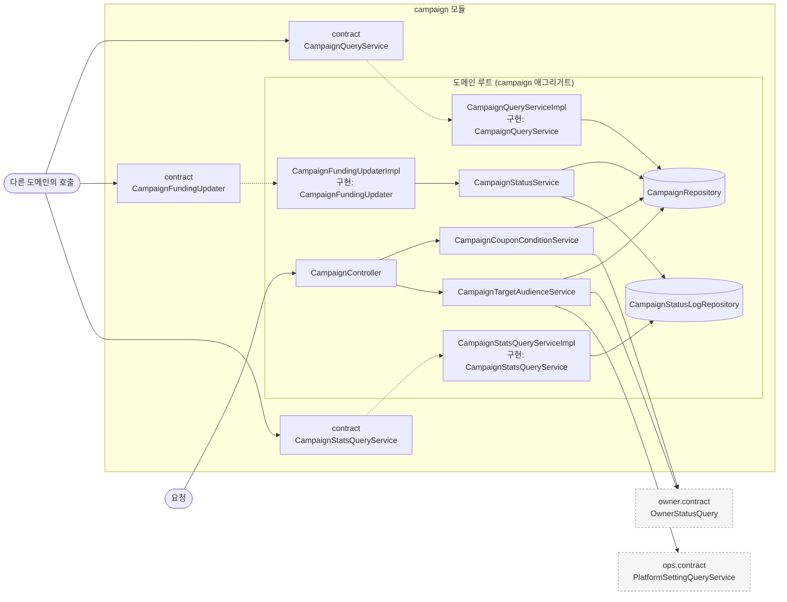
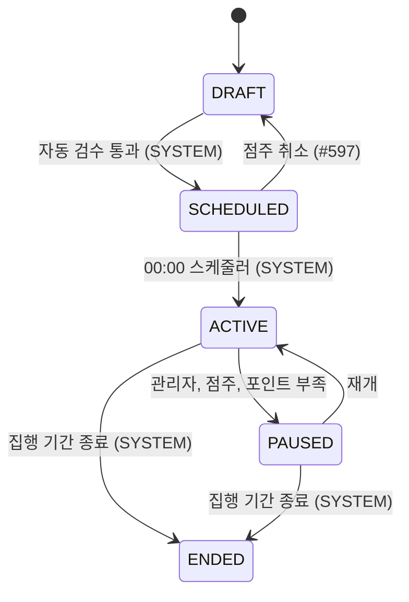
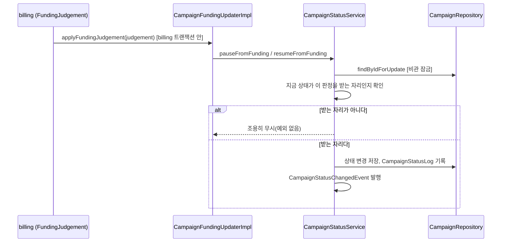
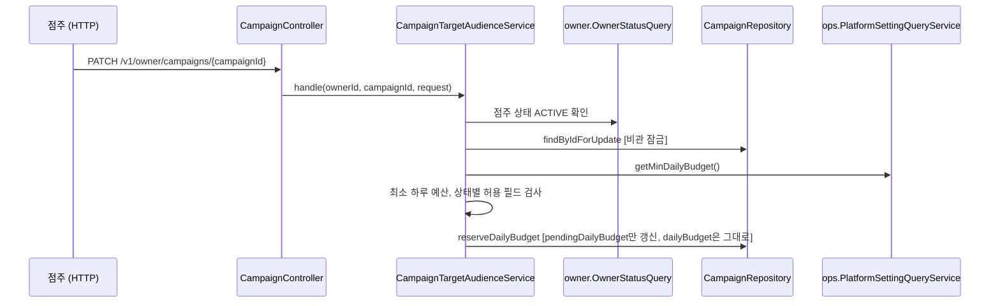

# campaign 구조와 동작 설계

## 1. 범위

| 적을 것 | 내용 |
|---|---|
| 맡는 기능과 근거 | 캠페인의 상태 전이(FR-092)와 그 이력, 다른 도메인에 캠페인 정보를 공개하는 `CampaignQueryService` 구현, 정산의 예산 판정을 상태 전이로 옮기는 `CampaignFundingUpdater` 구현(#198), 분석의 일별 집계 배치에 영업일 말 ACTIVE 캠페인 수를 공개하는 `CampaignStatsQueryService` 구현(#354) |
| 맡지 않는 것과 그 소유 도메인 | 등록 화면 API 1·3·4단계(쿠폰 조건, 노출 대상, 하루 예산과 집행 기간)는 [`campaign-api-design.md`](./campaign-api-design.md)가 가짐(`#244`, `#253`, `#330`), 예산 집행과 소진(billing), 광고 배정(adserving), 템플릿과 포스터(같은 campaign 도메인의 다른 애그리거트, [`poster-api-design.md`](./poster-api-design.md)가 따로 가짐) |

이 문서는 `campaign` 애그리거트(도메인 이름과 같은 루트 애그리거트)만 다룬다. `template`, `poster`, `store_audience`는 범위 밖이다.

## 2. 애그리거트와 패키지

| 애그리거트 | 테이블 | 지키는 규칙 | 나눈 근거 |
|---|---|---|---|
| `campaign` | `campaign`, `campaign_status_log` | FR-092의 허용 전이 5개만 받고, 모든 전이를 `campaign_status_log`에 남긴다 | 도메인 이름과 같은 루트 애그리거트라 한 겹을 더 두지 않는다 |

```
campaign/
├── contract/
│   ├── PauseReason.java           campaign.paused_reason 값. CampaignStatus/TargetGender와 같은 이유로 contract에 둔다
│   ├── Judgement.java             billing의 FundingJudgement.judgement 값(NO_POINTS/RESUME/OK)
│   ├── Cause.java                 billing의 FundingJudgement.cause 값(DAILY/RECHARGE)
│   ├── FundingJudgement.java      billing이 CampaignFundingUpdater에 보내는 판정 record
│   └── CampaignStatsQueryService.java  분석의 일별 집계 배치가 부르는 집계 조회(#354)
├── entity/
│   ├── Campaign.java              캠페인 전체 필드와 전이 5개
│   ├── CampaignStatusLog.java     전이 이력(쓰고 잊는 로그, ops.AuditLog와 같은 방식)
│   ├── ActorType.java             campaign_status_log.actor_type 값
│   └── AgeGroupListConverter.java target_age_groups 콤마 문자열 <-> List<AgeGroup> 변환
├── repository/
│   ├── CampaignRepository.java
│   └── CampaignStatusLogRepository.java
└── service/
    ├── CampaignStatusService.java        전이 5개 + pauseFromFunding/resumeFromFunding, 로그 기록, 이벤트 발행, pause/resume의 가게 요약 갱신(#468)
    ├── CampaignDailyTransitionService.java 00:00 배치의 종료(집행 기간 만료)와 집행 시작(SCHEDULED -> ACTIVE) 전환(#569)
    ├── CampaignStoreSummaryService.java  00:00 배치의 새 영업일 가게 요약 준비(#838)
    ├── CampaignPauseResumeService.java   점주용 중단·재개(#468). 점주 상태·본인 소유를 확인하고 CampaignStatusService에 맡긴다
    ├── CampaignQueryServiceImpl.java     CampaignQueryService 구현
    ├── CampaignFundingUpdaterImpl.java   CampaignFundingUpdater 구현. FundingJudgement를 상태 전이 호출로 옮긴다
    └── CampaignStatsQueryServiceImpl.java  CampaignStatsQueryService 구현
```

`CampaignStatusLog`는 `Campaign`을 `@ManyToOne` 연관관계가 아니라 `campaignId`(원시 `Long`)로만 참조한다. `Campaign`이 자기 로그 목록을 조회할 기능이 이 이슈에 없어서, `ops.AuditLog`가 쓰는 방식을 그대로 따랐다(제가 정한 것).

`PauseReason`은 처음엔 `campaign.entity`에 뒀다가 `campaign.contract`로 옮겼다(2026-10-12). `CampaignStatus`, `TargetGender`, `DiscountTargetType`, `DiscountType`, `AgeGroup`처럼 캠페인 테이블 CHECK 제약과 1:1로 대응하는 enum은 전부 contract에 두고 엔티티가 그대로 쓰는 게 이미 있는 패턴인데, `PauseReason`만 거기서 벗어나 있었다. 다른 도메인(billing)이 `CampaignInfo.pauseReason` 필드로 이 타입을 그대로 쓰려는 계획이 나오면서, `ArchitectureTest`의 `contract는_entity와_repository를_참조하지_않는다`가 그 자리를 막는다는 게 드러나 옮겼다.

입구 넷 가운데 이 이슈에서 실제로 연결된 것은 "다른 도메인의 호출"(`CampaignQueryService`, `CampaignFundingUpdater`)뿐이었다. `pause`/`resume`은 "캠페인 수동 중단과 재개(점주)" 이슈(`#468`)가 `CampaignController`의 `POST .../{campaignId}:pause`, `:resume`으로 연결했다. `end`는 점주의 직접 종료(`#600`)가 `POST .../{campaignId}:end`로 연결했고, 집행 기간이 끝난 정기 종료(`end`)와 집행 시작(`activate`)은 00:00 배치(`#569`)가 부른다. `schedule`은 캠페인 활성화(`#561`)가 부른다.

`#198`이 더한 `pauseFromFunding`/`resumeFromFunding`은 billing의 `CampaignFundingUpdaterImpl`이 바로 부른다(간접 전이). `pause`/`resume`과 다른 점 하나는, 지금 상태가 그 판정을 받을 자리가 아니면 `IllegalStateException`이 아니라 조용히 무시한다는 것이다(12장 "정산 확인 질문 5개" 중 질문 4 답변). 정산의 00:00 배치나 재시도가 "그 상태에서는 무시된다"는 것 때문에 멈출 이유가 없다.

## 3. 저장

| 적을 것 | 내용 |
|---|---|
| DB 제약으로 막을 것과 코드로 막을 것 | 마이그레이션의 CHECK 8개(`chk_campaign_discount_target`, `_discount_value`, `_paused_reason`, `_period`, `_quantity_budget`, `_usable_time`, `_target_age_groups`, `_pending_daily_budget`)를 `Campaign.create()`와 전이 메서드가 Java 레벨에서 그대로 한 번 더 검사한다([`entity-creation-guideline.md`](../../code-convention/entity-creation-guideline.md) R4-1) |
| 다른 도메인 데이터의 사본 | 해당 없음 |
| 이력 | 상태 변경마다 `CampaignStatusLog` 한 행. 현재 상태는 `campaign.status`가 그대로 가진다 |
| 복잡한 조회 | `findServableOn`은 `campaign` 테이블 하나만 조회한다. billing의 "예약" 데이터(`budget_daily_plan`)는 `campaign -> billing` 간선이 없어 조인할 수 없다([설계 문서](../../architecture/런치캐치_도메인_구조와_의존성_설계.md) 2.2, 역방향은 순환). FR-092의 전이 규칙상 `PAUSED(OWNER, NO_POINTS)`는 그날 `ACTIVE`였다가 멈춘 것만 존재하므로 campaign 자신의 컬럼(`status`, `paused_reason`, `start_date`, `end_date`)만으로 조건이 성립한다고 보았다(제가 추론한 것, 문서에 명시돼 있지 않음) |
| `findServableOn`과 billing의 00:00 예약 조회 공유(#198) | billing이 요청한 `findForReservation(businessDate)`의 조건이 `findServableOn`과 같다(위 행). 메서드를 따로 두면 "예약이 있는 PAUSED"의 해석이 두 곳에 흩어져 한쪽만 바뀌면 어긋난다. 그래서 새 메서드를 만들지 않고 billing이 `findServableOn`을 그대로 부르기로 했다 |
| 특정 시각의 상태 재구성(#354) | `CampaignStatusLog.countActiveAsOf`는 `campaign` 테이블의 현재 `status`를 보지 않는다. `campaign_status_log`에서 캠페인마다 그 시각 이전 마지막 전이 행의 `to_status`를 윈도 함수(`row_number() over (partition by campaign_id order by created_at desc)`)로 구해 `ACTIVE`인 것만 센다. 그래서 지금 상태가 `ENDED`인 캠페인도 과거 영업일에는 그때의 상태로 집계된다. `idx_campaign_status_log_campaign_created(campaign_id, created_at)`(`V15`)가 없으면 이 윈도 함수가 테이블 전체를 풀스캔한다 |
| 이 집계가 기대는 전제(#354 리뷰) | `campaign_status_log`에만 기대므로, `CampaignStatusService`를 거치지 않고 `campaign` 테이블에 직접 쓰는 경로(`R__30_template_campaign.sql`, `R__50_daily.sql` 시드 등)는 이 집계에 전혀 보이지 않는다. 운영 코드의 모든 전이가 그 서비스를 거친다는 전제가 깨지면 이 집계는 조용히 실제와 어긋난다. 아직 그걸 맞대보는 자동 검증은 없다 |

## 4. 계산 로직

해당 없음. 이 이슈는 조건으로 거르는 조회와 상태 전이뿐이라, 뺄 순수 계산 공식이 없다.

## 5. 모듈 연결

| 방향 | 대상 도메인 | 인터페이스 | 시점 |
|---|---|---|---|
| 공개 | 모든 도메인 | `CampaignQueryService`(`findByStoreIdIn`, `findAllById`, `findServableOn`, `findEligibleCampaigns`, `findByOwnerIdAndStatusIn`, `hasLiveCampaign`, `findOwnerIdsWithLiveCampaign`, `findByIdForUpdate`) | 요청마다. `findByIdForUpdate`는 호출자의 쓰기 트랜잭션 안에서 불러야 잠금이 유지된다(`#378`, billing의 재예약 경합 방지용, 실제 호출은 `#319`가 이어 붙인다) |
| 공개 | analytics | `CampaignStatsQueryService.activeCampaignCount(businessDate)`. `businessDate`가 오늘이거나 미래면 `IllegalArgumentException`(#354 리뷰) | 분석의 일별 집계 배치마다(#354) |
| 받음(직접 호출) | billing | `CampaignFundingUpdater.applyFundingJudgement` | 정산의 00:00 예산 판정, 충전 직후 재예약 판정 때마다. 이벤트가 아니라 정산의 트랜잭션 안에서 직접 부른다 |
| 쓰기 | store | `StoreCampaignSummaryUpdater` | `pause`/`resume`은 `#468`이 연결했다. 같은 트랜잭션 안에서 상태 변경, `CampaignStatusLog` 저장 다음에 부른다 |
| 쓰기(`end`는 `#600`, `activate`는 `#569`가 연결) | store | `StoreCampaignSummaryUpdater` | `activate`/`end`/`pauseFromFunding`/`resumeFromFunding` 때도 호출해야 한다(잔액 부족 중단과 충전 후 재개도 가게 요약에 반영돼야 함, 가게 담당 회신 2026-10-13). `pauseFromFunding`/`resumeFromFunding` 두 자리는 각자의 구현 이슈가 이어 붙인다 |

받는 이벤트는 해당 없음.

## 6. 구조와 동작 그림

### 모듈 구조



입구는 둘만 실제로 연결돼 있다. HTTP 요청(`CampaignController`, `#244`/`#253`/`#330`)과 다른
도메인의 호출(`CampaignQueryService`, `CampaignFundingUpdater`, `CampaignStatsQueryService`,
`#354`)이다. 스케줄과 이벤트 수신은
아직 없다(`CampaignStatusService`의 `schedule`/`activate`/`end`를 부를 배치가 아직 없다,
2장). `CampaignController`와 `CampaignCouponConditionService`/`CampaignTargetAudienceService`의
업무 규칙은 이 문서가 아니라 [`campaign-api-design.md`](./campaign-api-design.md)가 가진다
(1장). 여기서는 구조만 보인다.

`owner.contract.OwnerStatusQuery`(점주 상태 확인)와 `ops.contract.PlatformSettingQueryService`(최소
하루 예산, `#330`)는 등록 화면 API 두 서비스가 부르는 바깥 도메인이다. `CampaignStatusService`와
`CampaignQueryServiceImpl`, `CampaignFundingUpdaterImpl`, `CampaignStatsQueryServiceImpl`은 다른
도메인을 부르지 않는다.

### 상태 변경



| 전이 | 일으키는 쪽 | 나가는 이벤트 | 금지일 때 응답 |
|---|---|---|---|
| DRAFT -> SCHEDULED | OWNER(활성화 요청, 자동 검수 통과) | 없음 | `CAMPAIGN-006` |
| SCHEDULED -> DRAFT(`#597`) | OWNER(취소 요청) | 없음(다른 도메인은 SCHEDULED 를 그때그때 읽기만 한다) | `CAMPAIGN-006` |
| SCHEDULED -> ACTIVE | SYSTEM | 없음(00:00 배치가 같은 흐름에서 다시 조회) | `IllegalStateException` |
| ACTIVE -> PAUSED | ADMIN, OWNER, SYSTEM(포인트 부족) | `CampaignStatusChangedEvent`(servable=false) | `IllegalStateException` |
| PAUSED -> ACTIVE | OWNER, SYSTEM(충전 재예약) | `CampaignStatusChangedEvent`(servable=true) | `IllegalStateException` |
| ACTIVE/PAUSED -> ENDED | SYSTEM | `CampaignStatusChangedEvent`(servable=false), `CampaignEndedEvent` | `IllegalStateException` |

DRAFT -> SCHEDULED는 점주의 캠페인 활성화 요청(`#561`)이 호출부가 되었다. `CampaignActivationService`가
`CampaignStatusService.schedule()`을 부르기 전에 캠페인이 DRAFT인지 먼저 확인해서 거부하므로,
`Campaign.schedule()`의 `IllegalStateException`은 이 경로에서 실제로 던져지지 않는다. 그 대신
`CampaignActivationService`가 `CAMPAIGN-006`으로 응답한다. 기존의 나머지 전이(SCHEDULED -> ACTIVE 등)는
아직 HTTP 엔드포인트가 없어 "금지일 때 응답"이 엔티티의 `IllegalStateException` 그대로다.

#### SCHEDULED 캠페인의 취소(`#571`)

점주가 본인 소유 `SCHEDULED` 캠페인을 취소해 같은 캠페인을 `DRAFT`로 되돌리는 전이를 허용한다.
`SCHEDULED`에서는 포스터와 쿠폰 조건을 고칠 수 없다. 점주가 `ENDED`가 아닌 캠페인을 동시에
하나만 가질 수 있다는 제한(`#525`)도 있어 새 캠페인을 만들어 잘못 입력한 내용을 고칠 수도 없다.
취소로 기존 캠페인을 다시 수정하게 해 점주가 집행 전에 잘못된 내용을 스스로 고칠 수 있게 한다.

취소 뒤에는 `DRAFT`의 기존 수정 규칙을 적용한다.

| 대상 | 취소 뒤 수정 범위 |
|---|---|
| 포스터 | 포스터를 다시 만들거나 교체할 수 있다. [포스터 생성 설계](./poster-api-design.md#포스터-생성)의 기존 조건을 따른다 |
| 쿠폰 조건 | 같은 캠페인의 쿠폰 조건을 다시 입력할 수 있다. [캠페인 등록 설계](./campaign-api-design.md#캠페인-등록쿠폰-조건)의 기존 조건을 따른다 |
| 하루 예산 | `DRAFT`의 하루 예산을 다시 설정할 수 있다. [예산과 집행 기간 설계](./campaign-api-design.md#캠페인-등록노출-대상-하루-예산과-집행-기간)의 기존 조건을 따른다 |

수정한 캠페인을 다시 활성화할 때는 기존 활성화 절차와 자동 검수를 거쳐 `SCHEDULED`로 전환한다.
실제 취소 기능은 [구현 이슈 #597](https://github.com/lunch-catch/lc-backend/issues/597)이 맡았다.
이 결정은 취소를 허용할 상태와 취소 뒤 수정 범위를 정한다. 취소 API 의 공개 계약은
[명세서](../../api-spec/campaign-api-spec.md#캠페인-취소)에, 00:00 전환과의 경합 처리는
[API 설계](./campaign-api-design.md#캠페인-취소점주)에 있다.

### 주요 흐름

돈과 상태가 함께 걸린 흐름 둘만 그린다. 나머지(쿠폰 조건 등록 등)는 상태를 바꾸지 않아 뺀다.

**흐름 1. 정산의 예산 판정에 따른 간접 전이(`#198`)**



| 실패 지점 | 남는 상태 | 다시 요청하면 |
|---|---|---|
| 잠금 대기 중 billing 쪽 트랜잭션 타임아웃 | campaign 상태는 그대로, billing만 실패 | billing이 재시도. 같은 판정이라 멱등하게 같은 결과 |
| 저장 뒤 이벤트 발행 전 프로세스 종료 | 상태는 바뀌었는데 이벤트가 유실될 수 있다 | 이 문서 범위 밖(커밋 뒤 이벤트 처리는 [장애 처리 설계](./campaign_장애_처리_설계.md)) |

**흐름 2. ACTIVE 캠페인의 하루 예산 변경(`#330`)**



| 실패 지점 | 남는 상태 | 다시 요청하면 |
|---|---|---|
| 잠금 획득 뒤 `pause`가 먼저 커밋됨 | 이 요청은 갱신된 상태(PAUSED)를 보고 `CAMPAIGN-006`으로 거부 | 점주가 재개한 뒤 다시 요청 |
| `getMinDailyBudget()` 실패 | 트랜잭션 전체 롤백, `pendingDailyBudget` 미반영 | 재요청 시 처음부터 다시 검증 |

## 7. 트랜잭션과 동시성

| 흐름 | 한 트랜잭션에 묶는 것 | 트랜잭션 밖 |
|---|---|---|
| 전이 5개 | `Campaign` 상태 변경, `CampaignStatusLog` 저장, 이벤트 발행 | 없음(외부 API 호출 없음) |

| 상황 | 확인할 것 | 이 이슈의 처리 |
|---|---|---|
| 같은 캠페인에 동시 전이 요청 | 비관 잠금 여부 | `CampaignRepository.findByIdForUpdate`(`PESSIMISTIC_WRITE`)로 행 잠금을 건다. `CampaignStatusService.findOrThrow`가 이걸 쓴다. `TemplateRepository.findByIdForUpdate`와 같은 이유다 |
| 늦은 이벤트가 최신 상태를 덮는지 | `changedAt` 비교 | `CampaignStatusChangedEvent.changedAt`을 받는 쪽(광고 서빙 등)이 자기보다 늦은 것만 반영하기로 이미 계약에 적혀 있다(`CampaignStatusChangedEvent` Javadoc) |

영업일은 이 서비스가 직접 판단하지 않는다. `pause`/`resume`/`end`를 부르는 쪽이 `businessDate`를 넘긴다.

## 8. 외부 API

해당 없음.

## 9. 실패 처리

이 도메인은 돈을 직접 다루지 않는다(예약, 차감, 환불은 billing 소유). `applyFundingJudgement`가 처리할 돈이 걸린 경로는 하나다.

| 경로 | 처리 |
|---|---|
| `FundingJudgement`가 지금 상태와 안 맞을 때(NO_POINTS가 이미 PAUSED(ADMIN/OWNER)에, RESUME이 PAUSED(ADMIN/OWNER)나 ENDED에 온 경우) | 예외 대신 조용히 무시한다. 캠페인 상태는 바뀌지 않고 로그도 남지 않는다. billing의 00:00 배치나 재시도가 이 경로 때문에 멈출 이유가 없다고 판단했다(billing 확인 질문 4 답변, 12장) |
| 같은 `FundingJudgement`가 두 번 와도(재시도, 재실행) | `pauseFromFunding`/`resumeFromFunding`이 먼저 "이미 그 상태인가"를 보고 멱등하게 반환한다. `pause`/`resume`과 같은 패턴이다 |
| 점주의 직접 재개와 billing의 RESUME 판정이 같은 캠페인에 동시에 옴 | `CampaignRepository.findByIdForUpdate`(비관 잠금)가 순서를 정한다. 늦게 온 쪽은 갱신된 상태를 보고 자기 멱등/무시 조건을 그대로 적용해 추가 코드 없이 풀린다(billing 확인 질문 4 답변) |

## 10. 배치

00:00 묶음에 캠페인이 맡는 단계 셋을 `ops.scheduler.DailyJob`으로 등록한다(`#569`, `#838`, 요구사항명세서 102행). 순서 값은 102행 단계 번호 × 10 이고 정산 단계(40~)보다 앞이다. 앞 단계가 실패하면 뒤 단계(정산)는 돌지 않는다.

| 순서 | 클래스 | 작업 이름 | 하는 일 |
|---|---|---|---|
| `@Order(10)` | `CampaignEndJob` | `CAMPAIGN_END_EXPIRED` | 집행 종료일이 영업일보다 앞인 `ACTIVE`, `PAUSED` 캠페인을 `ENDED` 로 바꾼다 |
| `@Order(20)` | `CampaignStartJob` | `CAMPAIGN_START_SCHEDULED` | 집행 시작일이 영업일 이하인 `SCHEDULED` 캠페인을 `ACTIVE` 로 바꾸고, 같은 가게의 기존 `ACTIVE` 캠페인은 먼저 `ENDED` 로 바꾼다 |
| `@Order(30)` | `CampaignStoreSummaryJob` | `CAMPAIGN_STORE_SUMMARY` | 그 영업일에 `ACTIVE` 인 캠페인의 가게 요약을 `StoreCampaignSummaryUpdater.updateAll` 로 한 번에 만든다 |

- **캠페인마다 `CampaignStatusService`의 전이를 따로 부른다.** 전이 하나가 자기 트랜잭션과 행 잠금(`findByIdForUpdate`)을 가지고, `CampaignDailyTransitionService`는 트랜잭션을 열지 않는다. 한 캠페인이 실패해도 나머지는 계속 처리하고, 끝에서 실패가 하나라도 있으면 예외를 던져 단계를 실패시킨다. 한 캠페인 때문에 다른 캠페인의 종료가 막히지 않는다
- **멱등이다.** 대상 조회가 이미 `ENDED`, `ACTIVE` 인 캠페인을 걸러내고 `end`, `activate` 자체도 이미 그 상태면 조용히 성공하므로, 같은 영업일에 두 번 돌아도(이어받기, 수동 재실행) 결과가 같다. 시작일이 영업일 **이하**인 것을 대상으로 해서 배치가 하루 빠졌어도 다음 실행이 이어서 켠다
- **기존 `ACTIVE` 를 끝내는 것과 새 캠페인을 켜는 것은 서로 다른 트랜잭션이다.** 그 사이에 실패하면 기존 캠페인만 끝난 채로 남고, 단계가 실패로 끝나 다시 돌 때 새 캠페인이 이어서 켜진다. 점주는 `ENDED` 가 아닌 캠페인을 하나만 가질 수 있어(`#525`) 보통 같은 가게에 `ACTIVE` 가 둘 있는 일은 없고 이 종료는 안전장치다
- **집행 기간이 이미 지난 `SCHEDULED` 는 켜지 않는다.** `ACTIVE` 로 켰다가 바로 끝내는 대신 그대로 둔다. 이런 캠페인은 점주가 직접 처리한다
- `activate` 는 상태 변경과 로그에 더해 가게 요약(`StoreCampaignSummaryUpdater`)을 `ACTIVE` 로 갱신한다. `end` 는 `#600` 이 이미 갱신한다
- **가게 요약은 영업일마다 한 행이다(`#838`).** 전환 순간에만 쓰면 하루 넘게 진행하는 캠페인은 다음 날 요약이 없어 가게 목록과 상세에서 사라진다. 30번째 단계가 전환(10, 20) 뒤에 `ACTIVE` 캠페인 전부의 요약을 새 영업일 몫으로 만든다. 방금 켜진 캠페인은 들어가고 방금 끝난 캠페인은 빠진다
- 요약 저장은 한 트랜잭션에서 `updateAll` 로 한다(store 계약이 호출자의 쓰기 트랜잭션을 요구한다). 한 건이라도 실패하면(예: 대상 메뉴가 그 가게 메뉴가 아님) 전체가 롤백되고 예외가 올라가 단계가 실패한다. 뒤 단계(정산)는 돌지 않는다. (영업일, 캠페인) 기준 upsert 라 같은 영업일에 다시 돌아도 결과가 같다
- `PAUSED` 캠페인은 새 요약을 만들지 않는다. 점주 중단 때 쓴 요약은 그 영업일에만 남는다

## 11. 성능

해당 없음. 이 이슈엔 HTTP 엔드포인트가 없어 응답 시간 목표를 세울 자리가 없다.

## 12. 테스트와 미정 사항

| 미정 항목 | 어디까지 정해졌나 | 막는 것 |
|---|---|---|
| `StoreCampaignSummaryUpdater` 호출(`pauseFromFunding`/`resumeFromFunding`) | 전달 필드, 트랜잭션 기준, 호출 지점까지 가게 담당과 전부 확정했다(아래 "가게·분석 확정 사항" 참고). `pause`/`resume`은 `#468`, `end`는 `#600`, `activate`는 `#569`가 이어 붙여 해소됐다 | 남은 두 자리는 각자의 구현 이슈가 이어 붙여야 한다 |
| 사용자(MEMBER)용 저장 포스터 조회 API 구현 | 계약(경로, 권한, 응답, 공개 상태, 오류 처리)을 가게 담당과 전부 확정하고 명세·설계까지 썼다(`poster-api-spec.md`, `poster-api-design.md`) | `Poster` 엔티티·레포지토리·컨트롤러 구현이 아직 없다. 명세가 merge된 뒤 별도 PR로 진행한다 |
| `newPriorityUntil` | `ad_candidate`에만 컬럼이 있고 `campaign`엔 없다(#156 결정). `CampaignInfo`엔 항상 `null`로 채워 보낸다 | "신규 우선 노출" 계산 규칙 자체가 문서에 없다. campaign에 컬럼을 추가할지부터 정해야 한다 |

**"예약이 있는 PAUSED"의 정확한 의미는 `#198`에서 풀렸다.** billing이 `findServableOn`을 그대로 재사용하기로 해서(3장), 그 의미를 두 곳에서 따로 정의할 일이 없어졌다.

### 가게·분석 확정 사항 (`#198`, 가게·분석 담당 회신 2026-10-13)

| 항목 | 확정 내용 |
|---|---|
| 가게 - 캠페인 참조 메뉴 수정 | 가게가 보유한 현재 메뉴 이름·가격을 그대로 쓴다. `campaign`은 `targetMenuId`만 유지하고 스냅샷을 두지 않는다. 메뉴 이름·가격 수정으로 캠페인 설정을 다시 저장하지 않는다. **campaign 쪽 코드 불필요** |
| 가게 - `StoreCampaignSummaryUpdater` 전달 필드 | storeId, campaignId, 영업일(`businessDate`), 캠페인 상태, 할인 대상·유형·값, 대상 메뉴ID(MENU 할인일 때만 필수), 사용 가능 시작·종료시간. 상태 변경 시각과 점주 노출 반경은 넣지 않는다. 가게 목록과 지도는 캠페인 노출 반경을 적용하지 않는다(`#331`, `#512`). DTO는 `store.contract` 소유 타입으로 store가 직접 정의한다. `campaign` 내부 엔티티나 타입을 넘기지 않는다 |
| 가게 - 트랜잭션 기준 | 캠페인 상태 변경, `CampaignStatusLog` 저장, 가게 요약 갱신을 같은 트랜잭션으로 묶는다. 하나라도 실패하면 모두 롤백한다. store 쪽 구현은 기존 트랜잭션에 참여한다 |
| 가게 - 호출 지점 | `activate`, `pause`, `resume`, `end`에 더해 `pauseFromFunding`, `resumeFromFunding`도 포함한다(위 5장) |
| 분석 - 캠페인/소유 점주/가게 확인 | 분석이 리포트 요청마다 기존 `CampaignQueryService.findAllById`로 `ownerId`를 비교한다. 상태 필터 없이 신규·중단·종료 캠페인도 확인한다. **campaign 쪽 신규 메서드 불필요** |
| 분석 - 종료 캠페인의 과거 리포트 재집계 | `CampaignStatusLog`(과거 상태 이력) 조회를 추가하지 않는다. 노출·과금·쿠폰 발급·사용 기록을 영업일 기준 원천 기록으로 집계하고, 현재 캠페인 상태로 과거 기록을 제외하지 않는다. `campaign`이 캠페인 행을 하드 삭제하지 않는 지금 동작으로 "종료돼도 연결 정보 유지" 요구를 이미 만족한다. **campaign 쪽 코드 불필요**. 나중에 "특정 시각의 활성 상태" 분석이 필요해지면 그때 상태 이력 조회를 다시 요청하기로 했다 |

### 정산(billing) 확인 질문 5개 답변 (`#198`)

| 질문 | 답변 |
|---|---|
| 1. `CampaignStatusChangedEvent` 페이로드가 바뀔 예정인가 | 안 바뀐다. `campaignId, businessDate, servable, changedAt` 그대로 쓴다 |
| 2. 00:00 상태 전이와 정산 호출로 인한 전이도 이 이벤트를 발행하는가 | `schedule`/`activate`(00:00, SYSTEM 전용)는 발행하지 않는다(이미 결정, 6장). `pauseFromFunding`/`resumeFromFunding`(정산 호출로 인한 전이)은 각각 내부에서 `pause`/`resume`과 같은 이벤트를 발행한다. billing은 자기가 호출해서 받은 이벤트를 `changedAt`으로 걸러야 한다 |
| 3. 하루 예산을 누가 적용하는가 | campaign이 이미 적용한 값을 `CampaignInfo.dailyBudget`으로 그대로 준다. billing의 00:00 (3)단계는 카운터 초기화만 한다 |
| 4. 재개 경합과 RESUME 무시 시 예외 여부 | `findByIdForUpdate` 비관 잠금이 순서를 정해 경합을 푼다(9장). RESUME이 무시될 때 예외를 던지지 않고 조용히 넘긴다 |
| 5. `CampaignEndedEvent`를 정산이 받을 일이 없다는 전제 | 맞다. campaign도 그렇게 본다 |
