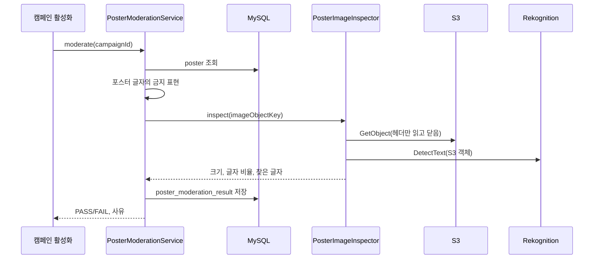

# poster 구조와 동작 설계

## 1. 범위

| 적을 것 | 내용 |
|---|---|
| 맡는 기능과 근거 | 포스터 자동 검수(명세서 57행, `#535`). 캠페인 ID 로 포스터를 검사해 `PASS`/`FAIL` 과 사유를 돌려주고 `poster_moderation_result` 에 남긴다 |
| 맡지 않는 것과 그 소유 | 검수를 부르고 캠페인을 `DRAFT` 에서 `SCHEDULED` 로 바꾸는 일은 캠페인 활성화(47행)가 한다. 포스터 생성과 조회 API 는 [`poster-api-design.md`](./poster-api-design.md) 가 가진다. 검수 기준을 바꾸는 관리(29행)는 범위 밖이다 |

이 문서는 검수와 포스터 저장 구조를 다룬다. 포스터 생성, 조회, 점주의 텍스트 수정(`#884`)의 처리 순서와 그렇게 정한
이유는 `poster-api-design.md`가 갖는다. 코드는 `PosterUploadService`(생성), `PosterQueryService`(조회),
`PosterEditService`(수정), `PosterSlots`(`slot_values` JSON과 인라인 스타일 처리), `PosterEditLimits`(범위)에 있다.

## 2. 애그리거트와 패키지

| 애그리거트 | 테이블 | 지키는 규칙 |
|---|---|---|
| `poster` | `poster`, `poster_moderation_result` | 캠페인당 포스터 1건(`uk_poster_campaign_id`). 공개된 캠페인의 포스터는 바뀌지 않는다. 검수는 할 때마다 결과 한 행을 쌓고 고치지 않는다 |

```
campaign/poster/
├── ForbiddenExpressionDictionary.java   금지 표현 사전. 리소스 파일을 서버가 뜰 때 한 번 읽는다
├── PosterEditLimits.java                점주가 고치는 텍스트와 글자 크기의 허용 범위
├── PosterImageUrlResolver.java          objectKey 를 URL 로 바꾼다
├── PosterSlotValue.java                 slot_values JSON 의 슬롯 하나
├── PosterSlots.java                     slot_values JSON 과 슬롯 인라인 스타일을 다루는 함수 모음
├── client/
│   ├── PosterImageInspection.java       그 결과(READ, UNREADABLE, TOOL_FAILURE)
│   └── PosterImageInspector.java        S3 에서 이미지 크기를 읽고 Rekognition DetectText 로 글자를 찾는다
├── config/
│   └── RekognitionConfig.java           RekognitionClient 빈. 리전은 s3.region 과 같다
├── controller/
│   ├── OwnerPosterController.java
│   └── PosterController.java
├── dto/
│   ├── PosterCreateRequest.java
│   ├── PosterCreateResponse.java
│   ├── PosterImagePrepareUploadRequest.java
│   ├── PosterImagePrepareUploadResponse.java
│   ├── PosterModerationOutcome.java     검수 결과와 사유 목록
│   ├── PosterResponse.java
│   ├── PosterSlotsResponse.java
│   └── PosterUpdateRequest.java
├── entity/
│   ├── ModerationFailReason.java        FAIL 사유 코드 5개
│   ├── ModerationResult.java            PASS, FAIL
│   ├── Poster.java
│   └── PosterModerationResult.java      검수 결과 한 행
├── repository/
│   ├── PosterModerationResultRepository.java
│   └── PosterRepository.java
└── service/
    ├── PosterEditService.java
    ├── PosterModerationService.java     검수의 입구
    ├── PosterQueryService.java
    └── PosterUploadService.java
```

`PosterModerationResult` 는 `Poster` 를 연관관계가 아니라 `posterId` 로만 참조한다. 포스터가 자기
검수 이력을 조회하는 기능이 없어서다. 캠페인 활성화는 같은 campaign 도메인이라 `contract` 를 두지 않는다.

## 3. 저장

| 적을 것 | 내용 |
|---|---|
| DB 제약과 코드 검사 | `chk_poster_moderation_result`(FAIL 이면 사유 필수)를 `PosterModerationResult.fail()` 이 한 번 더 검사한다 |
| 사유 형식 | `ModerationFailReason` 이름을 쉼표로 이어 `reason`(200자)에 넣는다. 예: `FORBIDDEN_EXPRESSION,TEXT_RATIO_EXCEEDED`. 코드 5개를 모두 이어도 200자를 넘지 않는다. 화면 문구는 코드를 받는 캠페인 활성화가 붙인다 |
| 기준값 | 숫자 기준(텍스트 비율 0.5, 최소 가로·세로 200px)은 `application.yml` 의 `campaign.moderation.*` 에 두고 환경 변수로 바꾼다. 금지 표현은 `src/main/resources/campaign/moderation/forbidden-expressions.txt` 에 둔다. 29행의 기준 관리가 생기면 둘 다 DB 로 옮긴다 |

## 4. 판정 규칙

| 기준(29행) | 판정 | 사유 코드 |
|---|---|---|
| 금지 표현 | 포스터 `title`, `slot_values` 의 텍스트 값, 이미지 속 글자(DetectText 의 `LINE`)에서 찾는다. 이미지 슬롯의 URL 과 HTML 태그, 속성은 보지 않는다 | `FORBIDDEN_EXPRESSION` |
| 해상도 | 가로나 세로가 200px 보다 작으면 FAIL 이다 | `RESOLUTION_TOO_LOW` |
| 텍스트 비율 | 글자 줄 상자의 면적 비율 합이 0.5 를 넘으면 FAIL 이다. 상자가 겹쳐 1 을 넘으면 1 로 자른다 | `TEXT_RATIO_EXCEEDED` |
| 이미지 형식 | 이미지를 디코딩하지 못하면 FAIL 이다. Rekognition 은 부르지 않는다 | `IMAGE_UNREADABLE` |
| 검수 도구 장애 | S3 읽기나 Rekognition 이 실패하거나 시간을 넘기면 FAIL 이다(57행) | `MODERATION_TOOL_FAILURE` |

걸린 사유는 하나에서 멈추지 않고 모두 모은다. 점주가 한 번 고칠 때 전부 고칠 수 있게 하려는 것이다.

금지 표현은 공백을 지우고 소문자로 맞춘 뒤 글자 그대로 찾는다. 정규식으로 해석하지 않는다.
목록은 표시광고법, 식품 등의 표시·광고에 관한 법률, G마켓 표시·광고 가이드라인을 출처로
음식점 광고에 맞는 것만 골랐다. `최고`, `프리미엄` 처럼 메뉴 이름에 흔한 표현은 넣지 않았다.

### 따로 검사하지 않는 것

- **제목 길이(29행의 카드 제목 20자)**: 포스터 `title` 은 서버가 `가게 이름 - 템플릿 이름` 으로 만들고 점주가 고칠 수 없다. 검사하면 점주가 고칠 방법이 없는 FAIL 이 생겨서 뺐다.
- **전후 비교 이미지**: `TemplateSlotValidator` 가 `image` 슬롯을 템플릿마다 정확히 하나로 강제한다. 이미지 두 장을 나란히 두는 포스터가 만들어지지 않는다.

## 5. 모듈 연결

| 입구 | 부르는 쪽 |
|---|---|
| `PosterModerationService.moderate(campaignId)` | 캠페인 활성화(47행, `CampaignActivationService`) |

## 6. 주요 흐름



## 7. 트랜잭션과 동시성

`PosterModerationService` 는 트랜잭션을 걸지 않는다. 포스터 조회와 결과 저장은 저장소 호출마다
짧은 트랜잭션으로 끝나고, S3 와 Rekognition 호출은 그 밖에서 한다. 외부 호출을 기다리는 동안
DB 커넥션을 잡아 두지 않기 위해서다.

같은 캠페인을 동시에 검수하면 결과 두 행이 쌓인다. 결과는 이력이라 둘 다 남아도 어긋나지 않는다.
같은 캠페인의 활성화를 한 번만 처리하는 일은 캠페인 활성화가 맡는다.

## 8. 외부 API

| 대상 | 호출 | 제약 |
|---|---|---|
| S3 | `GetObject`. 스트림의 헤더만 읽어 크기를 구하고 닫는다 | `S3Config` 의 타임아웃(시도 3초, 전체 5초)을 그대로 쓴다 |
| Rekognition | `DetectText`. S3 객체를 직접 넘겨 이미지를 서버로 받지 않는다 | 서울 리전만 허용된다(lc-infra #9 의 `aws:RequestedRegion`). 타임아웃 5초, SDK 재시도 끔 |

개발 서버와 운영 서버는 서버 역할 권한으로 부른다(lc-infra #9). 로컬에는 AWS 키가 없어 검수가
`MODERATION_TOOL_FAILURE` 로 끝난다. `PASS` 흐름은 개발 서버에서 확인한다.

## 9. 실패 처리

외부 호출 실패와 타임아웃은 예외로 올리지 않고 `MODERATION_TOOL_FAILURE` 로 FAIL 한다(57행).
기본 처리와 다른 이유는 [`campaign_장애_처리_설계.md`](./campaign_장애_처리_설계.md) 에 있다.
포스터가 없으면 `POSTER-020` 을 그대로 올린다.

## 10. 배치

해당 없음.

## 11. 성능

금지 표현 사전은 메모리의 `Set` 이고, 검사할 글자는 많아야 수백 자다. 이미지 크기는 헤더만
읽어서 10MB 이미지도 앞부분만 받는다. 검수는 활성화 요청 때만 돈다.

## 12. 테스트와 한계

| 항목 | 내용 |
|---|---|
| 단위 테스트 | `ForbiddenExpressionDictionaryTest`, `PosterImageInspectorTest`(S3Client, RekognitionClient 를 Mockito 로 바꿈), `PosterModerationServiceTest` |
| 통합 테스트 | `PosterModerationIntegrationTest`. `PosterImageInspector` 를 스텁하고 결과 저장과 DB 제약을 본다 |
| 단어 100개 | DetectText 는 이미지 하나에서 단어를 100개까지만 찾는다. 글자가 아주 많은 포스터는 비율이 실제보다 낮게 나와 PASS 될 수 있다(`#535` 댓글) |
| 근사치 | 글자 줄 상자의 넓이를 더한 값이다. 기울어진 글자나 아주 작은 글자, 손글씨는 덜 잡혀 비율이 낮게 나올 수 있다 |
| OCR 오인식 | 이미지 속 글자를 잘못 읽으면 금지 표현을 놓치거나 엉뚱하게 걸 수 있다 |
| 형식과 크기 | DetectText 는 JPEG, PNG 와 S3 15MB 까지만 받는다. 업로드가 같은 두 형식과 10MB 상한을 이미 지킨다 |
