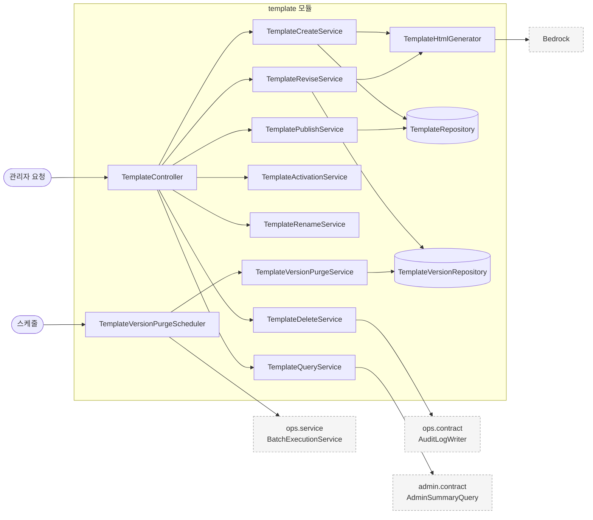
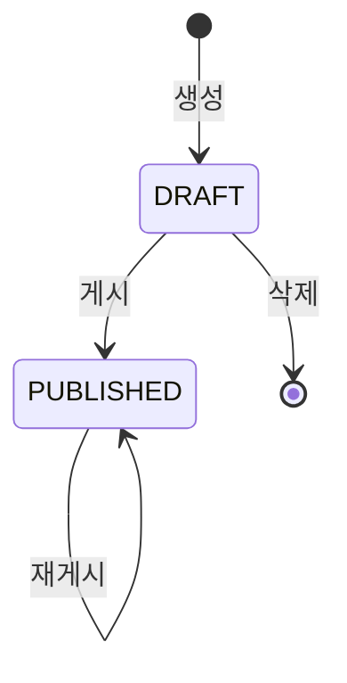
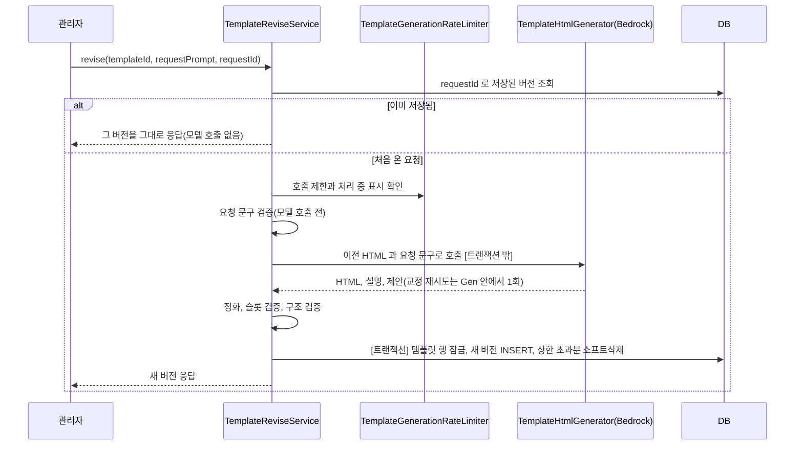
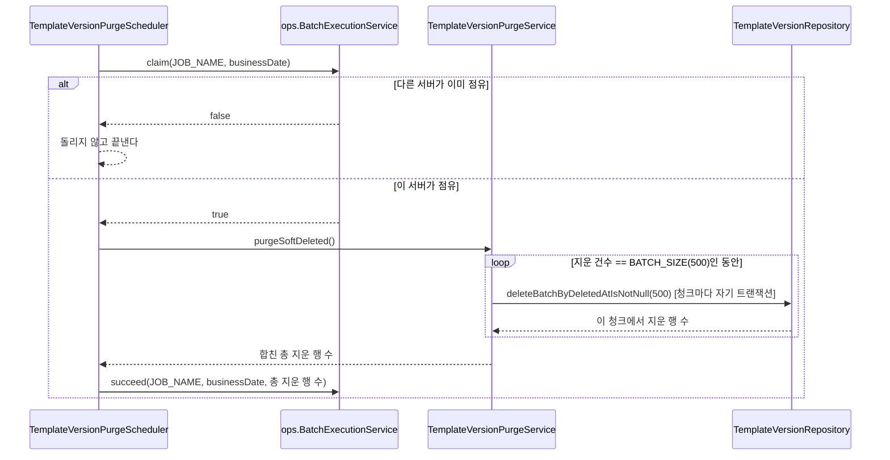

# template 구조와 동작 설계

## 1. 범위

| 적을 것 | 내용 |
|---|---|
| 맡는 기능과 근거 | 관리자가 LLM 채팅으로 템플릿을 만들고 고치는 흐름(버전 관리), 게시와 재게시, 활성화, 이름 변경, 삭제, 점주의 템플릿 목록 조회, 게시로 소프트삭제된 버전을 완전히 지우는 04시 배치(`#412`) |
| 맡지 않는 것과 그 소유 도메인 | `campaign` 애그리거트(상태 전이)는 [`campaign_구조와_동작_설계.md`](./campaign_구조와_동작_설계.md), 포스터는 [`poster_구조와_동작_설계.md`](./poster_구조와_동작_설계.md)가 가진다. 템플릿 API 의 처리 순서와 그렇게 정한 이유는 [`poster-api-design.md`](./poster-api-design.md)가 갖고, 이 문서는 모듈과 저장 구조, 동시성, 배치만 다룬다 |

`campaign_구조와_동작_설계.md` 1장이 `template`을 범위 밖으로 두므로, 이 문서가 `template` 애그리거트를 다룬다.

## 2. 애그리거트와 패키지

| 애그리거트 | 테이블 | 지키는 규칙 | 나눈 근거 |
|---|---|---|---|
| `template` | `template`, `template_version`, `template_quota` | 게시 전에는 HTML 을 `template_version` 이 갖고, 게시하면 고른 버전의 HTML 이 `template.html_content` 로 복사된다. `status`, `published_at`, `published_version_number` 는 항상 함께 바꾼다. 버전 번호는 템플릿 안에서 유일하고 계속 증가한다. 게시한 번호보다 높은 임시저장이 소프트삭제됐다가 04시 배치로 지워지면, 그 번호가 다시 쓰일 수 있다 | 도메인 이름과 다른 애그리거트라 하위 패키지로 나눈다 |

```
campaign/template/
├── TemplateHtmlSanitizer.java
├── TemplatePromptValidator.java
├── TemplateSlotValidator.java
├── TemplateStructureValidator.java
├── client/        외부 API 경계(Bedrock)
│   ├── BedrockTemplateHtmlGenerator.java
│   ├── FakeTemplateHtmlGenerator.java
│   ├── GeneratedTemplate.java
│   ├── TemplateGenerationTimeoutException.java
│   └── TemplateHtmlGenerator.java
├── config/
│   └── BedrockConfig.java
├── controller/
│   ├── OwnerTemplateController.java
│   └── TemplateController.java
├── dto/
├── entity/
│   ├── Template.java
│   ├── TemplateQuota.java
│   ├── TemplateStatus.java
│   └── TemplateVersion.java        deletedAt 으로 소프트삭제를 표시한다(`#150`)
├── repository/
│   ├── TemplateQuotaRepository.java
│   ├── TemplateRepository.java
│   └── TemplateVersionRepository.java
├── service/
│   ├── TemplateActivationService.java
│   ├── TemplateCreateService.java
│   ├── TemplateDeleteService.java
│   ├── TemplateGenerationRateLimiter.java
│   ├── TemplatePublishService.java
│   ├── TemplateQueryService.java
│   ├── TemplateRenameService.java
│   ├── TemplateReviseService.java
│   └── TemplateVersionPurgeService.java   BATCH_SIZE(500)씩 나눠 반복 지운다
└── job/            Entry 계층이라 Repository 를 직접 쓰지 않고 service 만 부른다
    └── TemplateVersionPurgeScheduler.java
```

`template`은 `contract`를 공개하지 않는다. 다른 도메인이 템플릿을 참조하지 않는다.

검증기는 모델 출력을 저장 가능한 템플릿으로 바꾸는 순서대로 이어진다. 요청 문구는 `TemplatePromptValidator` 가 모델을 부르기 전에 거르고, 모델이 돌려준 HTML 은 `TemplateHtmlSanitizer` 가 허용 태그와 속성만 남긴다. 그다음 `TemplateSlotValidator` 가 슬롯을 검증하고, 수정이면 `TemplateStructureValidator` 가 이전 버전과 슬롯 태그가 같은지 본다.

슬롯 검증(`TemplateSlotValidator`)은 슬롯 네 개가 하나씩 있는지 보고, `eventName`과 `discount` 슬롯 요소가 자식 요소
없이 글자만 갖는지도 본다(`#884`). 점주가 포스터에서 이 두 칸의 글자와 크기를 고치기 때문이다. 어긋나면 `POSTER-001`이다.
템플릿 생성 프롬프트(`BedrockTemplateHtmlGenerator`)에도 같은 규칙이 있고, 교정 재시도 지시가 이 위반을 함께 알린다.

## 3. 저장

| 적을 것 | 내용 |
|---|---|
| DB 제약으로 막을 것 | `chk_template_status` 가 `DRAFT` 와 `PUBLISHED` 에 맞는 `published_at` 값을 짝으로 요구한다. `template_version` 은 `uk_template_version_template_id_version_number` 가 번호 중복을, `uk_template_version_request_id` 가 같은 요청의 중복 저장을 막는다. 포스터가 `fk_poster_template` 으로 템플릿을 참조해 포스터가 있는 템플릿은 지우지 못한다 |
| 코드로 막을 것 | 생성 총량은 `template_quota` 한 행을 조건부 `UPDATE` 로만 올리고 내린다(`tryReserve`, `release`). 읽어서 더하고 저장하는 방식은 동시 요청에서 경쟁이 생겨 쓰지 않는다. 버전 상한(20개)과 새 번호 계산은 `TemplateReviseService` 가 한다 |
| 다른 도메인 데이터의 사본 | 해당 없음. 수정한 관리자의 이름은 템플릿에 복사하지 않고 조회할 때마다 `admin` 의 공개 계약으로 읽는다(`#949`) |
| 이력 | `lastModifiedBy`, `lastModifiedAt` 은 `template` 에 바로 복사해 둔다. 게시하면 `template_version` 이 소프트삭제되고 배치가 지우므로, 버전에만 두면 게시된 템플릿은 수정자를 잃는다 |
| 인덱스 | `template_version.deleted_at` 에 단일 인덱스를 둔다(`idx_template_version_deleted_at`, `V16`). 없으면 `deleteBatchByDeletedAtIsNotNull` 이 조건을 평가하려고 테이블 전체를 스캔하면서 모든 행에 잠금을 걸어, `publish()` 의 소프트삭제 UPDATE 나 새 버전 INSERT 와 부딪힌다 |

## 4. 계산 로직

| 계산 | 규칙 |
|---|---|
| 새 버전 번호 | `max(published_version_number, 남아 있는 최대 번호) + 1`. 게시하면 임시저장이 모두 소프트삭제되고 04시 배치가 지우므로, `max(version_number) + 1` 로만 매기면 번호가 1부터 다시 시작한다. 소프트삭제된 행이 남아 있는 동안은 UNIQUE 가 그 번호를 쥐고 있어 남아 있는 최대 번호도 함께 센다 |
| 버전 상한 | 템플릿당 20개다. 넘기면 번호가 (최신 번호 - 20) 이하인 살아 있는 버전을 모두 소프트삭제한다. 번호는 바꾸지 않는다 |
| 처리 중 표시의 TTL | 60초. Bedrock 호출 한 번이 최대 30초이고 교정 재시도까지 두 번 부를 수 있다. 정화, 검증, 저장은 이 계산에 넣지 않아, 처리가 TTL 안에 끝나지 않으면 같은 `requestId` 가 다시 통과해 모델을 한 번 더 부를 수 있다 |

## 5. 모듈 연결

| 방향 | 대상 | 인터페이스 | 시점 |
|---|---|---|---|
| 호출 | ops | `BatchExecutionService`(점유, 성공/실패 닫기, 처리 건수 기록) | `TemplateVersionPurgeScheduler` 가 매일 04시 시도마다(`#412`) |
| 호출 | ops | `AuditLogWriter` | 템플릿 영구 삭제와 같은 트랜잭션(`#877`) |
| 호출 | admin | `AdminSummaryQuery` | 템플릿 조회, 이름 변경, 활성화 응답을 만들 때(`#949`) |
| 호출 | 외부 | Bedrock Converse | 생성과 수정 요청마다. 트랜잭션 밖 |
| 호출 | 외부 | Redis | `TemplateGenerationRateLimiter` 의 호출 제한과 처리 중 표시 |

## 6. 구조와 동작 그림

### 모듈 구조



### 상태 변경



| 전이 | 일으키는 쪽 | 조건 | 금지일 때 응답 |
|---|---|---|---|
| 생성 | ADMIN | 템플릿 총량이 상한 미만 | `POSTER-003` |
| DRAFT -> PUBLISHED | ADMIN | 고른 버전이 살아 있는 임시저장 | `POSTER-008` |
| PUBLISHED -> PUBLISHED(재게시) | ADMIN | 살아 있는 임시저장을 고름 | `POSTER-007`, `POSTER-008` |
| 삭제 | ADMIN | DRAFT 상태 | `POSTER-006` |
| 활성 여부 변경 | ADMIN | PUBLISHED 상태 | `POSTER-009` |

활성 여부(`active`)는 상태와 별개의 플래그다. 게시하거나 재게시해도 바뀌지 않는다. 수정과 이름 변경은 상태를 바꾸지 않는다. 게시된 템플릿도 수정할 수 있다(`#880`).

### 주요 흐름

**흐름 1. 템플릿 수정 요청(생성도 같은 모양이다)**



| 실패 지점 | 남는 상태 | 다시 요청하면 |
|---|---|---|
| 모델 호출이 실패하거나 검증을 통과하지 못함 | 저장된 것이 없다 | 처리 중 표시는 60초 TTL 이 지나야 풀린다. 그 전에 같은 `requestId` 로 보내면 `POSTER-004` 이고, 새 `requestId` 는 바로 보낼 수 있다(호출 제한에는 센다) |
| 요청 문구 검증에서 거부됨 | 저장된 것이 없다 | 처리 중 표시를 바로 풀어, 문구를 고친 같은 `requestId` 의 재요청이 막히지 않는다 |
| 저장 직전에 같은 `requestId` 가 먼저 저장됨 | UNIQUE 충돌로 저장이 되돌아간다 | 먼저 저장된 버전을 조회해 그대로 응답한다 |
| 호출 중에 템플릿이 삭제됨 | 저장 단계에서 템플릿이 없어 `POSTER-005` 로 끝난다 | 요청을 새로 해도 같다 |

**흐름 2. 소프트삭제된 버전을 청크 단위로 완전히 지운다(`#412`)**



| 실패 지점 | 남는 상태 | 다시 요청하면 |
|---|---|---|
| 청크 N번째 실행 중 예외 | 1~(N-1)번째 청크는 이미 각자 커밋돼 지워진 채로 남는다(N번째 청크만 트랜잭션이 되돌린다). `batch_execution_log`는 FAILED로 닫힌다 | 다음 날 04시(또는 관리자 수동 재실행)에 다시 돌면 같은 조건(`deletedAt is not null`)이라 멱등하게 이어 지운다. 이미 지운 1~(N-1)번째 청크를 다시 지우려 하지 않는다 |

## 7. 트랜잭션과 동시성

| 흐름 | 한 트랜잭션에 묶는 것 | 트랜잭션 밖 |
|---|---|---|
| 생성 | 총량 예약(`tryReserve`), 템플릿과 첫 버전 INSERT | 요청 문구 검증, 호출 제한, 모델 호출, 정화와 슬롯 검증 |
| 수정 | 템플릿 행 잠금, 새 버전 INSERT, 상한 초과분 소프트삭제 | 위와 같음 |
| 게시, 재게시 | 메서드 전체(`@Transactional`). 템플릿 행 잠금, 게시본 복사, 버전 소프트삭제 | 없음 |
| 활성 여부 변경 | 메서드 전체. 잠금 없이 플래그만 바꾼다 | 없음 |
| 이름 변경 | 템플릿 행 잠금, 이름과 수정자 갱신 | 없음 |
| 삭제 | 템플릿 행 잠금, 버전 삭제, 템플릿 삭제, 총량 반환, 감사 로그 | 없음 |
| 버전 삭제 배치 | 청크 하나(`deleteBatchByDeletedAtIsNotNull` 호출 1번, 최대 500건) | 다음 청크 호출(각자 새 트랜잭션). 외부 호출은 없음 |

수정, 게시, 이름 변경, 삭제가 모두 `findByIdForUpdate` 로 같은 템플릿 행을 잠가 순서가 정해진다. 모델 호출은 트랜잭션 밖이라 응답을 기다리는 동안 이 잠금과 DB 커넥션을 쥐지 않는다.

**결정: 소프트삭제된 버전을 한 트랜잭션으로 지울지, 청크로 나눠 지울지**

| 선택지 | 장점 | 단점 |
|---|---|---|
| A. `DELETE ... WHERE deleted_at IS NOT NULL` 한 번 | 구현이 단순하다 | 이 배치가 처음 도는 날처럼 쌓인 행이 많으면, 한 트랜잭션이 그 많은 행의 잠금을 끝까지 들고 있어 `publish()`나 새 버전 INSERT와 오래 부딪힌다 |
| B. `LIMIT 500`으로 나눠 0건이 나올 때까지 반복 | 각 청크가 따로 커밋돼 잠금을 오래 들고 있지 않는다. 쌓인 양이 얼마든 같은 방식으로 안전하다 | 쿼리 횟수가 늘고, 중간에 실패하면 일부만 지워진 상태로 남는다(그래도 멱등해서 다시 돌면 이어 지운다) |

B를 고른다. 이 배치는 첫 실행에 얼마나 쌓여 있는지 모른다. 많이 쌓여 있어도 안전한 쪽이 B다.

| 상황 | 확인할 것 | 처리 |
|---|---|---|
| 같은 작업을 배치 서버 두 대가 동시에 시도 | 중복 실행 차단 | `BatchExecutionService.claim`이 `batch_execution_log` 유일 제약으로 한 서버만 통과시킨다(배치 운영 문서 2장). 이 도메인이 새로 만든 동시성 로직은 없다 |
| 같은 작업이 두 번(재시도, 다음 날) 돌아도 되는지 | 멱등성 | `delete ... where deleted_at is not null`은 이미 지운 행을 다시 지우지 않아 자연히 멱등하다. 별도 코드나 테스트를 더하지 않았다 |
| 이 배치가 도는 동안 `publish()`나 새 버전 생성이 같은 테이블에 쓰는지 | 잠금 경합 | `deleted_at`에 인덱스(`V16`)가 있어 각 청크는 조건에 맞는 최대 500행만 잠근다. 인덱스가 없었다면 청크 크기와 무관하게 테이블 전체를 스캔하며 모든 행을 잠갔을 것이다 |

**게시된 템플릿의 수정과 재게시(`#880`)의 상태와 동시성**

| 상황 | 처리 |
|---|---|
| 게시된 템플릿을 수정한다 | 상태 검사 없이 수정을 받는다. 이전 HTML 은 살아 있는 최신 임시저장이 있으면 그것, 없으면 `template.html_content`(게시본)다. 새 버전 번호는 `max(published_version_number, 남아 있는 최대 번호) + 1` 이다 |
| 수정하는 동안 점주가 템플릿을 쓴다 | 점주 목록과 포스터 생성은 게시되고 활성인 템플릿의 `html_content` 만 읽는다. 임시저장은 읽지 않아 영향이 없다 |
| 재게시와 수정 저장, 게시, 이름 변경, 삭제가 겹친다 | 모두 `findByIdForUpdate` 로 같은 템플릿 행을 잠가 순서가 정해진다 |
| 재게시와 포스터 생성이 겹친다 | 포스터 생성은 템플릿을 한 행으로 읽어 이전 또는 새 게시본 중 하나로 일관되게 만들어진다. 이미 만든 포스터는 자기 행에 HTML 과 슬롯 값을 저장해 바뀌지 않는다 |
| 수정하는 LLM 호출 중 재게시가 커밋된다 | 그 요청의 이전 HTML 은 옛 게시본이지만 슬롯 구조는 모든 버전이 같아 새 임시저장은 유효하다. 저장 단계에서 상태를 다시 확인하지 않는다 |
| 같은 재게시 요청을 다시 보낸다 | 고른 번호가 지금 게시된 번호와 같으면 재시도로 보고 지금 상태를 돌려준다 |

## 8. 외부 API

Bedrock Converse 를 `BedrockTemplateHtmlGenerator` 가 부른다. `bedrock.model-id` 가 없으면 `FakeTemplateHtmlGenerator` 가 대신한다.

| 항목 | 값 |
|---|---|
| 호출 시간 제한 | 호출 전체와 시도 모두 30초, 연결 3초. 넘으면 `POSTER-004` |
| SDK 재시도 | 끈다(`maxAttempts(1)`). 서버가 교정 재시도를 직접 한다 |
| 출력 토큰 상한 | 4,000 |
| 교정 재시도 | 같은 대화에 교정 지시를 붙여 1회. 대상은 허용 안 된 태그, 슬롯 누락, 구조 불일치, 토큰 잘림, 가드레일 차단이다 |
| 일시 오류(호출 제한, 서비스 불가, 모델 타임아웃 등) | 재시도하지 않고 즉시 `POSTER-012` 로 끝낸다 |

호출이 실패했을 때 무엇을 막고 무엇을 통과시키는지는 [`campaign_장애_처리_설계.md`](./campaign_장애_처리_설계.md)의 "외부 API: Bedrock LLM" 이 갖는다.

## 9. 실패 처리

이 도메인이 기대는 대상과 기본 처리를 벗어난 것은 [`campaign_장애_처리_설계.md`](./campaign_장애_처리_설계.md)가 `campaign` 최상위 도메인 전체(이 서브도메인 포함) 단위로 가진다. 버전 삭제 배치의 DB 삭제는 그 문서의 기본 처리("DB 쓰기: 트랜잭션을 되돌린다")를 그대로 따르고, 배치 중복 실행 방지는 [`런치캐치_배치_운영.md`](../ops/런치캐치_배치_운영.md) 2장의 공통 기준을 그대로 따른다.

## 10. 배치

| 적을 것 | 내용 |
|---|---|
| 작업이 하는 일 | `template_version` 중 `deleted_at`이 채워진(게시로 소프트삭제된) 행을 500건씩 나눠 반복해서 완전히 지운다(`#412`) |
| 읽는 상태 | `TemplatePublishService.publish()`가 게시 시점에 이미 찍어 둔 `deleted_at`(`#150`). 이 배치는 그 전 단계를 따로 확인하지 않는다 |
| 같은 날 두 번 돌면 | 두 번째 실행은 첫 호출의 `deleted_at is not null` 조건에 걸리는 행이 없어 0건을 지우고 성공으로 끝난다. 누적되지 않는다 |
| 실패하면 그날 서비스는 | 영향 없다. 템플릿 조회·게시·생성·수정 어느 것도 `template_version`의 소프트삭제 행을 읽지 않는다(`findPage`, `findByTemplateIdAndVersionNumberAndDeletedAtIsNull` 모두 `deletedAt is null` 조건). 다음 날 다시 돌면 이어서 지운다 |

00:00 묶음(`DailyJob`)에는 태우지 않는다. 캠페인·정산·광고 서빙의 순서 보장용 묶음과 이 정리 작업 사이에 순서 의존이 없다. 매일 04시에 독립적으로 돌고, 멈춘 실행은 다른 서버가 `StandaloneJob` 으로 이어받는다(`#622`).

## 11. 성능

| 적을 것 | 내용 |
|---|---|
| 처리량 | 청크당 500건, 청크마다 독립 트랜잭션. 삭제 대상이 많이 쌓여 있어도 한 트랜잭션이 길어지지 않는다(7장 결정) |
| 목록 조회 | 템플릿 총량에 상한(기본 100개)이 있어 페이지네이션을 두지 않는다. DRAFT 템플릿의 미리보기는 최신 버전을 한 번에 조회하고, 수정자 이름도 ID 를 모아 한 번만 조회해 템플릿 수만큼 쿼리가 나가지 않게 한다 |
| 확인 방법 | 부하 테스트는 하지 않았다. 운영 DB에 지금 소프트삭제된 행이 몇 건 쌓여 있는지 확인하는 것이 첫 실행 전에 할 일로 남아 있다 |

생성과 수정의 응답 시간은 Bedrock 호출이 정한다. 호출 시간 제한은 30초이고, 교정 재시도까지 포함하면 최대 60초가 걸린다.

## 12. 테스트와 미정 사항

| 미정 항목 | 어디까지 정해졌나 | 막는 것 |
|---|---|---|
| `deleteBatchByDeletedAtIsNotNull()`의 실제 DB 동작 확인 | `TemplateVersionPurgeServiceTest`/`TemplateVersionPurgeSchedulerTest`가 이 쿼리를 목으로 검증하고, `TemplatePublishedEditIntegrationTest`가 실제 MySQL 에서 게시, 배치 삭제, 번호 이어짐을 확인한다 | 청크 경계(500건)와 큰 데이터에서의 동작은 실제 DB 로 확인하지 않았다 |
| 청크 크기(500) 값의 근거 | 다른 배치와 비교하지 않고 임의로 고른 값이다(등급 C) | 실제 쌓인 행 수와 테이블 잠금 영향을 재서 맞는 값인지 확인할 근거가 아직 없다 |
| 수정 중인 임시저장을 버리고 게시본으로 돌아가는 기능 | `#880` 범위에서 뺐다. 지금은 임시저장을 만든 채로 두거나 재게시로만 정리된다 | 임시저장 폐기 API 와 `hasDraft` 가 false 로 돌아가는 규칙을 정해야 한다 |
| 게시 후 삭제나 폐기로 생성 상한 자리를 돌려주는 기능 | `#880` 범위에서 뺐다. 포스터가 `fk_poster_template` 으로 템플릿을 참조해 게시된 템플릿의 삭제는 따로 설계해야 한다 | 포스터가 쓴 템플릿을 지울 때의 참조 처리 |
