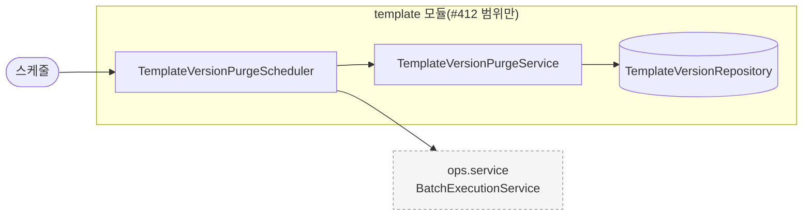
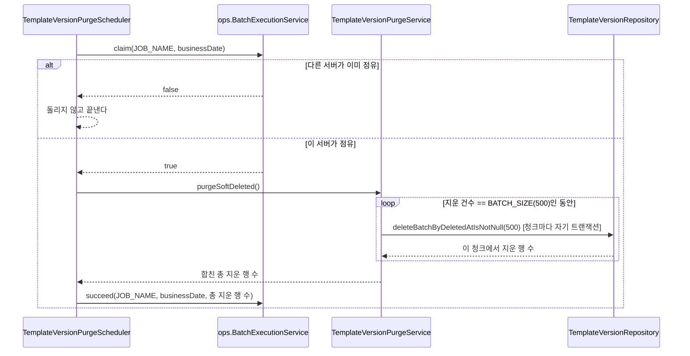

# template 구조와 동작 설계

## 1. 범위

| 적을 것 | 내용 |
|---|---|
| 맡는 기능과 근거 | 관리자 LLM 챗팅으로 템플릿을 만들고 수정하는 흐름(버전 관리), 게시와 활성화, 점주의 템플릿 목록 조회. 이번 PR(`#412`)이 더하는 것은 게시로 소프트삭제된 버전을 완전히 지우는 배치뿐이다 |
| 맡지 않는 것과 그 소유 도메인 | `campaign` 애그리거트(상태 전이)는 [`campaign_구조와_동작_설계.md`](./campaign_구조와_동작_설계.md), 포스터는 [`poster-api-design.md`](./poster-api-design.md)가 가진다 |

`campaign_구조와_동작_설계.md` 1장이 `template`을 범위 밖으로 뺀 채로 남아 있어, 이 문서가 처음으로 `template` 애그리거트를 다룬다. 이번 PR(`#412`)이 건드리지 않은 장은 "아직 훑지 않았다"로 비워 둔다.

## 2. 애그리거트와 패키지

| 애그리거트 | 테이블 | 지키는 규칙 | 나눈 근거 |
|---|---|---|---|
| `template` | `template`, `template_version`, `template_quota` | 아직 훑지 않았다(생성·수정·게시·활성화의 상세 규칙은 이번 PR 범위 밖) | 도메인 이름과 다른 애그리거트라 하위 패키지로 나눈다 |

```
campaign/template/
├── client/        외부 API 경계(Bedrock). 아직 훑지 않았다
├── config/
├── controller/
├── dto/
├── entity/
│   ├── Template.java
│   ├── TemplateVersion.java        deletedAt 으로 소프트삭제를 표시한다(`#150`)
│   └── TemplateQuota.java
├── repository/
│   └── TemplateVersionRepository.java   deleteBatchByDeletedAtIsNotNull(batchSize) 추가(`#412`)
├── service/
│   └── TemplateVersionPurgeService.java  신설(`#412`). BATCH_SIZE(500)씩 나눠 반복 지운다
└── job/            신설(`#412`). Entry 계층이라 Repository 를 직접 쓰지 않고 service 만 부른다
    └── TemplateVersionPurgeScheduler.java
```

`template`은 `contract`를 공개하지 않는다. 다른 도메인이 템플릿을 참조하지 않는다.

## 3. 저장

| 적을 것 | 내용 |
|---|---|
| DB 제약으로 막을 것과 코드로 막을 것 | 해당 없음(이 PR은 제약을 추가하지 않는다) |
| 인덱스 | `template_version.deleted_at`에 단일 인덱스를 더한다(`idx_template_version_deleted_at`, `V16`). 없으면 `deleteBatchByDeletedAtIsNotNull`이 조건을 평가하려고 테이블 전체를 스캔하면서 스캔한 모든 행에 잠금을 걸어, `publish()`의 소프트삭제 UPDATE나 새 버전 INSERT와 부딪힌다(설계 검토로 찾음, 2026-10-17) |

나머지(생성·수정·게시·활성화의 저장 구조)는 아직 훑지 않았다.

## 4. 계산 로직

아직 훑지 않았다.

## 5. 모듈 연결

| 방향 | 대상 도메인 | 인터페이스 | 시점 |
|---|---|---|---|
| 호출 | ops | `BatchExecutionService`(점유, 성공/실패 닫기, 처리 건수 기록) | `TemplateVersionPurgeScheduler`가 매일 04시 시도마다(`#412`) |

그 외 모듈 연결은 아직 훑지 않았다(Bedrock 외부 API 등).

## 6. 구조와 동작 그림

### 모듈 구조



생성·수정·게시·활성화·조회 쪽 모듈 구조는 아직 훑지 않았다.

### 상태 변경

아직 훑지 않았다. `TemplateStatus`(DRAFT/PUBLISHED)와 `TemplateVersion.deletedAt`의 전이 규칙은 이번 PR 범위 밖이다.

### 주요 흐름

**흐름: 소프트삭제된 버전을 청크 단위로 완전히 지운다(`#412`)**



| 실패 지점 | 남는 상태 | 다시 요청하면 |
|---|---|---|
| 청크 N번째 실행 중 예외 | 1~(N-1)번째 청크는 이미 각자 커밋돼 지워진 채로 남는다(N번째 청크만 트랜잭션이 되돌린다). `batch_execution_log`는 FAILED로 닫힌다 | 다음 날 04시(또는 관리자 수동 재실행)에 다시 돌면 같은 조건(`deletedAt is not null`)이라 멱등하게 이어 지운다. 이미 지운 1~(N-1)번째 청크를 다시 지우려 하지 않는다 |

## 7. 트랜잭션과 동시성

**결정: 소프트삭제된 버전을 한 트랜잭션으로 지울지, 청크로 나눠 지울지**

| 선택지 | 장점 | 단점 |
|---|---|---|
| A. `DELETE ... WHERE deleted_at IS NOT NULL` 한 번 | 구현이 단순하다 | 이 배치가 처음 도는 날처럼 쌓인 행이 많으면, 한 트랜잭션이 그 많은 행의 잠금을 끝까지 들고 있어 `publish()`나 새 버전 INSERT와 오래 부딪힌다 |
| B. `LIMIT 500`으로 나눠 0건이 나올 때까지 반복 | 각 청크가 따로 커밋돼 잠금을 오래 들고 있지 않는다. 쌓인 양이 얼마든 같은 방식으로 안전하다 | 쿼리 횟수가 늘고, 중간에 실패하면 일부만 지워진 상태로 남는다(그래도 멱등해서 다시 돌면 이어 지운다) |

B를 고른다. 이 배치는 지금까지 한 번도 돈 적이 없어 첫 실행에 얼마나 쌓여 있는지 모른다. 많이 쌓여 있어도 안전한 쪽이 B다.

| 흐름 | 한 트랜잭션에 묶는 것 | 트랜잭션 밖 |
|---|---|---|
| 버전 삭제 배치 | 청크 하나(`deleteBatchByDeletedAtIsNotNull` 호출 1번, 최대 500건) | 다음 청크 호출(각자 새 트랜잭션). 외부 호출은 없음 |

| 상황 | 확인할 것 | 이 PR의 처리 |
|---|---|---|
| 같은 작업을 배치 서버 두 대가 동시에 시도 | 중복 실행 차단 | `BatchExecutionService.claim`이 `batch_execution_log` 유일 제약으로 한 서버만 통과시킨다(배치 운영 문서 2장). 이 도메인이 새로 만든 동시성 로직은 없다 |
| 같은 작업이 두 번(재시도, 다음 날) 돌아도 되는지 | 멱등성 | `delete ... where deleted_at is not null`은 이미 지운 행을 다시 지우지 않아 자연히 멱등하다. 별도 코드나 테스트를 더하지 않았다 |
| 이 배치가 도는 동안 `publish()`나 새 버전 생성이 같은 테이블에 쓰는지 | 잠금 경합 | `deleted_at`에 인덱스(`V16`)가 있어 각 청크는 조건에 맞는 최대 500행만 잠근다. 인덱스가 없었다면 청크 크기와 무관하게 테이블 전체를 스캔하며 모든 행을 잠갔을 것이다 |

생성·수정·게시·활성화의 동시성은 아직 훑지 않았다.

## 8. 외부 API

아직 훑지 않았다(Bedrock LLM). 이번 PR은 외부 API를 부르지 않는다.

## 9. 실패 처리

이 도메인이 기대는 대상과 기본 처리를 벗어난 것은 [`campaign_장애_처리_설계.md`](./campaign_장애_처리_설계.md)가 `campaign` 최상위 도메인 전체(이 서브도메인 포함) 단위로 가진다. 이번 PR의 DB 삭제는 그 문서의 기본 처리("DB 쓰기: 트랜잭션을 되돌린다")를 그대로 따르고, 배치 중복 실행 방지는 [`런치캐치_배치_운영.md`](../ops/런치캐치_배치_운영.md) 2장의 공통 기준을 그대로 따른다. 벗어난 것이 없어 이 문서들에 새로 적을 것이 없다.

## 10. 배치

| 적을 것 | 내용 |
|---|---|
| 작업이 하는 일 | `template_version` 중 `deleted_at`이 채워진(게시로 소프트삭제된) 행을 500건씩 나눠 반복해서 완전히 지운다(`#412`) |
| 읽는 상태 | `TemplatePublishService.publish()`가 게시 시점에 이미 찍어 둔 `deleted_at`(`#150`). 이 배치는 그 전 단계를 따로 확인하지 않는다 |
| 같은 날 두 번 돌면 | 두 번째 실행은 첫 호출의 `deleted_at is not null` 조건에 걸리는 행이 없어 0건을 지우고 성공으로 끝난다. 누적되지 않는다 |
| 실패하면 그날 서비스는 | 영향 없다. 템플릿 조회·게시·생성·수정 어느 것도 `template_version`의 소프트삭제 행을 읽지 않는다(`findPage`, `findByTemplateIdAndVersionNumberAndDeletedAtIsNull` 모두 `deletedAt is null` 조건). 다음 날 다시 돌면 이어서 지운다 |

00:00 묶음(`DailyJob`)에는 태우지 않는다. 캠페인·정산·광고 서빙의 순서 보장용 묶음과 이 정리 작업 사이에 순서 의존이 없다(`런치캐치_배치_운영.md` "아직 비어 있는 것"). 매일 04시에 독립적으로 돈다.

## 11. 성능

| 적을 것 | 내용 |
|---|---|
| 처리량 | 청크당 500건, 청크마다 독립 트랜잭션. 삭제 대상이 많이 쌓여 있어도 한 트랜잭션이 길어지지 않는다(7장 결정) |
| 확인 방법 | 부하 테스트는 하지 않았다. 운영 DB에 지금 소프트삭제된 행이 몇 건 쌓여 있는지 확인하는 것이 첫 실행 전에 할 일로 남아 있다 |

응답 시간 목표는 해당 없음(HTTP 엔드포인트가 없다).

## 12. 테스트와 미정 사항

| 미정 항목 | 어디까지 정해졌나 | 막는 것 |
|---|---|---|
| `deleteBatchByDeletedAtIsNotNull()`의 실제 DB 동작 확인 | `TemplateVersionPurgeServiceTest`/`TemplateVersionPurgeSchedulerTest`가 이 쿼리를 목으로 검증한다. 같은 저장소의 다른 커스텀 쿼리(`softDeleteAllByTemplateId` 등)도 통합 테스트가 없는 것이 이 서브도메인의 기존 관례다 | 실제 DB에 대고 돌리는 통합 테스트가 없어, 이 쿼리는 `./gradlew check` 통과와 별개로 한 번도 실제로 실행되지 않은 상태다 |
| 청크 크기(500) 값의 근거 | 다른 배치와 비교하지 않고 임의로 고른 값이다(등급 C) | 실제 쌓인 행 수와 테이블 잠금 영향을 재서 맞는 값인지 확인할 근거가 아직 없다 |

생성·수정·게시·활성화 쪽 미정 사항은 아직 훑지 않았다.
