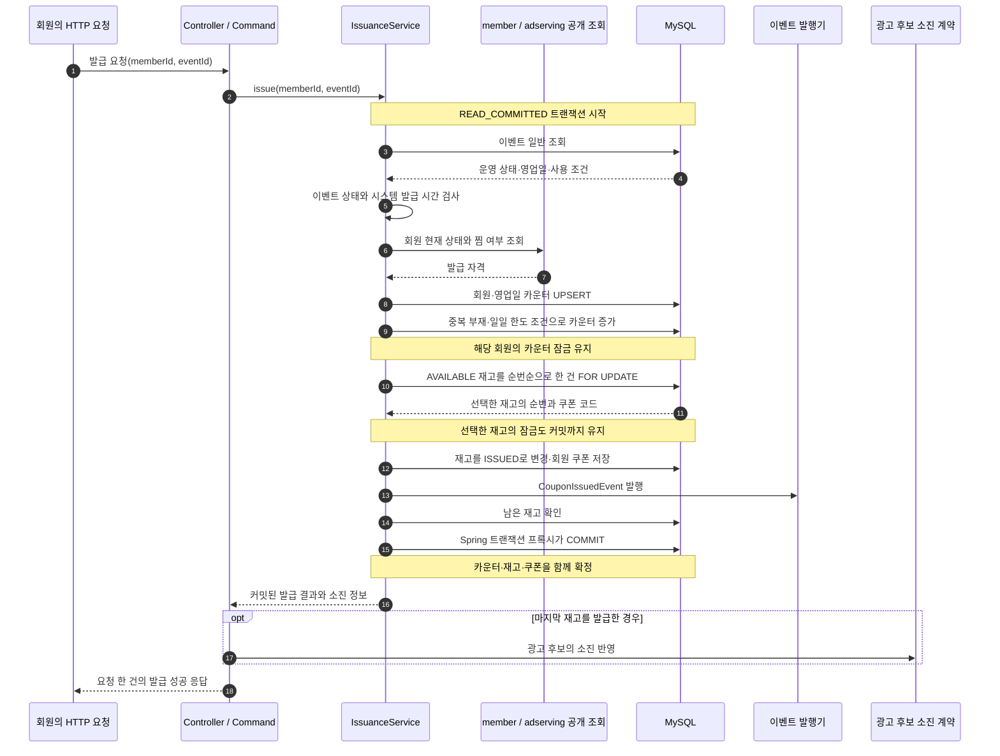
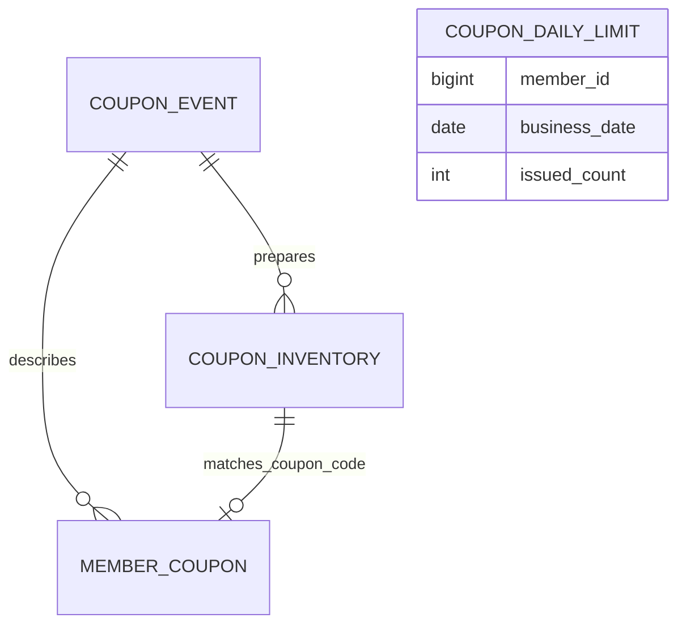

# 쿠폰 발급 v1 설계도: MySQL에서 재고를 선택한다

v1은 MySQL에서 재고를 선택하고 요청 한 건의 발급을 트랜잭션 하나로 확정한다.
이 문서는 MySQL 발급 경로의 구조와 호출 순서, 잠금과 실패 처리의 설계를 설명한다.
정상 시퀀스는 이벤트를 일반 조회하도록 바꾼 v1의 마지막 구조를 기준으로 그린다.
초기 이벤트 배타 잠금과의 차이는 아래의 잠금 설계에 구분한다.

업무 조건과 HTTP 응답은 [발급 명세](../../api-spec/coupon-api-spec.md#쿠폰-발급)를 따른다.
대표 부하 측정 결과는 [쿠폰 v3 부하 시험 결과](../../troubleshooting/coupon/coupon-load-test-results.md)에 있다. v1의 측정 결과와는 조건이 다르다.
다음 구조는 [v2 순번 발급기 설계도](./coupon-issuance-v2-design.md)다.

## 1. 구성 요소의 책임

| 구성 요소 | 책임 |
|---|---|
| `CouponController` | 인증된 회원 ID와 이벤트 ID를 받아 발급 결과를 HTTP 응답으로 바꾼다. |
| `CouponCommandService` | 발급 서비스를 호출한다. 커밋된 결과를 받은 뒤 필요한 소진 통보를 수행한다. |
| 당시의 `CouponIssuanceService` | 이벤트와 자격을 검사하고 재고·일일 횟수·회원 쿠폰을 같은 트랜잭션에서 변경한다. |
| member·adserving의 공개 조회 계약 | 현재 회원 상태와 캠페인 찜 여부를 제공한다. 쿠폰 서비스가 제공자의 내부 저장소를 직접 읽지 않는다. |
| MySQL | 재고와 발급 결과를 저장한다. 행 잠금과 UNIQUE·CHECK로 동시 요청의 불변식을 지킨다. |

`CouponIssuanceService`는 당시 단건 발급 서비스의 이름이다. 현재 코드는 v3의 묶음 서비스로 바뀌었다.

## 2. 정상 발급 시퀀스

그림은 모든 업무 조건을 통과한 요청을 나타낸다.
이벤트 발행 호출은 트랜잭션 안에 있지만 분석 수신자는 커밋 뒤 처리한다.
광고 후보 소진 반영과 분석 저장은 발급 성공을 확정하는 DB 트랜잭션에 넣지 않는다.

## 3. 저장과 트랜잭션의 경계

그림의 연결은 데이터의 논리적 관계다. JPA 객체 연관이나 모든 연결의 FK를 뜻하지 않는다.
재고와 회원 쿠폰은 이벤트 ID와 쿠폰 코드로 대응하며 일일 카운터는 회원·영업일로 대응한다.
스키마 제약의 기준은 [쿠폰 마이그레이션](../../../src/main/resources/db/migration/coupon/)이다.

한 발급에서 바꾸는 값은 재고 상태, 일일 발급 횟수, 새 회원 쿠폰이다.
세 변경을 나눠 커밋하면 쿠폰 없이 횟수만 증가하거나 재고만 소비될 수 있다.
따라서 세 변경은 같은 커넥션과 트랜잭션에서 함께 커밋하거나 함께 롤백한다.
`saveAndFlush`는 SQL을 DB에 보내는 시점이며 최종 커밋 경계는 서비스의 트랜잭션 종료다.

## 4. 동시 요청을 제어할 때 고려한 것

| 고려한 상황 | 설계 |
|---|---|
| 같은 회원이 서로 다른 이벤트에 동시에 요청한다. | 이벤트별 재고 잠금만으로는 일일 한도를 지킬 수 없다. 회원·영업일 카운터의 쓰기 잠금으로 횟수를 조정한다. |
| 같은 회원이 같은 이벤트에 다시 요청한다. | 조건부 증가에서 기존 발급 부재를 검사한다. 이벤트·회원 UNIQUE도 중복 저장을 막는다. |
| 서로 다른 회원이 같은 재고를 고른다. | 가장 앞의 AVAILABLE 재고를 FOR UPDATE로 선택한다. 잠금 획득 뒤 확정한 재고만 소비한다. |
| 잠금을 기다리는 동안 앞 요청이 커밋한다. | READ_COMMITTED에서 앞 요청의 발급 결과를 반영해 중복과 한도를 판정한다. |
| 재고 선택까지 갔지만 재고가 없다. | 요청을 거절하고 앞서 증가한 카운터도 같은 트랜잭션에서 롤백한다. |
| 쿠폰을 삭제한 회원이 같은 이벤트에 재요청한다. | 회원 쿠폰의 발급 기록을 남긴다. 카운터 차감과 해당 이벤트의 재발급 허용을 같은 의미로 취급하지 않는다. |

초기 v1은 이벤트 한 행에도 배타 잠금을 잡았다. 서로 다른 회원의 발급이 이벤트 행 하나에서 직렬화되는 구조였다.
v1의 마지막 구조는 이벤트를 일반 조회하고 카운터와 재고의 쓰기 잠금으로 발급을 조정했다.
이벤트 상태는 발급에서 처음 검사한 값을 기준으로 삼았다.

재고 선택에는 이벤트·상태·순번 인덱스를 지정했다.
인덱스는 선택할 행을 찾는 경로를 정한다. 한 재고를 한 번만 소비하는 보장은 잠금과 트랜잭션, DB 제약이 담당한다.

## 5. 실패와 응답의 경계

| 실패 시점 | 발급 상태와 응답 |
|---|---|
| 이벤트·자격·중복·한도 검사에서 거절된다. | 회원 쿠폰을 생성하지 않고 트랜잭션을 롤백한다. 정해진 업무 오류를 반환한다. |
| 재고 변경이나 회원 쿠폰 저장이 실패한다. | 재고와 카운터를 함께 롤백한다. DB 오류를 공통 오류 처리로 전달한다. |
| DB 커밋 뒤 소진 통보나 분석 저장이 실패한다. | 발급한 쿠폰은 유지한다. 후속 반영의 실패로 이미 확정한 발급을 취소하지 않는다. |
| 커밋 뒤 HTTP 응답을 받지 못한다. | DB의 발급 결과는 남는다. 재요청은 중복 발급 판정에 참여한다. |

v1은 DB 한 곳에서 발급을 확정하는 구조다.
다만 재고의 탐색과 선택도 DB가 맡으므로 같은 이벤트의 다음 재고를 고르는 요청들이 기다릴 수 있다.
이 선택 책임을 Redis로 옮긴 구조가 v2다.
