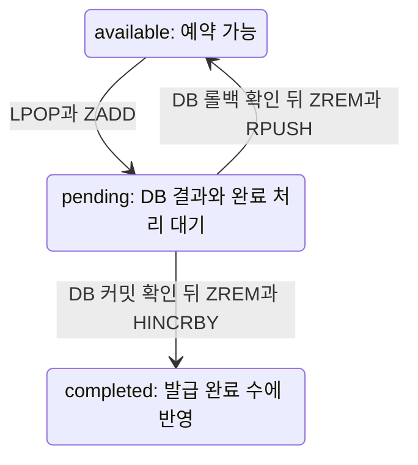
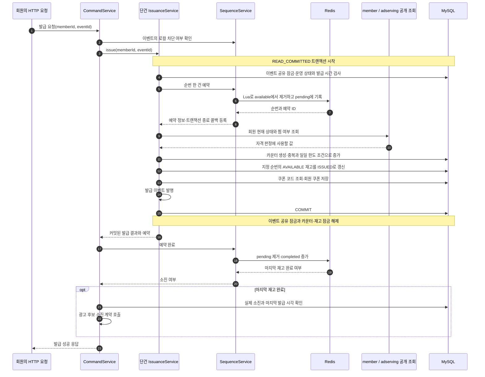
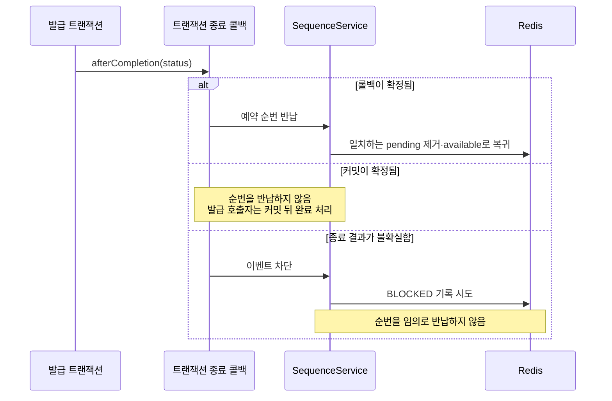
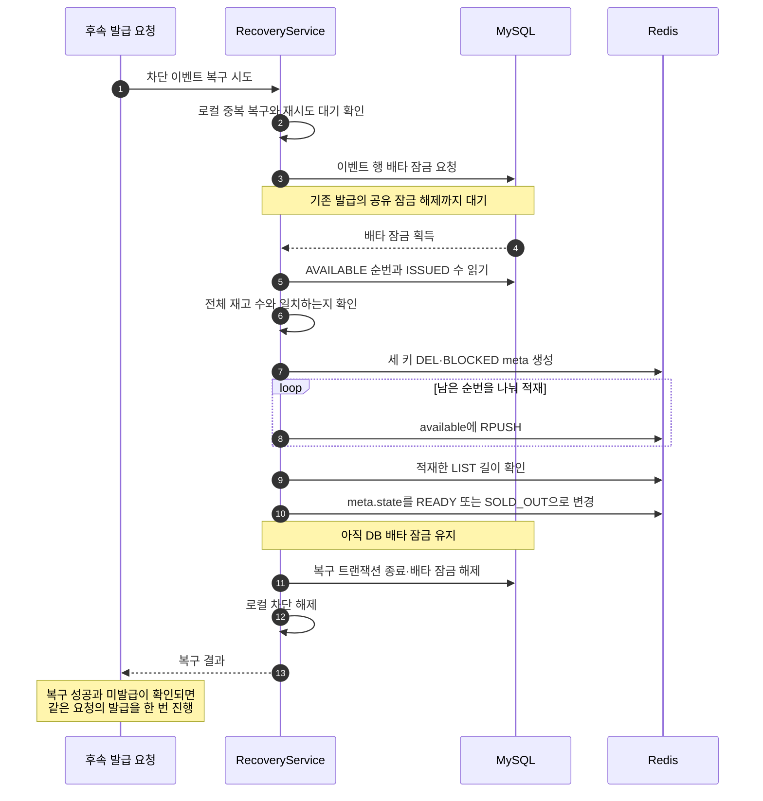
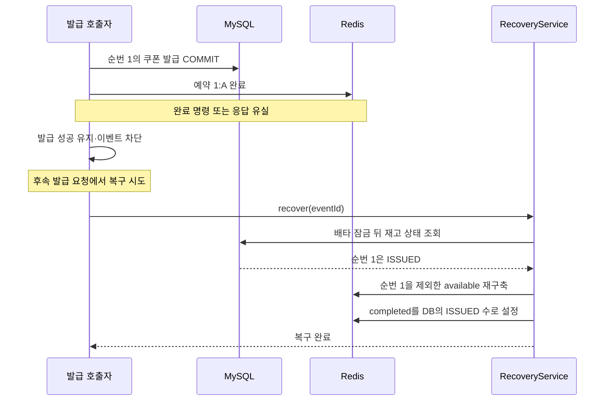

# 쿠폰 발급 v2 설계도: Redis가 재고 순번을 예약한다

v2는 요청마다 다른 재고 순번을 Redis에서 예약하고 MySQL에서 발급을 확정한다.
발급 요청 한 건이 트랜잭션 하나를 사용한다. HTTP 요청을 모으는 대기열과 묶음 작업자는 아직 없다.
이 문서는 순번 발급기를 도입한 당시의 구조를 설명한다.
키와 예약·복구의 상세는 v2에서 도입해 v3도 사용하는 공통 설계로 정리한다.
현재 공통 코드는 여러 건을 받는 `reserveAll`을 사용하며 v2의 단건 예약은 한 건을 예약하는 흐름으로 그린다.
7.1절은 복구 성공 후 같은 요청의 발급을 이어가는 조건을 설명한다.

[v1 설계도](./coupon-issuance-v1-design.md)에서 재고 선택의 책임을 분리했다.
여러 요청을 한 번에 커밋하는 구조는 [v3 설계도](./coupon-issuance-v3-design.md)다.
측정과 개선 이력은 [v2 트러블슈팅](../../troubleshooting/coupon/coupon-issuance-v2-improvement-comparison.md)에 있다.

## 1. 구성 요소와 데이터의 책임

| 구성 요소 | 책임 |
|---|---|
| `CouponCommandService` | 요청을 받아 발급을 호출한다. 차단된 이벤트의 복구와 커밋 후 소진 통보를 조정한다. |
| 당시의 `CouponIssuanceService` | 이벤트 공유 잠금을 잡고 순번 예약·자격 검사·DB 발급을 요청 한 건의 트랜잭션으로 처리한다. |
| `CouponSequenceService` | 예약 ID를 만들고 예약을 DB 트랜잭션의 종료 결과와 연결한다. 순번 상태가 불확실하면 발급을 차단한다. |
| `CouponSequenceRepository`와 Lua | 예약·완료·반납에 필요한 여러 Redis 명령을 다른 요청이 끼어들지 않는 단위로 실행한다. |
| `CouponSequenceRecoveryService` | DB에서 진행 중인 발급이 끝나기를 기다린 뒤 남은 재고로 Redis를 다시 만든다. |
| MySQL | 발급 결과의 원본을 저장한다. 지정 순번의 조건부 갱신과 회원별 한도·중복 제약을 유지한다. |

Redis는 남은 재고의 순번을 나눠 준다. Redis 예약이 성공했다고 회원에게 쿠폰이 발급된 것은 아니다.
MySQL의 재고·카운터·회원 쿠폰이 함께 커밋돼야 발급이 확정된다.

## 2. Redis 키 설계

### 2.1 이벤트 ID로 키 세 개를 묶는다

이벤트 ID가 `81`이면 다음 키를 만든다. 키 이름의 중괄호는 실제 이름에 포함한다.

| 키 | 자료형 | 역할 |
|---|---|---|
| `coupon:{81}:available` | LIST | 아직 예약하지 않은 재고의 `sequence_no`를 순서대로 저장한다. |
| `coupon:{81}:pending` | ZSET | 순번을 예약했지만 완료·반납 처리가 끝나지 않은 예약을 저장한다. |
| `coupon:{81}:meta` | HASH | 발급기 상태와 전체 재고 수, 완료한 발급 수를 저장한다. |

`coupon`은 도메인을 구분하고 `81`은 `coupon_event_id`를 가리킨다.
날짜·회원 ID·캠페인 ID를 키의 추가 구분자로 쓰지 않는다. 영업일과 캠페인은 해당 이벤트가 가진다.
예약할 재고와 복구를 조정하는 DB 잠금도 같은 이벤트에 속하므로 키의 관리 단위를 이벤트에 맞췄다.

`{81}`은 Redis Cluster의 해시 태그다. 같은 이벤트의 세 키가 같은 슬롯에 놓이게 한다.
예약·완료·반납은 여러 키를 함께 다루므로 이 세 키를 Lua 입력의 `KEYS`로 넘긴다.
모든 스크립트의 키 순서는 `available`, `pending`, `meta`다.
이 키 배치는 클러스터의 다중 키 연산 조건에 맞춘 설계이며 클러스터 장애를 실제 검증했다는 뜻은 아니다.

### 2.2 available은 예약 가능한 순번을 가진 LIST다

```text
coupon:{81}:available
["1", "2", "3"]
```

값은 DB `coupon_inventory.sequence_no`를 문자열로 바꾼 것이다.
쿠폰 코드와 회원 ID는 복제하지 않는다. 순번으로 DB의 재고 한 행을 지정하고 쿠폰 코드는 DB에서 읽는다.
복구할 때는 DB의 AVAILABLE 순번을 오름차순으로 읽어 RPUSH로 적재한다.

예약은 LPOP으로 맨 앞 순번을 꺼낸다. 두 요청이 같은 목록 원소를 함께 가져가지 못하게 한다.
확정된 롤백은 RPUSH로 맨 뒤에 순번을 돌려놓는다.
예를 들어 `1`을 예약한 뒤 반납하면 목록은 `["2", "3", "1"]`이 된다.
반납된 순번을 숫자순으로 다시 정렬하지 않으므로 순번의 오름차순과 HTTP 요청의 도착 순서를 같은 보장으로 취급하지 않는다.

단순 INCR만 사용하지 않은 이유는 실패한 발급의 순번을 다시 예약할 수 있어야 하기 때문이다.
목록은 복구 시 DB에서 남아 있는 순번만 골라 채울 수도 있다.

### 2.3 pending은 예약 ID와 예약 시각을 가진 ZSET이다

```text
coupon:{81}:pending
member = "1:550e8400-e29b-41d4-a716-446655440000"
score  = 1792458000000
```

예시의 member는 `순번:예약 UUID`이고 score는 예약한 시각의 Unix 밀리초다.
예약 시각은 애플리케이션 서버의 시계 대신 Lua 안에서 Redis TIME으로 읽는다.
ZSET의 가장 작은 score를 조회하면 오래 남은 예약 한 건을 바로 검사할 수 있다.

예약할 때마다 새 UUID를 만든다. 같은 회원의 재요청도 새 예약으로 취급한다.
Redis에는 요청의 성공 응답을 재생할 정보나 회원과 예약의 대응표를 따로 저장하지 않는다.
회원의 중복 발급 여부는 DB가 판단한다.

순번만 pending에 저장하면 과거 예약의 늦은 반납이 새 예약을 지울 수 있다.
예를 들어 `1:예약A`를 반납한 뒤 같은 순번을 `1:예약B`로 다시 예약할 수 있다.
이때 예약A의 완료·반납은 `1:예약A`만 제거할 수 있으므로 예약B를 건드리지 않는다.

pending은 DB에서 아직 커밋하지 않았다는 뜻으로 한정하지 않는다.
DB는 커밋됐지만 Redis 완료 호출이나 응답이 유실된 예약도 pending에 남을 수 있다.
따라서 예약이 오래됐다는 사실만으로 AVAILABLE로 되돌리지 않는다.

### 2.4 meta는 발급기의 상태와 수량을 가진 HASH다

```text
coupon:{81}:meta
state     = "READY"
total     = "3"
completed = "0"
expiresAt = "1792476000000"
```

| 필드 | 의미와 변경 규칙 |
|---|---|
| `state` | READY에서 새 순번을 예약하고 전량 발급을 완료하면 SOLD_OUT으로 바꾼다. 이상을 발견하거나 재구축하는 동안에는 BLOCKED로 둔다. |
| `total` | 이벤트의 전체 재고 수다. 재구축은 DB의 AVAILABLE 수와 ISSUED 수의 합으로 채운다. |
| `completed` | DB 커밋 뒤 Redis 완료까지 반영한 수다. 정상 완료가 일치하는 pending을 제거했을 때만 1 증가한다. 재구축은 DB의 ISSUED 수로 다시 맞춘다. |
| `expiresAt` | 해당 영업일의 발급 종료 시각에 보관 여유시간을 더한 Unix 밀리초다. 세 키는 같은 절대 시각에 만료하며 예약·완료·반납·차단은 만료를 연장하지 않는다. |

`completed`는 실시간 DB 발급 수와 잠시 다를 수 있다.
DB 커밋 뒤 Redis 완료 전에는 해당 순번이 아직 pending에 들어 있기 때문이다.
마지막 완료 Lua는 `completed == total`이 되는 증가와 `state = SOLD_OUT` 전환을 함께 수행한다.
DB 기준 재구축도 전량 발급을 확인했으면 SOLD_OUT으로 마친다.
SOLD_OUT에서는 available과 pending이 모두 비어 있고 completed가 total과 같아야 한다.
이전 코드가 남긴 READY와 `completed == total` 조합도 소진으로 읽으며 예약 Lua가 같은 조합을 만나면 SOLD_OUT으로 맞춘다.
소진 사전 응답과 광고 후보 통보의 실행 위치는 [API 설계](./coupon-api-design.md#찜과-소진-contract-연결)를 따른다.

### 2.5 세 키의 수량은 함께 맞아야 한다

```text
LLEN(available) + ZCARD(pending) + completed = total
0 <= completed <= total
```

예약 Lua는 READY 또는 SOLD_OUT과 오래된 pending을 확인한 뒤 위 수량을 검사한다.
정상 초기화 직후 pending은 비어 있다. 빈 목록·집합의 키가 없는 상태와 meta가 유실된 상태를 같은 의미로 처리하지 않는다.
meta가 없거나 BLOCKED이면 발급기가 준비됐다고 판단하지 않는다.
SOLD_OUT인데 completed가 total보다 작으면 정상 소진으로 응답하지 않고 복구 대상으로 삼는다.

| 상태 | 해석 |
|---|---|
| available이 남아 있다. | 다음 순번을 예약할 수 있다. |
| available은 비었고 pending이 남아 있다. | 남은 재고를 다른 요청이 처리 중이다. 소진 확정 대신 일시적 발급 불가로 응답한다. |
| completed가 total과 같다. | 전체 재고의 발급 완료를 반영했다. |
| 수량 합이 맞지 않는다. | 키 유실이나 불완전한 변경을 의심하고 차단·재구축한다. |

수량 합의 일치는 순번 내용까지 올바르다는 증명은 아니다.
Redis가 오래된 순번을 돌려주면 DB의 AVAILABLE 조건부 UPDATE가 최종적으로 막는다.
사전 소진 조회인 `availability`는 meta를 읽는다. 세 키의 수량과 오래된 예약 검사는 예약 Lua에서 수행한다.

### 2.6 TTL은 발급 종료 시각을 기준으로 설정한다

TTL은 발급이 끝난 이벤트의 Redis 데이터를 정리하기 위해 둔다.
발급 허용 여부는 DB의 이벤트 상태와 요청 시각으로 판정한다. Redis 키가 남아 있다는 이유로 종료된 이벤트의 발급을 허용하지 않는다.

```text
키 만료 시각
= 해당 이벤트 영업일의 시스템 발급 종료 시각(Asia/Seoul)
  + 진행 중인 발급과 Redis 후속 처리를 마칠 여유시간
```

발급 시간이 11~14시라면 세 키의 만료 시각은 해당 영업일의 14시에 여유시간을 더한 시각으로 맞춘다.
13시에 처음 키를 만들었다고 생성 시점부터 3시간을 더해 16시까지 보관하지 않는다.
쿠폰을 사용할 수 있는 종료 시각은 발급기의 보관 기한을 정하는 기준으로 사용하지 않는다.

| 적용할 규칙 | 이유 |
|---|---|
| available·pending·meta에 같은 절대 만료 시각을 지정한다. | 키마다 생성 시각이 달라도 같은 이벤트의 상태를 같은 보관 기한으로 정리한다. EXPIREAT 또는 PEXPIREAT로 지정한다. |
| 최초 생성과 재구축에 같은 만료 시각을 적용한다. | 장애 복구로 키를 다시 만들었다는 이유로 이벤트의 보관 기한을 연장하지 않는다. |
| 예약·반납·차단으로 키가 다시 생길 때도 같은 만료 시각을 적용한다. | 빈 LIST·ZSET이나 유실된 HASH가 재생성된 뒤 TTL 없이 남는 것을 막는다. |
| 만료 시각이 지난 이벤트의 키는 다시 만들지 않는다. | 정상적인 정리로 키가 사라진 상황을 장애로 보고 초기화·복구하는 반복을 막는다. 늦은 완료·반납·차단 처리에도 적용한다. |
| TTL 만료를 순번 반납이나 DB 발급 취소로 해석하지 않는다. | 키 정리는 DB의 커밋·롤백 결과를 변경하지 않는다. 예약 반납은 계속 DB 롤백 확정을 기준으로 한다. |

절대 만료 시각 지정은 [Redis EXPIREAT](https://redis.io/docs/latest/commands/expireat/)의 동작을 따른다.
발급 종료 직전에 접수한 요청은 종료 시각 뒤에도 처리될 수 있으므로 후속 처리를 마칠 여유시간을 둔다.
보관 여유시간은 1시간으로 정했다. `coupon.sequence.retention-grace`의 기본값이며 발급 종료가 14시면 키는 같은 영업일 15시에 만료한다.
이 값은 DB 작업을 강제로 끝내는 제한 시간이 아니다. 진행 중 발급의 취소와 종료 순서는 별도 설계를 따른다.
HTTP 응답 대기 제한만으로 DB 작업이 끝났다고 판단하지 않는다.

**코드 반영 상태:** 절대 만료 시각과 재생성 차단을 구현했다.
`rebuild.lua`는 초기화·분할 적재·정상 상태로의 전환마다 만료를 검사하고 생성한 키의 TTL을 같은 Lua 호출 안에서 설정한다.
`block.lua`는 보존 기한 안의 기존 meta만 차단한다. 키가 없으면 새 HASH를 만들지 않는다.
Redis TIME으로 이미 지난 만료 시각을 검사하므로 복구 중간에 키가 만료돼도 뒤늦은 적재가 키를 되살리지 않는다.

`coupon.sequence.stale-after`의 기본 30초는 pending의 이상을 감지하는 기준이다. 키 TTL이나 예약을 자동 반납하는 시간은 아니다.
예약 Lua가 호출될 때 가장 오래된 pending을 검사하므로 별도 타이머가 정확히 30초 뒤 복구를 시작하지 않는다.

## 3. 예약·완료·반납이 키를 바꾸는 순서



### 3.1 예약은 꺼내기와 예약 기록을 함께 수행한다

1. meta가 READY 또는 SOLD_OUT인지 확인한다.
2. 가장 오래된 pending이 `stale-after`를 넘겼는지 확인한다. 넘겼으면 BLOCKED로 바꾸고 중단한다.
3. 수량 합과 completed의 범위를 검사한다. 맞지 않으면 BLOCKED로 바꾸고 중단한다.
4. 발급 완료 수가 전체 재고 수에 닿았으면 SOLD_OUT으로 맞추고 소진을 반환한다.
5. available에서 순번을 LPOP하고 `순번:예약 UUID`를 pending에 ZADD한다.
6. 호출자에게 순번을 반환하고 DB 트랜잭션 종료 결과에 참여시킨다.

| 현재 공통 예약 Lua의 반환값 | 의미와 호출자의 처리 |
|---|---|
| 양수 | 해당 순번을 예약했다. DB 발급을 진행한다. |
| `0` | 소진으로 거절한다. |
| `-1` | 준비되지 않았거나 이상이 발견됐다. 이벤트를 차단하고 복구 대상으로 삼는다. |
| `-2` | 지금 꺼낼 순번이 없다. 일시적 발급 불가로 응답하되 이 이유만으로 전체 큐를 재구축하지 않는다. |

현재 `reserve_many.lua`는 여러 예약 ID를 받아 같은 순서의 결과를 반환한다.
v2의 단건 흐름은 한 건을 예약하는 경우이며 v3는 통과한 요청 수만큼 이 호출에 넣는다.
여러 건을 예약하다 순번이 떨어지면 앞의 성공한 예약은 유지하고 남은 요청에 `-2`를 채운다.
예약 결과의 개수가 요청 수와 다르면 호출자는 예약 상태를 확정할 수 없으므로 차단한다.

### 3.2 완료와 반납은 같은 pending을 한 번만 제거한다

| 동작 | 선행 조건 | Redis 안에서 함께 수행하는 변경 |
|---|---|---|
| 예약 완료 | DB 커밋이 확정됐다. | READY인지 검사하고 정확히 일치하는 pending을 ZREM한다. 실제로 제거했을 때만 completed를 1 늘리고 total에 도달하면 SOLD_OUT으로 함께 바꾼다. |
| 순번 반납 | DB 롤백이 확정됐다. | READY인지 검사하고 정확히 일치하는 pending을 ZREM한다. 실제로 제거했을 때만 순번을 available 끝에 RPUSH한다. |

완료 스크립트의 `1`은 이번 완료로 total에 도달했다는 뜻이다.
`0`은 정상 완료했지만 마지막 재고가 아닌 경우에도 반환한다.
SOLD_OUT이나 BLOCKED이거나 일치하는 예약이 없을 때도 `0`이므로 완료 반환값만으로 모든 누락을 구분하지 않는다.
반납 스크립트의 반환값은 실제 반납이면 `1`, 변경하지 않았으면 `0`이며 현재 Java 반납 메서드는 이 값을 사용하지 않는다.

### 3.3 재고 세 장의 변경 예시

아래의 `A`는 설명을 줄이기 위한 예약 UUID의 별칭이다.

| 시점 | available | pending | completed | total |
|---|---|---|---:|---:|
| DB에서 초기화했다. | `[1, 2, 3]` | 비어 있다. | 0 | 3 |
| A가 순번 1을 예약했다. | `[2, 3]` | `1:A` | 0 | 3 |
| DB가 커밋됐지만 Redis 완료 전이다. | `[2, 3]` | `1:A` | 0 | 3 |
| Redis 완료까지 반영했다. | `[2, 3]` | 비어 있다. | 1 | 3 |

A가 커밋 대신 롤백됐다면 available은 `[2, 3, 1]`, pending은 빈 집합, completed는 `0`이 된다.
이미 완료·반납한 A의 명령을 다시 실행해도 pending에서 A를 지우지 못하므로 수량은 다시 바뀌지 않는다.

Lua를 사용하는 이유는 이 변경 사이에 다른 Redis 요청이 끼지 못하게 하기 위해서다.
Lua 안의 일부 명령이 실패했을 때 앞선 변경까지 DB 트랜잭션처럼 롤백된다고 가정하지 않는다.
호출 오류와 수량 불일치는 예약 재실행으로 덮지 않고 차단·재구축으로 처리한다.

## 4. 정상 발급 시퀀스



공유 잠금은 같은 이벤트의 발급끼리 함께 잡을 수 있다.
재고는 Redis에서 서로 다른 순번을 받은 뒤 갱신한다. 다음 재고를 DB에서 다시 탐색하지 않는다.
회원별 카운터 잠금과 DB 재고 UPDATE의 쓰기 잠금은 여전히 필요하다.

## 5. 롤백과 커밋 결과 불명을 구분한다



MySQL과 Redis는 같은 원자적 커밋에 참여하지 않는다.
DB 커밋 여부를 모를 때 순번을 반납하면 이미 발급한 재고를 다른 요청에 다시 배정할 수 있다.
따라서 롤백 확정일 때만 반납하고 결과가 불확실하면 DB를 읽는 복구로 넘긴다.
DB 커밋 후 Redis 완료만 실패한 경우에도 발급 결과는 유지한다.

## 6. 장애 시나리오와 대응

대응의 기준은 DB가 롤백됐는지, 커밋됐는지, 결과를 모르는지다.
Redis 연결이 돌아왔거나 HTTP 요청이 끝났다는 사실은 DB 트랜잭션 결과를 대신하지 않는다.
순번 예약 불가와 복구 중 응답은 명세의 `503 COUPON-008`, 소진 확정은 `409 COUPON-006`을 따른다.
DB 오류는 `500 COMMON-001`로 전달한다. 이미 확정된 업무 거절이나 발급 성공을 후속 반납·완료 실패로 바꾸지 않는다.

### 6.1 Redis 호출이나 데이터에 문제가 생긴다

| 시나리오 | 남거나 알 수 없는 상태 | 대응 |
|---|---|---|
| 예약 전에 연결이 끊기거나 소진 조회가 실패한다. | Redis 상태를 읽을 수 없다. | 해당 이벤트를 로컬에서 차단하고 Redis에도 BLOCKED 기록을 시도한다. DB 재고 탐색 방식으로 우회 발급하지 않는다. |
| 예약 명령을 보냈지만 응답을 잃는다. | LPOP·ZADD가 이미 실행됐을 수 있다. 순번을 받지 못했어도 예약이 없다고 단정할 수 없다. | 같은 요청에서 새 순번을 계속 뽑지 않는다. 발급을 중단하고 DB 기준 복구로 pending을 정리한다. |
| 키가 처음부터 없거나 meta가 유실된다. | 정상 소진과 초기화 전 상태를 구별해야 한다. | 준비되지 않은 발급기로 보고 차단한다. 최초 초기화도 DB 기준 재구축을 사용하며 7.1절의 조건을 충족하면 현재 요청의 발급을 이어간다. |
| 일부 키가 유실되거나 자료형이 잘못된다. | 예약 시 수량 불일치나 Redis 명령 오류가 발생할 수 있다. | 이상이 검출되면 차단하고 세 키를 함께 재구축한다. 빈 available 하나만 보고 재고를 임의로 채우지 않는다. |
| pending이 오래 남는다. | DB 롤백 뒤 반납 누락, DB 커밋 뒤 완료 누락, 아직 진행 중인 작업을 구별할 수 없다. | 오래된 예약을 발견한 예약 Lua가 BLOCKED로 바꾼다. DB 작업의 종료를 확인한 뒤 재구축한다. |
| DB 커밋 뒤 완료 명령이나 완료 응답을 잃는다. | DB에는 발급된 쿠폰이 있다. Redis는 pending이 남거나 완료까지 반영된 상태일 수 있다. | 발급 성공은 유지하고 이벤트를 차단한다. 복구는 DB의 ISSUED 순번을 available에서 제외한다. |
| DB 롤백 뒤 반납 명령이나 응답을 잃는다. | DB 재고는 AVAILABLE이지만 Redis의 pending·available 상태는 불확실하다. | 원래의 거절·DB 오류를 유지하고 이벤트를 차단한다. 복구가 DB의 AVAILABLE 순번을 다시 적재한다. |
| Redis 재시작·페일오버 뒤 과거 데이터가 나타난다. | 세 키의 수량 합이 맞아도 이미 발급된 순번이 available에 있을 수 있다. | 지정 순번의 DB 조건부 UPDATE가 실패하면 차단·롤백·재구축한다. 복원본이 오래됐다는 사실을 항상 즉시 감지한다고 보장하지 않는다. |

### 6.2 MySQL의 결과에 따라 처리한다

| 시나리오 | 남거나 알 수 없는 상태 | 대응 |
|---|---|---|
| DB 커넥션을 얻지 못해 순번 예약도 시작하지 못한다. | 해당 요청이 예약한 순번은 없다. | DB 오류를 반환한다. 이 실패만으로 Redis 전체를 재구축하지 않는다. |
| v2에서 예약 뒤 자격·중복·한도 검사에 거절된다. | DB 발급은 확정되지 않았고 Redis 예약이 있다. | 트랜잭션 롤백이 확인된 뒤 순번을 반납한다. v3는 이 판정을 먼저 하므로 거절할 요청의 예약이 없다. |
| 재고나 쿠폰 저장이 실패하고 롤백이 확정된다. | 카운터·재고·회원 쿠폰은 함께 되돌아갔다. | 트랜잭션 종료 콜백이 정확히 해당 예약만 반납한다. 반납에 성공하면 전체 복구는 필요 없다. |
| 커밋 중 연결이 끊겨 종료 결과가 불명확하다. | 실패 응답 뒤에도 DB에 커밋됐을 수 있다. | 순번을 반납하지 않는다. 이벤트를 차단하고 DB 배타 잠금으로 진행 중 작업이 끝나기를 기다린다. |
| Redis 순번의 재고를 DB에서 갱신하지 못한다. | Redis와 DB가 어긋났거나 순번이 잘못됐다. | 요청을 성공 처리하지 않는다. 트랜잭션을 롤백하고 이벤트를 차단해 DB 기준으로 재구축한다. |
| 복구가 DB에 연결하지 못하거나 이벤트 배타 잠금을 얻지 못한다. | 기존 발급 결과를 확정해서 읽을 수 없다. | 차단을 유지한다. Redis만 연결됐다는 이유로 READY로 재개하지 않는다. |

### 6.3 애플리케이션이 중단되거나 늦은 요청이 도착한다

| 시나리오 | 남거나 알 수 없는 상태 | 대응 |
|---|---|---|
| 예약 뒤 프로세스가 종료된다. | Redis에 pending이 남는다. DB는 종료 시점에 따라 롤백되거나 이미 커밋됐을 수 있다. | 후속 예약이 오래된 pending을 발견하면 차단한다. DB 트랜잭션이 끝난 뒤 AVAILABLE·ISSUED를 읽어 복구한다. 요청이 없으면 감지와 복구도 진행하지 않는다. |
| DB 커밋 뒤 HTTP 성공 응답이 유실된다. | 쿠폰은 발급된 상태다. | 재요청은 DB의 중복 발급 판정에 참여한다. 같은 예약으로 성공 응답을 재생하는 멱등 응답 저장소는 두지 않는다. |
| 반납한 순번의 과거 완료·반납이 늦게 도착한다. | 같은 순번이 다른 UUID로 다시 예약됐을 수 있다. | 정확한 pending member가 없으면 변경하지 않는다. 새 예약을 지우거나 목록에 같은 순번을 다시 넣지 않는다. |
| 재구축 전 예약의 완료·반납이 늦게 도착한다. | 새 발급기는 과거 pending을 갖고 있지 않다. | 과거 예약의 명령은 일치하는 pending이 없어 무시한다. |
| 복구 프로세스가 목록을 채우다 종료된다. | meta는 BLOCKED이거나 키가 일부만 만들어졌을 수 있다. | 다음 요청이 준비되지 않은 상태를 발견하면 처음부터 다시 재구축한다. |
| 복구가 READY를 기록한 직후 프로세스가 종료된다. | Redis 목록은 채워졌지만 복구 호출자가 정상 종료를 확인하지 못했을 수 있다. | DB 잠금이 풀린 뒤 DB 조건부 갱신을 거쳐 발급한다. 필요하면 후속 요청이 다시 복구한다. |

### 6.4 차단의 범위와 복구 책임을 구분한다

`blockedEvents`는 해당 프로세스의 이벤트별 차단 목록이다.
Redis에 BLOCKED를 쓰는 것까지 실패해도 이 서버의 차단은 유지한다.
다른 서버는 자신의 로컬 차단이나 Redis 오류·BLOCKED 감지로 발급을 중단한다.
Redis 단절 순간 모든 서버에 차단이 동시에 전파된다고 가정하지 않는다.

이미 순번을 예약하고 진행 중인 DB 작업은 성공 또는 롤백까지 진행한다.
공유 잠금·조건부 UPDATE·DB 제약이 해당 작업의 경계를 지킨다.
복구는 DB 배타 잠금으로 이 작업들의 종료를 기다린다.

## 7. 복구는 DB 작업의 종료를 기다린 뒤 수행한다

### 7.1 복구를 시작하는 조건

차단을 확인하거나 순번 발급기의 이상을 만난 요청이 복구를 시도한다. 별도 복구 스케줄러는 없다.
복구가 성공하면 아래 조건을 충족하는 요청은 같은 HTTP 요청 안에서 실제 발급까지 진행한다.
요청이 없으면 오래된 예약 검사와 복구도 진행하지 않는다.

같은 서버에서는 이벤트 ID를 `recovering` 집합에 넣어 복구 시도 하나만 진행한다.
복구가 실패하면 `retryAfter`에 다음 시도 가능 시각을 기록하고 1초 동안 다시 시도하지 않는다.
이 시각은 경과 시간 비교용 `System.nanoTime`을 사용한다.
두 자료구조는 메모리 안에만 있으며 서버 사이의 조정은 DB 배타 잠금이 맡는다.
DB 잠금은 재구축을 직렬화하지만 여러 서버가 순차적으로 같은 이벤트의 복구를 시도하는 것까지 제거하지는 않는다.

**복구에 성공한 요청은 정상 발급을 한 번 더 진행할 수 있다.**

별도의 복구 스케줄러는 두지 않는다. 차단이나 이상을 발견한 요청이 복구를 시도한다.
복구 성공 자체를 발급 성공으로 반환하지 않는다. 복구 트랜잭션을 끝낸 뒤 정상 발급 경로로 다시 들어간다.
v3에서는 해당 요청 한 건을 기존 배처에 접수하며 실제 DB 발급 커밋이 확인돼야 성공을 반환한다.
실패한 묶음 전체를 다시 실행하거나 실패할 때마다 재귀 호출하지 않는다.

발급을 이어갈 수 있는 조건은 다음과 같다.

- 기존 발급 시도가 아직 없거나 해당 요청의 미발급이 확인됐다. 이미 시작한 시도가 있으면 그 시도의 트랜잭션과 결과 전달이 끝나야 한다.
- 복구 함수가 재구축과 복구 트랜잭션 종료의 성공을 `true`로 반환했다. 실패·진행 중·재시도 대기·기한 종료는 `false`로 구분한다.
- 요청 스레드가 인터럽트되지 않았고 최초 처리 기한 안에 복구와 발급을 이어갈 시간이 남아 있다.
- 같은 HTTP 요청에서는 복구 후 발급 재접수를 아직 하지 않았다. 재접수는 최대 한 번만 허용한다.

| 처음 실패한 상황 | 같은 요청의 발급을 이어갈지 |
|---|---|
| 발급 접수 전에 로컬 차단을 발견했다. | 복구 성공 후 처음으로 배처에 접수한다. |
| 키 누락·BLOCKED 등 순번 발급기 이상으로 실패했고 해당 요청의 미발급이 확인됐다. | 기존 처리 종료와 복구 성공을 확인한 뒤 해당 요청만 한 번 재접수한다. 묶음 일부가 커밋된 경우 다른 요청의 결과는 유지한다. |
| 요청별 업무 거절, 대기열 포화 또는 모든 남은 순번이 처리 중이라 예약하지 못했다. | 복구 후 재접수의 대상으로 삼지 않는다. |
| DB 연결 실패·제약 위반 또는 순번 발급기 복구와 무관한 오류가 발생했다. | 복구 성공을 이유로 DB 발급을 다시 실행하지 않는다. |
| HTTP 대기 시간 초과·취소 또는 DB 커밋 결과 불명이다. | 자동 재접수하지 않는다. HTTP 대기가 끝났다고 기존 발급 시도도 끝났다고 판단하지 않는다. |
| DB 발급은 커밋됐고 Redis 완료만 실패했다. | 발급 성공을 유지한다. 같은 요청으로 다시 발급하지 않는다. |

순번 오류는 복구할 이벤트를 `CouponException`에 기록한다. 트랜잭션 안의 오류는 `afterCompletion`에서 롤백이 확인돼야 재접수를 허용한다.
예약 거절 Outcome은 순번을 받지 못한 요청에만 복구 표시를 담으며 배처는 커밋 종료 뒤 미발급을 확인해 전달한다.
`ISSUANCE_BUSY`라는 오류 코드나 서버의 로컬 차단 여부만으로 재접수 가능 여부를 판단하지 않는다.
커밋 결과 불명인 작업은 기존 DB 기준 복구로 넘기되 이번 HTTP 요청에서 발급을 다시 시도하지 않는다.

복구 성공 여부와 요청당 한 번의 재접수로 흐름을 제한한다.
다른 요청이 이미 복구 중이거나 실패 후 재시도 대기 중이면 이번 요청은 기다리는 목록에 등록하지 않고 기존 일시적 발급 불가로 응답한다.
여러 서버가 순차로 같은 이벤트를 재구축하는 문제는 현재 DB 배타 잠금으로 안전을 유지하며 추가 조정 장치는 도입하지 않는다.
복구 함수는 재시도 대기로 건너뛰거나 다른 복구가 진행 중인 경우를 성공으로 반환하지 않는다.

복구와 발급 결과 대기는 최초 `wait-timeout`을 공유한다. 복구는 남은 시간을 트랜잭션 제한 시간으로 적용한다.
요청 시작 전, DB 잠금 뒤, Redis 재구축 전과 재접수 전에 기한을 확인한다. Redis 호출은 기존 클라이언트 제한 시간을 사용한다.
이미 실행 중인 작업의 취소와 모든 의존 호출의 대기 상한을 요청 기한에 맞추는 변경은 [v3 보완 설계](./coupon-issuance-v3-design.md#61-요청-취소와-발급-작업의-기한을-연결한다)로 남아 있다.
재접수할 때 기한을 새로 시작하지 않으며 최초 큐 접수 시각이 있으면 그대로 전달한다.
재접수한 발급은 자격·중복·한도·운영 상태를 다시 검사하므로 복구가 성공해도 소진이나 업무 거절로 끝날 수 있다.
요청이 없을 때 복구되지 않는 한계와 복구를 수행한 요청의 응답 지연을 받아들이는 대신 스케줄러와 복구 대기자 관리를 추가하지 않는다.

### 7.2 재구축의 순서와 재개 조건

이벤트 배타 잠금은 MySQL에서 해당 `coupon_event` 행을 `FOR UPDATE`로 잠그는 것이다.
일반 발급은 같은 행의 공유 잠금을 잡으므로 여러 발급은 함께 진행할 수 있다.
복구는 배타 잠금을 얻기 전에 기존 발급의 공유 잠금이 모두 풀리기를 기다린다.
배타 잠금을 보유하는 동안 새 발급과 다른 복구가 같은 행의 공유·배타 잠금을 얻지 못한다.
이 잠금으로 복구 중 DB 재고가 바뀌지 않게 한다. Redis에 별도의 분산 잠금을 잡는다는 뜻은 아니다.

1. 이벤트 행의 배타 잠금을 얻는다. 이미 시작한 발급이 공유 잠금을 해제할 때까지 기다린다.
2. DB의 AVAILABLE 순번을 오름차순으로 읽고 ISSUED 수를 센다.
3. 두 수의 합이 `coupon_event.issue_quantity`와 같은지 확인한다. 다르면 차단을 유지한다.
4. 해당 이벤트의 Redis 키 세 개를 DEL하고 meta를 BLOCKED로 만든다. total은 두 수의 합, completed는 DB의 ISSUED 수로 채운다.
5. AVAILABLE 순번을 RPUSH로 적재한다. 현재 저장소는 호출 한 번에 최대 500개씩 넣는다. 이 값은 복구 적재 단위이며 v3의 발급 묶음 크기와 별개다.
6. LIST 길이가 DB에서 읽은 AVAILABLE 수와 같은지 확인한다. 과거 pending은 복원하지 않는다.
7. Redis state를 남은 재고가 있으면 READY로, 전량 발급됐으면 SOLD_OUT으로 바꾼다. 이때까지 DB 배타 잠금을 유지해 새 발급이 공유 잠금을 먼저 얻지 못하게 한다.
8. DB 복구 트랜잭션이 끝나면 해당 서버의 로컬 차단과 복구 재시도 대기를 해제한다.

재구축 전체를 Redis Lua 한 번으로 실행하지는 않는다.
중간 상태를 정상 예약에 사용하지 못하도록 BLOCKED와 DB 배타 잠금을 함께 사용한다.
Redis 재구축 도중의 오류나 DB 트랜잭션 종료 실패는 다시 차단하는 경로로 처리한다.
Redis 정상 상태로의 전환과 DB 트랜잭션 종료가 하나의 분산 커밋으로 묶인 구조는 아니다.



위 그림은 요청 시 복구를 나타낸다. 복구 실패나 재접수 조건을 충족하지 못한 요청은 원래 오류를 반환한다.

### 7.3 커밋 뒤 완료 응답을 잃은 경우



Redis에 완료가 반영됐는지 추측해서 수량을 더하거나 빼지 않는다.
DB에 저장된 발급 상태로 세 키를 다시 만들면 응답 유실 전후 어느 상태였어도 같은 기준으로 복구할 수 있다.

## 8. 구현과 검증 범위

| 근거 | 확인할 내용 |
|---|---|
| [CouponSequenceRepository](../../../src/main/java/com/launchcatch/coupon/repository/CouponSequenceRepository.java) | 키 이름과 순서, StringRedisTemplate 사용, meta 조회와 BLOCKED 기록, 재구축 적재를 구현한다. |
| [reserve_many.lua](../../../src/main/resources/scripts/coupon/reserve_many.lua) | READY·오래된 예약·수량 검사와 순번 예약, 요청별 결과 코드를 구현한다. |
| [complete.lua](../../../src/main/resources/scripts/coupon/complete.lua), [release.lua](../../../src/main/resources/scripts/coupon/release.lua) | 예약 ID를 확인한 완료와 반납을 구현한다. |
| [CouponSequenceService](../../../src/main/java/com/launchcatch/coupon/service/CouponSequenceService.java) | 로컬 차단과 트랜잭션 종료 결과별 반납·차단을 구현한다. |
| [CouponSequenceRecoveryService](../../../src/main/java/com/launchcatch/coupon/service/CouponSequenceRecoveryService.java) | DB 배타 잠금, 수량 검증, 복구 시도 조정과 재개를 구현한다. |
| [CouponSequenceServiceTest](../../../src/test/java/com/launchcatch/coupon/service/CouponSequenceServiceTest.java) | 롤백 확정·결과 불명·예약 응답 유실·반납 실패의 분기를 검증한다. |
| [CouponIntegrationTest의 SequenceRecovery](../../../src/test/java/com/launchcatch/coupon/CouponIntegrationTest.java) | 늦은 반납과 재구축 전 예약, 완료 응답 유실과 오래된 pending, 키 유실, 진행 중 DB 작업을 기다리는 복구를 다룬다. |

현재 통합 테스트는 v3 묶음 경로에서 공통 순번·복구 코드를 호출한다.
이 테스트가 과거 v2 단건 경로를 그대로 실행한다는 뜻은 아니다.
실제 Redis 재시작·페일오버·네트워크 분리와 여러 애플리케이션 프로세스의 동시 복구는 별도 검증이 필요하다.
키에 해시 태그를 넣은 설계만으로 클러스터에서의 장애 복구 검증이 끝난 것으로 판단하지 않는다.
복구 후 같은 요청의 발급 재개와 TTL은 단위 테스트와 실제 Redis·MySQL 통합 테스트로 검증한다.
요청당 한 번의 재접수, 최초 기한·요청 시각 유지, 복구 실패·건너뛰기, 롤백·커밋 결과 불명의 구분을 검사한다.
통합 테스트는 키 유실과 오래된 예약을 복구한 요청의 실제 발급을 확인하며 절대 만료 유지와 만료 뒤 재생성 차단도 검사한다.

Redis의 동작 전제는 [공식 Cluster 해시 태그 설명](https://redis.io/docs/latest/operate/oss_and_stack/reference/cluster-spec/#hash-tags)과 [Lua 실행 설명](https://redis.io/docs/latest/develop/programmability/eval-intro/)에서 확인할 수 있다.
v3는 이 키와 복구 설계를 유지하고 예약할 요청 수와 커밋 단위, 완료 처리를 맡는 스레드를 바꾼다.
