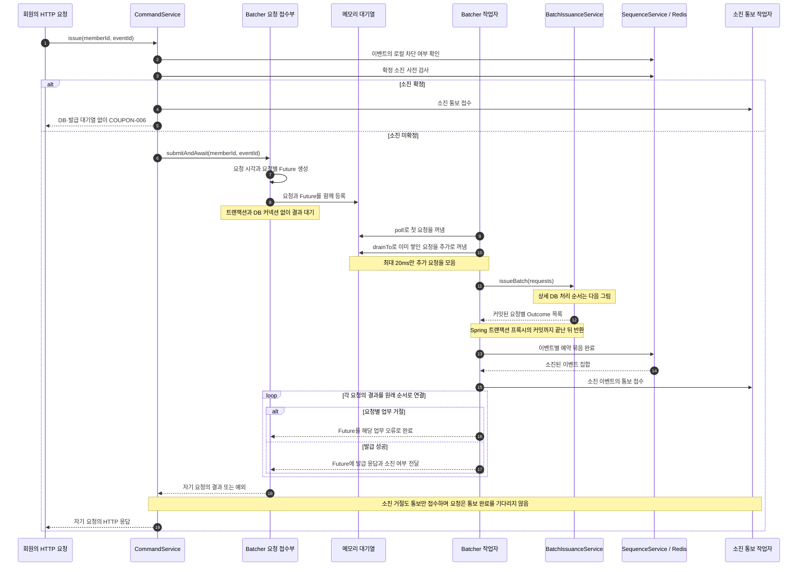
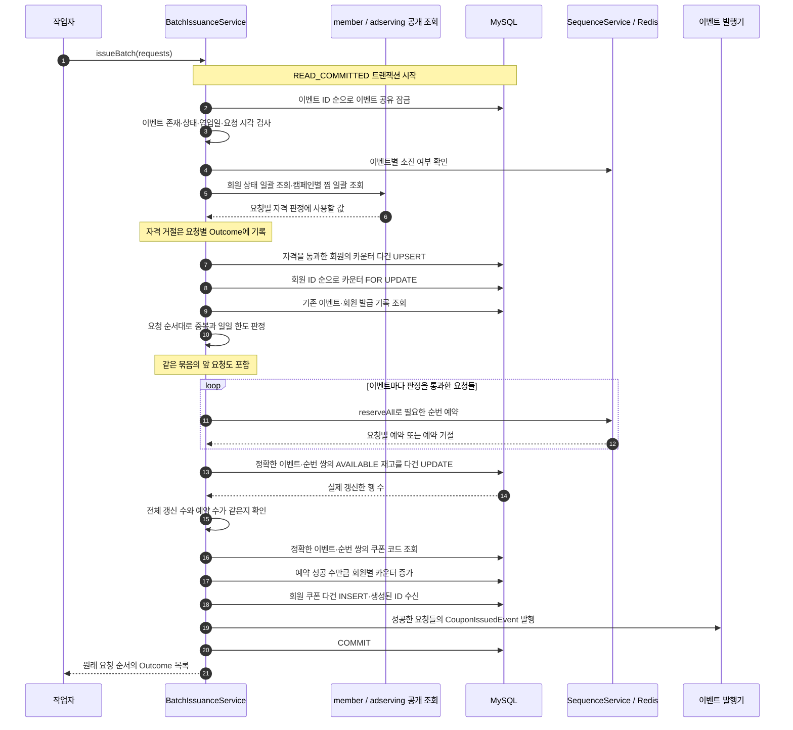
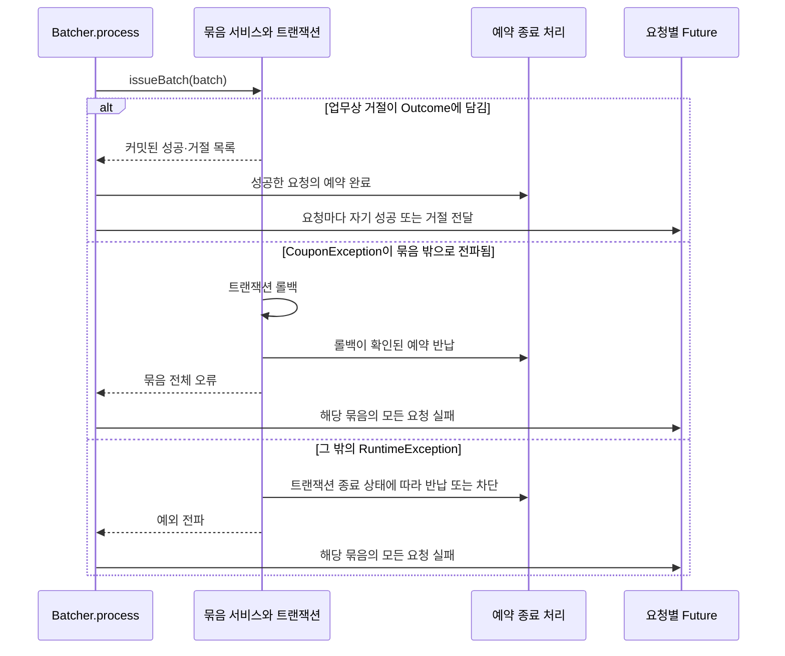

# 쿠폰 발급 v3 설계도: 작업자가 여러 요청을 한 트랜잭션으로 처리한다

v3는 HTTP 요청을 서버 메모리의 대기열에 넣고 작업자가 꺼낸 요청들을 묶어 발급한다.
Redis 순번 예약과 DB 기준 복구는 [v2 설계](./coupon-issuance-v2-design.md)를 유지한다.
바뀐 경계는 발급 트랜잭션이다. 요청 하나 대신 묶음 하나가 트랜잭션 하나를 사용한다.
HTTP 응답은 요청마다 따로 반환하며 DB 커밋 뒤에만 발급 성공을 전달한다.

이 문서는 현재 묶음 발급 코드의 구성과 실행 순서를 그린다.
6.1절은 요청 취소와 커밋 시작을 같은 상태로 판정하는 현재 구현을 설명한다.
복구에 성공한 요청이 정상 발급을 이어가는 조건은 [v2의 복구 시작 조건](./coupon-issuance-v2-design.md#71-복구를-시작하는-조건)이 갖는다.
아래 그림은 정상 발급 한 번을 나타낸다. 복구할 수 있는 미발급 오류가 나면 복구 후 같은 요청으로 한 번만 이 경로를 다시 진행한다.
설정값과 HTTP 계약은 [API 설계](./coupon-api-design.md#묶음으로-처리하는-쿠폰-발급), [발급 명세](../../api-spec/coupon-api-spec.md#쿠폰-발급)를 따른다.
대표 부하 측정 결과와 측정본의 범위는 [쿠폰 v3 부하 시험 결과](../../troubleshooting/coupon/coupon-load-test-results.md)에 있다.

## 1. 클래스와 스레드의 책임

| 구성 요소 | 실행 위치와 책임 |
|---|---|
| `CouponCommandService.issue` | 요청 스레드에서 Redis 확정 소진을 먼저 검사하고 소진이면 DB와 발급 대기열 없이 거절한다. 차단 복구와 소진 통보 접수도 조정하며 `Propagation.NEVER`로 호출자의 트랜잭션 안에서 대기하지 못하게 한다. |
| `CouponIssueBatcher.submitAndAwait` | 요청 정보와 결과 통로인 Future를 대기열에 넣고 자기 결과를 기다린다. DB 커넥션을 잡지 않는다. |
| `CouponIssueBatcher.runWorker` | 별도 작업자 스레드에서 첫 요청과 이미 쌓인 요청을 꺼내 묶음을 만든다. |
| `CouponIssueBatcher.process` | 묶음 서비스를 호출하고 커밋 후 Redis 예약을 완료한다. 각 요청의 Future에 결과를 전달한다. |
| `CouponBatchIssuanceService.issueBatch` | 묶음 하나의 자격·중복·한도를 판정하고 재고·카운터·회원 쿠폰을 한 트랜잭션으로 저장한다. |
| `CouponBatchIssueRepository` | 여러 행을 다루는 SQL을 실행한다. JdbcTemplate은 서비스의 Spring 트랜잭션과 같은 커넥션을 사용한다. |
| `CouponSoldOutNotificationService` | 별도 작업자 하나가 소진 통보를 처리한다. 중복 접수와 실패 재시도의 기준은 [API 설계](./coupon-api-design.md#찜과-소진-contract-연결)를 따른다. |

작업자 수는 동시에 실행할 발급 묶음 수를 정한다. DB 커넥션 풀의 크기와 별도 설정이다.
이 제한은 묶음 발급 경로에 적용하며 쿠폰 조회·사용·복구까지 같은 수로 제한하지 않는다.

## 2. 요청 접수부터 응답까지의 시퀀스

서비스를 배처와 별도 빈으로 둔 이유는 트랜잭션 프록시를 거쳐 묶음마다 커밋하게 하기 위해서다.
대기열에서 결과를 기다리는 구간과 DB 트랜잭션 구간을 같은 메서드의 트랜잭션으로 묶지 않는다.
`issueBatch`가 결과 객체를 만들었다는 사실만으로 Future를 성공 처리하지 않는다. 호출이 커밋까지 마쳐야 한다.

## 3. 묶음 트랜잭션 내부의 시퀀스

Redis 예약은 자격·중복·한도 판정 뒤에 둔다. 거절할 요청이 순번을 먼저 차지하지 않게 하기 위해서다.
다건 재고 갱신의 행 수가 예약 수와 다르면 상태가 어긋난 것으로 보고 관련 이벤트를 모두 차단한다.
이 경우 묶음 전체를 롤백한다. 일부 재고만 바뀐 상태로 커밋하지 않는다.

회원 상태는 `findCurrentStatuses`로 묶음당 한 번 조회하고 찜은 기존 공개 계약인 `findWishedMemberIds`로 캠페인당 한 번 조회한다.
반환되지 않은 회원은 ACTIVE로 취급하지 않으며 반환된 찜 집합에 없는 회원은 찜 자격을 거절한다.
공개 계약의 입력 상한은 [API 설계](./coupon-api-design.md#트랜잭션과-잠금)를 따른다.
다른 도메인의 내부 테이블을 JOIN해 공개 계약을 우회하지 않는다.

## 4. 같은 묶음과 서로 다른 묶음의 동시성을 나눠 제어한다

| 고려한 상황 | 설계 |
|---|---|
| 서로 다른 묶음이 같은 회원을 발급한다. | 회원·영업일 카운터를 잠근 뒤 기존 발급 기록을 읽는다. 앞 트랜잭션이 확정한 횟수와 쿠폰을 반영한다. |
| 여러 회원을 한 번에 잠근다. | 카운터는 회원 ID 순으로 처리하고 잠금 조회의 인덱스를 고정한다. 작업자마다 잠금 순서가 달라지는 것을 줄인다. |
| 여러 이벤트를 한 번에 처리한다. | 이벤트 ID 순으로 공유 잠금을 잡는다. 복구와 운영 상태 변경은 공유 잠금이 해제되기를 기다린다. |
| 한 묶음에 같은 회원의 같은 이벤트 요청이 둘 있다. | 기존 발급 쌍에 앞 요청의 쌍을 추가하면서 순서대로 판정한다. 같은 묶음 안의 중복도 거절한다. |
| 한 묶음에서 같은 회원이 서로 다른 이벤트를 요청한다. | DB 횟수에 앞 요청의 발급 예정 수를 더해 일일 한도를 판정한다. |
| 판정을 통과했지만 순번 예약에 실패한다. | 실패한 요청은 실제 카운터 증가와 쿠폰 저장에서 제외한다. 같은 회원의 뒤 요청에 대해 앞선 한도 판정을 다시 배정하지는 않는다. |

회원 쿠폰 INSERT의 생성 키는 저장한 순서대로 받는다.
거절한 요청의 위치를 제외한 인덱스를 따로 보관해 생성된 쿠폰 ID를 원래 요청의 Outcome에 연결한다.
다른 요청의 쿠폰 ID가 전달되지 않도록 입력과 결과의 순서를 유지한다.
DB의 UNIQUE·CHECK도 최종 방어선으로 유지한다.

대기열의 꺼내기 순서와 발급 완료 순서는 다르다.
여러 작업자의 DB 잠금 대기와 실행 순서가 달라질 수 있으므로 전역 HTTP 도착 순서와 커밋 순서의 일치는 보장하지 않는다.

## 5. 요청별 거절과 묶음 실패를 구분한다

중복·일일 한도·찜 같은 요청별 거절은 Outcome으로 전달하므로 다른 요청의 발급을 막지 않는다.
반면 Redis 초기화 실패나 재고 불일치처럼 예외로 전파되는 오류는 같은 묶음의 다른 이벤트에도 영향을 줄 수 있다.
작업자는 실패한 묶음을 나누거나 자동으로 재시도하지 않는다. 묶음의 모든 요청에 원래 오류를 전달한다.
요청별 업무 거절과 묶음 전체 실패의 구분은 유지한다.
자동 재시도를 다시 추가할 때의 조건과 상한은 [장애 처리 설계](./coupon_장애_처리_설계.md#발급-묶음의-자동-재시도)가 갖는다.
불확실한 커밋 결과의 순번을 무조건 반납하지 않는 원칙은 v2와 같다.

## 6. 대기열과 요청 수명

다음 표는 현재 코드의 동작이다. 복구와 결과 대기는 최초 처리 기한을 공유한다.
실행 중인 발급의 취소와 커밋 경쟁은 6.1절의 판정을 따른다.

| 고려한 상황 | 설계 |
|---|---|
| 요청이 적어 묶음 상한까지 차지 않는다. | 최대 20ms 더 모으며 가장 이른 요청 기한에 닿으면 먼저 처리한다. 한 건짜리 묶음도 커밋한다. |
| 대기열이 가득 찬다. | 접수를 기다리게 하지 않고 현재 명세의 일시적 발급 불가로 거절한다. |
| 대기 중 발급 종료 시각을 지난다. | 큐 접수 시각을 요청에 보관해 시스템 발급 시간 판정에 사용한다. 영업일과 운영 상태도 처리 시 검사한다. |
| HTTP 결과 대기가 먼저 끝난다. | 커밋 전이면 취소를 공유하고 묶음을 롤백한다. 커밋 시작 뒤에는 실제 결과를 기다린다. |
| 요청 스레드가 끝난 뒤 DB가 커밋된다. | 작업자가 Redis 완료까지 맡는다. 요청 스레드가 사라져도 pending이 남지 않도록 한다. |
| 서버 프로세스가 종료된다. | 대기열은 영속적이지 않다. 아직 DB 작업을 시작하지 않은 접수는 유실될 수 있다. 남은 Redis 예약은 DB 기준 복구에 참여한다. |
| Redis 완료만 실패한다. | 이미 커밋한 발급을 유지하고 해당 이벤트를 차단한다. 이후 DB 기준으로 재구축한다. |

예약과 메모리 대기열은 별개의 수명이다. 대기열에 넣을 때 Redis 순번을 미리 예약하지 않는다.
소진 통보는 커밋과 예약 완료 뒤 DB의 실제 소진을 확인해 수행한다.
분석 이벤트도 커밋 뒤 수신하며 후속 반영의 실패로 발급을 롤백하지 않는다.
종료·장애별 세부 처리는 [장애 처리 설계](./coupon_장애_처리_설계.md)가 갖는다.

### 6.1 요청 취소와 발급 작업의 기한을 연결한다

`CouponBatchDeadline`은 취소와 커밋 시작을 같은 잠금으로 판정한다. 대기열의 요청도 취소 표시를 공유한다.
여기서 요청은 회원이 보낸 쿠폰 발급 HTTP 요청 한 건과 그 요청에 대응하는 배처 작업 한 건을 뜻한다.

발급 조정 메서드에 진입할 때 요청별 처리 기한과 취소 상태를 만든다. HTTP 결과 대기와 복구·발급 작업자가 같은 상태를 참조한다.
처리 기한은 기존 `coupon.issue.batch.wait-timeout`을 사용하며 복구와 대기열에서 보낸 시간도 포함한다.
남은 시간은 단조 증가 시계로 계산한다. 발급 가능 시간의 업무 판정에 쓰는 `requestTime`과 구분한다.
작업자는 요청을 꺼내거나 복구 후 재접수했다고 처리 기한을 새로 시작하지 않는다.
업무 판정의 `requestTime`은 발급 조정자가 최초로 접수한 시각을 유지한다. 발급 대기열에서 기다리거나 복구해도 시각을 바꾸지 않는다.

| 취소하거나 기한이 끝나는 시점 | 처리 |
|---|---|
| 대기열에 있거나 작업자가 꺼냈지만 묶음 처리를 시작하기 전이다. | 요청을 취소 상태로 바꾸고 대기열에서 제거한다. 작업자가 이미 꺼냈으면 묶음에서 제외한다. Redis 예약과 DB 쓰기를 시작하지 않는다. |
| 묶음 트랜잭션이 실행 중이며 커밋 시작 전이다. | 작업자가 취소를 확인하면 묶음 전체를 롤백한다. 롤백이 확인된 예약만 반납한다. |
| 커밋이 이미 시작됐다. | 취소만으로 롤백됐다고 판단하지 않는다. 실제 트랜잭션 종료 결과에 따라 완료·반납·차단한다. |
| DB 커밋이 확인됐다. | 발급을 유지한다. HTTP 대기가 끝났어도 작업자가 Redis 완료를 수행한다. |

대기 요청의 취소와 작업자의 처리 시작은 같은 상태 전이로 경쟁하게 한다.
취소가 먼저 확정된 요청을 작업자가 나중에 실행하지 못하게 한다.
HTTP 대기 시간 초과와 요청 스레드의 인터럽트가 이 취소 상태를 갱신한다.
클라이언트가 연결을 끊었다는 사실은 동기 HTTP 처리 중 즉시 감지되지 않을 수 있으므로 처리 기한도 함께 사용한다.
`CompletableFuture.cancel`만 호출하는 방법은 채택하지 않는다. 결과 통로의 취소와 별도로 작업자가 취소 상태를 확인해야 한다.

묶음 시작 전에 취소·만료 요청을 제외하고 남은 요청 중 가장 이른 기한을 묶음의 처리 기한으로 삼는다.
작업자는 트랜잭션 시작 전, 잠금·공개 조회 뒤, Redis 예약 전후, DB 쓰기 사이와 커밋 직전에 기한과 취소를 확인한다.
실행 중 한 요청의 취소도 같은 트랜잭션에 참여한 다른 요청을 롤백시킬 수 있다.
개별 요청의 쓰기만 되돌리는 방식은 채택하지 않는다. v3의 묶음 단위 원자성을 유지하는 대신 이 영향 범위를 받아들인다.

DB 커넥션 획득·잠금·쿼리와 Redis 호출에는 기존 의존 대상별 대기 상한을 유지한다. 요청 기한은 작업 경계와 커밋 직전에 별도로 검사한다.
트랜잭션 제한 시간만으로 모든 대기를 끊을 수 있다고 가정하지 않는다.
드라이버가 취소를 반영하는 동안 기한을 넘길 수 있으며 실행 중인 Java 스레드를 강제로 종료하지 않는다.
beforeCommit에서 커밋 시작을 표시한 뒤에는 취소 실패로 응답하지 않고 실제 결과를 기다린다. 따라서 커밋이나 정리 중에는 최초 처리 기한을 넘길 수 있다.
커밋 결과 불명일 때는 순번을 반납하지 않고 [DB 기준 복구](./coupon-issuance-v2-design.md#7-복구는-db-작업의-종료를-기다린-뒤-수행한다)로 확정한다.

취소된 Future에 성공을 다시 전달하지 않더라도 커밋 뒤 Redis 완료와 롤백 뒤 반납은 생략하지 않는다.
이 정리 작업은 만료된 요청의 기한과 별도로 제한 시간을 둔다. 정리에 실패하면 이벤트를 차단하고 복구로 넘긴다.
Redis 명령 제한 시간은 기존 1초이며 완료가 실패하면 차단을 시도한다. DB·Redis 호출 자체가 멈추는 시점은 드라이버 제한 시간에 따르며 취소 표시로 강제 중단하지 않는다.
커밋 전 기한 만료는 `503 COUPON-008`로 반환한다. 커밋 시작 뒤에는 실제 트랜잭션 결과를 반환한다. 별도의 취소 성공 응답이나 결과 조회 API는 추가하지 않는다.

구현 검증은 대기열 취소, 꺼내기와 취소의 경쟁, 예약 후 취소의 묶음 롤백, 커밋과 취소의 경쟁을 포함한다.
HTTP 대기 종료 뒤에도 완료·반납이 수행되는지와 커밋 결과 불명일 때 재발급하지 않는지도 확인한다.
배포 중 같은 취소 상태를 사용하는 순서는 [발급 작업자의 종료](./coupon_장애_처리_설계.md#발급-작업자의-종료)가 갖는다.

## 7. 구현과 설계도의 대응

- [CouponIssueBatcher](../../../src/main/java/com/launchcatch/coupon/service/CouponIssueBatcher.java)는 접수·묶음 구성·예약 완료·결과 전달을 구현한다.
- [CouponBatchIssuanceService](../../../src/main/java/com/launchcatch/coupon/service/CouponBatchIssuanceService.java)는 묶음의 판정 순서와 DB 트랜잭션을 구현한다.
- [CouponBatchIssueRepository](../../../src/main/java/com/launchcatch/coupon/repository/CouponBatchIssueRepository.java)는 잠금 조회와 다건 쓰기를 구현한다.
- [발급 전달값](./coupon_구조와_동작_설계.md#발급과-예약의-전달값)은 요청·예약·판정·최종 결과의 데이터 구조를 정의한다.

## 8. 후속 검토 항목

| 항목 | 검토 상태 |
|---|---|
| 대기 시간이 끝난 요청의 취소 | 6.1절의 취소·커밋 경쟁을 구현했다. 검증 결과는 이번 위험 보완 기록에 남긴다. |
| Redis 예약의 다건 완료 | 이벤트별로 예약 UUID를 확인해 Lua 한 번에 완료한다. 다른 이벤트의 완료와 응답은 별도 가상 스레드에서 진행한다. |
| 예약 실패 뒤 일일 한도 재배정 | 나중에 검토한다. 현재 판정 순서를 유지한다. |
| 발급이 몰릴 때 다른 API 보호 | Tomcat의 200개 작업자 제한과 기존 동기 응답을 유지한다. 발급 결과를 기다리는 HTTP 요청도 작업자를 점유한다. |

## 로컬 부하 시험 뒤 반영한 발급 경로

예약할 재고가 없지만 다른 요청의 예약이 남았으면 즉시 혼잡 응답을 주지 않는다.
발급 묶음의 트랜잭션이 끝난 뒤 별도 작업자가 대기 요청을 이벤트별로 모아 10ms 간격으로 상태를 확인한다.
소진이 확정되면 대기 요청을 소진으로 끝내고 재고가 반납되면 원래 요청 시각과 처리 기한으로 다시 접수한다.
대기열·예약 대기·실행·Redis 후처리를 합친 요청 수가 접수 상한을 넘지 않게 한다. 롤백이나 정리가 끝날 때 접수 허용량을 반납한다.
예약 조회는 이벤트마다 하나씩만 진행하며 다른 이벤트의 Redis 대기를 직렬로 기다리지 않는다. DB 연결과 발급 작업자 네 개를 점유하지 않는다.

찜은 기존 공개 계약으로 캠페인별 회원 집합을 조회하며 다른 도메인의 저장소를 직접 호출하지 않는다.
재고 갱신과 코드 조회도 정확한 이벤트·순번 쌍으로 각각 한 SQL을 사용한다.
전체 갱신 수가 예약 수와 다르면 관련 이벤트를 모두 차단하고 묶음을 롤백한다.

대기열에서 꺼낸 뒤 아직 발급을 시작하지 않은 만료 요청은 제외한다.
실행 중인 요청도 6.1절의 취소·커밋 판정을 따른다.

DB 커밋 후 예약 완료도 이벤트별로 묶어 Lua 한 번에 처리한다.
이미 완료한 예약은 다시 세지 않으며 Redis 실패 시에도 DB 발급 성공은 유지하고 복구를 요청한다.

Tomcat은 기본 실행기와 `server.tomcat.threads.max=200`을 유지한다.
HTTP 컨트롤러는 기존 동기 응답을 사용하며 요청 스레드가 발급 결과를 기다린다.
공통 로깅 필터와 보안 설정을 변경하지 않으며 별도의 ASYNC 디스패치도 사용하지 않는다.

발급 조정자와 배처는 각각 `queue-capacity`의 상한을 지킨다.
발급 조정자의 상한에 닿아도 확정 소진은 Redis로 확인해 혼잡 응답보다 먼저 반환한다.
발급 조정자는 확정 소진을 검사한 뒤 배처에 바로 접수한다. 별도의 200건 허용량으로 묶음 크기를 제한하지 않는다. 배처의 전체 미완료 상한 2,000건, 작업자 4개와 묶음 상한 500건을 유지한다.
발급 조정자에서 정한 요청 시각과 최초 10초 기한은 작업자를 거치거나 재접수해도 바꾸지 않는다.
HTTP 연결 종료가 작업자에게 즉시 전달된다고 가정하지 않으며 커밋 전 기한 검사와 커밋 시작 뒤 정리를 유지한다.
쿠폰 전용 메트릭은 추가하지 않으며 Tomcat의 busy 작업자 지표도 기존 의미를 유지한다.

예약 대기용 Lua도 reserve_many와 같은 `stale-after`를 사용한다.
기다리는 사이 가장 오래된 예약이 기준을 넘으면 BLOCKED로 바꾸고 복구가 필요한 결과를 반환한다.
발급 조정자는 남은 원래 기한 안에서 DB 기준 복구와 한 번의 재접수를 수행한다.

### 여러 이벤트의 Redis 왕복을 함께 기다린다

발급 트랜잭션 안의 소진 조회와 순번 예약은 이벤트별 명령을 파이프라인으로 보낸다. 각 이벤트의 예약은 기존 Lua 한 번으로 원자적으로 처리하며 여러 이벤트를 하나의 원자적 작업으로 묶지 않는다. HTTP 사전 소진 검사는 기존처럼 요청마다 Redis를 읽는다.

파이프라인은 기존 Redis 연결 설정을 사용한다. 연결 풀 의존성과 공통 설정은 이번 변경에 포함하지 않는다. 명령과 연결 생성의 기존 1초 제한은 유지한다.

응답 순서와 이벤트·예약 수가 맞는지 모두 확인한 뒤 결과를 사용한다. 예약 명령 중 일부만 실행됐을 수 있는 오류는 관련 이벤트 전부를 로컬에서 먼저 차단한다. Redis 차단도 파이프라인 한 번으로 시도해 장애 시 대기 상한이 이벤트 수만큼 늘어나지 않게 한다. 이후 DB 기준 복구 절차를 따른다. 정상 결과의 예약 UUID 확인, 커밋 후 완료와 롤백 후 반납은 기존 방식으로 유지한다.

요청을 모으는 시간은 최대 20ms다. 작은 묶음이 반복해서 자격 조회와 트랜잭션을 만드는 비용을 줄인다. 묶음 상한이나 가장 빠른 요청 기한에 먼저 닿으면 기다리지 않고 처리한다.
