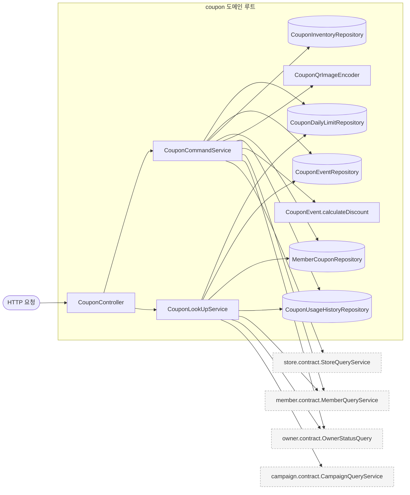
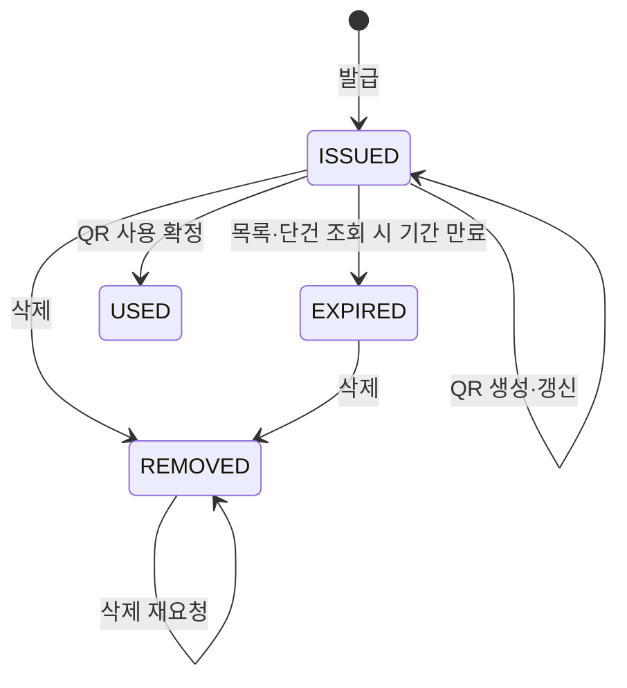
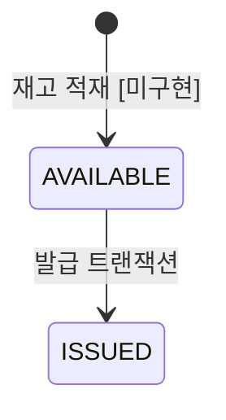
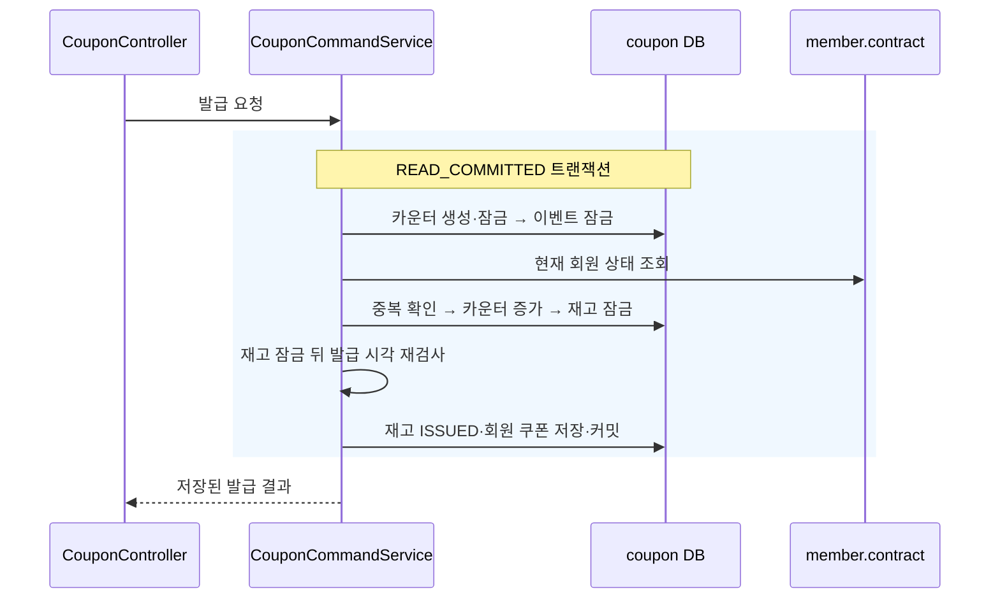
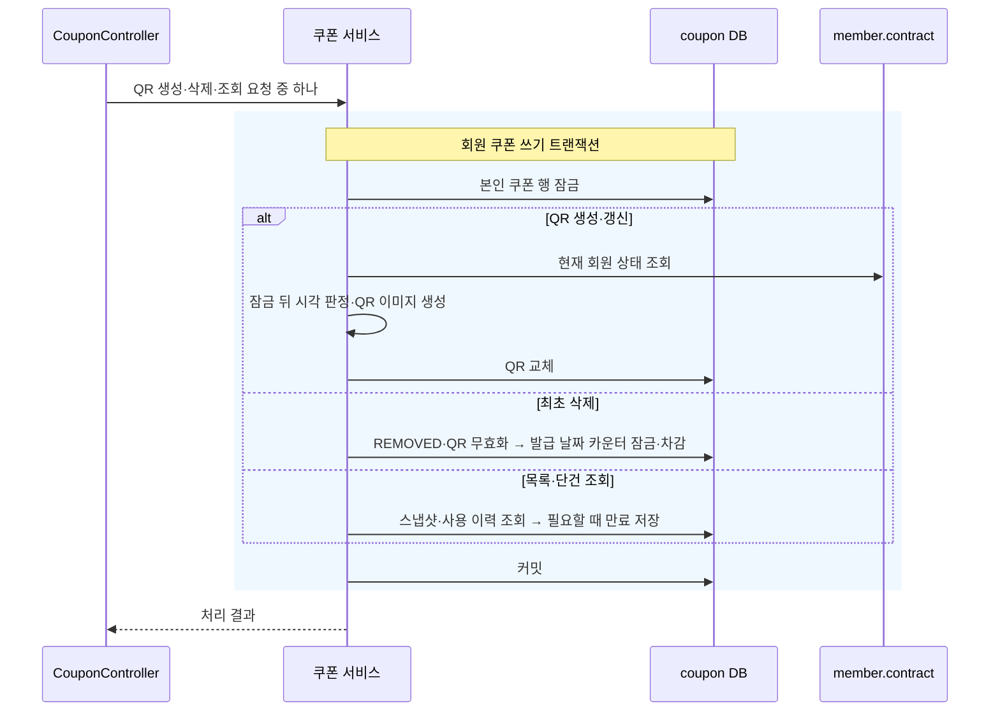

# coupon 구조와 동작 설계

이 문서는 쿠폰 도메인의 현재 구현과 여러 API가 공유하는 설계를 갖는다.
엔드포인트별 계약과 흐름은 [쿠폰 명세](../../api-spec/coupon-api-spec.md)와 [API 설계](./coupon-api-design.md)가 갖는다.
QR 사용 정책은 API 설계의 [QR 사용 구현 전 확정 사항](./coupon-api-design.md#qr-사용-구현-전-확정-사항)을 따른다. HTTP 명세와 QR 사용 코드에 반영했다.

## 1. 범위

| 구분 | 내용 |
|---|---|
| 현재 구현 | 선착순 발급, 당일 발급 한도와 누적 통계 조회, 목록·단건 조회와 조회 시 만료 저장, 미사용 쿠폰 삭제, QR 생성·갱신·사용 확정, 매장 사용 이력과 오늘 이벤트 상태 조회, 발급·사용 퍼널 이벤트 발행과 분석용 쿠폰 집계 조회를 처리한다 |
| 후속 구현 | 이벤트·재고 생성과 캠페인 이벤트 수신, 오픈·만료 배치의 이벤트 발행을 연결한다 |
| 다른 도메인의 소유 | 캠페인 할인 조건은 campaign, 현재 매장 관리 권한은 store, 계정 상태는 member·owner, 찜과 광고 후보는 adserving, 통계 집계는 analytics가 소유한다 |

데이터 소유와 의존 방향의 근거는 [도메인 설계 1.2와 2장](../../architecture/런치캐치_도메인_구조와_의존성_설계.md)이다.
coupon은 다른 도메인의 내부 엔티티와 저장소를 읽지 않는다.

## 2. 애그리거트와 패키지

현재 코드는 도메인 루트에서 발급과 회원 쿠폰을 함께 조정한다. 하위 애그리거트 패키지는 나누지 않았다.
아래 표는 현재 저장과 변경의 묶음이며 별도 서비스나 독립된 트랜잭션으로 분리했다는 뜻은 아니다.

| 묶음 | 테이블 | 지키는 규칙 |
|---|---|---|
| 발급 회차와 재고 | `coupon_event`, `coupon_inventory` | 같은 회차의 재고를 순번으로 소비하고 쿠폰 코드 한 개를 한 번만 발급한다 |
| 회원의 일일 한도 | `coupon_daily_limit` | 회원과 영업일마다 카운터 한 행을 갖고 발급·삭제 때 횟수 변경을 잃지 않는다 |
| 회원 쿠폰과 사용 결과 | `member_coupon`, `coupon_usage_history` | 상태 변경과 사용 이력을 같은 트랜잭션으로 확정하고 저장한 할인액을 조회한다 |

현재 발급은 카운터·재고·회원 쿠폰을 한 트랜잭션으로 바꾼다.
이 경계의 근거는 [MySQL 발급 v1](./coupon-api-design.md#mysql-쿠폰-발급-v1)이며 이번 문서 작업에서 경계를 바꾸지 않는다.

| 선택지 | 장점 | 단점 |
|---|---|---|
| 현재 MySQL 트랜잭션을 유지한다 | 실패한 발급이 카운터나 재고를 소비하지 않는다 | 같은 회차의 발급은 이벤트 행 잠금에 대기한다 |
| 재고 예약과 발급을 나눈다 | 이벤트 행에 대한 경쟁을 줄일 여지가 있다 | 예약 만료와 보상 처리가 필요하며 현재 구현에 없다 |

현재 구현은 첫 번째 방식을 쓴다. 부하 목표 충족 여부는 11장에서 구분한다.

```text
coupon/
├── contract/      CouponStatsQueryService, 집계 결과와 오픈·발급·사용·만료 이벤트 record
├── CouponListFilter.java
├── CouponQrImageEncoder.java
├── config/        CouponSecurityConfig, CouponOpenApiConfig
├── controller/    CouponController
├── dto/           요청·응답 record와 입력 변환
├── entity/        CouponEvent, CouponInventory, CouponDailyLimit,
│                  MemberCoupon, CouponUsageHistory
├── repository/    각 엔티티 저장소와 목록용 Querydsl 구현
├── service/       CouponCommandService, CouponLookUpService, CouponStatsQueryServiceImpl
└── exception/     CouponException, CouponErrorCode
```

엔티티는 다른 엔티티를 객체 연관으로 쥐지 않고 ID로 참조한다.
HTTP 요청과 집계 조회 contract, 공개 이벤트가 연결되어 있다. `job/`과 캠페인 이벤트를 받는 `listener/`는 아직 없다.

### 규칙을 두는 곳

| 규칙 | 현재 자리 |
|---|---|
| QR 교체, 사용·삭제·만료 전이 | `MemberCoupon`이 자기 상태와 사용 시간을 검사한다 |
| 재고 소비와 카운터 증감 | `CouponInventory`, `CouponDailyLimit`이 자기 값의 불변식을 지킨다 |
| 상태와 사용 가능 여부, 이벤트 발급 불가 사유 | `CouponLookUpService`가 시각과 조회 결과를 조합한다 |
| 다른 도메인 조회, 잠금 순서와 트랜잭션 | 명령·조회 서비스가 조정한다 |
| 메뉴 한 개의 할인액 | CouponEvent가 자기 스냅샷으로 계산하며 저장된 값을 변경하지 않는다 |
| QR 이미지 변환 | `CouponQrImageEncoder`가 UUID를 PNG와 Base64로 변환한다 |

## 3. 저장

스키마의 기준은 [V1](../../../src/main/resources/db/migration/coupon/V1__coupon_init.sql)부터 [V5](../../../src/main/resources/db/migration/coupon/V5__coupon_inventory_available_index.sql)까지의 쿠폰 마이그레이션이다.

| 대상 | DB가 막는 것 | 코드가 담당하는 것 |
|---|---|---|
| 일일 카운터 | 회원·영업일 UNIQUE와 0~3 CHECK를 둔다 | 행 잠금 아래 설정된 일일 한도와 증감을 검사한다 |
| 이벤트 | 캠페인·영업일 UNIQUE, 할인 조합과 메뉴 스냅샷 CHECK를 둔다 | 조회 대상 매장·영업일에 이벤트가 둘이면 대표를 고르지 않고 정합성 오류를 낸다 |
| 재고 | 이벤트·순번 UNIQUE와 쿠폰 코드 UNIQUE를 둔다 | AVAILABLE만 순번으로 잠가 ISSUED로 바꾼다 |
| 회원 쿠폰 | 이벤트·회원 UNIQUE와 쿠폰 코드 UNIQUE를 둔다 | 삭제한 쿠폰도 재발급을 막고 행 잠금으로 상태 전이를 조정한다 |
| 사용 이력 | 회원 쿠폰에 대한 FK를 둔다. 현재 회원 쿠폰 ID 인덱스는 UNIQUE가 아니다 | 사용 확정은 회원 쿠폰 행 잠금 아래 이력을 한 번만 저장한다 |

설정만으로 일일 한도를 3보다 크게 올릴 수 없다. 카운터 CHECK도 함께 바꿔야 한다.
현재 coupon은 Valkey와 별도 인메모리 원본·캐시를 쓰지 않는다.

### 이벤트 스냅샷

`coupon_event`에 스냅샷 컬럼을 직접 둔다. 같은 이벤트에서 발급된 쿠폰은 `coupon_event_id`로 같은 스냅샷을 공유한다.
별도 스냅샷 테이블이나 회원별 사본은 두지 않는다.

| 스냅샷 대상 | 컬럼 |
|---|---|
| 사용 매장 | `store_id`, `store_name` |
| 대표 이미지 | `store_image_url`에 최대 512자의 URL을 저장하며 없으면 NULL이다 |
| 할인 조건 | `discount_target_type`, `discount_type`, `discount_value` |
| 대상 메뉴 | `target_menu_id`, `target_menu_name`, `target_menu_price`, `target_menu_discounted_price` |
| 사용 가능 시간 | `usable_start_at`, `usable_end_at` |

MENU이면 메뉴 네 컬럼을 모두 채우고 ALL이면 모두 NULL로 둔다.
할인 전·후 가격은 원 단위이며 `0 <= target_menu_discounted_price <= target_menu_price`를 만족한다.
지원 조합과 할인 계산 정책은 [API 설계의 확정 사항](./coupon-api-design.md#qr-사용-구현-전-확정-사항)이 갖는다.
사용 시 확정한 할인액은 `coupon_usage_history.discount_amount`에 저장하며 이후 원본 가격으로 재계산하지 않는다.

| 선택지 | 장점 | 단점 |
|---|---|---|
| 이벤트에 스냅샷을 둔다 | 같은 이벤트의 쿠폰이 같은 혜택을 보고 과거 가격을 보존한다 | 원본 변경이 기존 쿠폰에 반영되지 않으며 이미지의 보존 계약이 필요하다 |
| 조회·사용 때 원본을 읽는다 | 원본 변경을 즉시 볼 수 있다 | 발급 때의 혜택과 실제 사용 기준이 달라질 수 있다 |

[쿠폰 명세의 공통 표시 정보](../../api-spec/coupon-api-spec.md#쿠폰-목록단건-공통-표시-정보)에 따라 이벤트 스냅샷을 쓴다.
이벤트 생성 시 campaign·store의 공개 contract로 완성한 값을 준비하는 경로는 아직 미구현이다.
이 경로는 대상 메뉴의 매장 소속도 검사해야 한다.
혜택과 사용 시간은 생성 이후 수정하지 않으며 이벤트 상태 변경과 구분한다.
이벤트의 `created_at`을 스냅샷 생성 시각으로 사용한다.

이미지는 소유 도메인이 제공한 URL을 그대로 저장한다. 조회 때 CDN 주소를 붙이거나 다시 인코딩하지 않는다.
이미지와 URL이 쿠폰 보존 기간 동안 유지되는지는 이미지 소유 도메인과 맞춰야 한다.
[V3](../../../src/main/resources/db/migration/coupon/V3__coupon_event_image_url.sql)는 이미지 데이터가 없는 환경에서 컬럼을 변경한다. 과거 객체 키를 URL로 복원하는 작업은 포함하지 않는다.
매장 좌표는 스냅샷에 저장하지 않는다.

현재 DB는 매장·영업일에 일반 인덱스만 둔다. 매장당 하루 이벤트 한 건을 DB UNIQUE로 보장하지는 않는다.
과거 스냅샷 보완 출처는 미정이며 현재 원본 값이나 임의 기본값으로 대신 채우지 않는다.

### 집계와 목록

일일 한도는 카운터를 읽고 누적 발급·사용 수와 할인액은 회원 쿠폰·사용 이력에서 집계한다.
삭제한 회원 쿠폰은 남기며 누적 발급 수에 포함한다.
목록은 이벤트와 이력을 ID로 모아 일괄 조회한다. 매장 사용 이력은 쿠폰·이벤트를 조인하지 않고 확정 이력만 읽는다.
각 조회의 필터·커서와 집계식은 [API 설계](./coupon-api-design.md)가 갖는다.

## 4. 계산 로직

현재 서비스는 쿠폰 상태와 시각으로 사용 가능 여부를 계산한다.
CouponEvent.calculateDiscount는 자기 스냅샷의 메뉴 가격 차액 또는 정액 할인값으로 할인액을 계산한다. 저장소 조회나 상태 변경 없이 할인액을 반환한다.
V7은 전체 메뉴 정률 조합을 CHECK에서 제외한다. 지원하지 않는 조합은 계산에서도 거절한다.
메뉴 할인은 이미 반올림한 스냅샷 가격 차액을 사용한다. 지원하는 조합과 메뉴 한 개 적용, 반올림의 기준은 [QR 사용 명세](../../api-spec/coupon-api-spec.md#qr-사용)가 갖는다.
메뉴 스냅샷을 처음 계산하는 이벤트 생성 경로는 여전히 미구현이다.

## 5. 모듈 연결

| 상태 | 방향과 대상 | 공개 계약 | 호출 시점 |
|---|---|---|---|
| 연결됨 | 읽기, member | `MemberQueryService.findById(Long)` | 발급·QR 생성·이벤트 상태·새 사용 확정마다 한 번 호출한다 |
| 연결됨 | 읽기, owner | `OwnerStatusQuery.findCurrentStatus(Long)` | 매장 사용 이력·사용 확정 요청마다 한 번 호출하며 캐시를 우회한다 |
| 연결됨 | 읽기, campaign | `CampaignQueryService.findByStoreIdIn(List<Long>)` | 이벤트 상태 요청마다 한 번 일괄 호출한다 |
| QR 사용 연결됨 | 읽기, store | `StoreQueryService.canManageStore(Long, Long)`, `findAllById(List<Long>)` | QR 사용은 관리 권한과 좌표를 각각 한 번 조회한다. 기존 이력·이벤트 조회의 매장 검증은 미연결이다 |
| 미연결 | 읽기·쓰기, adserving | 아키텍처의 `WishlistQueryService`, `CandidateStateUpdater` | #163에서 공개 계약을 준비한 뒤 발급과 이벤트 조회에 연결한다 |
| 미연결 | 받음, campaign | `CampaignStatusChangedEvent`, `CampaignEndedEvent` | 이벤트의 정의는 있지만 coupon 수신 경로는 없다 |
| 연결됨 | 공개, analytics | `CouponIssuedEvent`, `CouponRedeemedEvent` | 발급·사용 트랜잭션 안에서 발행하며 분석은 커밋 후 비동기로 수신한다 |
| 호출 대기 | 공개, analytics | `CouponIssueOpenedEvent`, `CouponExpiredEvent` | 이벤트 타입만 준비했다. 오픈·만료 배치를 구현할 때 발행한다 |
| 공개됨 | 공개, analytics | `CouponStatsQueryService` | 캠페인별 일일 집계와 회원별 누적 단건 집계를 제공한다. 분석의 호출 연결은 후속 작업이다 |

계약과 의존 방향은 [아키텍처 2장](../../architecture/런치캐치_도메인_구조와_의존성_설계.md)을 따른다.
store 메서드의 반환 정책은 [공개 계약 문서](../store/store-query-contract.md)가 갖는다.
쿠폰 집계 조회의 날짜·상태·반환·실패 정책은 [집계 조회 계약](./coupon-stats-query-contract.md)이 갖는다.
현재 coupon은 공개 조회 계약 위에 자체 캐시를 추가하지 않는다.
공개 이벤트의 필드는 [contract 디렉터리](../../../src/main/java/com/launchcatch/coupon/contract/)가 갖는다.
분석 수신자가 비동기 리스너와 저장을 소유하며 coupon은 분석 내부를 호출하지 않는다.

## 6. 구조와 동작 그림

### 모듈 구조



스케줄·이벤트 수신·다른 도메인의 직접 호출 입구는 아직 없으므로 연결선도 그리지 않았다.

### 상태 변경



| 전이 | 일으키는 쪽 | 현재 검증과 이벤트 |
|---|---|---|
| 생성 → ISSUED | 회원의 발급 요청 | 발급 조건을 검사하고 발급 이벤트를 발행한다. 분석은 커밋 후 수신한다 |
| ISSUED → EXPIRED | 목록·단건 조회 | `changeToExpired`가 기간 종료를 검사하며 QR·재고·카운터는 유지한다 |
| ISSUED·EXPIRED → REMOVED | 본인 삭제 요청 | USED 삭제는 거절하며 최초 삭제만 발급 날짜의 카운터를 줄인다 |
| REMOVED → REMOVED | 본인 삭제 재요청 | 추가 쓰기와 카운터 차감을 하지 않는다 |
| ISSUED → USED | 점주의 QR 사용 요청 | CouponCommandService가 상태와 이력을 함께 저장하고 사용 이벤트를 발행한다. QR 식별 기준은 [QR 사용 설계](./coupon-api-design.md#qr-사용-구현-전-확정-사항)를 따른다 |



`CouponInventory.issue`만 현재 상태 변경 메서드다. 발급 후 삭제해도 재고를 AVAILABLE로 돌리지 않는다.

```mermaid
stateDiagram-v2
    state SCHEDULED
    state ACTIVE
    state PAUSED
    state ENDED
```

위 그림은 `CouponEvent`에 선언된 상태만 표시한다. 이벤트 생성과 전이 메서드·리스너가 없으므로 구현된 전이 화살표는 없다.
카운터는 enum 상태가 없으며 `CouponUsageHistory`는 확정 결과를 읽는 엔티티다.

### 주요 흐름





그림의 다른 도메인 호출은 같은 프로세스 안의 공개 contract 호출이며 외부 HTTP 호출이 아니다.
목록 조회는 본인 범위의 페이지를 잠그며 단건·삭제·QR 생성은 본인 ID 조건으로 한 행을 잠근다.

| 실패 지점 | 남는 상태 | 재요청 결과 |
|---|---|---|
| 발급의 조회·검사·저장·커밋 | 실패한 트랜잭션의 카운터·재고·회원 쿠폰 변경은 남지 않는다 | 조건을 다시 검사하며 커밋된 중복 발급은 거절한다 |
| QR 이미지 생성 또는 저장 | 기존 토큰과 버전·만료 시각을 유지한다 | 새 QR 생성을 다시 요청할 수 있다 |
| 삭제의 카운터 저장 | 삭제 상태와 QR 무효화도 함께 되돌린다 | 최초 삭제로 다시 처리한다 |
| 목록·단건의 조립 또는 저장 | 이번 요청의 만료 변경을 되돌린다 | 최신 상태를 다시 읽는다 |

## 7. 트랜잭션과 동시성

| 흐름 | 같은 트랜잭션에 묶는 것 | 잠금 순서 |
|---|---|---|
| 발급 | 카운터 생성·증가, 재고 소비, 회원 쿠폰 INSERT를 묶는다 | 카운터 → 이벤트 → AVAILABLE 재고 |
| 최초 삭제 | 쿠폰 REMOVED, QR 무효화, 발급 날짜 카운터 차감을 묶는다 | 회원 쿠폰 → 카운터 |
| QR 생성·갱신 | 본인 범위 조회, 회원 상태 확인, QR 교체를 묶는다 | 회원 쿠폰 |
| QR 사용 | 쿠폰 USED 전이와 이력 INSERT를 묶는다. 이력을 JPA로 저장하며 auditing의 createdAt을 사용 시각으로 쓴다 | 토큰 참조 조회 → 회원 쿠폰 잠금 |
| 목록·단건 조회 | 스냅샷·이력 조회와 필요할 때 만료 저장을 묶는다 | 본인 범위의 회원 쿠폰 |
| 한도·통계·이력·이벤트 상태 조회 | 읽기 전용으로 실행한다 | 쓰기 잠금을 잡지 않는다 |

발급과 QR 사용은 READ_COMMITTED를 명시한다. 다른 경로는 현재 애플리케이션·DB의 기본 격리 수준을 사용한다.
발급의 중복 확인에서 기존 회원 쿠폰을 추가로 쓰기 잠그지 않는다. 삭제와 반대 순서로 카운터·회원 쿠폰을 잠그지 않기 위해서다.
근거는 [발급 트랜잭션 설계](./coupon-api-design.md#트랜잭션과-잠금)와 현재 저장소의 `PESSIMISTIC_WRITE` 조회다.

QR 생성·삭제·만료 저장은 같은 회원 쿠폰 행을 잠근다. 잠금은 조회부터 커밋까지 유지한다.
사용 확정도 같은 행 잠금을 사용한다.
토큰으로 먼저 ID와 버전을 얻었다면 잠금 뒤 최신 토큰·버전·상태를 다시 확인해야 한다.
`qr_version`은 QR 세대이며 JPA의 낙관적 잠금 버전이 아니다.

| 경쟁 상황 | 현재 처리 또는 후속 검증 |
|---|---|
| 같은 발급이 다시 온다 | DB UNIQUE와 발급 검사로 한 번만 반영한다. 삭제된 쿠폰도 중복 검사에 포함한다 |
| 같은 회원이 여러 이벤트를 발급한다 | 회원·영업일 카운터 행이 한도를 직렬화한다 |
| 여러 회원이 같은 이벤트를 발급한다 | 이벤트와 재고 잠금으로 재고 초과를 막는다 |
| 같은 쿠폰을 두 번 삭제한다 | 최초 삭제만 카운터를 줄인다 |
| QR 갱신·삭제·조회가 겹친다 | 먼저 커밋된 상태를 다음 요청이 읽어 만료나 QR 변경으로 덮어쓰지 않는다 |
| 사용·삭제·QR 갱신이 겹친다 | 사용 HTTP 통합 테스트가 실제 잠금 선후와 재요청을 검증한다 |
| 캠페인 이벤트가 늦게 온다 | 현재 수신 경로가 없다. 정렬·중복 처리 기준은 아키텍처에 있으나 저장·전이 연결은 미정이다 |

영업일은 `Clock`을 Asia/Seoul로 읽어 정한다. 삭제 카운터는 삭제 날짜가 아닌 원래 발급 날짜를 쓴다.
이벤트 상태 조회는 매장 최대 100개, 목록·이력은 페이지 최대 100개를 다룬다.
### 퍼널 이벤트의 발행과 수신

| 선택지 | 장점 | 단점 |
|---|---|---|
| 트랜잭션 안에서 발행하고 커밋 후 비동기로 수신한다 | 기존 업무 값을 그대로 쓰고 분석 저장을 요청에서 분리한다 | 프로세스 중단과 비동기 실행 실패로 유실될 수 있다 |
| 같은 트랜잭션의 outbox를 폴링한다 | 커밋한 이벤트를 재전달할 수 있다 | 저장·폴링·보존을 관리해야 한다 |

아키텍처와 #355가 퍼널 유실을 허용하므로 첫 번째 방식을 쓴다.
`CouponCommandService`가 `ApplicationEventPublisher`를 직접 주입받는다. 기존 트랜잭션 안에서 이벤트 record를 생성해 `publishEvent`를 호출한다.
별도 커밋 콜백과 실행기, DB 조회, outbox는 추가하지 않는다.
분석 수신자가 `@Async`와 `@TransactionalEventListener(AFTER_COMMIT)`로 처리하며 롤백된 작업은 수신하지 않는다.
발행된 이벤트에 일반 동기 리스너를 붙이면 트랜잭션 안에서 실행되므로 분석 저장에는 그 방식을 쓰지 않는다.
비동기 실행기와 저장 실패·유실의 관측도 분석 수신자가 소유한다.

`eventId`는 유형과 회차 ID 또는 회원 쿠폰 ID로 만든다. 같은 동작을 재처리해도 같은 ID를 유지한다.
이벤트의 발급 시각은 회원 쿠폰, 사용 시각은 사용 이력의 `createdAt`을 그대로 전달한다.
오픈·만료 이벤트는 타입만 준비했으며 발행은 후속 배치 작업에서 구현한다.

## 8. 외부 API

해당 없음. coupon은 외부 네트워크 API를 호출하지 않으며 QR 이미지도 프로세스 안에서 생성한다.
다른 도메인 공개 contract의 반환·실패 정책은 해당 도메인의 설계가 소유한다.

## 9. 실패 처리

의존 대상 장애의 처리는 [coupon 장애 처리 설계](./coupon_장애_처리_설계.md)가 갖는다.
아래는 금액과 수량에 영향을 주는 결과만 적는다.

| 흐름 | 불리하게 남을 수 있는 경우 | 영향받는 쪽 | 처리 기준 |
|---|---|---|---|
| 발급 | 저장 일부만 반영되면 재고나 일일 횟수만 소비될 수 있다 | 회원 | 6장의 실패 표처럼 같은 트랜잭션으로 되돌린다 |
| 발급 커밋 후 응답 유실 | 쿠폰은 발급됐지만 클라이언트가 결과를 모른다 | 회원 | 중복 재시도로 추가 발급하지 않는다. 쿠폰함에서 커밋 결과를 확인한다 |
| QR 갱신 커밋 후 응답 유실 | 이전 QR이 무효화됐지만 새 이미지를 받지 못한다 | 회원 | QR 생성 요청으로 새 토큰을 발급받는다. 실패한 이미지의 토큰을 로그에 노출하지 않는다 |
| 삭제 | 쿠폰과 카운터가 따로 저장되면 일일 횟수가 어긋난다 | 회원 | 두 변경을 같은 트랜잭션으로 저장한다 |
| QR 사용 | 사용 상태·이력·할인액 중 일부만 남거나 재시도로 두 번 반영될 수 있다 | 회원·점주 | 상태·이력을 함께 롤백하며 보존한 마지막 토큰으로 재요청을 거절한다. HTTP 통합 테스트로 검증한다 |

## 10. 배치

현재 등록한 coupon 배치 작업은 없다. 조회 시 만료 저장은 배치가 아니다.
오픈·만료 업무를 구현할 때 해당 서비스가 같은 트랜잭션에서 이벤트 record를 생성해 발행한다. 이벤트 전달만을 위한 별도 배치는 두지 않는다.
회차·재고 생성과 캠페인 종료 반영은 아키텍처상 후속 연결 대상이다.
각 작업의 실행 순서·재실행 키·실패 시 당일 서비스 범위는 아직 정하지 않았으며 구현 전에 이 장에 기록해야 한다.

## 11. 성능

목표 수치와 부하 검증 상태는 [API 설계의 발급 성능 목표](./coupon-api-design.md#발급-성능-목표)와 [검증](./coupon-api-design.md#검증)이 소유한다.

| 요청 | 현재 구조에서 발생하는 비용 |
|---|---|
| 정상 발급 | coupon DB 읽기 네 번과 쓰기 네 번, member 공개 조회 한 번을 수행한다. 카운터 UPSERT도 쓰기 한 번으로 센다 |
| QR 생성 | 회원 쿠폰 잠금 조회·갱신과 member 조회, 이미지 인코딩을 수행한다 |
| QR 사용 | coupon DB 읽기 세 번·쓰기 두 번과 owner·member 조회 각 한 번, store 공개 조회 두 번을 수행한다 |
| 쿠폰 목록 | 회원 쿠폰 페이지와 이벤트 일괄 조회, 필요할 때 이력 일괄 조회를 수행한다. 만료된 반환 항목은 UPDATE한다 |
| 이벤트 상태 | 이벤트 조회와 재고 집계, 회원 발급 이력과 카운터 조회를 수행한다. campaign·member 조회는 매장마다 반복하지 않는다 |

위 비용은 정상 경로의 논리적 SQL 기준이다. 다른 도메인 내부 SQL과 실행 계획·잠금 대기 비용은 측정하지 않았다.
목표 피크 2,500 RPS에서 발급만으로 coupon DB 읽기와 쓰기가 각각 초당 10,000문장 수준이다.
모든 요청이 이벤트 하나에 몰리면 이벤트 잠금 구간은 요청당 평균 0.4ms 이하여야 그 처리율을 낼 수 있다.
현재 구조가 이 조건을 충족한다고 판단할 측정은 없다. 작은 동시성 테스트의 통과를 부하 목표 달성으로 보지 않는다.
실행 계획·잠금 보유 시간과 DB 처리량을 포함한 부하 시험이 필요하다.
QR 사용의 응답 시간·동시 요청 목표와 부하 검증은 아직 없다.

## 12. 테스트와 미정 사항

아래 표는 기존 테스트와 설계의 대응 관계다. QR 사용 테스트는 이 장의 뒤쪽에 따로 정리한다. 실행 결과는 빌드 보고서가 갖는다.

| Given | When | Then | 기존 검증 |
|---|---|---|---|
| 재고 세 장과 회원 다섯 명 | 동시에 발급한다 | 재고 세 장만 발급한다 | `CouponIntegrationTest.서로_다른_회원_다섯_명이_동시에_요청해도_재고_세_장만_발급한다` |
| 같은 회원과 같은 이벤트 | 동시에 다시 발급한다 | 회원 쿠폰은 한 장이다 | `같은_회원의_동시_재요청은_한_장만_발급한다` |
| 같은 회원과 여러 이벤트 | 동시에 발급한다 | 하루 세 장을 넘지 않는다 | `여러_이벤트에_동시에_요청해도_한_회원은_세_장까지만_발급한다` |
| 발급 중 저장 오류 | 일부 값을 바꾼 뒤 실패한다 | 카운터·재고·쿠폰을 함께 되돌린다 | `각_저장_단계의_실패는_카운터와_재고와_쿠폰을_모두_롤백한다` |
| 사용 기간이 지난 미사용 쿠폰 | 조회한다 | 만료를 저장하며 QR과 사용 이력은 유지한다 | `만료_저장은_QR과_발급_횟수와_재고와_사용_이력을_보존한다` |
| 같은 쿠폰 | 동시에 삭제한다 | 카운터를 한 번만 줄인다 | `같은_쿠폰을_동시에_삭제해도_발급_횟수는_한_번만_차감한다` |
| 사용 완료 쿠폰 | 삭제한다 | 상태·QR·이력을 유지하며 거절한다 | `사용_완료_쿠폰은_409를_반환하고_사용_이력과_QR을_변경하지_않는다` |
| 미사용 쿠폰 | QR을 동시에 갱신한다 | 마지막 토큰만 저장한다 | `동시_QR_갱신은_직렬화하여_마지막_토큰만_저장한다` |
| 쿠폰 행 잠금 대기 중 기간 종료 | QR 잠금을 얻는다 | 갱신을 거절한다 | `잠금을_기다리는_중_사용_시간이_끝나면_잠금_획득_후_거절된다` |
| HTTP로 발급한 쿠폰 | 같은 쿠폰을 QR로 사용한다 | 발급·사용 이벤트의 회원 쿠폰 ID가 같다 | `HTTP로_발급한_쿠폰의_사용_이벤트는_같은_회원_쿠폰_ID를_싣는다` |
| 발급 트랜잭션 | 바깥 트랜잭션을 롤백한다 | 분석 리스너가 수신하지 않는다 | `HTTP_발급을_감싼_트랜잭션이_롤백하면_분석_리스너가_수신하지_않는다` |
| 사용 트랜잭션 | 바깥 트랜잭션을 롤백한다 | 분석 수신과 사용 결과가 남지 않는다 | `HTTP_사용을_감싼_트랜잭션이_롤백하면_분석_리스너와_사용_결과에_남지_않는다` |

모든 행의 테스트는 [CouponIntegrationTest](../../../src/test/java/com/launchcatch/coupon/CouponIntegrationTest.java)에 있다.
엔티티의 입력·상태 규칙과 서비스 분기는 [쿠폰 테스트 디렉터리](../../../src/test/java/com/launchcatch/coupon/)의 단위 테스트가 보완한다.
기간 만료 시각과 삭제 날짜 경계, 목록·삭제 경합은 기존 통합 테스트에 있다.
USED 전이와 사용 시각·할인 계산, 실제 사용 요청의 동시 재시도는 CouponIntegrationTest의 Redeem와 단위 테스트가 검증한다.
목록 테스트가 직접 SQL로 사용 결과를 만드는 경우를 실제 QR 사용 API 검증으로 보지 않는다.

| 미정·미완료 항목 | 현재 상태 | 막는 것 |
|---|---|---|
| store 연결 | QR 사용은 공개 메서드를 연결했다. 기존 이력·이벤트 조회의 호출은 TODO다 | 이력 조회의 매장 관리 권한과 이벤트 조회의 매장 존재 검증을 완료하지 못했다 |
| adserving 연결 | #163의 찜·소진 반영을 기다린다 | 발급 자격과 이벤트 조회의 발급 가능 안내가 완성되지 않았다 |
| 회차·재고와 이벤트 연결 | 생성·수신 경로와 오픈·만료 배치의 발행 연결은 없다. V2는 status_changed_at을 제거했다 | 이벤트 순서 판정과 재실행 저장 구조를 별도 작업에서 정해야 한다 |
| 과거 스냅샷·이미지 유지 | 복원 출처와 이미지 보존 계약을 확정하지 않았다 | 과거 데이터를 임의의 현재 값으로 대체할 수 없다 |
| 부하와 운영 장애 | 기능 테스트만 있으며 부하·장애 복구 시험은 미완료다 | 응답 시간과 처리량·복구 동작을 보장했다고 보고할 수 없다 |

### QR 사용의 네 축 검증

| 축 | 검증 |
|---|---|
| 금액·권한과 원자성 | 실제_HTTP로_네_할인_조합과_JPA_저장_결과를_확인한다, 점주_상태와_매장_권한과_위치를_검사한다, 쿠폰과_이력의_저장_실패는_함께_롤백한다 |
| 동시성 | 같은_QR의_실제_HTTP_동시_요청은_한_건만_성공한다, 새_QR을_사용한_뒤_잠금을_얻은_이전_QR은_유효하지_않다 |
| 멱등성과 재시도 | 만료_QR은_거절하고_사용한_QR의_재요청은_만료_후에도_구분한다 |
| 시각 경계 | 같은 중첩 HTTP 테스트와 MemberCouponRedemptionTest가 만료 경계와 판정·저장 시각의 일치를 검증한다 |

QR 사용 테스트는 [CouponIntegrationTest](../../../src/test/java/com/launchcatch/coupon/CouponIntegrationTest.java)의 Redeem에 있다.
MockMvc와 서버 포트로 보내는 실제 HTTP 요청에서 핵심 시나리오를 검증한다.
owner·store의 공개 조회와 점주 AT 폐기 검증은 대역으로 제공하므로 이 검증을 제공자 내부 DB 조회 검증으로 해석하지 않는다.
