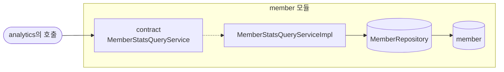
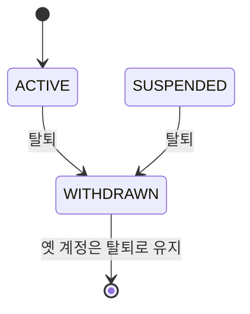
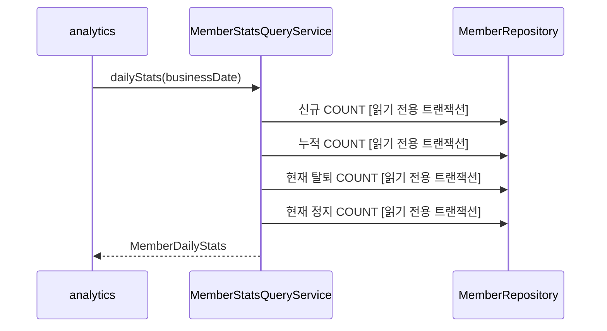
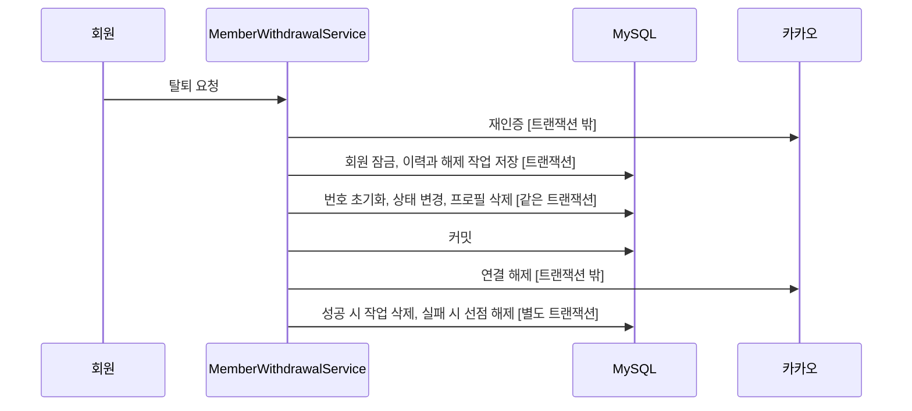

# member 구조와 동작 설계

이 문서는 회원 계정과 탈퇴 이력, 재가입 판정, 분석용 회원 집계를 다룬다. #357의 집계 구조를 #615의 새 회원 ID 발급 정책에 맞췄다. HTTP 요청과 응답은 [member API 설계](./member-api-design.md)가 갖는다.

## 1. 범위

| 구분 | 내용과 근거 |
|---|---|
| 맡는 기능 | 회원 가입·탈퇴와 재가입 제한을 판단하고 계정 수를 영업일별로 집계한다. #357과 #615가 근거다 |
| 맡지 않는 기능 | 활성 회원 수는 analytics가 `event_log`로 계산한다 |

## 2. 애그리거트와 패키지

| 애그리거트 | 테이블 | 지키는 규칙 | 나눈 근거 |
|---|---|---|---|
| 회원 | `member` | 가입 한 번에 회원 ID 하나를 발급한다. 탈퇴한 행은 되살리지 않는다 | #615의 계정 분리 결정 |
| 탈퇴 이력 | `member_withdrawal_history` | 회원마다 탈퇴 한 건을 기록하고 같은 카카오 계정의 이력을 보존한다 | 재가입 제한이 회원 ID를 넘어 유지되어야 한다 |
| 연결 해제 작업 | `kakao_unlink_failure` | 해제 성공 전까지 행을 유지하고 호출을 선점한다 | 외부 호출 중 새 계정 생성을 막는다 |

`entity/`, `repository/`, `service/`는 기존 member 패키지 아래에 둔다. 이력은 과거 회원의 ID 값만 갖고 현재 회원으로 연결을 옮기지 않는다. 다른 도메인의 공개 계약은 변경하지 않는다.

### 규칙을 두는 곳

| 규칙 | 두는 곳 |
|---|---|
| 영업일의 KST 시작과 끝 계산 | `MemberStatsQueryServiceImpl` |
| 가입 시각과 현재 상태에 따른 개수 조회 | `MemberRepository` |
| 다른 도메인에 공개하는 결과 모양 | `MemberStatsQueryService`, `MemberDailyStats` |
| 재가입 이력과 날짜·해제 상태 판정 | `MemberLoginService` |
| 탈퇴 이력 기록과 개인정보 초기화 | `MemberWithdrawalService` |
| 외부 연결 해제 작업 선점과 결과 반영 | `MemberWithdrawalService`, `KakaoUnlinkRetryService` |

## 3. 저장

`member.provider_user_id`는 nullable UNIQUE다. WITHDRAWN이면 NULL이고 나머지 상태이면 값이 있어야 한다는 CHECK를 둔다. 옛 회원의 가입 시각과 탈퇴 시각은 유지한다. 찜·쿠폰·사용 이력의 회원 ID와 캐시 키는 새 ID로 이관하지 않는다.

`member_withdrawal_history`는 `member_id`, `provider_user_id`, `withdrawn_at`, `suspended_at`을 보존한다. `member_id`에는 UNIQUE와 같은 도메인 FK를 두고 카카오 번호와 탈퇴 시각에는 복합 인덱스를 둔다. 닉네임·사진·위치·탈퇴 사유는 복사하지 않는다. 공통 생성·수정 시각을 갖는다.

집계는 `member`의 COUNT 네 개를 사용한다. 재가입은 새 행이므로 신규·누적 계정 수에 포함되고 옛 행의 탈퇴는 그대로 남는다. 회원 수는 사람 수를 중복 제거한 지표가 아니라 생성한 계정 수다.

### 기존 데이터와 배포

V4는 기존 WITHDRAWN 행을 이력에 먼저 복사한 뒤 회원의 카카오 번호를 비운다. 카카오 연결 해제 작업의 번호 사본은 보존한다. 이미 재활성화되어 사라진 과거 탈퇴는 복원하지 못한다.

구버전 API와 배치의 로그인·탈퇴·연결 해제 작업을 중지하고 실행 중 외부 호출이 끝났는지 확인한다. 그 뒤 마이그레이션을 적용한 새 버전을 기동한다. NULL 전환 후 구버전 코드가 가입을 받는 혼합 배포는 허용하지 않는다. MySQL DDL은 전체 트랜잭션으로 롤백되지 않으므로 실패하면 적용된 단계와 Flyway 이력을 확인한 뒤 복구한다.

## 4. 계산 로직

공식이 있는 순수 계산은 없다. 서비스가 `ClockConfig.ZONE`으로 `[영업일 00:00, 다음 날 00:00)` 경계를 만들고 저장소가 다음 값을 센다.

| 값 | 조건 |
|---|---|
| 신규 | `created_at >= 영업일 시작`이고 `created_at < 다음 날 시작` |
| 누적 | `created_at < 다음 날 시작` |
| 탈퇴 | 현재 `status = WITHDRAWN`이고 `withdrawn_at < 다음 날 시작` |


### 재가입 판정과 시각 경계

현재 회원이 없으면 최신 탈퇴 이력을 잠그고 전체 이력의 정지 여부를 확인한다. 정지 이력이 있으면 MEMBER-003, 연결 해제 작업이 남으면 MEMBER-005로 거절한다. #641에서 탈퇴 당일의 재가입을 막는 날짜 검사와 관련 테스트를 잠시 비활성화했다. 날짜 검사를 다시 활성화하면 주입된 한국 시각 Clock으로 가장 최근 탈퇴일이 오늘 이상인지 확인해 MEMBER-004로 거절한다. 같은 날 23:59에 탈퇴했어도 다음 날 00:00부터 날짜 제한이 풀린다. 허용 시 새 회원을 만들고 온보딩을 다시 받는다.

### 연결 해제 웹훅의 구분 한계

app_id와 관리자 키를 검증한 뒤 user_id로 현재 회원을 조회한다. 같은 카카오 번호의 탈퇴 이력이 하나라도 있으면 과거 계정의 통보와 구분할 수 없어 현재 회원과 토큰을 유지한다. 회원 ID를 포함한 오류 로그와 `member.unlink.webhook.ambiguous` 카운터를 남긴다.

현재 수신 계약에는 발생 시각이나 가입 회차가 없다. referrer_type도 가입 회차를 식별하는 근거로 정의되지 않았다. 따라서 재가입 계정의 통보는 모두 보류되며 실제 현재 연결 해제도 자동 탈퇴되지 않는다. 이력 존재는 지연을 입증하는 데이터가 아니며 운영 확인 대상으로 분류하는 기준이다. #615에서 사용자가 이 한계를 설명받고 계정 유지 정책을 선택했다.

## 5. 모듈 연결

| 방향 | 대상 도메인 | 인터페이스 | 시점 |
|---|---|---|---|
| 공개 | analytics가 부른다 | `MemberStatsQueryService` | 일별 집계 |
| 공개 | coupon이 부른다 | `MemberQueryService.findCurrentStatuses` | 쿠폰 묶음 발급. 계약은 [member-api-design.md](./member-api-design.md) 7장이 갖는다 |

```java
public interface MemberStatsQueryService {
    MemberDailyStats dailyStats(LocalDate businessDate);
}

public record MemberDailyStats(
        long newMemberCount,
        long cumulativeMemberCount,
        long withdrawnCount,
        long suspendedCount
) {
}
```

## 6. 구조와 동작 그림

### 모듈 구조



### 상태 변경

이번 조회는 상태를 바꾸지 않는다. 탈퇴 수와 정지 수에 영향을 주는 기존 전이만 표시한다.



| 전이 | 일으키는 쪽 | 집계에 미치는 영향 |
|---|---|---|
| ACTIVE 또는 SUSPENDED에서 WITHDRAWN | 회원 탈퇴 | 탈퇴 시각 이후 날짜의 탈퇴 수에 들어간다. SUSPENDED 였으면 과거 날짜를 다시 셀 때 정지 수에서 빠진다 |
| 새 ACTIVE 행 생성 | 재가입 제한을 통과한 회원 | 신규·누적 계정 수에 한 건이 추가되고 옛 탈퇴는 유지된다 |

`SUSPENDED`로 가는 전이는 지금 일어나지 않는다. 정지 기능(FR-009)이 구현 제외라 `member` 테이블에 `suspended_at`, `suspended_until`, `suspension_reason` 컬럼만 있고 정지·해제를 수행하는 메서드와 API가 없다. `suspended_at`은 재가입 차단 판정과 정지 수 집계에 읽는다. 정지 수는 지금 `SUSPENDED`이고 `suspended_at`이 다음 날 시작보다 이른 회원을 센다. 정지 상태는 데이터로만 들어온다. 정지 기능을 다시 채택할 때 정할 것은 [member API 설계 5장](./member-api-design.md#5-구현-제외-기능을-다시-채택할-때-정할-것)에 있다.

### 주요 흐름



| 실패 지점 | 남는 상태 | 다시 요청하면 |
|---|---|---|
| COUNT 조회 | 바뀌는 상태가 없다 | 같은 영업일을 다시 조회한다 |



| 실패 지점 | 남는 상태 | 다시 요청하면 |
|---|---|---|
| 이력 또는 작업 저장 | DB 변경을 롤백해 이전 계정을 유지한다 | 같은 계정으로 탈퇴를 다시 요청한다 |
| 외부 연결 해제 | 옛 계정과 이력, 작업을 유지한다 | 재가입을 보류하고 배치가 해제를 재시도한다 |
| 실행 중 프로세스 종료 | 선점과 작업을 유지한다 | 장애 처리 설계의 복구 절차를 따른다 |

## 7. 트랜잭션과 동시성

| 흐름 | 한 트랜잭션에 묶는 것 | 트랜잭션 밖 |
|---|---|---|
| 회원 일별 지표 조회 | 신규, 누적, 탈퇴, 정지 COUNT 네 개를 읽기 전용 트랜잭션에서 조회한다 | 해당 없음 |
| 가입 판정 | 현재 회원·최신 이력 잠금, 전체 정지 이력과 남은 작업 검사, 새 회원 저장 | 카카오 인증과 토큰 발급 |
| 탈퇴 | 회원 잠금, 이력·해제 작업 저장, 번호·상태·프로필 변경 | 카카오 재인증과 연결 해제 |
| 연결 해제 재시도 | 작업 선점과 결과 반영을 별도 트랜잭션으로 수행한다 | 카카오 호출 |

집계 조회는 쓰기와 잠금을 하지 않는다. 영업일은 `ClockConfig.ZONE`의 00:00을 기준으로 한다. 재가입이 옛 탈퇴 수를 줄이지 않는다.

로그인 판정은 카카오 번호로 현재 회원을 먼저 잠그고 최신 탈퇴 이력을 잠근다. 없는 번호의 동시 삽입에서 잠금 교착이 나면 새 트랜잭션으로 최대 세 번 판정한다. UNIQUE 충돌 후에는 현재 회원을 잠가 상태를 다시 검사한다.

탈퇴는 회원 잠금, 이력 저장, 연결 해제 작업 선점, 회원 번호 초기화, 프로필 삭제를 같은 트랜잭션에 묶는다. 토큰 폐기의 기존 DB·Redis 경계는 인증 설계를 따른다. 외부 연결 해제 호출은 커밋 뒤에 실행한다.

해제 작업의 `processing`은 최초 호출과 재시도 호출이 같은 작업을 함께 수행하지 못하게 한다. 재시도는 큐 행을 잠그고 선점한다. 재가입은 resolved 여부와 무관하게 같은 번호의 작업 행이 하나라도 있으면 거절한다. 웹훅은 실행 중 작업을 삭제하지 않는다.

## 8. 외부 API

카카오 인증 교환과 연결 해제는 member가 수행한다. 로그인 검증은 [auth API 설계](../auth/auth-api-design.md)를 따르고, 연결 해제의 실패와 실행 중단 복구는 [장애 처리 설계](./member_장애_처리_설계.md)가 갖는다.

## 9. 실패 처리

돈이 걸린 흐름은 아니다. DB 읽기가 실패하면 빈 집계를 반환하지 않고 예외를 호출자에게 올린다. analytics가 날짜 집계를 실패로 남기고 다시 실행하는 규칙은 [analytics 배치 설계](../analytics/analytics-batch-design.md)가 소유한다.

## 10. 배치

analytics의 일별 집계가 `MemberStatsQueryService`를 호출한다. member는 기존 매일 03시 연결 해제 재시도 작업을 유지한다. 대상과 한도는 장애 처리 설계가 갖는다.

## 11. 성능

| 항목 | 내용 |
|---|---|
| 호출 한 번의 비용 | DB COUNT 읽기 3회, DB 쓰기 0회, 다른 도메인 호출 0회 |
| 처리량 | analytics가 영업일마다 한 번 호출하며 재집계 때 같은 조회가 추가된다 |
| 확인 방법 | 운영 데이터에서 COUNT 쿼리 시간을 확인한다. 목표를 넘으면 실행 계획을 보고 인덱스를 정한다 |

신규 계정 판정 부분은 현재 회원·최신 이력·정지 이력·해제 작업을 읽는 쿼리 네 번과 회원 INSERT 한 번이다. 기존 로그인은 현재 회원 한 행을 잠그고 로그인 시각을 갱신한다. 프로필 조회와 토큰 발급 비용은 인증 설계가 갖는다. 처리량 목표는 아직 정하지 않았고 회원별 경합과 이력 증가에 따른 실행 계획을 운영 데이터로 측정해야 한다.

## 12. 테스트와 미정 사항

| Given | When | Then |
|---|---|---|
| 영업일과 저장소의 신규, 누적, 탈퇴, 정지 수가 있다 | `dailyStats`를 부른다 | KST 시작과 다음 날 시작을 저장소에 넘기고 네 값을 그대로 반환한다 |
| 다음 날 00:00에 가입한 회원이 있다 | 영업일 신규와 누적을 센다 | 미만 조건이라 그 회원은 들어가지 않는다 |
| 탈퇴 뒤 재가입한 회원이 있다 | 과거 영업일을 다시 센다 | 옛 행이 WITHDRAWN으로 남으므로 과거 탈퇴 수가 줄지 않는다 |
| 탈퇴가 어제이고 해제 작업이 없다 | 로그인 HTTP 요청을 보낸다 | 새 ID와 미완료 온보딩을 반환한다 |
| 한국 시각 자정 직전과 직후다 | 같은 카카오 번호로 가입한다 | 날짜 제한을 다시 활성화할 때까지 관련 테스트를 비활성화한다 |
| 같은 번호의 재가입 요청 네 개다 | 동시에 HTTP 요청을 보낸다 | 활성 계정 한 행만 생긴다 |
| 연결 해제 최초 호출이 실행 중이다 | 배치와 재가입, 웹훅이 함께 온다 | 중복 외부 호출과 신규 계정 생성을 막고 작업을 유지한다 |
| 재가입 계정에 연결 해제 웹훅이 온다 | 과거 탈퇴 이력을 찾는다 | 실제 지연 여부를 추정하지 않고 현재 계정을 유지한다 |

회원 집계는 COUNT 네 번으로 정했다. 탈퇴 이력의 보존 기간은 [member API 설계 6장](./member-api-design.md#6-아직-정해지지-않은-것)이 갖는다.
