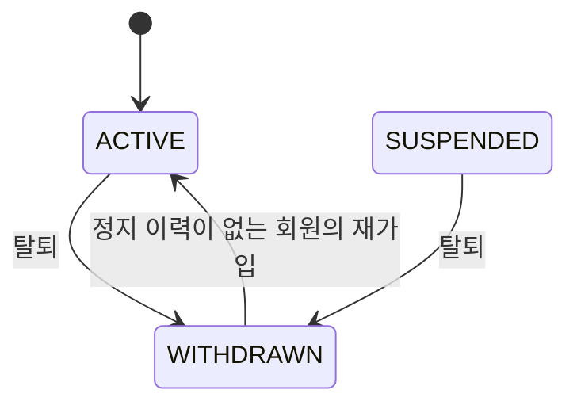
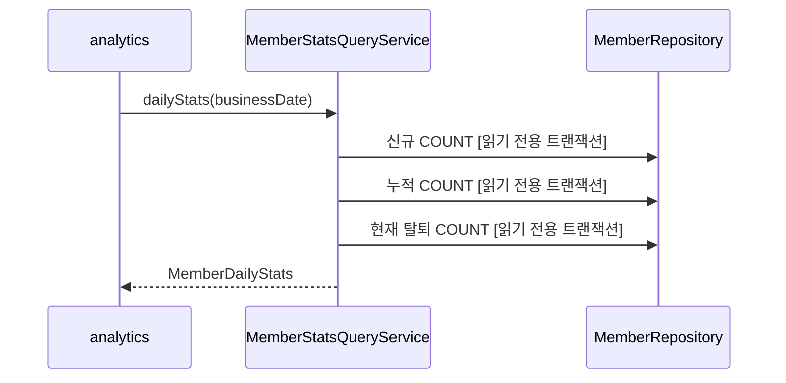

# member 구조와 동작 설계

이 문서는 이슈 #357에서 추가한 분석용 회원 집계 조회와 회원 상태의 저장 구조를 다룬다. 회원 HTTP API가 하는 일은 [member API 설계](./member-api-design.md)에 있고, 카카오 연동의 전체 설계는 아직 훑지 않았다.

## 1. 범위

| 구분 | 내용과 근거 |
|---|---|
| 맡는 기능 | `member`가 소유한 가입 시각과 현재 회원 상태로 영업일별 신규, 누적, 탈퇴 회원 수를 계산한다. 이슈 #357이 근거다 |
| 맡지 않는 기능 | 활성 회원 수는 analytics가 `event_log`로 계산한다. 정지 회원 수는 정지 기능의 이력과 해제 기준이 정해질 때까지 analytics가 0으로 둔다 |

## 2. 애그리거트와 패키지

| 애그리거트 | 테이블 | 지키는 규칙 | 나눈 근거 |
|---|---|---|---|
| 회원 | `member` | 가입 시각은 유지한다. 탈퇴하면 현재 상태와 탈퇴 시각을 바꾸고 재가입하면 탈퇴 시각을 지운다 | `Member` 엔티티와 이슈 #357 |

이번 변경은 다른 도메인의 호출이라는 입구 하나를 추가한다. `contract`가 공개 타입을 소유하고 `service`가 KST 영업일 경계를 만든다. `repository`는 `member` 테이블의 개수를 센다.

### 규칙을 두는 곳

| 규칙 | 두는 곳 |
|---|---|
| 영업일의 KST 시작과 끝 계산 | `MemberStatsQueryServiceImpl` |
| 가입 시각과 현재 상태에 따른 개수 조회 | `MemberRepository` |
| 다른 도메인에 공개하는 결과 모양 | `MemberStatsQueryService`, `MemberDailyStats` |

## 3. 저장

집계용 사본이나 이력 테이블을 만들지 않는다. 신규와 누적은 `member.created_at`으로 세고 탈퇴는 현재 `status`와 `withdrawn_at`으로 센다. 세 조회 모두 행을 애플리케이션으로 가져오지 않고 DB의 COUNT로 끝낸다.

**결정: 재가입한 회원의 과거 탈퇴 수를 어떻게 복원하나**

| 선택지 | 장점 | 단점 |
|---|---|---|
| 현재 `member` 행만 센다 | 새 테이블과 상태 변경 쓰기가 없다 | 재가입 뒤 과거 날짜를 다시 집계하면 과거 탈퇴 수가 줄 수 있다 |
| 탈퇴 이력을 따로 저장한다 | 과거 날짜를 그대로 복원할 수 있다 | 이력 테이블과 상태 변경 쓰기가 늘어난다 |

현재 행만 센다. 이슈 #357에서 재가입 뒤 과거 탈퇴 수가 달라지는 손실을 허용했다.

인메모리 저장소는 사용하지 않는다.

## 4. 계산 로직

공식이 있는 순수 계산은 없다. 서비스가 `ClockConfig.ZONE`으로 `[영업일 00:00, 다음 날 00:00)` 경계를 만들고 저장소가 다음 값을 센다.

| 값 | 조건 |
|---|---|
| 신규 | `created_at >= 영업일 시작`이고 `created_at < 다음 날 시작` |
| 누적 | `created_at < 다음 날 시작` |
| 탈퇴 | 현재 `status = WITHDRAWN`이고 `withdrawn_at < 다음 날 시작` |

## 5. 모듈 연결

| 방향 | 대상 도메인 | 인터페이스 | 시점 |
|---|---|---|---|
| 공개 | analytics가 부른다 | `MemberStatsQueryService` | 일별 집계 |
| 공개 | coupon이 부른다 | `MemberQueryService.findCurrentStatuses` | 쿠폰 묶음 발급. 계약은 [member-api-design.md](./member-api-design.md) 7장이 갖는다 |

```java
public interface MemberStatsQueryService {
    MemberDailyStats dailyStats(LocalDate businessDate);
}

public record MemberDailyStats(
        long newMemberCount,
        long cumulativeMemberCount,
        long withdrawnCount
) {
}
```

## 6. 구조와 동작 그림

### 모듈 구조


### 상태 변경

이번 조회는 상태를 바꾸지 않는다. 탈퇴 수에 영향을 주는 기존 전이만 표시한다.



| 전이 | 일으키는 쪽 | 집계에 미치는 영향 |
|---|---|---|
| ACTIVE 또는 SUSPENDED에서 WITHDRAWN | 회원 탈퇴 | 탈퇴 시각 이후 날짜의 탈퇴 수에 들어간다 |
| WITHDRAWN에서 ACTIVE | 회원 재가입 | 현재 행만 세므로 과거 날짜를 다시 집계할 때도 탈퇴 수에서 빠진다 |

`SUSPENDED`로 가는 전이는 지금 일어나지 않는다. 정지 기능(FR-009)이 구현 제외라 `member` 테이블에 `suspended_at`, `suspended_until`, `suspension_reason` 컬럼만 있고 정지·해제를 수행하는 메서드와 API가 없다. `suspended_at`은 재가입 차단 판정에만 읽는다. 정지 기능을 다시 채택할 때 정할 것은 [member API 설계 5장](./member-api-design.md#5-구현-제외-기능을-다시-채택할-때-정할-것)에 있다.

### 주요 흐름



| 실패 지점 | 남는 상태 | 다시 요청하면 |
|---|---|---|
| COUNT 조회 | 바뀌는 상태가 없다 | 같은 영업일을 다시 조회한다 |

## 7. 트랜잭션과 동시성

| 흐름 | 한 트랜잭션에 묶는 것 | 트랜잭션 밖 |
|---|---|---|
| 회원 일별 지표 조회 | 신규, 누적, 탈퇴 COUNT 세 개를 읽기 전용 트랜잭션에서 조회한다 | 해당 없음 |

조회는 쓰기와 잠금을 하지 않는다. 같은 DB 시점에서 같은 영업일을 다시 조회하면 같은 결과다. 재가입처럼 현재 회원 행이 바뀐 뒤에는 3장에서 허용한 대로 과거 탈퇴 수가 달라질 수 있다. 영업일은 `ClockConfig.ZONE`의 00:00을 기준으로 한다.

## 8. 외부 API

이번 집계 조회는 외부 API를 부르지 않는다. 기존 member 도메인의 카카오 API 연동은 이번 문서에서 아직 훑지 않았다.

## 9. 실패 처리

돈이 걸린 흐름은 아니다. DB 읽기가 실패하면 빈 집계를 반환하지 않고 예외를 호출자에게 올린다. analytics가 날짜 집계를 실패로 남기고 다시 실행하는 규칙은 [analytics 배치 설계](../analytics/analytics-batch-design.md)가 소유한다.

## 10. 배치

member는 이 조회를 위한 작업을 등록하지 않는다. analytics의 일별 집계가 `MemberStatsQueryService`를 호출한다.

## 11. 성능

| 항목 | 내용 |
|---|---|
| 호출 한 번의 비용 | DB COUNT 읽기 3회, DB 쓰기 0회, 다른 도메인 호출 0회 |
| 처리량 | analytics가 영업일마다 한 번 호출하며 재집계 때 같은 조회가 추가된다 |
| 확인 방법 | 운영 데이터에서 COUNT 쿼리 시간을 확인한다. 목표를 넘으면 실행 계획을 보고 인덱스를 정한다 |

## 12. 테스트와 미정 사항

| Given | When | Then |
|---|---|---|
| 영업일과 저장소의 신규, 누적, 탈퇴 수가 있다 | `dailyStats`를 부른다 | KST 시작과 다음 날 시작을 저장소에 넘기고 세 값을 그대로 반환한다 |
| 다음 날 00:00에 가입한 회원이 있다 | 영업일 신규와 누적을 센다 | 미만 조건이라 그 회원은 들어가지 않는다 |
| 탈퇴 뒤 재가입한 회원이 있다 | 과거 영업일을 다시 센다 | 현재 상태가 ACTIVE라 탈퇴 수에 들어가지 않는다 |

| 미정 항목 | 어디까지 정해졌나 | 막는 것 |
|---|---|---|
| 회원 수 증가에 따른 인덱스 | 현재는 COUNT 세 번으로 정했다 | 운영 데이터에서 목표 시간을 넘기면 정한다 |
| 기존 member 도메인의 전체 구조 | #357의 집계 조회와 회원 상태의 저장 구조만 훑었다 | 기존 기능을 바꾸는 작업 전에 보완한다 |
