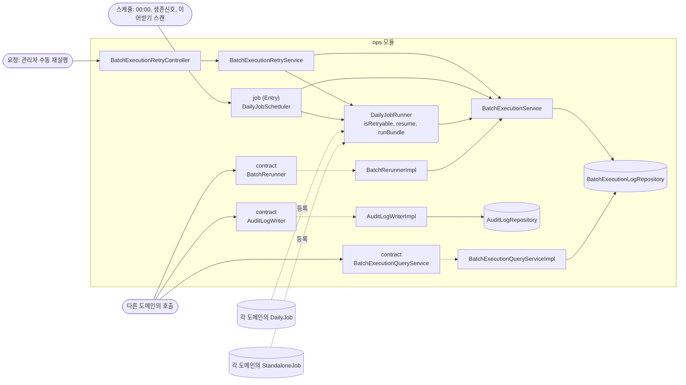
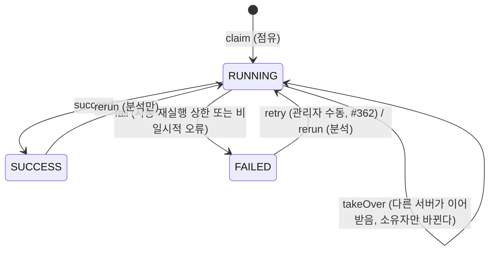
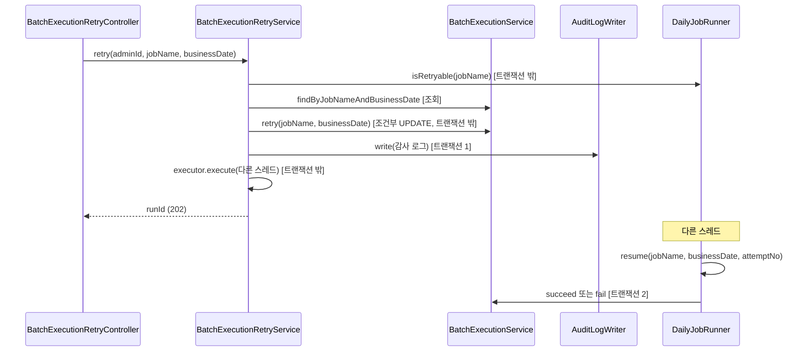

# ops 구조와 동작 설계

## 1. 범위

| 적을 것 | 예 |
|---|---|
| 맡는 기능과 근거 | 배치 실행의 점유·생존·이어받기·수동 재실행(`batch_execution_log`), 감사 로그(`audit_log`), 플랫폼 설정값(`platform_setting`). 설계 문서 1.2절 |
| 맡지 않는 것과 그 소유 도메인 | 각 배치 단계가 실제로 하는 일은 그 단계를 등록한 업무 도메인(`DailyJob`/`StandaloneJob` 구현). ops는 순서와 중복 실행 방지, 재개 경로만 책임진다(설계 문서 1.1절, 런치캐치_배치_운영.md 3장) |

이 문서는 #362(배치 작업 수동 재실행)를 계기로 처음 쓴다. 배치 실행 점유·이어받기 규칙 자체는
이미 [런치캐치_배치_운영.md](./런치캐치_배치_운영.md) 2장, 3장이 갖고 있어 그 문서를 가리키고
다시 쓰지 않는다. 플랫폼 설정값(`PlatformSetting`)의 세부 동작은 이 PR이 건드리지 않아
아직 훑지 않았다.

## 2. 애그리거트와 패키지

| 애그리거트 | 테이블 | 지키는 규칙 | 나눈 근거 |
|---|---|---|---|
| 배치 실행(`BatchExecutionLog`) | `batch_execution_log` | (job_name, business_date) 유일, 조건부 UPDATE로만 상태를 바꾼다 | 두 배치 서버가 같은 작업을 동시에 시도해도 하나만 이기게 하는 규칙이 이 테이블 하나에 걸린다 |
| 감사 로그(`AuditLog`) | `audit_log` | 관리자 행위마다 한 건, 호출자 트랜잭션에 반드시 참여한다(MANDATORY) | 다른 도메인의 관리 행위 트랜잭션에 얹혀야 해서 자기 트랜잭션을 갖지 않는다 |
| 플랫폼 설정값(`PlatformSetting`) | `platform_setting` | 아직 훑지 않았다 | 아직 훑지 않았다 |

- 세 애그리거트는 서로 ID로도 참조하지 않는다. 같은 패키지 안이지만 독립이다.
- `ops`는 작은 도메인이라 하위 패키지 없이 계층 구조만 둔다(설계 문서 1.3절). `contract/`,
  `entity/`, `job/`, `repository/`, `scheduler/`, `service/`, `exception/`(#362에서 추가),
  `controller/`(#362에서 추가), `config/`(#362에서 추가)다.
- 입구: 요청(이번 PR의 수동 재실행 HTTP만 있다. 설정값·감사 로그는 아직 자기 HTTP 입구가
  없다), 스케줄(`DailyJobScheduler`의 `@Scheduled` 셋), 이벤트(없다), 다른 도메인의 호출
  (`AuditLogWriter`, `BatchExecutionQueryService`, `BatchRerunner`, `BatchAttemptGuard`를
  다른 도메인이 부른다).

## 3. 저장

원본은 MySQL이다. `ops`는 인메모리 저장소를 직접 쓰지 않는다(플랫폼 설정값이 Caffeine을
쓰는지는 아직 훑지 않았다).

| 적을 것 | 예 |
|---|---|
| DB 제약으로 막을 것과 코드로 막을 것 | (job_name, business_date) UNIQUE가 중복 실행을 막는다. 상태 전이는 모두 `WHERE status = '...'` 조건부 UPDATE다. 코드의 "조회 후 쓰기"는 쓰지 않는다 |
| 집계를 세는 방식 | 해당 없음. 이 도메인은 집계를 갖지 않는다 |
| 다른 도메인 데이터의 사본 | 없다. `batch_execution_log`의 job_name은 각 도메인이 정한 문자열일 뿐 그 도메인 데이터의 사본이 아니다 |
| 이력 | `batch_execution_log` 자체가 실행 한 번의 이력이다. 더 세분화한 이력 테이블은 없다 |
| 복잡한 조회 | 없다. `findByJobNameAndBusinessDate`, `findByBusinessDate` 단순 조회뿐이다 |

## 4. 계산 로직

해당 없음. 순수 계산 클래스가 필요한 공식이 없다.

## 5. 모듈 연결

| 방향 | 대상 도메인 | 인터페이스 | 시점 |
|---|---|---|---|
| 공개 | 분석 | `BatchRerunner` | 분석이 전날 FAILED로 끝난 집계를 다음 밤 자동으로 재실행할 때 |
| 공개 | 모든 도메인 | `AuditLogWriter` | 관리자 행위를 기록할 때 |
| 공개 | 분석, 정산 | `BatchExecutionQueryService` | 배치 실행 기록을 조회할 때. `BatchExecutionRecord.attemptNo`(#434)로 정상 경로(claim, retry, rerun 직후)도 자기 세대를 읽어 `BatchAttemptGuard.assertCurrentAttempt`에 넘길 수 있다. 전에는 이어받은 경로(`StandaloneJob.run`)만 세대를 받았다 |
| 공개 | 각 도메인의 결과 공개 코드 | `BatchAttemptGuard` | 결과를 커밋하기 전 자기 소유와 세대를 확인할 때(#360, 실제 호출자는 아직 없다) |
| 받음 | 각 업무 도메인 | `DailyJob`, `StandaloneJob` | 각 도메인이 00:00 묶음 단계 또는 묶음 밖 작업을 등록할 때. 이어받기와 수동 재실행은 `StandaloneJob.runCounting`을 부르고 돌려받은 건수를 `processed_count`에 남긴다(#559) |

- `ops`는 어떤 업무 도메인도 의존하지 않는다(설계 문서 1.1절). 그래서 위 "공개"는 모두
  `ops.contract`의 인터페이스를 다른 도메인이 구현 없이 그대로 호출하는 것이고, "받음"은
  다른 도메인이 `ops.scheduler`의 인터페이스를 구현해 등록하는 것이다. 방향은 항상
  도메인 -> `ops`다.
- `DailyJobRunner.isRetryable`/`resume`은 `ops` 내부 공개다(#362). 다른 도메인에
  노출하지 않고 `ops.service.BatchExecutionRetryService`만 부른다. `DailyJobRunner`는
  `job/`(Entry 계층)이 아니라 `service/`(Service 계층)에 둔다. Entry 는 누구에게도 불리지
  않는다는 계층 규칙(설계 문서 1.5절) 때문에, Service 계층인 `BatchExecutionRetryService`가
  `job/`의 `DailyJobScheduler`를 직접 부를 수 없다.

## 6. 구조와 동작 그림

### 모듈 구조

`BatchExecutionRetryService`(Service)가 `DailyJobScheduler`(Entry, `job/`)를 부르지 않고
`DailyJobRunner`(Service, `service/`)만 쓰는 것은 취향이 아니라 계층 규칙이다. "Entry 는
누구에게도 불리지 않는다"(설계 문서 1.5절)가 그 방향을 막는다. 그래서 묶음을 실제로 도는
로직과 재개 경로(`isRetryable`/`resume`)를 Service 계층으로 옮기고, `DailyJobScheduler`에는
점유 확인과 스케줄 트리거만 남겼다.

### 상태 변경

| 전이 | 일으키는 쪽 | 나가는 이벤트 | 금지일 때 응답 |
|---|---|---|---|
| FAILED -> RUNNING (retry) | 관리자(HTTP, #362) | 없음 | `404`(행 없음), `409`(FAILED 아님) |
| FAILED/SUCCESS -> RUNNING (rerun) | 분석(`BatchRerunner`) | 없음 | 해당 없음. 분석 내부에서 판정 |

### 주요 흐름

| 실패 지점 | 남는 상태 | 다시 요청하면 |
|---|---|---|
| 조건부 UPDATE 뒤, 감사 로그 기록 전 | 행은 RUNNING, 감사 로그 없음 | 서비스가 그 자리에서 잡아 FAILED로 되돌리고 예외를 올린다. 관리자가 다시 누르면 처음부터 다시 간다 |
| 감사 로그 기록 뒤, 접수(executor.execute) 전 | 행은 RUNNING, 감사 로그는 남음 | 위와 같다. FAILED로 되돌리므로 관리자가 다시 누를 수 있다. 감사 로그는 "시도했다"는 기록으로 남는다 |
| 접수 뒤, 실제 재개(resume) 전에 프로세스가 죽음 | 행은 RUNNING, 아무도 닫지 않는다 | 되돌릴 방법이 없다. `DailyJobScheduler.takeOverStale`이 2분 뒤 다른 서버에서 이어받아 같은 `DailyJobRunner.resume` 경로로 다시 돈다 |

## 7. 트랜잭션과 동시성

| 흐름 | 한 트랜잭션에 묶는 것 | 트랜잭션 밖 |
|---|---|---|
| 수동 재실행 접수(#362) | 감사 로그 기록 하나 | 상태 조회, 조건부 UPDATE(retry), 실제 재개(resume) |
| 배치 상태 전환(claim/succeed/fail/renew 등) | 그 UPDATE 또는 INSERT 하나 | 그 전후의 작업 실행 자체 |

- 실제 재개(`DailyJobRunner.resume`)는 트랜잭션 밖, 별도 스레드에서 돈다. 00:00 묶음은
  여러 단계가 걸려 오래 걸릴 수 있어 요청 스레드나 DB 트랜잭션을 묶어 두지 않는다.
- 접수(`executor.execute`)가 실패(대기열 가득 참)하거나 감사 로그 기록이 실패하면 되돌린
  행을 다시 `FAILED`로 닫는다(분석의 A-05, `AggregationRecalculationService`와 같은 처리).

| 상황 | 확인할 것 | 예 |
|---|---|---|
| 같은 요청이 다시 옴 | 멱등 키와 UNIQUE | (job_name, business_date) UNIQUE, 상태 조건부 UPDATE |
| 같은 회원의 요청이 동시에 옴 | 회원 단위 상한 | 해당 없음. 관리자 행위라 회원 단위 개념이 없다 |
| 여러 회원이 같은 자원에 씀 | 수량, 잔액 초과 | 해당 없음 |
| 이벤트가 늦거나 순서가 바뀜 | 늦은 이벤트가 최신 상태를 덮는지 | 해당 없음. 이 도메인은 이벤트를 받지 않는다 |

묶음 밖 작업의 재개(`DailyJobRunner.resume`)는 생존 확인, 재실행 기록, 닫기의 조건부 UPDATE에 소유자와 함께 넘겨받은 세대를 넣는다(#591). 같은 서버가 새 세대를 잡은 뒤 낡은 시도가 끝나도 새 시도의 행은 바뀌지 않는다. 세대를 받지 않는 기존 메서드는 쿼리에 `null`을 넘겨 소유자만 본다. `null`은 그 메서드만 넘기고, 세대를 받는 메서드는 `int`로 받아 세대 검사가 빠지지 않게 한다.

경쟁 지점은 모두 조건부 UPDATE다. 비관 잠금은 `findByJobNameAndBusinessDateForUpdate`
(`assertCurrentAttempt`)와 00:00 묶음의 단계 동시성 테스트(`DailyJobRunnerTest`)가 쓴다.
영업일은 Asia/Seoul 00:00 기준이고(`BatchExecutionService.businessDate`), 한 번에 다루는
건수의 상한은 해당 없음(한 번에 한 (job_name, business_date)만 다룬다).

## 8. 외부 API

해당 없음. 이 도메인은 외부 API를 부르지 않는다.

## 9. 실패 처리

| 흐름 | 불리하게 남는 경우 | 누구에게 | 막는 방법 |
|---|---|---|---|
| 수동 재실행 접수(#362) | 상태가 RUNNING으로 바뀌었는데 재개가 영원히 안 도는 경우 | 그 배치 작업에 기대는 모든 사용자(예: 00:00 묶음이 멈추면 그날 서비스가 영향받는다) | `takeOverStale`이 2분 뒤 다른 서버에서 이어받아 같은 재개 경로로 다시 돈다 |

세부 대상별 장애 처리는 [ops_장애_처리_설계.md](./ops_장애_처리_설계.md)에 있다.

## 10. 배치

이 도메인은 00:00 묶음과 묶음 밖 작업의 순서·중복 실행 방지·이어받기 틀 자체를 소유한다.
그 틀의 규칙은 [런치캐치_배치_운영.md](./런치캐치_배치_운영.md) 2장이, 구현 대응표는 3장이
갖는다. 여기서 다시 쓰지 않는다. `ops` 자신은 00:00 묶음에 등록하는 작업이 없다(작업 내용은
각 업무 도메인이 등록한다).

## 11. 성능

| 적을 것 | 예 |
|---|---|
| 요청 하나의 비용(수동 재실행 접수) | DB 읽기 2(isRetryable은 메모리 조회, 행 조회 1, 재조회 1), DB 쓰기 1(조건부 UPDATE) + 감사 로그 쓰기 1, 트랜잭션 1(감사 로그) |
| 처리량 계산 | 관리자가 누르는 수동 동작이라 목표 TPS를 두지 않는다 |
| 확인 방법 | 해당 없음 |

## 12. 테스트와 미정 사항

| 미정 항목 | 어디까지 정해졌나 | 막는 것 |
|---|---|---|
| 운영 전역의 배치 실행 기록 조회 API | 명세와 설계는 #570이 정했다([batch-execution-history-api-design.md](./batch-execution-history-api-design.md)). 구현은 #575가 한다 | 관리자가 수동 재실행 결과를 화면에서 바로 확인하는 것 |
| 플랫폼 설정값의 캐시 전략, 조회 API | 아직 훑지 않았다 | 이 PR과 무관하다 |
