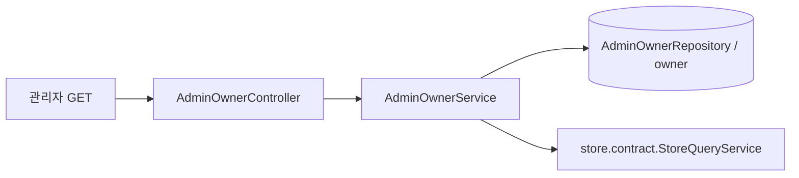
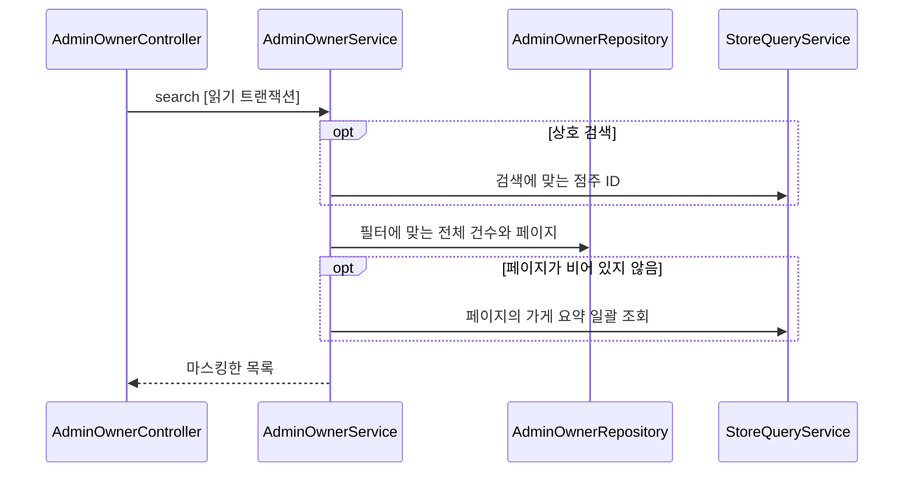

# owner 구조와 동작 설계

이 문서는 #536의 관리자 점주 목록이 추가한 구조를 다룬다. 기존 인증·온보딩 기능의 세부 구조는 아직 훑지 않았다. 해당 기능은 [점주 API 설계](owner-api-design.md)와 [상태 캐시 설계](owner-status-cache.md)가 소유한다.

## 1. 범위

점주 계정 목록과 검색은 owner가 소유한다. 관리자 계정 인증은 admin과 auth가, 가게 조회와 사업자번호의 기본 마스킹은 store가 소유한다. HTTP 계약은 [관리자 API 명세](../../api-spec/admin-api-spec.md#관리자-점주-목록)를 따른다.

## 2. 애그리거트와 패키지

목록은 기존 owner 계정 애그리거트를 읽는다. 새 애그리거트나 상태 전이는 만들지 않는다. `controller/AdminOwnerController`, `service/AdminOwnerService`, `repository/AdminOwnerRepository`와 읽기 결과 `AdminOwnerRow`를 둔다. `config/AdminOwnerSecurityConfig`는 관리자 조회 경로만 담당한다.

### 규칙을 두는 곳

요청 범위 검증은 `AdminOwnerListQuery`, 검색 분기와 조회 순서 및 응답 마스킹은 서비스, owner SQL은 저장소가 담당한다.

## 3. 저장

기존 owner 테이블을 읽으며 스키마와 인덱스는 변경하지 않는다. 가게 데이터 사본과 목록 캐시는 만들지 않는다. 계정 페이지와 전체 건수는 같은 조건으로 조회한다.

## 4. 계산 로직

해당 없음. 별도 공식이나 계산 모델을 추가하지 않는다.

## 5. 모듈 연결

owner 서비스가 store의 공개 조회 계약을 요청마다 호출한다. 메서드와 호출 횟수는 [관리자 점주 목록 설계](owner-api-design.md#관리자-점주-목록-536)가 소유한다. 새 공개 인터페이스나 이벤트는 추가하지 않는다.

## 6. 구조와 동작 그림

### 모듈 구조

### 상태 변경

해당 없음. 목록 조회는 상태를 변경하지 않는다.

### 주요 흐름

## 7. 트랜잭션과 동시성

목록 조회는 서비스의 읽기 전용 트랜잭션 한 번으로 처리한다. 쓰기나 잠금을 추가하지 않는다. 날짜 경계와 정렬은 API 설계가 소유한다. 목록의 반복 요청은 DB 상태를 변경하지 않는다.

## 8. 외부 API

해당 없음. 목록 조회는 외부 API를 호출하지 않는다.

## 9. 실패 처리

[owner 장애 처리 설계](owner_장애_처리_설계.md)를 따른다. 돈이나 상태 변경이 없어 부분 반영이나 보상 작업은 없다.

## 10. 배치

해당 없음. 목록은 요청 시점의 데이터를 조회한다.

## 11. 성능

요청당 비용과 측정 목표는 [API 설계](owner-api-design.md#관리자-점주-목록-536)가 소유한다. 1만 건의 검색 후보 ID를 메모리에서 정렬·페이징하지 않고 owner SQL에서 필터·페이지를 적용한다. 기존 인덱스로 목표를 충족하는지는 로컬 검증이 필요하다.

## 12. 테스트와 미정 사항

서비스 단위 테스트는 숫자·상호 검색, 가입일 경계, 가게 없는 계정, 마스킹과 장애 전파를 확인한다. HTTP 통합 테스트는 관리자 권한과 개인정보 비노출에 집중한다. 성능 목표의 동시 요청 수는 아직 정하지 않았다. 기존 인증·온보딩 기능의 구조는 이번 작업에서 훑지 않았다.
