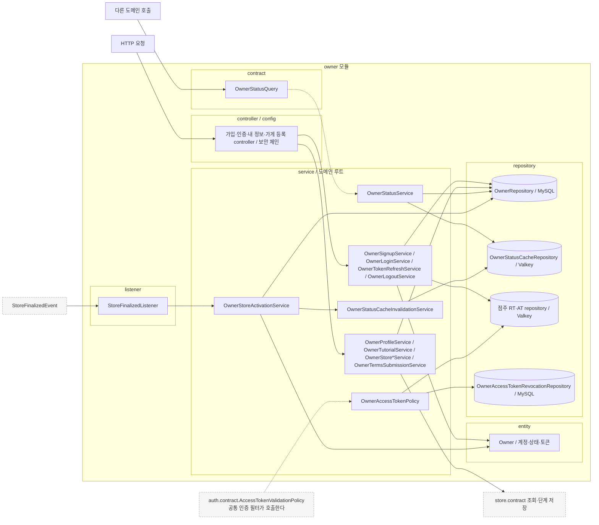
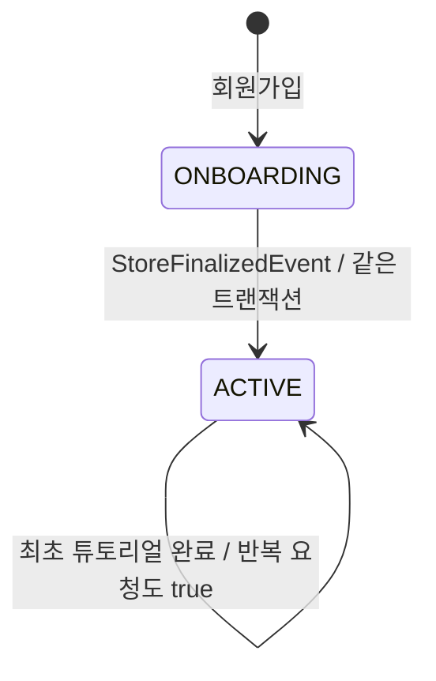
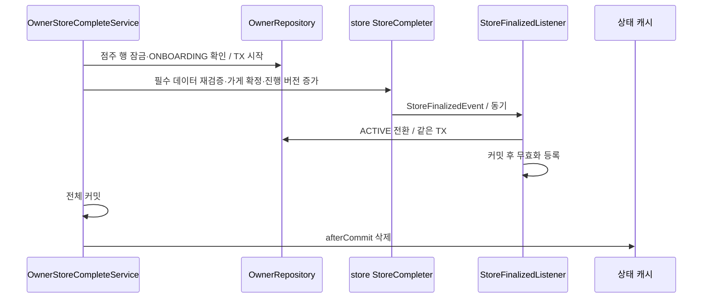

# owner 구조와 동작 설계

점주 회원가입·로그인·토큰 재발급·로그아웃·본인 정보 조회·최초 튜토리얼 확인과 가게 등록 진입점을 다룬다.
기능별 구현 이슈와 develop에 반영된 코드·테스트를 근거로 작성했다. HTTP별 절차는 [점주 API 설계](owner-api-design.md), 토큰 회전은 [인증 설계](../auth/auth-api-design.md)가 소유한다.

## 1. 범위

기능 구현 담당자는 **gyudongjeong**이며 해당 작성자의 develop 반영 기능으로 범위를 한정한다. 2026-10-23에 확인한 코드·테스트와 연결 이슈를 기준으로 한다. #534는 문서 정리 작업이며 기능 구현 근거가 아니다.

| 기능                             | 구현 이슈 |
|--------------------------------|---|
| 회원가입                           | [#62](https://github.com/lunch-catch/lc-backend/issues/62). 같은 내용의 #63은 중복 종료되어 제외한다 |
| 로그인·토큰 재발급·로그아웃                | [#71](https://github.com/lunch-catch/lc-backend/issues/71), [#121](https://github.com/lunch-catch/lc-backend/issues/121), [#132](https://github.com/lunch-catch/lc-backend/issues/132) |
| 최초 튜토리얼 완료·내 정보 조회             | [#137](https://github.com/lunch-catch/lc-backend/issues/137), [#151](https://github.com/lunch-catch/lc-backend/issues/151) |
| 약관·가게 기본 정보·위치·영업시간의 점주 확인과 조정 | [#147](https://github.com/lunch-catch/lc-backend/issues/147), [#415](https://github.com/lunch-catch/lc-backend/issues/415), [#482](https://github.com/lunch-catch/lc-backend/issues/482), [#489](https://github.com/lunch-catch/lc-backend/issues/489) |
| 내 가게·진행 상태 조회의 진입점             | [#427](https://github.com/lunch-catch/lc-backend/issues/427), [#453](https://github.com/lunch-catch/lc-backend/issues/453) |
| 상태 캐시·인증 로그 보정과 검증 | [#678](https://github.com/lunch-catch/lc-backend/issues/678), [#836](https://github.com/lunch-catch/lc-backend/issues/836) |
| 최종 등록의 `ACTIVE` 전환·커밋 후 캐시 무효화   | [#502](https://github.com/lunch-catch/lc-backend/issues/502) |

[#124](https://github.com/lunch-catch/lc-backend/issues/124)는 상태 캐시 문서 이동이며 상태 조회 기능 전체를 구현한 근거로 사용하지 않는다.
이슈의 당시 토큰 유효기간·폐기 방식과 현재 코드가 다르면 현재 코드·명세를 따른다. 과거 요구를 현재 동작으로 되돌리지 않는다.

owner는 계정·상태·튜토리얼·현재 토큰 상태를 소유한다. 가게 등록 요청의 현재 점주 상태를 검증하고 store 공개 계약을 호출한다.
가게·약관·사업자 검증·진행 상태는 store가 소유한다. JWT 서명·쿠키와 공통 필터는 auth가 제공한다.
다른 작성자가 추가한 관리자 점주 목록 HTTP 기능은 이 문서에 포함하지 않는다. 예외로 포함한 5·6단계 업로드·메뉴 기능과 구현자 표시는 [store 설계](../store/store_구조와_동작_설계.md)가 소유한다.
정지·탈퇴 상태는 존재하지만 해당 상태 변경 기능을 구현한 것으로 설명하지 않는다.
근거는 [아키텍처](../../architecture/런치캐치_도메인_구조와_의존성_설계.md) 1.2, [점주 명세](../../api-spec/owner-api-spec.md)다.

이슈 링크는 구현 이력을 추적하는 용도다. 설계 결정의 근거는 이 문서 각 장에서 연결한 저장소 내부 명세·API 설계·아키텍처로 한정한다. 내부 문서가 이유를 정하지 않은 선택은 12장의 미정 사항으로 남긴다.

## 2. 애그리거트와 패키지

`Owner`가 계정, 상태와 토큰 발급·폐기 순번을 한 행에 둔다. 가게는 ID로만 연결한다.
계정 상태와 입점 데이터는 변경 주기가 달라 도메인을 나누되 최종 등록은 동기 이벤트로 같은 트랜잭션에 연결한다.

| 애그리거트 | 테이블 | 지키는 규칙 | 경계의 근거 |
|---|---|---|---|
| 점주 계정 | `owner` | 계정 상태·튜토리얼·현재 토큰을 점주 행 잠금 아래 갱신한다 | [점주 API 설계](owner-api-design.md), [인증 설계](../auth/auth-api-design.md) |

계정과 가게를 합치면 등록 데이터와 상태를 직접 갱신할 수 있지만 입점 기능이 계정 내부에 결합된다. 분리하면 계정 정책과 입점 데이터의 소유가 명확해지는 대신 최종 등록을 공개 계약과 이벤트로 연결해야 한다.
분리 근거는 [아키텍처](../../architecture/런치캐치_도메인_구조와_의존성_설계.md) 1.2와 2.4다.

```text
owner/
├── config/
│   ├── OwnerSecurityConfig.java
│   └── OwnerTermsSecurityConfig.java
├── contract/
│   ├── OwnerAccountStatus.java
│   └── OwnerStatusQuery.java    다른 도메인에 점주 상태 조회를 공개한다
├── controller/
│   ├── OwnerLoginController.java
│   ├── OwnerLogoutController.java
│   ├── OwnerProfileController.java
│   ├── OwnerSignupController.java
│   ├── OwnerStoreCompleteController.java
│   ├── OwnerStoreController.java
│   ├── OwnerStoreHoursController.java
│   ├── OwnerStoreInfoController.java
│   ├── OwnerStoreLocationController.java
│   ├── OwnerStoreOnboardingController.java
│   ├── OwnerTermsAgreementController.java
│   ├── OwnerTokenRefreshController.java
│   └── OwnerTutorialController.java
├── entity/
│   ├── Owner.java
│   └── OwnerStatus.java
├── exception/
│   ├── OwnerErrorCode.java
│   └── OwnerException.java
├── listener/
│   └── StoreFinalizedListener.java    가게 최종 등록 이벤트를 동기로 받는다
├── repository/
│   ├── OwnerAccessTokenRevocationRepository.java    MySQL의 점주 AT 폐기 순번을 조회한다
│   ├── OwnerAccessTokenVersionRepository.java    Valkey. 점주 AT 폐기 순번을 관리한다
│   ├── OwnerLogoutTokenRepository.java    Valkey. 점주 RT 폐기를 처리한다
│   ├── OwnerRefreshTokenRepository.java    Valkey. 점주 RT의 소비·재사용 표시를 관리한다
│   ├── OwnerRepository.java
│   └── OwnerStatusCacheRepository.java    Valkey. 점주 상태 조회 캐시를 관리한다
└── service/
    ├── OwnerAccessTokenPolicy.java    auth의 AccessTokenValidationPolicy를 구현한다
    ├── OwnerLoginResult.java
    ├── OwnerLoginService.java
    ├── OwnerLogoutService.java
    ├── OwnerProfileService.java
    ├── OwnerSignupService.java
    ├── OwnerStatusCacheInvalidationService.java    커밋 후 상태 캐시를 삭제한다
    ├── OwnerStatusService.java    OwnerStatusQuery 구현. 일반 조회는 캐시를 사용한다
    ├── OwnerStoreActivationService.java    점주를 ACTIVE로 전환한다
    ├── OwnerStoreCompleteService.java
    ├── OwnerStoreHoursService.java
    ├── OwnerStoreInfoService.java
    ├── OwnerStoreLocationService.java
    ├── OwnerStoreOnboardingService.java
    ├── OwnerStoreService.java
    ├── OwnerTermsSubmissionService.java
    ├── OwnerTokenRefreshResult.java
    ├── OwnerTokenRefreshService.java
    └── OwnerTutorialService.java
```

입구는 HTTP, `OwnerStatusQuery` 호출, auth의 AT 정책 호출과 `StoreFinalizedEvent`다. 자체 스케줄은 없다.

### 규칙을 두는 곳

| 규칙 | 두는 곳 |
|---|---|
| `ONBOARDING` 생성, `ACTIVE` 전환, 튜토리얼 완료와 토큰 순번 증가 | `Owner` |
| DB 현재 상태 확인과 가게 작업의 호출 순서 | `OwnerStore*Service`, `OwnerTermsSubmissionService` |
| 캐시 우회·DB 폴백·커밋 후 무효화 | `OwnerStatusService`, `OwnerStatusCacheInvalidationService` |
| HTTP 역할 검사 | `OwnerSecurityConfig`, `OwnerTermsSecurityConfig`, store가 소유한 등록 경로의 보안 설정 |

## 3. 저장

MySQL `owner`가 원본이다. 이메일 UNIQUE가 동시 가입 중복을 막는다. BCrypt 해시, RT 해시·만료, 로그인 시각, 발급 순번과 AT 폐기 순번을 보관한다.
튜토리얼은 기존 `tutorial_viewed`를 `false`에서 `true`로 바꾼다. 가게 정보를 owner에 복사하지 않는다.

| 데이터 | 키 | 만료 | 원본 | 읽는 곳 |
|---|---|---|---|---|
| 점주 상태 | `ownerStatus:{ownerId}` | 설정 기본 30초 | `owner.status` | `OwnerStatusService.findStatus` |
| RT·현재 해시 | `refreshToken:{hash}`, `activeRefreshToken:OWNER:{id}` | DB 만료까지 남은 시간 | `owner`의 현재 RT 해시·만료 | 점주 로그인·토큰 재발급 서비스 |
| RT 게시 순번 | `refreshTokenIssuanceVersion:OWNER:{id}` | TTL을 두지 않는다 | `owner.refresh_token_issuance_version` | RT 게시·폐기 Lua |
| AT 폐기 순번 | `accessTokenRevokedThroughVersion:OWNER:{id}` | TTL을 두지 않는다 | `owner.access_token_revoked_version` | `OwnerAccessTokenPolicy` |

상태·튜토리얼은 현재 값만 보관하며 별도 전이 이력 테이블과 도메인 집계는 없다. RT 소비·재사용 표시는 DB 현재 해시만으로 재구성되지 않는다. 이 한계는 [인증 설계](../auth/auth-api-design.md)의 점주 절 중 `POST /v1/owner/auth/tokens:refresh` 항목에 따라 유지하며 완전 복구 방식은 12장에 남긴다.

상태 캐시는 트랜잭션 중에 읽거나 채우지 않는다. 이때 `findStatus`도 DB를 읽는다.
상태 변경 후 삭제와 이전 조회의 재저장이 경합할 수 있어 커밋 후 30초 이내 최신화를 보장하지 않는다. 상세는 [상태 조회 설계](owner-status-cache.md)의 "상태 변경과 접근 제어를 연결할 때의 조건" 절이 소유한다.
최신 store의 공통 판정은 검증된 로고를 필수로 보고 내부 이미지를 선택으로 처리한다. 미완료 내부 업로드가 있어도 다른 필수 조건을 갖추면 최종 등록·조회가 같은 결과를 낸다. 이 보정은 `gyudongjeong`의 [#633](https://github.com/lunch-catch/lc-backend/issues/633)이며 owner는 공개 계약 결과를 사용한다.

## 4. 계산 로직

수량·금액 계산은 해당 없다. 비밀번호 비교와 토큰 생성·해싱은 기존 보안·auth 구현을 사용한다.
가게 재개 단계·완료 여부는 owner가 계산하지 않고 store 공개 조회 결과를 변환한다.

## 5. 모듈 연결

| 방향 | 인터페이스·이벤트 | 시점 |
|---|---|---|
| 공개 | `Optional<OwnerAccountStatus> findStatus(Long ownerId)`, `findCurrentStatus(Long ownerId)` | `OwnerStatusService`가 구현한다. 부재는 `empty`, DB 장애는 예외다 |
| 구현 | auth `AccessTokenValidationPolicy` | `OwnerAccessTokenPolicy`가 DB 폐기를 먼저 검사한다 |
| 읽기 | store `StoreRegistrationQuery`, `StoreOnboardingQuery`, `StoreQueryService` | 내 정보·진행 상태·내 가게 조회에서 호출한다 |
| 쓰기 | store `OwnerTermsAgreementRecorder`, `StoreInfoSaver`, `StoreLocationSaver`, `StoreHoursSaver`, `StoreCompleter` | 점주 행 잠금·상태 확인 후 같은 쓰기 트랜잭션에서 호출한다 |
| 받음 | `StoreFinalizedEvent(ownerId, storeId)` | 동기 리스너가 `ACTIVE`로 전환하고 커밋 후 캐시 삭제를 예약한다 |

공개 타입은 [OwnerStatusQuery](../../../src/main/java/com/launchcatch/owner/contract/OwnerStatusQuery.java)가 소유한다.
store 계약의 반환 record와 조건은 [가게 조회 계약](../store/store-query-contract.md), [가게 API 설계](../store/store-api-design.md)를 따른다.

`OwnerStatusQuery`의 두 메서드는 모두 `Optional<OwnerAccountStatus>`를 반환한다. 반환 enum은 `ONBOARDING`, `ACTIVE`, `SUSPENDED`, `WITHDRAWN`이며 별도 record는 없다.
내 정보는 `ONBOARDING`일 때 `StoreRegistrationQuery.findResumeStep(ownerId)`를 1회, 내 가게는 `StoreQueryService.getOwnerStoreOverview(ownerId)`를 1회, 진행 조회는 `StoreOnboardingQuery.getProgress(ownerId)`를 1회 호출한다. 이 HTTP 경로에는 store 결과 캐시를 두지 않는다.
상태 공개 조회만 3장의 캐시를 사용한다. 호출 조건의 근거는 [점주 API 설계](owner-api-design.md)다.

## 6. 구조와 동작 그림

### 모듈 구조



### 상태 변경



`Owner.activate`는 `ONBOARDING`에서만 허용한다. 정지·탈퇴는 판정 가능한 상태지만 현재 엔티티에 전이 메서드가 없다.
최종 등록 시 상태 조건 위반은 `OWNER-002`로 거부한다. 가입과 튜토리얼 완료는 상태 변경 이벤트를 발행하지 않는다.

| 전이·변경 | 일으키는 쪽 | 나가는 이벤트 | 금지일 때 응답 |
|---|---|---|---|
| 계정 없음 → `ONBOARDING` | 회원가입 | 없음 | 입력·이메일 중복은 [점주 명세](../../api-spec/owner-api-spec.md)를 따른다 |
| `ONBOARDING` → `ACTIVE` | store의 동기 `StoreFinalizedEvent` 수신 | owner의 추가 이벤트는 없다 | 현재 점주 상태가 다르면 `OWNER-002` |
| `ACTIVE` 유지·`tutorialViewed=false` → `true` | 최초 튜토리얼 완료 | 없음 | `ONBOARDING`·정지·탈퇴는 `OWNER-002` |
| `ACTIVE` 유지·`tutorialViewed=true` 유지 | 튜토리얼 완료 재요청 | 없음 | 인증·역할 오류는 점주 명세를 따른다 |

정지·탈퇴 전이는 현재 범위에 없으며 임의 상태 변경을 허용하지 않는다.

### 주요 흐름

**최종 등록과 `ACTIVE` 전환.** store의 필수 조건 재검증부터 점주 상태 변경까지 같은 트랜잭션이며 도메인 간 호출·이벤트 수신은 같은 프로세스 안에서 수행한다.



| 실패 지점 | 남는 상태 | 다시 요청하면 |
|---|---|---|
| 가입 이메일 중복 | 새 계정을 남기지 않는다 | `OWNER-001`로 거부한다 |
| 최종 등록·`ACTIVE` 전환 | 가게·진행 버전·점주 변경을 함께 롤백한다 | 현재 버전·조건을 확인해 요청한다 |
| 커밋 후 캐시 삭제 | `ACTIVE`는 유지하고 낡은 캐시가 남을 수 있다 | 중요한 작업은 DB를 확인한다 |
| 로그아웃 Redis 반영 | DB 토큰 폐기는 유지한다 | 이전 AT를 재사용해 복구할 수 있다고 가정하지 않는다 |

## 7. 트랜잭션과 동시성

| 흐름          | 한 DB 트랜잭션에 묶는 것 | 트랜잭션 밖·별도 처리 |
|-------------|---|---|
| 회원가입        | 계정 저장 | 사전 중복 조회·BCrypt |
| 로그인·토큰 재발급  | 행 잠금·상태 재검사·RT 해시·순번 저장 | 비밀번호 비교, 커밋 후 별도 현재 상태 확인, Redis 게시·소비 표시 |
| 로그아웃        | RT 제거·발급 순번 증가·AT 폐기 기준 저장 | Redis RT 폐기·AT 순번 반영 |
| 튜토리얼 완료     | 행 잠금·`ACTIVE` 확인·`tutorialViewed` 저장 | 외부 효과 없음 |
| 단계 저장·최종 등록 | 점주 상태 확인과 store 계약의 업무 저장·진행 갱신, 최종 등록의 `ACTIVE` 전환 | 커밋 후 상태 캐시 삭제 |

각 경계의 근거는 [점주 API 설계](owner-api-design.md), [인증 설계](../auth/auth-api-design.md), [가게 API 설계](../store/store-api-design.md)다.

가입의 중복 사전 확인·BCrypt는 저장 트랜잭션 밖에서 수행한다. 최종 중복 방지는 UNIQUE다.
로그인·토큰 재발급·로그아웃·튜토리얼·온보딩 쓰기는 `findByIdForLogin`의 점주 행 잠금으로 직렬화한다.
입점 단계의 잠금 순서는 점주 → 진행 상태 → 업무 데이터다. `ACTIVE` 영업시간 저장은 진행 상태를 사용하지 않는다.
같은 튜토리얼 요청은 `true`로 수렴한다. 단계 저장은 버전 충돌을 거부하며 같은 내용이라도 버전을 올린다.
오래된 토큰 게시·폐기는 순번을 비교해 최신 로그인을 덮지 않는다. 늦은 이벤트로 임의 상태를 덮어쓰는 범용 상태 변경 메서드는 없다.

**결정: `ACTIVE` 전환은 동기 이벤트, 캐시 삭제는 `afterCommit`으로 처리한다.** 비동기 이벤트는 가게만 확정된 구간을 만들기 때문에 사용하지 않는다.

| 선택지 | 장점 | 단점 |
|---|---|---|
| A. 상태 변경 TX 안에서 캐시를 삭제한다 | 별도 후속 호출이 없다 | DB 롤백에도 캐시가 바뀌고 미커밋 값을 다시 채울 수 있다 |
| B. 커밋 뒤 콜백에서 캐시를 삭제한다 | 커밋된 상태 변경에만 무효화를 적용한다 | 커밋 뒤 중단·삭제 실패로 낡은 캐시가 남을 수 있다 |

B를 따른다. 콜백은 같은 요청 스레드에서 실행하며 영속 큐는 없다. 캐시 재저장과의 경합은 DB 직접 조회로 중요한 판정을 보호한다.
근거는 [아키텍처](../../architecture/런치캐치_도메인_구조와_의존성_설계.md) 2.4와 [상태 조회 설계](owner-status-cache.md)의 "상태 변경과 접근 제어를 연결할 때의 조건" 절이다.
토큰 DB·Redis 분할과 회전 보상은 [인증 설계](../auth/auth-api-design.md)의 점주 절 중 `POST /v1/owner/auth/tokens:refresh` 항목을 따른다.

| 흐름 | 같은 요청이 다시 옴 | 같은 점주의 동시 요청 | 여러 점주가 같은 자원에 씀 | 이벤트 지연·순서 역전 |
|---|---|---|---|---|
| 가입 | 같은 이메일은 중복 거절한다 | 사전 조회만으로 막지 않고 UNIQUE로 최종 판정한다 | 이메일 UNIQUE로 보호한다 | 해당 없음 |
| 로그인·토큰 재발급·로그아웃 | 회전된 RT의 재사용을 정상 성공으로 바꾸지 않는다 | 점주 행을 비관 잠근다 | 점주별 토큰·순번을 분리한다 | 이벤트 대신 지연 Redis 작업을 순번으로 보호한다 |
| 튜토리얼 완료 | `true` 상태로 수렴한다 | 상태 확인과 저장에 같은 비관 잠금을 쓴다 | 점주별 행이 다르며 공유 수량은 없다 | 해당 없음 |
| 단계 저장·최종 등록 조정 | 버전·현재 상태로 반복 요청을 판정한다 | 점주 → 진행 상태 → 업무 데이터 순서다 | 가게 소유·UNIQUE 연결로 다른 점주 접근을 막는다 | 최종 등록 이벤트는 동기이며 별도 지연 큐가 없다 |

비관 잠금은 현재 상태 확인 뒤 변경이 끼어드는 것을 막지만 같은 점주의 인증·등록 대기를 공유한다. 단순 상태 조회만으로 검사하면 대기는 줄지만 검사와 저장 사이 경합을 막지 못한다.
근거는 [점주 API 설계](owner-api-design.md)와 [가게 API 설계](../store/store-api-design.md)다. 영업일 계산·일괄 상한은 owner 단건 처리에는 해당 없다.

## 8. 외부 API

해당 없음. 점주 이메일·비밀번호 인증과 가게 등록 조정에서 외부 기관을 호출하지 않는다.
카카오 장소 정보는 프론트가 확정한 값을 store에 전달한다. OAuth 카카오 로그인은 member의 범위다.

## 9. 실패 처리

돈이 걸린 직접 업무 흐름은 해당 없다. 인증 부분 실패와 낡은 상태 캐시의 위험은 [장애 처리 설계](owner_장애_처리_설계.md)가 소유한다.

## 10. 배치

해당 없음. 점주 토큰·상태 캐시의 영속 복구 스케줄러는 현재 없다.

## 11. 성능

AT 검증은 요청마다 DB 폐기 조회를 추가한다. 내 정보 조회는 계정 조회에 더해 `ONBOARDING`일 때 진행 상태 계약을 호출한다.
상태 캐시 적중은 Redis 조회 1회이며 미스는 DB 조회와 선택적 캐시 저장이 추가된다. 동시에 만료되면 미스 요청 수만큼 DB 조회가 늘 수 있다.
가입·로그인은 BCrypt, 같은 점주의 변경은 행 잠금으로 제한된다. 예상 트래픽에 대한 실제 처리량과 DB·CPU 용량은 미검증이다.

인증 요청 TPS가 T이면 폐기 확인만 T회의 DB 읽기가 추가된다. 상태 조회 TPS가 S, 캐시 미스 비율이 m이면 원본 상태 읽기는 대략 S×m회이며 트랜잭션 중 조회는 전부 DB 읽기에 포함한다.
확인 방법은 캐시 적중·동시 만료·장애·복구 조건에서 DB 읽기, 잠금 대기, BCrypt CPU와 p95를 측정하는 것이다. [인증 설계](../auth/auth-api-design.md)는 로그인·토큰 재발급·로그아웃의 오류율을 0.1% 미만으로 두고 인증 API의 TPS·지연 목표는 두지 않는다. 예상 트래픽과 실제 풀 용량에 대한 부하 검증은 별도로 남긴다.

## 12. 테스트와 미정 사항

| Given(조건)·When(요청) | Then(기대 결과) | 근거 테스트 |
|---|---|---|
| 중복 이메일로 가입한다 | UNIQUE를 포함해 중복을 거부한다 | `OwnerSignupServiceTest`, `OwnerStoreIntegrationTest` |
| 로그인·토큰 재발급이 경합하거나 Redis가 실패한다 | 현재 해시·순번을 기준으로 처리한다 | `OwnerLoginServiceTest`, `OwnerTokenRefreshConcurrencyIntegrationTest` |
| 로그아웃 후 Redis 폐기 키가 없거나 장애다 | DB에서 폐기된 AT를 허용하지 않는다 | `OwnerAccessTokenPolicyTest`, `OwnerLogoutSecurityIntegrationTest` |
| `ACTIVE` 계정이 튜토리얼 완료를 반복한다 | 상태·토큰을 건드리지 않고 `true`로 수렴한다 | `OwnerTutorialIntegrationTest` |
| 가게 확정 중 수신 처리가 실패한다 | 전체 롤백하며 성공 때만 `ACTIVE`로 전환한다 | `StoreCompleteIntegrationTest` |
| 상태 캐시가 실패하거나 트랜잭션 중 조회한다 | DB 폴백·캐시 우회와 커밋 후 무효화를 지킨다 | `OwnerStatusServiceTest`, `OwnerStatusCacheInvalidationServiceTest` |
| 필수 로고와 미완료 내부 이미지가 있는 가게를 최종 등록한다 | 다른 필수 조건을 갖추면 가게 확정·점주 `ACTIVE` 전환이 함께 성공한다 | develop의 `StoreCompleteIntegrationTest` |

| 추가 Given·When | Then | 근거 테스트 |
|---|---|---|
| 새 이메일로 가입한다 | `OWNER`·`ONBOARDING`·`tutorialViewed=false`가 된다 | `OwnerSignupServiceTest` |
| `ONBOARDING` 점주의 최종 등록이 성공한다 | 같은 트랜잭션에서 `ACTIVE`가 된다 | `StoreCompleteIntegrationTest`, `OwnerStoreActivationServiceTest` |
| `ONBOARDING` 점주가 튜토리얼 완료를 요청한다 | `OWNER-002`로 거부하고 완료 값을 바꾸지 않는다 | `OwnerTutorialIntegrationTest` |
| 같은 이메일로 두 가입 요청이 경합한다 | UNIQUE로 하나만 저장한다 | `OwnerSignupServiceTest`는 중복 변환 근거다. 실제 동시 가입 시험은 미검증이다 |
| 단계 저장·최종 등록이 같은 점주에서 경합한다 | 동일 잠금·버전으로 부분 확정을 막는다 | `StoreCompleteIntegrationTest`, `StoreRegistrationProgressIntegrationTest` |

도메인 이벤트의 지연 큐와 공유 수량 경합은 7장의 해당 없음 사유를 따른다.

테스트 이름은 구현 근거이며 이번 문서 변경의 실행 결과가 아니다.
정지·탈퇴의 전이·토큰 폐기 정책, 캐시 허용 지연과 장애 허용 횟수의 경보는 [기존 상태 설계](owner-status-cache.md)와 [장애 처리 설계](owner_장애_처리_설계.md)의 미정 사항이다.

| 미정 항목 | 어디까지 정해졌나 | 막는 것 |
|---|---|---|
| 상태 캐시 허용 지연·정지·탈퇴 폐기 | 일반 조회와 현재 상태 조회를 분리했으며 정지·탈퇴 전이는 구현 범위 밖이다 | owner 담당자의 권한 정책·허용 지연 합의가 필요하다 |
| 원본에서 복원할 수 없는 RT 소비·재사용 기록 | 현재 DB 해시만 복원 가능하다. [인증 설계](../auth/auth-api-design.md)에 유실 한계가 기록되어 있다 | owner·auth 담당자가 영속 이력 필요성과 가이드 차이를 정해야 한다 |
| 토큰 게시·캐시 무효화의 종료 중 유실 | `afterCommit`과 직접 게시이며 영속 큐가 없다 | 자동 복구 필요성과 운영 책임을 확정하지 못한다 |
| 예상 트래픽·부하 측정 | 11장에 DB 읽기 모델과 측정 방법을 적었다. 인증 API는 별도 TPS·지연 목표를 두지 않는다 | 실제 동시 요청량·캐시 복구 부하와 풀 용량을 대조하기 전에는 운영 용량을 판단하지 못한다 |
| 같은 이메일의 동시 가입 시험 | UNIQUE와 중복 오류 변환 근거는 있으나 실제 동시 가입 시험은 미검증이다 | 7장의 공유 이메일 경합 검증 완료로 표시할 수 없다 |
