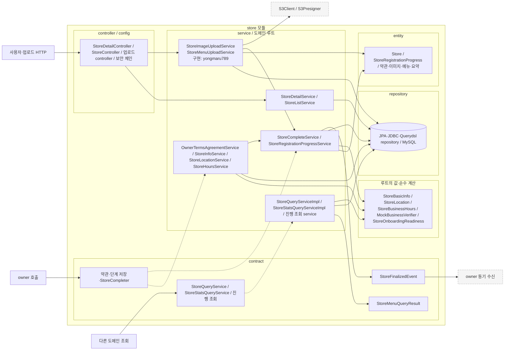
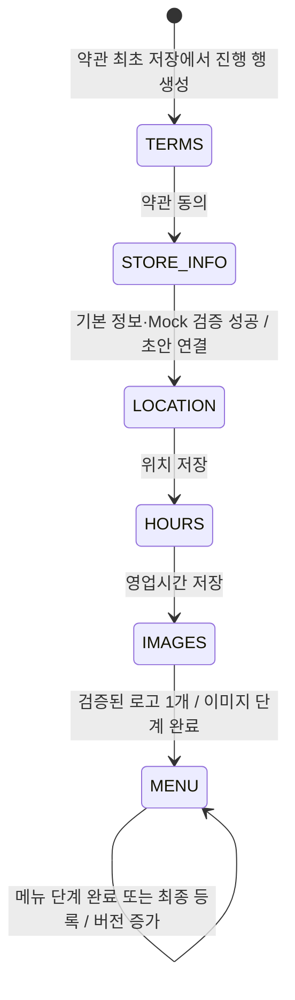
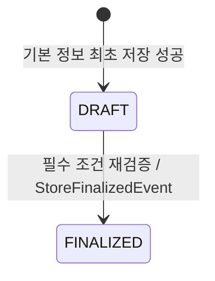
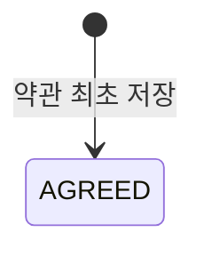
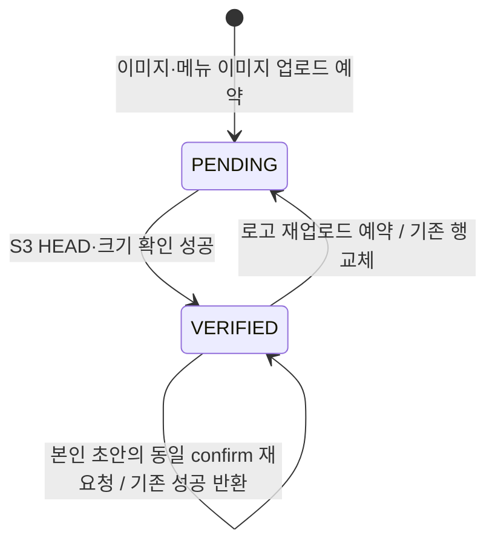
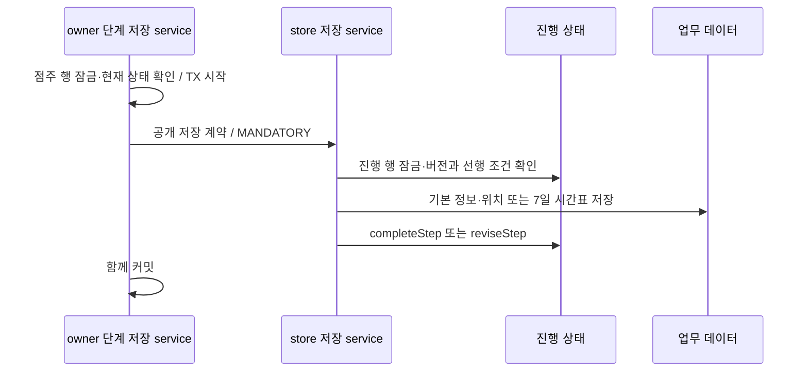
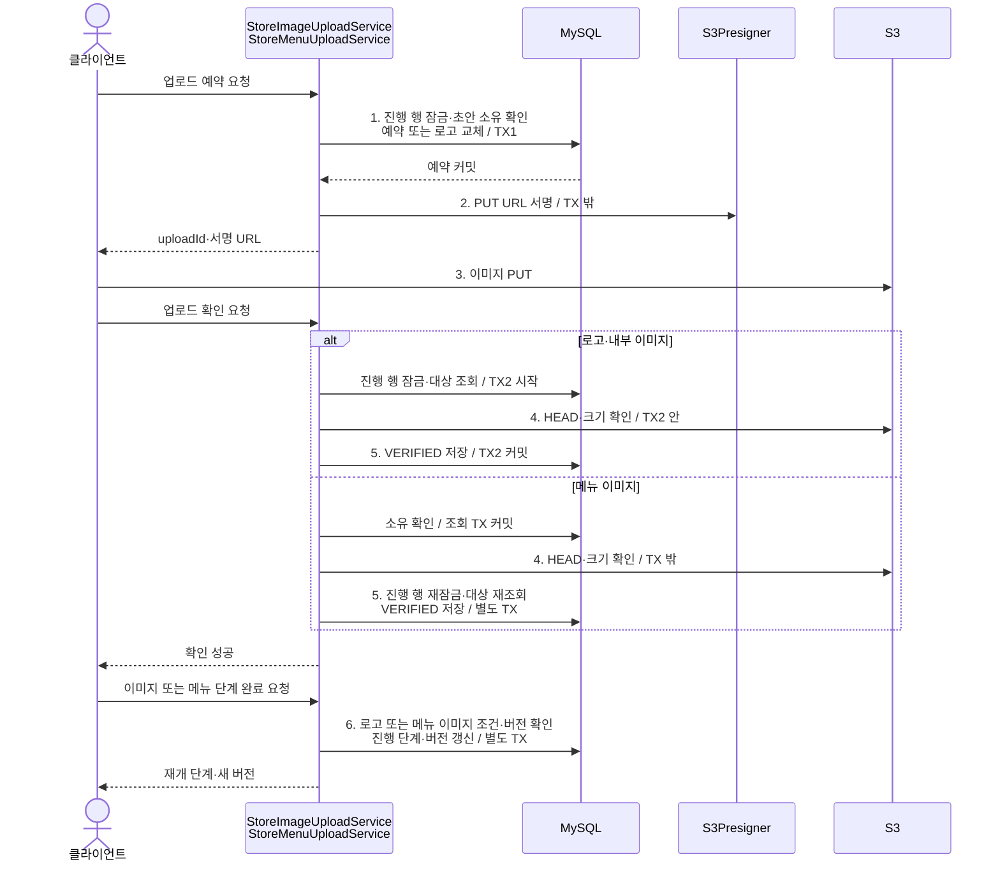

# store 구조와 동작 설계

**gyudongjeong**의 입점 등록·조회 기능과 공개 조회 계약을 정리한다. 2026-10-23에 병합한 develop의 코드·테스트와 기능별 구현 이슈를 근거로 작성했다.
예외로 온보딩 5단계의 로고·내부 이미지와 6단계의 대표 메뉴·메뉴 이미지 등록을 포함한다. 이 업로드·메뉴 기능의 최초 구현 담당자는 **yongmaru789**다. 최종 등록 판정·조회 정책 보정과 #679의 실패 로그 보완은 **gyudongjeong**의 작업으로 구분한다.
요청·응답은 [가게 명세](../../api-spec/store-api-spec.md), API별 절차는 [가게 API 설계](store-api-design.md)가 소유한다.

## 1. 범위

기본 범위의 기능 구현 담당자는 **gyudongjeong**이다. 해당 작성자의 develop 반영 기능을 다룬다. #534는 문서 정리 작업이며 기능 구현 근거가 아니다.

| 기능 | 구현·변경 이슈 |
|---|---|
| 진행 상태 저장 기반과 통합 단계 설계 | [#249](https://github.com/lunch-catch/lc-backend/issues/249), [#320](https://github.com/lunch-catch/lc-backend/issues/320) |
| 점주 약관 동의 | [#147](https://github.com/lunch-catch/lc-backend/issues/147) |
| 기본 정보·사업자 Mock 검증 | [#415](https://github.com/lunch-catch/lc-backend/issues/415) |
| 내 가게 조회·진행 상태 조회 | [#427](https://github.com/lunch-catch/lc-backend/issues/427), [#453](https://github.com/lunch-catch/lc-backend/issues/453) |
| 위치·영업시간 저장 | [#482](https://github.com/lunch-catch/lc-backend/issues/482), [#489](https://github.com/lunch-catch/lc-backend/issues/489) |
| 최종 등록·사용자 가게 상세 조회 | [#502](https://github.com/lunch-catch/lc-backend/issues/502), [#503](https://github.com/lunch-catch/lc-backend/issues/503) |
| 쿠폰·광고·분석·점주 목록이 사용하는 가게 조회 계약 | [#297](https://github.com/lunch-catch/lc-backend/issues/297), [#161](https://github.com/lunch-catch/lc-backend/issues/161), [#363](https://github.com/lunch-catch/lc-backend/issues/363), [#365](https://github.com/lunch-catch/lc-backend/issues/365) |
| 대표 이미지 조회·필수 검증 보정 | [#608](https://github.com/lunch-catch/lc-backend/issues/608), [#627](https://github.com/lunch-catch/lc-backend/issues/627) |
| 최종 등록·조회에서 내부 이미지를 선택 항목으로 처리 | [#633](https://github.com/lunch-catch/lc-backend/issues/633) |
| 쿠폰용 로고 임시 허용·이미지 없는 상세 조회 | [#647](https://github.com/lunch-catch/lc-backend/issues/647), [#650](https://github.com/lunch-catch/lc-backend/issues/650) |
| 목록·상세의 이미지·캠페인 데이터 오류 격리 | [#857](https://github.com/lunch-catch/lc-backend/issues/857) |
| 최종 등록·업로드 실패 로그 보정 | [#679](https://github.com/lunch-catch/lc-backend/issues/679) |
| 메뉴 데이터 오류를 정상 메뉴와 분리한 공개 조회 결과 | [#788](https://github.com/lunch-catch/lc-backend/issues/788) |

아래 세 기능만 다른 작성자의 구현을 예외로 포함한다. 정책 결정의 근거는 [가게 API 설계](store-api-design.md)의 이미지·대표 메뉴 절을 따른다.

| 예외로 포함하는 기능 | 구현 이슈 | 구현자 |
|---|---|---|
| 5단계 대표 이미지(로고) 업로드·교체 | [#588](https://github.com/lunch-catch/lc-backend/issues/588). 명세·설계는 #589다 | `yongmaru789` |
| 5단계 가게 내부(인테리어) 이미지 업로드 | [#375](https://github.com/lunch-catch/lc-backend/issues/375) | `yongmaru789` |
| 6단계 대표 메뉴·메뉴 이미지 등록 | [#389](https://github.com/lunch-catch/lc-backend/issues/389) | `yongmaru789` |

[#190](https://github.com/lunch-catch/lc-backend/issues/190)의 백엔드 카카오 검색 요구는 이후 #320의 프론트 검색·선택 방식으로 변경됐다. closed 상태만으로 현재 백엔드 검색 API가 구현되어 있다고 판단하지 않는다.
캠페인 요약은 사용자 상세가 읽는 저장 데이터와 연결 관계만 설명한다. 다른 팀원의 요약 저장·광고 대상 인원 집계·관리자 점주 목록 HTTP 구현은 이 문서의 기능 범위에 포함하지 않는다.
이슈의 초기 단계·조회 자동 생성 요구보다 #320·#453 등 후속 변경과 현재 코드·테스트를 우선한다.

| 맡는 것 | 맡지 않는 것 |
|---|---|
| 약관, 가게 초안·확정, 기본 정보·사업자 Mock 검증·위치·영업시간과 입점 진행 상태 | 점주 계정의 현재 상태·인증은 owner가 검증한다 |
| 내 가게·진행 상태·사용자 상세와 가게·메뉴·입점 수 공개 조회 | 캠페인 원본과 광고 노출·쿠폰 정책은 해당 도메인이 판단한다 |
| 가게가 소유한 캠페인 요약을 사용자 상세에서 읽는다 | 요약 저장·당일 준비·캠페인 상태 전달 구현은 이 문서에서 다루지 않는다 |
| 로고·내부 이미지·대표 메뉴와 메뉴 이미지 등록을 예외로 포함한다 | 세 기능의 구현자는 `yongmaru789`다 |

근거는 [아키텍처](../../architecture/런치캐치_도메인_구조와_의존성_설계.md) 1.2와 2.4, [진행 상태 설계](store-registration-progress.md)다.

이슈 링크는 구현 이력을 추적하는 용도다. 설계 결정의 근거는 이 문서 각 장에서 연결한 저장소 내부 명세·API 설계·아키텍처로 한정한다. 내부 문서가 이유를 정하지 않은 선택은 12장의 미정 사항으로 남긴다.

## 2. 애그리거트와 패키지

| 데이터 묶음 | 저장 | 규칙 |
|---|---|---|
| 가게 등록 | `store`, `store_registration_progress`, `owner_terms_agreement`, 영업시간 | 단계 입력과 진행 버전을 같은 트랜잭션에서 반영한다 |
| 이미지·메뉴 | `store_image`, `store_menu`, `store_menu_image` | 업로드 예약과 검증 상태를 구분한다 |
| 일일 캠페인 요약 | `store_campaign_summary` | 캠페인 원본 대신 공개 명령으로 받은 당일 사본을 읽는다 |

위 표는 저장 데이터를 묶은 것이며 각 행을 독립 애그리거트로 확정한 표는 아니다. 현재 진행 상태와 업무 데이터는 같은 트랜잭션으로 저장한다.
진행 상태를 독립 애그리거트로 해석하면 같은 도메인의 두 애그리거트를 한 트랜잭션에 묶지 않는 가이드와 충돌한다. 정확한 경계 확정은 12장의 미정 사항으로 남긴다.
현재 저장·잠금 범위의 근거는 [가게 API 설계](store-api-design.md)의 "`STORE_INFO` 저장" 절에 있는 "접근 확인과 트랜잭션" 항목이다.

```text
store/
├── config/
│   ├── OwnerStoreSecurityConfig.java
│   └── StoreSecurityConfig.java
├── contract/
│   ├── FinalizedStoreCounts.java
│   ├── OwnerStoreOverview.java
│   ├── OwnerStoreSnapshot.java
│   ├── OwnerTermsAgreementRecorder.java
│   ├── StoreAdCandidateInfo.java
│   ├── StoreCampaignStatus.java
│   ├── StoreCompleteResult.java
│   ├── StoreCompleter.java    owner가 호출하는 최종 등록 계약
│   ├── StoreDiscountTargetType.java
│   ├── StoreDiscountType.java
│   ├── StoreFinalizedEvent.java    owner가 받는 가게 최종 등록 이벤트
│   ├── StoreHoursSaveCommand.java
│   ├── StoreHoursSaveResult.java
│   ├── StoreHoursSaver.java
│   ├── StoreInfo.java
│   ├── StoreInfoSaveCommand.java
│   ├── StoreInfoSaveResult.java
│   ├── StoreInfoSaver.java
│   ├── StoreLocationSaveCommand.java
│   ├── StoreLocationSaveResult.java
│   ├── StoreLocationSaver.java
│   ├── StoreMenuInfo.java
│   ├── StoreMenuQueryResult.java    정상 메뉴와 데이터 오류 ID를 나누어 반환한다
│   ├── StoreOnboardingQuery.java
│   ├── StoreOnboardingStatus.java
│   ├── StoreQueryService.java    가게·메뉴·광고 후보·본인 가게 조회를 공개한다
│   ├── StoreRegistrationQuery.java
│   ├── StoreStatsQueryService.java    분석의 영업일별 입점 수 조회를 공개한다
│   ├── StoreSummary.java
│   └── TermsAgreementResult.java
├── controller/
│   ├── StoreController.java
│   ├── StoreDetailController.java
│   ├── StoreImageController.java
│   └── StoreMenuController.java
├── entity/
│   ├── OwnerTermsAgreement.java
│   ├── Store.java
│   ├── StoreCampaignSummary.java
│   ├── StoreImage.java
│   ├── StoreImageType.java
│   ├── StoreImageUploadStatus.java
│   ├── StoreMenu.java
│   ├── StoreMenuImage.java
│   ├── StoreRegistrationProgress.java    진행 단계·연결 가게·버전을 보관한다
│   └── StoreRegistrationStep.java
├── exception/
│   ├── StoreErrorCode.java
│   └── StoreException.java
├── repository/
│   ├── OwnerStoreQueryRepository.java
│   ├── OwnerTermsAgreementRepository.java
│   ├── StoreBusinessHourRepository.java
│   ├── StoreCampaignSummaryRepository.java
│   ├── StoreDetailData.java
│   ├── StoreDetailRepository.java
│   ├── StoreImageRepository.java
│   ├── StoreMenuImageRepository.java
│   ├── StoreMenuRepository.java
│   ├── StoreOnboardingQueryRepository.java
│   ├── StoreQueryRepository.java
│   ├── StoreRegistrationProgressRepository.java
│   ├── StoreRepository.java
│   ├── StoreRepositoryCustom.java
│   ├── StoreRepositoryImpl.java
│   └── StoreStatsQueryRepository.java
├── service/
│   ├── OwnerTermsAgreementService.java
│   ├── StoreCompleteService.java    가게 확정과 최종 등록 이벤트 발행을 처리한다
│   ├── StoreDetailService.java
│   ├── StoreHoursService.java
│   ├── StoreImageUploadService.java    yongmaru789의 로고·내부 이미지 업로드 구현
│   ├── StoreInfoService.java
│   ├── StoreListService.java
│   ├── StoreLocationService.java
│   ├── StoreMenuUploadService.java    yongmaru789의 대표 메뉴·메뉴 이미지 등록 구현
│   ├── StoreQueryServiceImpl.java    StoreQueryService 구현
│   ├── StoreRegistrationProgressQueryService.java
│   ├── StoreRegistrationProgressService.java    진행 버전·단계 저장을 처리한다
│   ├── StoreRegistrationQueryService.java
│   ├── StoreStatsQueryServiceImpl.java    StoreStatsQueryService 구현
│   └── StoreUploadSupport.java    업로드 공통 검증·사전 서명·S3 확인 실패 기록을 지원한다
├── BusinessVerificationStatus.java
├── MockBusinessVerifier.java    외부 API 없이 사업자번호 Mock 검증을 수행한다
├── StoreBasicInfo.java
├── StoreBusinessHours.java    7일 영업시간을 정규화하고 검증한다
├── StoreImageUrlResolver.java    객체 키를 CDN URL로 변환한다
├── StoreLocation.java
└── StoreOnboardingReadiness.java    실제 저장값으로 단계 완료와 최종 등록 가능 여부를 계산한다
```

가게 등록 HTTP 진입점 일부는 owner에 둔다. store는 owner 내부를 역참조하지 않는다.
입구는 HTTP와 공개 contract 호출이다. 자체 스케줄·수신 이벤트는 없고 최종 등록 이벤트를 발행한다.
가게·점주·캠페인 관계는 ID로 전달한다. 읽기 전용 엔티티와 쓰기 엔티티의 경계는 [API 설계](store-api-design.md)를 따른다.

### 규칙을 두는 곳

| 규칙 | 두는 곳 |
|---|---|
| 기대 버전·단계 전이·연결할 가게 ID | `StoreRegistrationProgress` |
| 기본 정보·좌표·시간표의 유효성 | `StoreBasicInfo`, `StoreLocation`, `StoreBusinessHours` |
| 실제 저장 데이터로 단계 완료와 최종 등록 가능 여부 계산 | `StoreOnboardingReadiness` |
| 정상 메뉴·이미지 데이터 오류 분류와 URL 변환 | `StoreQueryServiceImpl`, `StoreImageUrlResolver` |
| 메뉴 조회의 두 결과 목록을 방어적으로 복사한다 | `StoreMenuQueryResult` |
| 저장 순서·소유 가게·트랜잭션·이벤트 | 각 service |
| 점주 상태·역할 검사 | owner service와 해당 경로의 security config |

## 3. 저장

MySQL이 원본이며 store 자체의 Valkey 캐시는 없다. `store.owner_id`와 진행 상태의 owner·store UNIQUE가 중복 연결을 막는다.
약관은 가게 생성 전 owner ID로 저장한다. 기본 정보 검증 성공 때 초안을 만들고 ID를 진행 상태에 연결한다.
좌표는 DECIMAL(10,7), 최종 등록 시각은 KST의 `finalized_at`으로 저장한다. 시간표는 정규화한 7일 전체를 교체한다.
상세 필드·제약은 [API 설계](store-api-design.md), 조회 정책은 [공개 조회 계약](store-query-contract.md)을 따른다.

**결정: 진행 위치와 실제 완료 여부를 구분한다.** 진행 위치만 믿으면 누락·불완전 데이터를 완료로 오인한다.
실제 데이터 검증은 조회 비용이 늘지만 최종 등록도 같은 `StoreOnboardingReadiness`를 사용해 판정을 맞춘다.
메뉴 0개는 허용하며 메뉴가 하나라도 있으면 모두 유효해야 한다. 근거는 [진행 상태 설계](store-registration-progress.md)다.

5단계 이미지 완료와 최종 등록은 검증된 로고 1개를 요구한다. 내부 이미지는 0~3개의 선택 항목이며 미검증 업로드가 남아 있어도 최종 등록을 막지 않는다. 조회에는 `VERIFIED`만 포함한다. 이 판정 보정은 `gyudongjeong`의 #627·#633이며 로고·내부 이미지 업로드 자체는 `yongmaru789`의 구현이다.
6단계 메뉴도 0~3개의 선택 항목이다. 메뉴가 없으면 `MENU`의 완료 표시가 `false`여도 필수 조건을 갖춰 최종 등록할 수 있으며 빈 메뉴 저장·완료 요청은 필수가 아니다. 메뉴가 있으면 이름·가격과 검증된 이미지가 필요하다.
로고 재업로드는 기존 행을 `PENDING`으로 되돌리고 메뉴 이미지는 기존 `PENDING` 예약만 교체하며 `VERIFIED` 재예약은 거부한다. 상세 조건은 [가게 API 설계](store-api-design.md)의 이미지·대표 메뉴 절이 소유한다.
현재 develop은 #647의 임시 정책으로 쿠폰용 `findAllById`의 대표 이미지 누락·미검증·공백 키를 `null` URL로 반환한다. 최종 등록의 로고 필수 검증은 유지하며 복원 조건은 [공개 조회 계약](store-query-contract.md#이미지-url)이 소유한다. #627의 과거 필수 조회 검증을 현재 읽기 정책으로 되돌리지 않는다.

캠페인 요약은 다른 도메인 데이터의 사본이다. 직접 조인하면 최신 원본을 읽지만 도메인 내부에 의존한다.
현재 구조는 store 소유 요약만 읽어 경계를 지키는 대신 호출자가 상태·영업일별 갱신을 전달해야 한다. 요약 갱신이 없으면 캠페인 원본의 최신성을 보장하지 않는다.

DB 제약과 코드 검사는 [API 설계](store-api-design.md)의 저장 규칙을 따른다. `store_id`는 가게 내부 FK, `owner_id`는 도메인 간 ID 참조다.
가게는 현재 확정 여부·확정 시각을 보관하며 등록 취소·변경 이력 원장은 없다. 입점 수는 원본 가게를 SQL로 집계하며 별도 카운터를 두지 않는다.
캠페인 요약을 준비하는 쪽의 책임은 [가게 API 설계](store-api-design.md)의 "요약을 저장하는 공개 계약" 절을 참조한다. 일반 조회의 조인·분할 방식은 [공개 조회 계약](store-query-contract.md)에 모은다.

메뉴 공개 조회(#788)는 기존 `store`·`store_menu`·`store_menu_image`를 SQL 한 번으로 읽는다. `VERIFIED` 조건의 LEFT JOIN 뒤 이미지 키가 없거나 공백인 행은 오류 ID로 분류한다. 스키마·SQL·캐시를 추가하지 않는다.

## 4. 계산 로직

| 구현 | 계산 |
|---|---|
| `MockBusinessVerifier` | 숫자 10자리만 받는다. `0000000000`만 `FAILED`, 나머지는 `VERIFIED`다. 외부 검증이 아니다 |
| `StoreBusinessHours` | 생략한 요일을 휴무로 채우고 7일 시간표의 유효성을 판정한다 |
| `StoreLocation` | 좌표 범위·문자열 길이를 검사하고 소수 일곱 자리로 맞춘다 |
| `StoreOnboardingReadiness` | 단계별 완료, 첫 미완료 단계와 최종 등록 가능 여부를 계산한다 |

시간·설정·조회값은 서비스가 제공한다. 계산 결과가 DB나 외부 기관의 사업자 진위를 보장하지 않는다.

## 5. 모듈 연결

| 방향 | 공개 계약 | 사용 |
|---|---|---|
| 쓰기 수신 | `OwnerTermsAgreementRecorder`, `StoreInfoSaver`, `StoreLocationSaver`, `StoreHoursSaver`, `StoreCompleter` | owner가 점주를 잠그고 같은 트랜잭션에서 호출한다 |
| 조회 공개 | `StoreRegistrationQuery`, `StoreOnboardingQuery`, `StoreQueryService` | owner의 화면 복원·쿠폰·광고·가게 조회 소비자가 사용한다 |
| 통계 공개 | `FinalizedStoreCounts finalizedStoreCounts(LocalDate businessDate)` | 분석이 KST 신규·누적 입점 수를 읽는다 |
| 이벤트 발행 | `StoreFinalizedEvent(ownerId, storeId)` | owner가 같은 트랜잭션에서 `ACTIVE`로 전환한다 |

`StoreQueryService`의 가게·메뉴·후보·점주 요약 메서드와 반환 record는 [공개 조회 계약](store-query-contract.md)이 소유한다.
업로드 구현만 S3를 호출한다. 일반 조회는 DB 객체 키로 CDN URL을 만들며 S3나 다른 도메인의 업무 API를 호출하지 않는다.

HTTP로 노출되는 단계 저장·화면 조회 계약의 시그니처와 record 설명은 [가게 API 설계](store-api-design.md), [공개 조회 계약](store-query-contract.md)에 둔다. 엔드포인트가 없는 공개 조회의 입출력은 다음과 같다.

| 공개 메서드 | 반환 record·자료형 |
|---|---|
| `findAllById(List<Long> storeIds)` | `List<StoreInfo>` |
| `findMenusByIdIn(List<Long> menuIds)` | `StoreMenuQueryResult(List<StoreMenuInfo> menus, List<Long> invalidMenuIds)` |
| `canManageStore(Long ownerId, Long storeId)` | `boolean` |
| `findAdCandidatesByStoreIds(List<Long> storeIds)` | `List<StoreAdCandidateInfo>` |
| `findSummariesByOwnerIds(Collection<Long> ownerIds)` | `List<StoreSummary>` |
| `findOwnerIdsByNameContaining(String keyword, int limit)` | `List<Long>` |
| `finalizedStoreCounts(LocalDate businessDate)` | `FinalizedStoreCounts(long newCount, long cumulativeCount)` |

가게·메뉴 record의 필드와 `null`·누락 정책은 [공개 조회 계약](store-query-contract.md)의 "반환 정책"과 "이미지 URL" 절이 소유한다. [StoreQueryService](../../../src/main/java/com/lunchcatch/store/contract/StoreQueryService.java)의 반환 타입을 사용하며 HTTP DTO를 받지 않는다.
`StoreRegistrationQuery.findResumeStep(Long ownerId)`는 `String`, `StoreOnboardingQuery.getProgress(Long ownerId)`는 `StoreOnboardingStatus`를 반환한다. 후자는 가게 ID·재개 단계·버전·확정 여부·최종 등록 가능 여부와 `Step(step, required, completed)` 목록을 갖는다.
메뉴 조회(#788)는 정상 메뉴를 `menus`에, 필수 이미지 누락·미검증·공백 키의 메뉴 ID를 `invalidMenuIds`에 담는다. 두 목록을 방어적으로 복사하고 존재하지 않거나 최종 등록 전인 메뉴는 두 목록 모두에서 제외한다. 광고·쿠폰·포스터 호출자는 자기 정책에 따라 오류 ID를 처리하며 상세는 [메뉴 조회 결과](store-query-contract.md#메뉴-조회-결과-788)가 소유한다.
일반 조회는 타 업무 도메인을 호출하거나 결과 캐시를 두지 않는다. 최종 등록은 이벤트를 1회 발행하며 owner의 내부 구현을 직접 호출하지 않는다.

## 6. 구조와 동작 그림

### 모듈 구조



### 상태 변경



`TERMS` 이외의 완료한 이전 단계 재저장은 재개 위치를 유지하고 버전만 올린다. 약관 재동의는 `TERMS-001`, 버전·단계 충돌은 명세의 STORE 오류로 거부한다.



`DRAFT`·`FINALIZED`는 `Store.finalized`의 의미를 나타낸다. 별도 enum은 없다. 등록 취소 경로는 없다.
업로드의 `PENDING → VERIFIED`는 S3 객체 검증 성공 때만 일어난다. 로고만 재업로드 시 같은 행을 `PENDING`으로 되돌린다. 캠페인 요약 상태는 전달받은 사본이며 store가 캠페인 전이를 결정하지 않는다.

약관 동의는 미저장 → 최초 동의 완료 이후 수정·철회 전이가 없다. 메뉴의 입력 유효성은 별도 상태 enum이 아니라 업무 데이터로 계산한다.





`AGREED`는 약관의 `agreed=true`, `agreed_at` 존재, 철회 없음이라는 저장 조건을 표시한 이름이다. 별도 enum은 없다.
이미지와 메뉴 이미지의 공통 전이는 검증과 같은 confirm의 재요청이다. `VERIFIED → PENDING`은 로고에만 해당하며 메뉴 이미지의 검증 완료 후 재업로드는 거부한다. 두 업로드 서비스의 구현자는 `yongmaru789`다.

| 전이·변경 | 일으키는 쪽 | 나가는 이벤트 | 금지일 때 응답 |
|---|---|---|---|
| `TERMS` → `STORE_INFO` | 점주 약관 동의 | 없음 | 중복 `TERMS-001`, 단계 `STORE-002` |
| `STORE_INFO` → `LOCATION` | 기본 정보·Mock 검증 성공 | 없음 | 입력 실패는 저장하지 않고, 버전은 `STORE-001` |
| `LOCATION` → `HOURS` → `IMAGES` → `MENU` | 해당 단계 최초 완료 | 없음 | 선행 단계·버전·연결 검증은 [가게 명세](../../api-spec/store-api-spec.md)를 따른다 |
| 완료한 단계 재저장·`MENU` 유지 | 이전 단계 수정·메뉴 단계 완료·최종 등록 | 최종 등록 외에는 없음 | 버전 `STORE-001`, 단계 `STORE-002` |
| `DRAFT` → `FINALIZED` | 점주의 최종 등록 | `StoreFinalizedEvent` 1회 | 조건 미충족 `STORE-015`, 잘못된 연결 `STORE-004` |
| `PENDING` → `VERIFIED`·`VERIFIED` 유지 | 이미지·메뉴 이미지 confirm | 없음 | 객체 없음 `STORE-009`, 크기 `STORE-006`, 대상·소유 검증은 가게 명세를 따른다 |
| `VERIFIED` → `PENDING`(로고만) | 점주가 로고 업로드를 다시 예약한다 | 없음 | 최종 등록된 가게는 온보딩 업로드를 거부한다 |

전이 조건의 단일 기준은 [진행 상태 설계](store-registration-progress.md)와 [가게 API 설계](store-api-design.md)다.

### 주요 흐름

**단계 저장.** 점주 확인부터 업무 데이터·진행 버전 갱신까지 같은 트랜잭션이다. 최종 등록의 동기 `ACTIVE` 전환은 [owner 설계](../owner/owner_구조와_동작_설계.md)의 주요 흐름을 따른다.



최종 등록은 같은 잠금 순서에서 `StoreCompleteService`가 실제 필수 데이터를 다시 검증한다. 가게 확정·버전 증가 후 동기 이벤트가 owner를 `ACTIVE`로 바꾼다.

| 실패 지점 | 남는 상태 | 다시 요청하면 |
|---|---|---|
| 기본 정보 Mock 실패 | 초안·진행 상태를 바꾸지 않는다 | 올바른 입력과 현재 버전으로 요청한다 |
| 단계 업무 저장 또는 진행 갱신 | 같은 트랜잭션의 변경을 모두 롤백한다 | 버전 충돌이면 조회 후 새 버전을 사용한다 |
| 최종 등록의 상태 수신·커밋 | 가게·진행·owner 변경을 함께 롤백한다 | 응답 유실 시 내 가게·내 정보에서 현재 상태를 확인한다 |
| 사용자 상세의 이미지·대상 메뉴 데이터 오류 | 해당 이미지나 캠페인을 제외하고 WARN 로그를 남긴다. 메뉴 자체는 이미지 없이 유지할 수 있다 | DB 장애와 정상 이미지의 CDN 설정 오류는 전파한다 |

**5·6단계 업로드.** 아래 로고·내부 이미지·대표 메뉴 구현은 `yongmaru789`의 작업이다. 메뉴 이미지는 메뉴 정보를 먼저 저장한 뒤 예약하며, 파일 전송은 클라이언트가 S3에 직접 한다.



| 실패 지점 | 남는 상태 | 다시 요청하면 |
|---|---|---|
| 1. 예약·로고 교체 | 해당 TX를 롤백한다 | 현재 초안·개수 제한을 다시 확인한다 |
| 2. URL 서명 | 새 예약은 별도 TX로 삭제를 시도한다. 기존 로고를 교체한 경우에는 `PENDING` 행을 유지한다 | 로고·메뉴는 예약 정책에 따라 다시 요청한다. 보상 실패로 남은 내부 이미지 예약은 개수 제한에 포함된다 |
| 3~5. 업로드·검증·DB 저장 | 검증되지 않은 예약이나 S3 객체가 남을 수 있다. DB 롤백이 S3 객체를 지우지는 않는다 | 본인 초안의 현재 uploadId로 확인한다. 이미 `VERIFIED`면 성공하며 이전 uploadId와 최종 등록 후 확인은 거부한다 |
| 6. 단계 완료 | 앞서 검증한 이미지는 유지하고 단계·버전 변경만 롤백한다 | 현재 버전과 필수 조건으로 다시 완료한다 |

**메뉴 일괄 조회(#788).** 입력 ID를 검증하고 기존 SQL 한 번으로 조회한다. 모든 행을 순회해 정상 메뉴와 데이터 오류 ID를 나눈다. 오류 행 뒤 정상 메뉴의 URL 변환이 실패해도 전체 호출은 실패하며 부분 결과를 반환하지 않는다.

| 실패 지점 | 남는 상태 | 다시 요청하면 |
|---|---|---|
| 메뉴 이미지 데이터 오류 | 쓰기 없이 `invalidMenuIds`에 해당 ID를 담는다 | 호출자가 오류 ID를 구분해 자기 정책을 적용한다 |
| SQL·정상 이미지 URL 변환 실패 | 쓰기가 없고 결과도 반환하지 않는다 | 실제 DB·설정 장애를 해결한 뒤 조회한다 |

## 7. 트랜잭션과 동시성

| 흐름 | 한 DB 트랜잭션에 묶는 것 | 트랜잭션 밖·별도 처리 |
|---|---|---|
| 메뉴 공개 조회(#788) | 기존 읽기 전용 TX를 유지한다. 쓰기·잠금을 추가하지 않는다 | 시간·영업일 분기가 없으며 조회 후 이미지 상태 변경까지 보장하지 않는다 |
| 약관·기본 정보·위치·`ONBOARDING` 시간표 | 호출자의 점주 확인, 업무 데이터와 진행 버전 갱신 | 외부 API 호출 없음 |
| `ACTIVE` 시간표 | 점주 확인·본인 확정 가게 확인·7일 전체 교체 | 진행 상태는 접근하지 않는다 |
| 최종 등록 | 진행 잠금·실제 조건 확인·가게 확정·버전 증가·owner의 동기 `ACTIVE` 전환 | owner의 커밋 후 상태 캐시 삭제 |
| 로고·내부·메뉴 이미지 예약 | 진행 행 잠금, 본인 미확정 가게 확인, `PENDING` 예약 또는 로고 교체 | 서명과 실패 시 별도 신규 예약 삭제. 기존 로고 교체 실패는 `PENDING`을 유지한다 |
| 로고·내부 이미지 confirm | 진행 행 잠금·대상 조회·S3 HEAD·`VERIFIED` 저장 | 현재 HEAD가 안에 있어 가이드와 차이가 있다 |
| 메뉴 등록·단계 완료 | 진행 행 잠금 아래 메뉴 개수 또는 이미지 조건을 확인하고 저장한다. 단계 완료 때만 진행 버전을 갱신한다 | 외부 호출 없음 |
| 메뉴 confirm | 첫 TX에서 소유 확인, HEAD 후 별도 TX에서 진행 행 재잠금·현재 상태 재조회·`VERIFIED` 저장 | 두 TX 사이에 S3 HEAD를 호출한다 |

등록과 업로드 경계의 근거는 [가게 API 설계](store-api-design.md)다. 로고·내부 이미지 confirm의 기존 구현 차이는 12장에서 담당자 결정을 기다린다. 업로드·메뉴 구현자는 `yongmaru789`다.

약관·기본 정보·위치·`ONBOARDING` 시간표·최종 등록은 점주 → 진행 상태 → 업무 데이터 순서로 잠근다.
진행 버전은 JPA `@Version`이 아니라 잠금 아래 명시적으로 비교·증가하는 값이다.
동시 최초 저장은 `owner_id` UNIQUE와 점주 행 잠금으로 중복 생성을 막는다. `ACTIVE` 시간표는 점주 행 잠금 아래 전체 교체하며 온보딩 버전을 사용하지 않는다.
영업시간 JDBC batch와 JPA 진행 변경은 같은 데이터소스 트랜잭션에 참여한다.

같은 내용의 단계 저장도 버전을 올리므로 이전 버전의 반복 요청을 성공으로 취급하지 않는다.
최종 등록은 `ONBOARDING`·미확정 가게만 허용한다. 응답을 잃은 재요청은 조회로 결과를 확인해야 한다.
store 자체에 이벤트 지연 적용 큐는 없다. 최종 등록 이벤트의 동기 처리와 커밋 후 캐시 삭제의 선택 이유는 [owner 설계](../owner/owner_구조와_동작_설계.md)를 따른다.

로고·내부 이미지 confirm은 `@Transactional` 안에서 S3 HEAD를 호출한다. 진행 행 잠금으로 로고 교체·최종 등록과의 경합을 막지만 S3 지연 동안 DB 연결과 잠금을 점유한다. 메뉴 confirm은 HEAD 전후의 별도 TX에서 같은 대상을 확인한다. 모든 외부 호출이 트랜잭션 밖이라고 일반화하지 않는다.

| 흐름 | 같은 요청이 다시 옴 | 같은 점주의 동시 요청 | 여러 점주가 같은 자원에 씀 | 이벤트 지연·순서 역전 |
|---|---|---|---|---|
| 약관·단계 저장 | 약관은 중복 거절, 다른 단계는 최신 버전이 필요하다 | 점주·진행 행의 비관 잠금과 명시적 버전 비교를 쓴다 | `owner_id`·`store_id` UNIQUE와 소유 검증을 적용한다 | 해당 없음 |
| `ACTIVE` 영업시간 교체 | 같은 전체 시간표로 수렴한다 | 점주 비관 잠금으로 나중 요청 전체를 반영한다 | 점주별 가게가 분리된다 | 해당 없음 |
| 최종 등록 | 현재 상태·버전 확인 후 거절하며 응답 유실은 조회로 확인한다 | 단계 저장과 같은 잠금 순서를 쓴다 | 소유 가게와 진행 연결을 확인한다 | 동기 이벤트만 사용한다 |
| 업로드 예약·확인 | 동일 confirm은 `VERIFIED`이면 성공한다. 로고 재예약은 같은 행을 교체하며 메뉴는 `PENDING` 예약만 교체한다 | 예약·confirm·완료가 같은 진행 행을 잠그며 메뉴 confirm은 HEAD 후 다시 확인한다 | 업로드 ID와 가게·메뉴 소유를 확인한다 | 자체 이벤트는 없다 |

잠금은 단계·실제 데이터를 함께 검사하지만 DB 대기를 만든다. 버전만 비교하면 화면 충돌은 알 수 있어도 동시 최초 생성·상태 변경 전체를 직렬화하지 못한다.
현재 조합은 [API 설계](store-api-design.md)가 근거다. store가 별도 비동기 실행기나 큐를 선택한 것은 아니다.

## 8. 외부 API

사업자번호는 순수 Mock, 카카오 장소는 프론트 확정값 저장이므로 이 두 저장 기능은 외부 API를 호출하지 않는다.
`yongmaru789`가 구현한 로고·내부 이미지·대표 메뉴 업로드의 예약·서명·확인은 [가게 API 설계](store-api-design.md)의 이미지·대표 메뉴 절, [장애 처리 설계](store_장애_처리_설계.md)의 S3 절을 따른다.
일반 CDN URL 조합은 객체 존재를 네트워크로 확인하는 작업이 아니다.

## 9. 실패 처리

직접 결제·잔액을 변경하는 흐름은 해당 없다. 업로드 개수와 등록 상태의 경합은 6·7장의 표를 따른다. 메뉴 데이터 오류는 반환 record로 구분하며 사용자 목록·상세는 해당 이미지·캠페인만 제외한다. 실제 DB·CDN 설정 장애를 데이터 오류로 숨기지 않는 정책과 S3 부분 실패는 [장애 처리 설계](store_장애_처리_설계.md)가 소유한다.

## 10. 배치

store가 등록한 배치 작업은 없다. 분석 배치는 KST 입점 수 조회를, 광고 배치는 후보 일괄 조회를 호출한다.
신규 수는 해당 날짜 00:00 이상 다음 날 00:00 미만, 누적 수는 다음 날 00:00 미만의 `finalized` 가게를 SQL 한 번으로 센다.
같은 DB 상태·날짜의 재조회는 같은 수치이며 누적 저장하지 않는다. 조회 실패 시 호출자에게 예외를 전파한다.

## 11. 성능

| 흐름 | 현재 비용·상한 |
|---|---|
| 쿠폰용 가게·메뉴 목록, 광고 후보 | 각 비어 있지 않은 조회는 SQL 1회다. 메뉴 결과는 한 번 순회하며 목록 크기는 조회된 행 수에 비례한다. 메뉴별 재조회·외부 호출은 없고 #788이 새 입력 상한을 정하지는 않는다. 광고 후보 입력은 중복 포함 최대 5,000개다 |
| 관리자 점주 목록용 요약 | 최대 100명, SQL 1회다. 상호 검색 limit는 최대 10,000이며 초과 결과를 일부 반환하지 않는다 |
| 입점 수 집계 | 날짜 경계를 앱에서 계산하고 SQL 1회로 두 수치를 반환한다 |
| 사용자 상세 | 가게·대표 이미지·영업시간·내부 이미지·메뉴·당일 캠페인을 나눠 읽는다. 메뉴 수만큼 재조회하지 않는다 |
| 내 가게·진행 조회 | 실제 단계 데이터를 추가 조회한다. 세부 조회 정책은 공개 조회 계약이 소유한다 |
| 로고·내부·메뉴 이미지 업로드 | 서명은 예약 커밋 뒤 1회다. 미검증 객체 confirm은 S3 HEAD 1회이며 파일 PUT은 클라이언트가 직접 한다. 로고 1개·내부 이미지 3개·메뉴 3개 제한과 진행 행 잠금이 경합 지점이다 |

후보 호출 TPS가 T이면 가게 후보 읽기는 T회의 SQL이며 5,000개 초과 분할은 호출자가 수행한다.
상세와 단계별 쓰기를 포함한 전체 처리량·대용량 메뉴 응답 메모리는 실측하지 않았다. 기존 통합 테스트의 시간 확인을 운영 용량 보장으로 보지 않는다.

사용자 상세는 가게 존재 시 SQL 6회로 구성되므로 상세 TPS가 D이면 기본 읽기는 약 6D회다. 인증 정책의 추가 조회는 이 계산과 별도로 센다.
확인 방법은 최대 후보 입력·단일 가게 동시 저장·메뉴 수가 많은 조회를 나누어 SQL 수, 잠금 대기, 응답 크기와 p95를 측정하는 것이다. 목표 TPS·지연 목표는 API 설계 담당자가 확정해야 하며 현재 구조의 충족 여부는 미정이다.

## 12. 테스트와 미정 사항

| Given(조건)·When(요청) | Then(기대 결과) | 근거 테스트 |
|---|---|---|
| 약관 최초·중복 저장과 기본 정보 Mock 실패 | 중복·잘못된 순서를 막고 실패 입력을 저장하지 않는다 | `OwnerTermsAgreementIntegrationTest`, `StoreInfoIntegrationTest` |
| 위치·시간표 동시 저장 또는 후속 갱신 실패 | 버전 경합을 거부하고 업무 데이터도 롤백한다 | `StoreLocationIntegrationTest`, `StoreHoursIntegrationTest`, `StoreRegistrationProgressIntegrationTest` |
| 초안 전·불완전 시간표·메뉴 0개 조회 | GET에서 쓰지 않고 실제 완료 조건으로 판정한다 | `StoreOnboardingStatusIntegrationTest`, `OwnerStoreIntegrationTest` |
| 필수 조건을 갖추거나 수신 처리가 실패한 최종 등록 | 성공 때만 가게·owner를 함께 확정한다 | `StoreCompleteIntegrationTest` |
| 공개 조회의 부재·이미지 누락·DB 실패 | 계약별 부재와 정합성·장애를 구분한다 | `StoreQueryIntegrationTest`, `StoreStatsQueryIntegrationTest` |
| 사용자 상세의 등록 전 가게·메뉴 없음·이미지 데이터 오류 | 등록 전은 부재, 메뉴 없음은 빈 목록이다. 이미지·캠페인 데이터 오류는 해당 항목만 제외하며 실제 장애는 전파한다 | `StoreDetailIntegrationTest`, `StoreDetailServiceTest` |
| 정상 메뉴와 이미지 누락·미검증·공백 키 메뉴가 섞여 있다 | `menus`와 `invalidMenuIds`를 함께 반환하고 두 목록은 겹치지 않는다 | `StoreQueryServiceImplTest`, `StoreQueryIntegrationTest` |
| 최종 등록 커밋·롤백과 S3 확인·보상 실패가 발생한다 | 커밋 여부와 실패 단계별 이벤트를 기록하고 민감정보를 제외한다 | `StoreCompleteServiceTest`, `StoreImageUploadServiceTest`, `StoreMenuUploadServiceTest` |
| 오류 메뉴 뒤 정상 메뉴의 CDN 설정 오류 또는 SQL 장애가 발생한다 | 결과를 반환하지 않고 실제 장애를 전파한다 | `StoreQueryServiceImplTest` |
| 오류 메뉴를 광고·쿠폰·포스터가 사용한다 | 광고는 해당 캠페인만 제외하며 쿠폰·포스터는 각 도메인의 실패 정책을 유지한다 | `CandidateLoadServiceTest`와 각 호출자의 단위 테스트 |

| 추가 Given·When | Then | 근거 테스트 |
|---|---|---|
| `TERMS`에서 최초 약관을 저장한다 | `STORE_INFO`로 진행하며 중복은 거부한다 | `OwnerTermsAgreementIntegrationTest` |
| 각 선행 단계와 최신 버전을 갖추고 기본 정보·위치·시간표를 저장한다 | `LOCATION`·`HOURS`·`IMAGES`로 각각 진행한다 | `StoreInfoIntegrationTest`, `StoreLocationIntegrationTest`, `StoreHoursIntegrationTest` |
| `IMAGES`에서 검증된 로고를 갖추고 완료한다 | `MENU`로 진행하고 버전을 증가시킨다 | `StoreImageSecurityIntegrationTest` |
| `MENU`에서 입력한 메뉴의 이미지를 모두 검증하고 완료한다 | `MENU`를 유지하며 버전만 증가한다. 메뉴 0개도 허용한다 | `StoreMenuSecurityIntegrationTest` |
| 로고 없이 완료하거나 기존 로고를 다시 예약한다 | 미검증 로고로는 완료하지 못하며 재예약은 같은 행을 `PENDING`으로 되돌린다 | `StoreImageUploadServiceTest`, `StoreImageSecurityIntegrationTest` |
| 검증된 로고와 미완료 내부 이미지가 있고 나머지 필수 조건을 갖춘다 | 내 가게·진행 조회·최종 등록이 모두 완료 가능으로 판정하고 미검증 내부 이미지는 공개하지 않는다 | `StoreCompleteIntegrationTest`, `StoreOnboardingStatusIntegrationTest` |
| 완료 단계를 다시 저장하거나 같은 버전이 경합한다 | 재개 위치를 보존하며 하나만 반영한다 | `StoreRegistrationProgressIntegrationTest` |
| `ACTIVE` 점주가 영업시간 전체를 다시 저장한다 | 진행 버전을 바꾸지 않고 시간표만 교체한다 | `StoreHoursIntegrationTest` |
| S3 확인을 마쳤거나 이미 `VERIFIED`인 객체를 confirm한다 | `PENDING`은 `VERIFIED`로 바뀌고 재요청은 성공이다 | `StoreImageUploadServiceTest`, `StoreMenuUploadServiceTest` |

캠페인 요약 원본의 전이와 이벤트 지연 큐는 store가 결정하지 않는다. 같은 가게의 업로드 개수는 제한 자원이므로 일반 등록 수량과 구분한다. 실제 동시 예약 시험의 충족 여부는 미검증으로 남긴다.

#788의 메뉴 공개 조회 자체에는 별도 미정 사항이 없다. 아래 미정 사항은 다른 등록·업로드 기능에 관한 것이다.
이번 문서 작업에서는 위 업무 테스트를 실행한 것으로 표시하지 않는다.
메뉴 사용 여부 조회와 실제 기관 사업자 검증은 후속 범위다. 장애 주입·S3 보상·성능 미검증은 [장애 처리 설계](store_장애_처리_설계.md)를 따른다.

| 미정 항목 | 어디까지 정해졌나 | 막는 것 |
|---|---|---|
| 같은 도메인의 애그리거트 경계 | 진행 상태·가게·약관을 함께 저장하지만 기존 설계에 정확한 애그리거트 경계가 명시되어 있지 않다 | store 담당자가 경계를 확정하기 전 독립 애그리거트 간 원자적 변경이 가이드에 맞는지 단정하지 못한다 |
| 로고·내부 이미지 confirm의 트랜잭션 안 S3 호출 | `yongmaru789`의 `StoreImageUploadService.confirmUpload`는 진행 행 잠금을 잡은 DB TX 안에서 HEAD를 호출한다. 메뉴 confirm은 외부 호출 뒤 별도 저장한다 | 외부 API는 TX 밖이라는 가이드와 차이가 있다. 분리 여부·검사 후 변경 경합 정책은 구현자가 정해야 한다 |
| 메뉴 사용 여부·실제 기관 사업자 검증 | 현재 범위에는 없으며 Mock만 제공한다 | 관련 도메인의 공개 계약·실제 기관 연동 설계를 기다린다 |
| 목표 성능·고아 객체·업로드 보상 | 비용 모델과 현재 한계만 기록했다 | 담당자의 부하 목표와 영속 정리·보상 정책이 필요하다 |
| 업로드 개수의 동시 예약 시험 | 잠금·개수 제한은 구현되어 있으나 실제 동시 예약 시험은 미검증이다 | 개수 상한의 동시성 검증 완료로 표시할 수 없다 |
