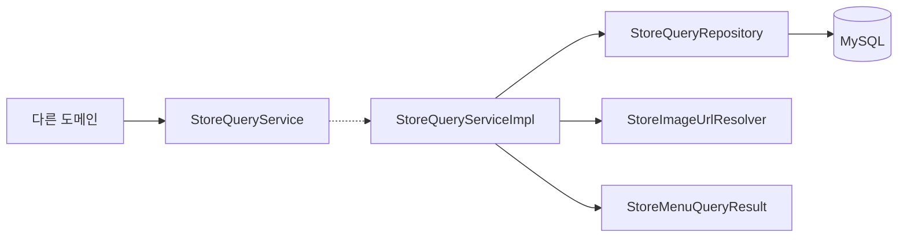

# store 구조와 동작 설계

## 1. 범위

이 문서는 #788의 도메인 간 메뉴 조회 구현을 다룬다. 입점과 온보딩의 구조는 아직 훑지 않았다.
메뉴 조회의 공개 시그니처와 반환 정책은 [조회 계약](store-query-contract.md#메뉴-조회-결과-788)이 소유한다.

## 2. 애그리거트와 패키지

메뉴와 메뉴 이미지는 store가 소유한다. 조회를 위해 새로운 애그리거트나 엔티티를 추가하지 않는다.

### 규칙을 두는 곳

| 규칙 | 구현 |
|---|---|
| 공개 조회 결과를 전달한다 | contract의 StoreMenuQueryResult가 두 목록을 방어적으로 복사한다 |
| 정상 메뉴와 데이터 오류를 분류한다 | service의 StoreQueryServiceImpl이 이미지 저장 키를 확인한다 |
| 최종 등록 여부와 검증된 이미지를 조회한다 | repository의 StoreQueryRepository가 기존 SQL을 실행한다 |
| 정상 메뉴의 이미지 URL을 만든다 | StoreImageUrlResolver가 기존 CDN 설정을 사용한다 |

## 3. 저장

기존 store, store_menu, store_menu_image를 한 SQL로 읽는다. 쿼리와 스키마는 변경하지 않는다.
메뉴 이미지의 LEFT JOIN은 VERIFIED 조건을 적용하므로 미검증 이미지도 서비스에서는 누락된 키로 보인다.
캐시와 새로운 저장 데이터는 없다.

## 4. 계산 로직

해당 없음. 이미지 키의 존재 여부를 분류하며 별도 계산 클래스를 두지 않는다.

## 5. 모듈 연결

광고 서빙, 쿠폰, 캠페인의 포스터 생성이 StoreQueryService를 호출한다.
공개 타입의 필드와 호출자의 처리 기준은 [조회 계약](store-query-contract.md#메뉴-조회-결과-788)을 따른다.
store는 이 호출자들의 내부 타입을 참조하지 않는다.

## 6. 구조와 동작 그림

### 모듈 구조

### 상태 변경

해당 없음. 조회는 상태를 변경하지 않는다.

### 주요 흐름

입력 ID를 검증한 뒤 기존 SQL을 한 번 실행한다.
서비스가 모든 행을 순회해 정상 메뉴와 데이터 오류가 난 메뉴 ID를 나누고 결과를 반환한다.
정상 메뉴의 URL 변환이나 SQL이 실패하면 결과를 반환하지 않고 실제 장애를 전파한다.

## 7. 트랜잭션과 동시성

기존 readOnly 트랜잭션을 유지하며 쓰기와 잠금을 추가하지 않는다.
조회 결과는 호출 시점의 데이터이며 저장 후 이미지 상태 변경까지 보장하지 않는다.
영업일과 시각에 따른 분기는 없다.

## 8. 외부 API

해당 없음. 이 조회는 객체 스토리지에 요청하지 않고 로컬에서 URL을 만든다.

## 9. 실패 처리

의존 대상의 처리는 [장애 처리 설계](store_장애_처리_설계.md)를 따른다.
이 조회는 쓰지 않으므로 실패 뒤 부분 저장이 남지 않는다.
메뉴 데이터 오류는 [조회 계약](store-query-contract.md#메뉴-조회-결과-788)에 정한 반환값으로 전달한다.

## 10. 배치

해당 없음. 메뉴 조회 자체는 배치 작업을 등록하지 않는다.

## 11. 성능

빈 입력은 SQL을 실행하지 않고 나머지는 SQL 한 번으로 처리한다.
결과를 한 번 순회하며 반환 목록은 조회된 메뉴 수에 비례한다. 메뉴별 재조회와 외부 호출은 없다.
새로운 성능 목표나 입력 상한은 이번 작업에서 정하지 않는다.

## 12. 테스트와 미정 사항

| 조건 | 검증 |
|---|---|
| 정상 메뉴와 이미지 누락 메뉴가 섞여 있다 | 단위 테스트와 StoreQueryIntegrationTest가 정상 메뉴와 오류 ID를 함께 확인한다 |
| 이미지가 미검증이거나 키가 공백이다 | 기존 MySQL 통합 테스트와 단위 테스트가 오류 ID 반환을 확인한다 |
| 데이터 오류 뒤 정상 메뉴의 URL 변환이 실패한다 | 단위 테스트가 CDN 설정 오류의 전파를 확인한다 |
| 광고 후보가 오류 메뉴를 사용한다 | CandidateLoadServiceTest가 해당 캠페인만 제외하고 정상 후보를 적재하는지 확인한다 |
| 쿠폰이나 포스터가 오류 메뉴를 사용한다 | 각 호출자의 단위 테스트가 기존 실패 정책을 유지하는지 확인한다 |

이번 메뉴 조회 구현에는 미정 사항이 없다. 다른 store 기능의 구조와 동시성은 아직 훑지 않았다.
