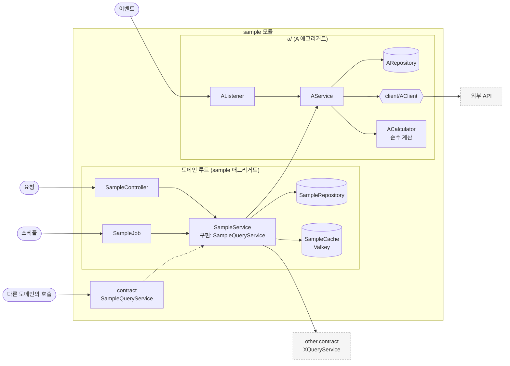
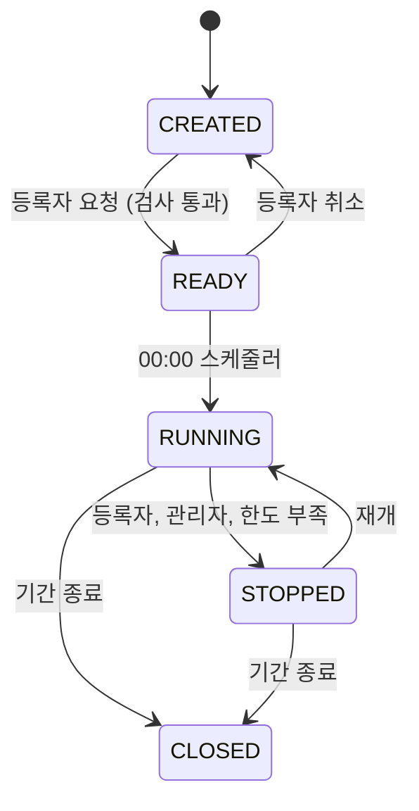
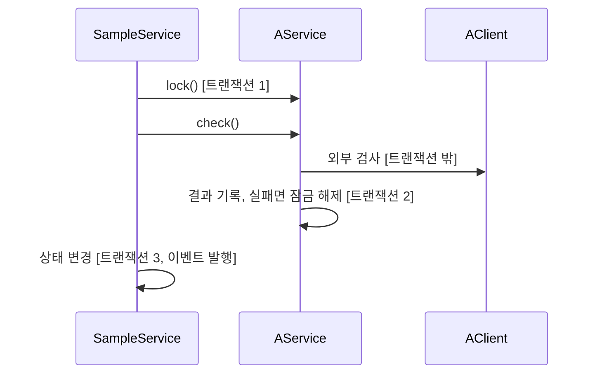

# 구조와 동작 설계 가이드

도메인 하나를 구현하기 전에 정할 것을 모은 체크리스트다. 도메인마다
`docs/design/{도메인}/{도메인}_구조와_동작_설계.md` 하나를 쓴다. 목차는 부록을 그대로 쓴다.

이 문서와 도메인 설계 문서는 코드 점검 기준이 아니다. 지금 코드가 지켜야 하는 것은 테스트와
`docs/code-convention`, `docs/software-quality` 가 소유한다.

이 문서의 예는 모두 자리표시다. `sample` 모듈, `A` 애그리거트, `other` 도메인처럼 실제 도메인과 클래스가
아니므로 이 이름으로 코드를 찾거나 만들지 않는다.

## 쓰는 규칙

- 결정마다 근거를 적는다. 명세서의 계약, 저장 구조의 테이블과 컬럼, 이슈 본문이다. 근거가 없으면
  미정 사항으로 보낸다.
- 근거는 저장소 안의 문서로 적는다. 저장소 밖에서 온 결정은 API 설계서가 받아서 적는다.
- 근거가 있어도 그 근거가 이 결정을 정하지 않으면 미정 사항이다. 가리킬 문서가 있다는 것과
  그 문서가 결정을 준다는 것은 다르다.
- 해당 없는 항목은 지우지 않고 "해당 없음"으로 적는다. 빠뜨린 것과 구별된다.
- 공통 규칙을 그대로 따르는 것은 적지 않는다. 벗어난 것과 그 이유만 적는다.
- 되돌리기 비싼 결정은 트레이드오프를 적는다. 선택지와 각각의 장단점, 고른 이유를 그 결정이 있는
  장에 적는다. 하나를 얻으면 무엇을 잃는지가 드러나야 한다. 애그리거트 경계, 다른 도메인 데이터의
  사본, 트랜잭션 분할, 비동기 처리와 그 방식, 잠금 방식이 그렇다. 되돌리기 쉬운 결정에는
  적지 않는다.

  ```markdown
  **결정: sample 상태 이력을 어디서 쓰나** (예시)

  | 선택지 | 장점 | 단점 |
  |---|---|---|
  | A. 상태 변경과 같은 트랜잭션에서 쓴다 | 이력이 빠지지 않는다 | 상태 변경마다 쓰기가 하나 늘어난다 |
  | B. 커밋 뒤 이벤트로 따로 쓴다 | 상태 변경이 가볍다 | 프로세스가 죽으면 이력이 빠진다 |

  A 를 고른다. 이력이 명세서의 감사 근거라 빠지면 안 된다. 대신 상태 변경마다 쓰기가 하나 늘어난다.
  ```

- 돈, 수량, 상태가 걸린 도메인은 6장, 7장, 9장을 반드시 채운다.

## 다른 문서가 정하는 것

| 무엇 | 문서 |
|---|---|
| 패키지 규칙, 애그리거트를 나누는 기준, 도메인 간 의존과 이벤트 | [설계 문서](../architecture/런치캐치_도메인_구조와_의존성_설계.md) 1장, 2장 |
| 엔티티, 값 객체 | [`entity-creation-guideline.md`](../code-convention/entity-creation-guideline.md) |
| 연관 매핑 | [`jpa-association-guideline.md`](../code-convention/jpa-association-guideline.md) |
| 오류 코드, 권한 | `docs/api-spec/{문서명}-api-spec.md`, 공통 규약은 [`api-spec.md`](../api-spec/api-spec.md) |
| 엔드포인트별 처리와 성능 목표 | `docs/design/{도메인}/{문서명}-api-design.md`. 한 도메인에 여럿이면 `{무엇}-api-design.md` |
| 의존 대상이 멈췄을 때의 처리 | [`장애_처리_설계_가이드.md`](./장애_처리_설계_가이드.md) |
| 성능 목표의 기준 | [`qa-performance-efficiency-guideline.md`](../software-quality/qa-performance-efficiency-guideline.md) |
| 타임아웃, 재시도 값 | [`qa-reliability-guideline.md`](../software-quality/qa-reliability-guideline.md) 2장, 3장 |
| 그 밖의 품질 목표 | [`quality-attributes.md`](../software-quality/quality-attributes.md) |
| 품질 속성끼리 부딪칠 때의 판단 기준 | [`qa-tradeoffs-guideline.md`](../software-quality/qa-tradeoffs-guideline.md) 1장 |
| 00:00 작업 순서와 중복 실행 방지 | [`런치캐치_배치_운영.md`](./ops/런치캐치_배치_운영.md) |

---

## 1. 범위

| 적을 것 | 예 |
|---|---|
| 맡는 기능과 근거 | sample 등록, A 검사 |
| 맡지 않는 것과 그 소유 도메인 | 한도 판정은 other 도메인 |

경계는 대개 "맡지 않는 것"에서 흐려진다. 다른 도메인의 판단을 다시 하고 있지 않은지 이 표로 본다.

## 2. 애그리거트와 패키지

| 애그리거트 | 테이블 | 지키는 규칙 | 나눈 근거 |
|---|---|---|---|
| 예: sample | `sample`, `sample_status_history` | 허용된 상태 전이만 일어난다 | 상태 변경과 이력이 한 트랜잭션 |
| 예: A | `a_result` | | 매일 00:00 덮어써서 변경 주기가 다르다 |

- 소유 데이터가 모두 패키지 트리와 모듈 구조 그림(6장)에 자리가 있는지 본다. 트리는 하위 패키지와 주요 클래스까지만 적는다.
- 애그리거트끼리 ID 로 참조하는지 객체로 쥐는지 적는다.
- 한 도메인 안에서 두 애그리거트에 걸친 규칙은 한 트랜잭션으로 묶지 않는다. 한쪽에 상태를 두고
  바꾸는 순서로 지킨다. 예: A 잠금 -> 외부 검사 -> sample 상태 변경.
- 도메인을 가로지르는 것은 [설계 문서](../architecture/런치캐치_도메인_구조와_의존성_설계.md) 2.4 가
  정한다. 기본이 같은 트랜잭션이라 여기서 다시 고르지 않는다. 예: sample 저장과 other 도메인의 기록.
- 입구 넷(요청, 스케줄, 이벤트, 다른 도메인의 호출)을 모두 센다.

### 규칙을 두는 곳

| 규칙 | 두는 곳 |
|---|---|
| 엔티티 하나의 상태로 판정되는 규칙 (허용 전이, 수정 가능 여부) | 엔티티 |
| 여러 입력을 엮는 계산 (점수, 배분) | 순수 계산 클래스 (4장) |
| 저장소나 다른 객체를 봐야 하는 규칙, 순서, 트랜잭션, 이벤트 발행 | service |

service 는 트랜잭션 단위, 읽기와 쓰기, 입구 가운데 하나가 다를 때 나눈다. 같은 규칙이 두 service 에
나오면 엔티티나 계산 클래스로 옮긴다.

## 3. 저장

원본은 MySQL 에 둔다. 인메모리 저장소(Valkey)에는 원본에서 다시 만들 수 있는 것만 둔다.

| 적을 것 | 예 |
|---|---|
| DB 제약으로 막을 것과 코드로 막을 것 | (요청 ID, 사용자) UNIQUE. 코드의 "조회 후 저장"은 동시 요청에 뚫린다 |
| 집계를 세는 방식 | 매번 세지 않고 카운터를 둔다. 틀리면 원본 기록에서 다시 센다 |
| 다른 도메인 데이터의 사본 | 언제 만들고 얼마나 낡을 수 있는지 |
| 이력 | 상태 변경 이력을 따로 둘지, 현재 값만 둘지 |
| 복잡한 조회 | 조인 한 번인지 나눠 부르는지, 어디서 거르는지 |

인메모리 저장소에 두는 데이터는 아래 표를 채운다.

| 데이터 | 키 | 만료 | 원본 | 읽는 곳 |
|---|---|---|---|---|
| 예: sample 캐시 | `sample_id` | TTL 30분 | `sample` 테이블 | sample 조회 |

## 4. 계산 로직

공식이 정해져 있는 계산은 순수 클래스로 빼서, 그 계산이 쓰는 데이터가 있는 하위 패키지 바로 아래에 둔다.

- Spring, JPA, repository, client 를 import 하지 않는다.
- 현재 시각과 설정값은 service 가 구해 인자로 넘긴다.
- 엔티티 대신 record 를 받는다. 상태를 갖지 않는다.

그래서 Spring 없이 테스트할 수 있다. API 설계서에 계산 예시가 있으면 그 숫자를 그대로 테스트로 쓴다.

```java
// 예시: 실제 클래스가 아니다
public final class ACalculator {
    public AResult calculate(AInput input, Instant now) {
        ...
    }
}
```

## 5. 모듈 연결

| 방향 | 대상 도메인 | 인터페이스 | 시점 |
|---|---|---|---|
| 읽기 | 예: other | `XQueryService` | 요청마다 |
| 쓰기 | 예: other | `XRecorder` | sample 저장과 같은 트랜잭션 |
| 받음 | 예: other | `XChangedEvent` | other 의 상태가 바뀔 때 |
| 공개 | 예: other 가 부른다 | `SampleQueryService` | 요청마다 |

- 공개 인터페이스는 메서드 시그니처와 record 까지 적는다. HTTP API 가 있으면 `docs/design/{도메인}/{문서명}-api-design.md` 에 적는다.
- 요청마다 다른 도메인을 부르면 몇 번 부르는지와 캐시를 둘지 적는다.
- 받는 이벤트는 [설계 문서](../architecture/런치캐치_도메인_구조와_의존성_설계.md) 2.4 에서 벗어난 것만 적는다.

## 6. 구조와 동작 그림

### 모듈 구조

2장부터 5장까지 정한 것을 도메인마다 그림 하나로 모은다. 패키지 트리는 어디에 무엇이 있는지만
보여 주고, 그림은 그 안에서 무엇이 무엇을 부르는지를 보여 준다. 자리와 계층 규칙은 [설계 문서](../architecture/런치캐치_도메인_구조와_의존성_설계.md)
1.3, 1.4 가 정하고, 이 그림은 그 규칙을 이 도메인에 적용한 결과다.

> 아래는 그리는 법을 보이는 예시다. 실제 클래스가 아니므로 이 이름으로 코드를 찾거나 만들지 않는다.



| 그리는 것 | 그리는 법 |
|---|---|
| 하위 패키지 | 상자 하나씩. 도메인 이름과 같은 애그리거트는 "도메인 루트" 상자 |
| 입구 넷 | 요청, 스케줄, 이벤트, 다른 도메인의 호출. 바깥에서 들어오는 화살표 |
| 공개면 | `contract` 상자. 어느 service 가 구현하는지 점선으로 잇는다 |
| 계층 | controller, job, listener, service, repository 의 주요 클래스만. 순수 계산과 `client/` 도 적는다 |
| 저장소 | repository 와 인메모리 저장소를 쓰는 클래스를 원통으로. 인메모리 쪽은 이름 옆에 `Valkey` 를 적는다. 키와 만료는 3장 표가 가진다 |
| 바깥 | 부르는 다른 도메인의 contract 와 외부 API 를 회색 점선 상자로. 그 너머는 그리지 않는다 |

- 입구에서 시작해 repository 까지 가지 못하는 service 가 있으면 입구를 빠뜨린 것이다
- 하위 패키지 사이의 화살표가 양쪽으로 나 있으면 경계가 잘못 그어진 것이다
- 다른 도메인끼리의 의존은 그리지 않는다. 그것은 설계 문서 2장이 가진다

### 상태 변경

상태가 있는 엔티티마다 상태 그림을 그린다. 그림에 없는 전이는 허용하지 않는다.

> 아래는 그리는 법을 보이는 예시다. 실제 상태가 아니므로 이 이름으로 코드를 찾거나 만들지 않는다.



| 전이 | 일으키는 쪽 | 나가는 이벤트 | 금지일 때 응답 |
|---|---|---|---|
| 예: RUNNING -> STOPPED | 등록자, 관리자, 다른 도메인 | `SampleStatusChangedEvent` | `409` |

### 주요 흐름

주요 흐름은 1~3개만 그린다. 돈이나 상태가 걸린 흐름, 여러 애그리거트에 걸친 흐름이 대상이다.
그림에 트랜잭션 구간과 외부 호출을 표시한다.

> 아래는 그리는 법을 보이는 예시다. 실제 클래스가 아니므로 이 이름으로 코드를 찾거나 만들지 않는다.



흐름마다 단계별로 실패하면 어떻게 남는지 적는다.

| 실패 지점  | 남는 상태             | 다시 요청하면      |
| ------ | ----------------- | ------------ |
| 예: 3단계 | A 잠김, sample CREATED | 재요청으로 이어서 진행 |

## 7. 트랜잭션과 동시성

| 흐름 | 한 트랜잭션에 묶는 것 | 트랜잭션 밖 |
|---|---|---|
| 예: sample 등록 | sample 저장, 이력 기록, other 기록 | 외부 API 호출, 이벤트 발행 |

- 외부 API 는 트랜잭션 밖에서 부른다. 안에서 부르면 기다리는 동안 DB 연결과 잠금을 붙잡는다.
- 커밋 뒤로 미루는 것(이벤트, 캐시 무효화, 되돌릴 수 없는 외부 효과)마다 무엇으로 미루는지
  적는다. 별도 실행기인지 `@Async` 인지 커밋 뒤 리스너인지 아웃박스인지에 따라 유실과
  순서와 재처리가 달라진다.

주요 흐름마다 아래 넷을 확인한다.

| 상황 | 확인할 것 | 예 |
|---|---|---|
| 같은 요청이 다시 옴 | 멱등 키와 UNIQUE | (요청 ID, 사용자) |
| 같은 회원의 요청이 동시에 옴 | 회원 단위 상한 | 사용자당 하루 횟수 |
| 여러 회원이 같은 자원에 씀 | 수량, 잔액 초과 | 남은 수량, 잔액 |
| 이벤트가 늦거나 순서가 바뀜 | 늦은 이벤트가 최신 상태를 덮는지 | 전이 시각 비교 |

- 경쟁 지점마다 비관 잠금인지 조건부 갱신인지 적는다. 여러 행을 잠그면 순서도 적는다.
- 영업일(Asia/Seoul 00:00)을 판단하는 곳과, 한 번에 다루는 건수의 상한을 적는다.

## 8. 외부 API

| 적을 것      | 예: 외부 시스템 X                                        |
| --------- | -------------------------------------------------- |
| 소유 도메인    | sample. 다른 도메인은 sample 의 공개 인터페이스로만 쓴다             |
| 실패 구분     | 거절, 전달 실패, 응답 불명                                   |
| 응답 불명일 때  | 다시 보내지 않고 재조회로 확정한다                                |
| 타임아웃, 재시도 | 공통 값과 다를 때만 적는다 |
| 가짜 구현     | 테스트용, 설정으로 교체                                      |

같은 타임아웃이라도 의미가 시스템마다 다르다. 예를 들어 돈이 오가는 호출은 결과 불명, 판정만 받는 호출은 실패,
다시 해도 되는 호출은 재시도 안내로 다룰 수 있다.

## 9. 실패 처리

의존 대상이 멈췄을 때의 처리는 `docs/design/{도메인}/{도메인}_장애_처리_설계.md` 에 쓴다. 이 도메인 설계
문서에는 돈이 걸린 경로에서 누군가에게 불리하게 남는 경우만 적는다. 6장의 실패 표가 근거다.

| 흐름 | 불리하게 남는 경우 | 누구에게 | 막는 방법 |
|---|---|---|---|
| 예: sample 등록 | 외부 검사 결과를 못 받아 A 가 잠긴 채 남는다 | 등록자 | |

## 10. 배치

00:00 묶음의 순서와 중복 실행 방지는 공통 기준을 따른다. 이 도메인 설계 문서에는 이 도메인이
등록하는 작업만 적는다.

| 적을 것 | 예 |
|---|---|
| 작업이 하는 일 | 전날 기록으로 A 를 덮어쓴다 |
| 읽는 상태 | 앞 단계가 확정한 상태 |
| 같은 날 두 번 돌면 | 덮어쓰기라 같은 결과인지, 누적이라 두 번 쌓이는지 |
| 실패하면 그날 서비스는 | 서비스 불가인지, 전날 결과를 쓰는지 |

## 11. 성능

엔드포인트별 목표는 `docs/design/{도메인}/{문서명}-api-design.md` 에 적는다. 이 도메인 설계 문서에는 그 목표를 지금
구조로 맞출 수 있는지 계산한다.

| 적을 것 | 예 |
|---|---|
| 요청 하나의 비용 | DB 읽기 2, DB 쓰기 3, 다른 도메인 호출 1, 인메모리 저장소 호출 2, 트랜잭션 1 |
| 처리량 계산 | 목표 TPS x 요청당 DB 쓰기 = 초당 DB 쓰기. 지금 구성으로 되는지 본다 |
| 확인 방법 | 부하 테스트로 피크 시간대를 재현한다 |

**처리량은 구현 전에 계산한다.** 목표를 못 맞추면 트랜잭션 구조를 바꿔야 해서, 다른 설계가 모두 바뀐다.

## 12. 테스트와 미정 사항

구현 전에 Given-When-Then 으로 쓴다. 써지지 않으면 아직 덜 정해진 것이다. 6장의 전이마다,
7장 동시성 표의 행마다 하나 이상 둔다.

| 미정 항목 | 어디까지 정해졌나 | 막는 것 |
|---|---|---|

돈이나 수량이 틀릴 수 있는 것, 다른 담당자가 기다리는 것, 구조를 바꾸는 것 순으로 닫는다.

---

## 부록. 설계 문서 목차

```markdown
# {도메인} 구조와 동작 설계

## 1. 범위
## 2. 애그리거트와 패키지
## 3. 저장
## 4. 계산 로직
## 5. 모듈 연결
## 6. 구조와 동작 그림
## 7. 트랜잭션과 동시성
## 8. 외부 API
## 9. 실패 처리
## 10. 배치
## 11. 성능
## 12. 테스트와 미정 사항
```
